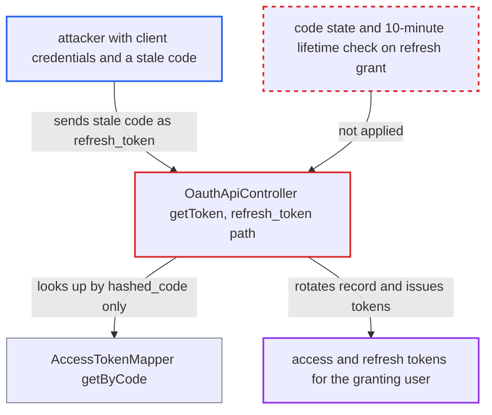

# OAuth2 refresh_token grant redeems expired authorization codes, bypassing 10-minute code lifetime

| Field | Value |
|---|---|
| ID | `find_01JDoAsvkXJnP8YKhHy3wZyS` |
| Severity | **Critical** |
| Status | open |
| CWE | CWE-613 — Insufficient Session Expiration |
| Created | 2026-10-27T21:20:04.277576Z |
| Claude Security | https://claude.ai/security/findings/find_01JDoAsvkXJnP8YKhHy3wZyS |

## Description

An attacker who holds a leaked authorization code that was never redeemed and is older than 10 minutes can still turn it into a full access token and refresh token for the user who granted it. The attacker also needs the OAuth client's `client_id` and `client_secret`. `OauthApiController::getToken()` checks the 10-minute lifetime only for `grant_type=authorization_code`, so sending the code as `grant_type=refresh_token` skips the check.

1. **the grant flow `ClientFlowLoginController::generateAppPassword`** creates a permanent app token and stores an authorization code for it. The code is saved in `oauth2_access_tokens` with `token_count` 0 and `codeCreatedAt` set to now, and the app token is a `PERMANENT_TOKEN` with no expiry. ([`core/Controller/ClientFlowLoginController.php:283-303`](https://github.com/cx-benchmark/server/blob/6b6317280f8ed50277369c33cee070a643d29654/core/Controller/ClientFlowLoginController.php#L283-L303))
2. **the job `CleanupExpiredAuthorizationCode`** leaves the unredeemed code in the table after it has expired. The job is `TIME_INSENSITIVE` and runs only every 30 days, so a stale code stays in the table until then. ([`apps/oauth2/lib/BackgroundJob/CleanupExpiredAuthorizationCode.php:24-40`](https://github.com/cx-benchmark/server/blob/6b6317280f8ed50277369c33cee070a643d29654/apps/oauth2/lib/BackgroundJob/CleanupExpiredAuthorizationCode.php#L24-L40))
3. **attacker** sends the stale code as a refresh token to `/apps/oauth2/api/v1/token`. The request uses `grant_type=refresh_token` with the stale code as `refresh_token` and the client's `client_id` and `client_secret`. ([`apps/oauth2/lib/Controller/OauthApiController.php:101-122`](https://github.com/cx-benchmark/server/blob/6b6317280f8ed50277369c33cee070a643d29654/apps/oauth2/lib/Controller/OauthApiController.php#L101-L122))
4. **the lookup `AccessTokenMapper::getByCode()`** finds the record by `hashed_code` alone. Rotated refresh tokens and unredeemed authorization codes share this column, and the lookup ignores `token_count` and `code_created_at`. ([`apps/oauth2/lib/Db/AccessTokenMapper.php:30-38`](https://github.com/cx-benchmark/server/blob/6b6317280f8ed50277369c33cee070a643d29654/apps/oauth2/lib/Db/AccessTokenMapper.php#L30-L38))
5. **the handler `getToken()`** skips the authorization-code expiry check. The `token_count` and `AUTHORIZATION_CODE_EXPIRES_AFTER` checks run only inside `if ($grant_type === 'authorization_code')`. ([`apps/oauth2/lib/Controller/OauthApiController.php:124-149`](https://github.com/cx-benchmark/server/blob/6b6317280f8ed50277369c33cee070a643d29654/apps/oauth2/lib/Controller/OauthApiController.php#L124-L149))
6. **the handler `getToken()`** rotates the record and returns a new `access_token` and `refresh_token`. It accepts the stored app token even if expired and calls `rotateToken()` with `$expectAuthorizationCodeState = false`, so the UPDATE neither requires `token_count = 0` nor checks the code's age. ([`apps/oauth2/lib/Controller/OauthApiController.php:200-265`](https://github.com/cx-benchmark/server/blob/6b6317280f8ed50277369c33cee070a643d29654/apps/oauth2/lib/Controller/OauthApiController.php#L200-L265))

## Assessment

The attacker needs the client's `client_id` and `client_secret`. These could come from a secret embedded in a distributed native client or leaked from the client's deployment. They also need an authorization code that was never redeemed and is older than 10 minutes. Possible sources are browser history after a failed redirect, a proxy log or a Referer. The report says both prerequisites are outside the attacker's control. No user action is needed at attack time. The code stays redeemable until the cleanup job deletes it, and that job runs every 30 days.

Impact: The attacker gets a full-scope app token and a refresh token for the user who granted the code. With them the attacker can read and modify that user's files, DAV data and APIs until the user revokes the device. The reach is limited to users with a stale, unredeemed code for that client. The code is still single-use, because rotation requires the old hash, so only the expiry is bypassed.

## Recommendation

The refresh grant in `getToken()` accepts any record found by `hashed_code`, including records still in authorization-code state (`token_count = 0`). It never applies the authorization-code lifetime check, so choosing the other grant type bypasses the 10-minute expiry.

Fix criteria: A record with `token_count = 0` can be redeemed only through `grant_type=authorization_code` and only within `AUTHORIZATION_CODE_EXPIRES_AFTER`. The refresh grant rejects such a record with a throttled error. The refresh rotation requires `token_count > 0`. To verify, issue a code, advance time past 10 minutes, and present it as `refresh_token` with valid client credentials. The request must fail and no token may be issued.

## Evidence

**https://github.com/cx-benchmark/server**

- [`apps/oauth2/lib/Controller/OauthApiController.php:124-149`](https://github.com/cx-benchmark/server/blob/6b6317280f8ed50277369c33cee070a643d29654/apps/oauth2/lib/Controller/OauthApiController.php#L124-L149)
- [`apps/oauth2/lib/Controller/OauthApiController.php:101-122`](https://github.com/cx-benchmark/server/blob/6b6317280f8ed50277369c33cee070a643d29654/apps/oauth2/lib/Controller/OauthApiController.php#L101-L122)
- [`apps/oauth2/lib/Controller/OauthApiController.php:200-265`](https://github.com/cx-benchmark/server/blob/6b6317280f8ed50277369c33cee070a643d29654/apps/oauth2/lib/Controller/OauthApiController.php#L200-L265)
- [`apps/oauth2/lib/Db/AccessTokenMapper.php:30-38`](https://github.com/cx-benchmark/server/blob/6b6317280f8ed50277369c33cee070a643d29654/apps/oauth2/lib/Db/AccessTokenMapper.php#L30-L38)
- [`apps/oauth2/lib/Db/AccessTokenMapper.php:74-89`](https://github.com/cx-benchmark/server/blob/6b6317280f8ed50277369c33cee070a643d29654/apps/oauth2/lib/Db/AccessTokenMapper.php#L74-L89)
- [`core/Controller/ClientFlowLoginController.php:283-303`](https://github.com/cx-benchmark/server/blob/6b6317280f8ed50277369c33cee070a643d29654/core/Controller/ClientFlowLoginController.php#L283-L303)
- [`apps/oauth2/lib/BackgroundJob/CleanupExpiredAuthorizationCode.php:24-40`](https://github.com/cx-benchmark/server/blob/6b6317280f8ed50277369c33cee070a643d29654/apps/oauth2/lib/BackgroundJob/CleanupExpiredAuthorizationCode.php#L24-L40)

