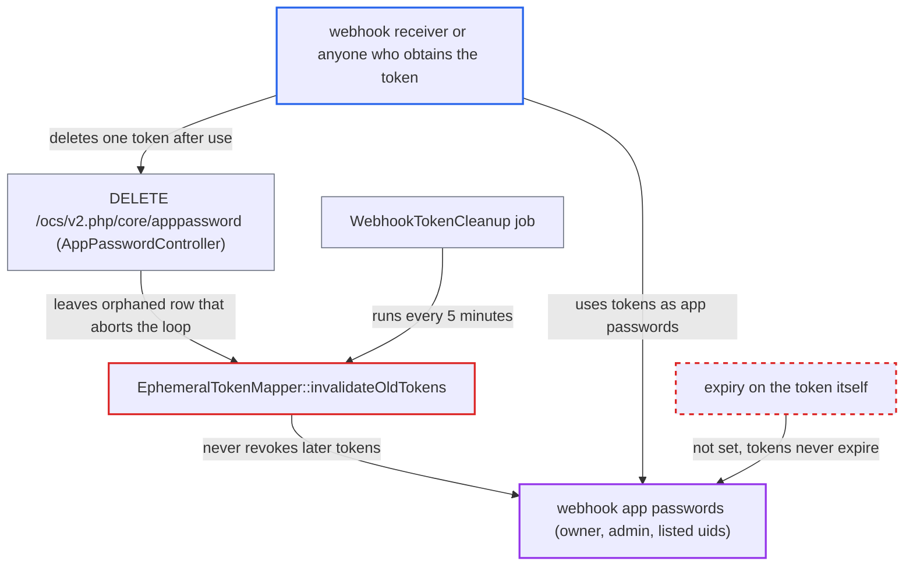

# Wrong catch class lets one revoked token stop webhook token expiry for good

| Field | Value |
|---|---|
| ID | `find_01Tv9p4n9B3VpXWJNbujhge2` |
| Severity | **Critical** |
| Status | open |
| CWE | CWE-613 — Insufficient Session Expiration |
| Created | 2026-10-27T21:25:06.824518Z |
| Claude Security | https://claude.ai/security/findings/find_01Tv9p4n9B3VpXWJNbujhge2 |

## Description

Anyone who gets a webhook's authentication token, such as the receiver or someone who reads its logs, can keep using it as a full app password long after the documented one hour. The cleanup job that should revoke tokens stops for good once one token's auth row is already gone. The cause is that `EphemeralTokenMapper::invalidateOldTokens()` catches `OCP\DB\Exception` but not `DoesNotExistException`. The webhook must have `tokenNeeded` set.

1. **the service `TokenService::createEphemeralToken()`** creates an app password for each webhook call that needs a token. The token is an unscoped `IToken::PERMANENT_TOKEN` with no `expires` value, and its id is recorded in `webhook_tokens`, so the one-hour lifetime depends only on the cleanup job. ([`apps/webhook_listeners/lib/Service/TokenService.php:131-153`](https://github.com/cx-benchmark/server/blob/6b6317280f8ed50277369c33cee070a643d29654/apps/webhook_listeners/lib/Service/TokenService.php#L131-L153))
2. **the job `WebhookCall::run()`** sends the token secret in the request body to the configured URI. The secret is placed in `$data['authentication']`, so the receiver and anything that logs or queues the body can see it. ([`apps/webhook_listeners/lib/BackgroundJobs/WebhookCall.php:49-55`](https://github.com/cx-benchmark/server/blob/6b6317280f8ed50277369c33cee070a643d29654/apps/webhook_listeners/lib/BackgroundJobs/WebhookCall.php#L49-L55))
3. **a user, the receiver, or user deletion** removes one token's auth row before cleanup reaches it. This can be a revoke in Settings (`AuthSettingsController::destroy` or `destroyOthers`), the receiver calling `DELETE /ocs/v2.php/core/apppassword` with the token, or deletion of the user. The matching `webhook_tokens` row stays behind. ([`core/Controller/AppPasswordController.php:128-143`](https://github.com/cx-benchmark/server/blob/6b6317280f8ed50277369c33cee070a643d29654/core/Controller/AppPasswordController.php#L128-L143))
4. **the `WebhookTokenCleanup` job** calls `invalidateOldTokens()` every 5 minutes. The job has no exception handling of its own, so any exception that escapes the method ends the run. ([`apps/webhook_listeners/lib/BackgroundJobs/WebhookTokenCleanup.php:29-33`](https://github.com/cx-benchmark/server/blob/6b6317280f8ed50277369c33cee070a643d29654/apps/webhook_listeners/lib/BackgroundJobs/WebhookTokenCleanup.php#L29-L33))
5. **`PublicKeyTokenMapper::getTokenById()`** throws `DoesNotExistException` for the orphaned row. This exception extends `\Exception`, not `OCP\DB\Exception`. ([`lib/private/Authentication/Token/PublicKeyTokenMapper.php:91-105`](https://github.com/cx-benchmark/server/blob/6b6317280f8ed50277369c33cee070a643d29654/lib/private/Authentication/Token/PublicKeyTokenMapper.php#L91-L105))
6. **the method `invalidateOldTokens()`** lets the exception escape its per-row catch and aborts the loop. The orphaned row is never deleted. Every later run fails at the same row, so on MySQL and SQLite, where rows come back in primary-key order, tokens minted afterwards are never revoked. ([`apps/webhook_listeners/lib/Db/EphemeralTokenMapper.php:99-118`](https://github.com/cx-benchmark/server/blob/6b6317280f8ed50277369c33cee070a643d29654/apps/webhook_listeners/lib/Db/EphemeralTokenMapper.php#L99-L118))
7. **the token holder** uses a later token as an app password after its one hour is over. Core removes a PERMANENT token only after `token_auth_token_retention` (365 days by default) without use. A token that keeps being used never expires. ([`lib/private/Authentication/Token/PublicKeyTokenProvider.php:276-292`](https://github.com/cx-benchmark/server/blob/6b6317280f8ed50277369c33cee070a643d29654/lib/private/Authentication/Token/PublicKeyTokenProvider.php#L276-L292))

## Assessment

An admin registers a webhook with `tokenNeeded`, which is a documented feature. One token's auth row is then deleted before cleanup reaches it. This can happen through a routine revoke or 'revoke all other sessions' in Settings, through deleting the user, or through the receiver calling `DELETE /ocs/v2.php/core/apppassword` with a token after use. Cleanup then fails on every run. The attacker needs no Nextcloud account. They only need a token sent through the webhook channel: the receiver itself, or someone who later gets the webhook bodies from logs, queues or a compromised receiver. The tokens covered include those for the owner, for admins and for any uid in `user_ids`. The report names no other way in.

Impact: The holder of a surviving token has a full, unscoped app password for the user it was minted for. They can read and write that user's files, calendars and contacts, and get administrative access if that user is an admin. The token stays valid until core removes it after 365 days without use, or indefinitely while it keeps being used. It also survives deletion of the webhook registration.

## Recommendation

(1) `EphemeralTokenMapper::invalidateOldTokens()` catches only `OCP\DB\Exception`. A `DoesNotExistException` from `PublicKeyTokenMapper::getTokenById()` aborts the whole cleanup and leaves the orphaned `webhook_tokens` row in place.

Fix criteria: Cleanup makes progress past any individual failure. A missing auth token is treated as already revoked and its `webhook_tokens` row is removed. No single row stops the remaining rows from being processed. Test: insert a `webhook_tokens` row whose auth token no longer exists, plus a newer expired row, and run the job. Both rows must be gone and the newer auth token must be invalidated.

(2) Token lifetime is enforced only by a best-effort background job. The auth token itself is created as a `PERMANENT_TOKEN` with no intrinsic expiry.

Fix criteria: Tokens issued for webhooks are rejected at authentication time once their one-hour lifetime has passed, whether or not the cleanup job has run. One way is to give them an expiry that the token provider honours. Test: a webhook token older than one hour must fail authentication even if the cleanup job has not run.

## Evidence

**https://github.com/cx-benchmark/server**

- [`apps/webhook_listeners/lib/Db/EphemeralTokenMapper.php:99-118`](https://github.com/cx-benchmark/server/blob/6b6317280f8ed50277369c33cee070a643d29654/apps/webhook_listeners/lib/Db/EphemeralTokenMapper.php#L99-L118)
- [`lib/private/Authentication/Token/PublicKeyTokenMapper.php:91-105`](https://github.com/cx-benchmark/server/blob/6b6317280f8ed50277369c33cee070a643d29654/lib/private/Authentication/Token/PublicKeyTokenMapper.php#L91-L105)
- [`apps/webhook_listeners/lib/Service/TokenService.php:131-153`](https://github.com/cx-benchmark/server/blob/6b6317280f8ed50277369c33cee070a643d29654/apps/webhook_listeners/lib/Service/TokenService.php#L131-L153)
- [`apps/webhook_listeners/lib/BackgroundJobs/WebhookCall.php:49-55`](https://github.com/cx-benchmark/server/blob/6b6317280f8ed50277369c33cee070a643d29654/apps/webhook_listeners/lib/BackgroundJobs/WebhookCall.php#L49-L55)
- [`apps/webhook_listeners/lib/BackgroundJobs/WebhookTokenCleanup.php:29-33`](https://github.com/cx-benchmark/server/blob/6b6317280f8ed50277369c33cee070a643d29654/apps/webhook_listeners/lib/BackgroundJobs/WebhookTokenCleanup.php#L29-L33)
- [`core/Controller/AppPasswordController.php:128-143`](https://github.com/cx-benchmark/server/blob/6b6317280f8ed50277369c33cee070a643d29654/core/Controller/AppPasswordController.php#L128-L143)
- [`lib/private/Authentication/Token/PublicKeyTokenProvider.php:276-292`](https://github.com/cx-benchmark/server/blob/6b6317280f8ed50277369c33cee070a643d29654/lib/private/Authentication/Token/PublicKeyTokenProvider.php#L276-L292)

