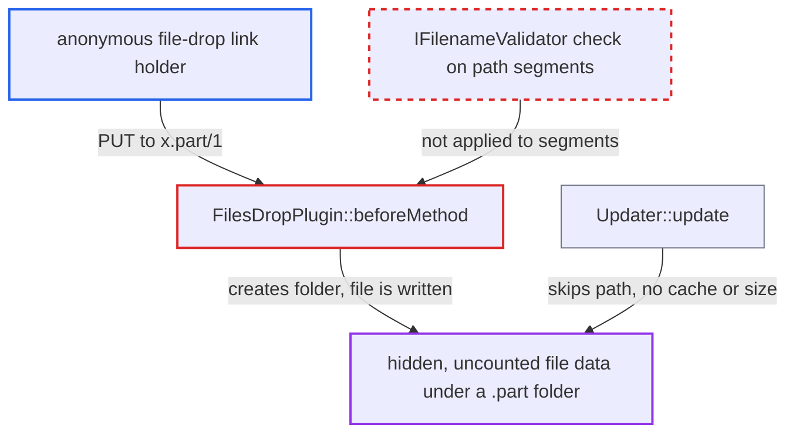

# Anonymous file-drop uploads create unvalidated folders, enabling hidden quota-exempt data under .part directories

| Field | Value |
|---|---|
| ID | `find_01LAjgfLBCxm7LPbVzGSGBZP` |
| Severity | **High** |
| Status | open |
| CWE | CWE-641 — Improper file name restriction |
| Created | 2026-10-27T22:07:31.550436Z |
| Claude Security | https://claude.ai/security/findings/find_01LAjgfLBCxm7LPbVzGSGBZP |

## Description

An anonymous person with a file-drop link can store any amount of hidden data in the share owner's files, and it is not counted against the owner's quota. They need only the link. The quota bypass matters only when an admin has set a quota, since `default_quota` is `none`. The cause is `FilesDropPlugin::beforeMethod()`, which creates folders from raw request-path segments without running `IFilenameValidator` on them.

1. **Anonymous attacker** sends a PUT to the file-drop link with a path such as `<token>/x.part/1`. The request carries `X-Requested-With: XMLHttpRequest`, and the plugin is active for any public share without read permission. ([`apps/dav/appinfo/v2/publicremote.php:172-176`](https://github.com/cx-benchmark/server/blob/6b6317280f8ed50277369c33cee070a643d29654/apps/dav/appinfo/v2/publicremote.php#L172-L176))
2. **the plugin `FilesDropPlugin::beforeMethod()`** creates each parent segment of the path with `$folder->newFolder($pathSegment)`. Only the `X-NC-Nickname` header is validated with `verifyPath()`, so segments such as `x.part` never reach `IFilenameValidator`. ([`apps/dav/lib/Files/Sharing/FilesDropPlugin.php:155-191`](https://github.com/cx-benchmark/server/blob/6b6317280f8ed50277369c33cee070a643d29654/apps/dav/lib/Files/Sharing/FilesDropPlugin.php#L155-L191))
3. **`Folder::newFolder()` and `View::basicOperation()`** accept the folder name. They reject only `..` and names on the `forbidden_filenames` list, so the always-forbidden `.part` extension passes. ([`lib/private/Files/View.php:1202-1206`](https://github.com/cx-benchmark/server/blob/6b6317280f8ed50277369c33cee070a643d29654/lib/private/Files/View.php#L1202-L1206))
4. **`View::getFileInfo()`** resolves the uncached `x.part` folder through `getPartFileInfo()`. The folder has no cache entry, because `Updater` and `Scanner` skip such paths, but the fallback builds a FileInfo with the directory mimetype from the storage. ([`lib/private/Files/View.php:1451-1459`](https://github.com/cx-benchmark/server/blob/6b6317280f8ed50277369c33cee070a643d29654/lib/private/Files/View.php#L1451-L1459))
5. **`Directory::getChild()` and `Directory::createFile()`** return a writable `Directory` for `x.part` and accept the child name `1`. `getChild()` checks the name only with `verifyPath(..., true)`, and `Common::verifyPath()` ignores forbidden-extension errors on parent folders. ([`lib/private/Files/Storage/Common.php:506-522`](https://github.com/cx-benchmark/server/blob/6b6317280f8ed50277369c33cee070a643d29654/lib/private/Files/Storage/Common.php#L506-L522))
6. **`File::put()` and `finalizeUpload()`** write the body to disk, then call `Updater::update()`. `Updater::update()` returns at once for any path containing `.part/`, so the file is never cached and its size is never recorded. ([`apps/dav/lib/Connector/Sabre/File.php:360-366`](https://github.com/cx-benchmark/server/blob/6b6317280f8ed50277369c33cee070a643d29654/apps/dav/lib/Connector/Sabre/File.php#L360-L366))
7. **`Quota::free_space()`** calculates free space from cached sizes only. The hidden data is never counted, so each new request can again write up to the full remaining quota. ([`lib/private/Files/Storage/Wrapper/Quota.php:78-96`](https://github.com/cx-benchmark/server/blob/6b6317280f8ed50277369c33cee070a643d29654/lib/private/Files/Storage/Wrapper/Quota.php#L78-L96))

## Assessment

The attacker is anyone who holds a file-drop link (a public share without read permission). No login is needed. They send a PUT to the link with a folder name the server forbids, such as `x.part`. A chunked MOVE to the link is also covered by the same plugin code. The quota bypass needs an admin-set quota, because `default_quota` is `none`. The attacker can repeat the request with new folder names without limit.

Impact: The attacker stores any amount of data in the owner's `files/` tree. The data is not indexed, not shown to the owner or admin, and not charged to quota. Only deleting the parent folder or cleaning up on disk removes it. With a quota set, the data partition can be filled and writes stop for every user. Other forbidden names, such as control characters, `.filepart`, names over 250 bytes or admin-forbidden names, are left as orphaned unindexed directories, but a PUT into them returns 404. Nothing is disclosed.

## Recommendation

(1) `FilesDropPlugin::beforeMethod()` creates folders from raw request-path segments with `Folder::newFolder()` and never applies `IFilenameValidator`. Anonymous uploads can therefore create folders the server always forbids, including `.part` folders.

Fix criteria: Every path segment taken from the request URL or the `Destination` header passes the same validation as `Directory::createDirectory()` (full `verifyPath()`/`validateFilename()`) before any folder is created. A failing segment gets a 4xx response and nothing is left on disk. A file-drop PUT to `<token>/x.part/1`, `<token>/a%01b/1` or `<token>/x.filepart/1` is rejected. No such directory appears in the owner's data directory. Repeated uploads raise the owner's recorded usage.

(2) A directory named `*.part` that exists on disk without a cache entry can still be resolved as a writable `Directory` through `View::getFileInfo()` and `getPartFileInfo()`. Files written beneath it are skipped by `Updater`, which gives uncounted, hidden storage.

Fix criteria: No DAV write can place file content under a path segment that the cache never indexes, such as a `.part` directory. With such a directory present on disk, a PUT beneath it is refused. No bytes are written outside what the owner's quota accounting records.

## Evidence

**https://github.com/cx-benchmark/server**

- [`apps/dav/lib/Files/Sharing/FilesDropPlugin.php:155-191`](https://github.com/cx-benchmark/server/blob/6b6317280f8ed50277369c33cee070a643d29654/apps/dav/lib/Files/Sharing/FilesDropPlugin.php#L155-L191)
- [`apps/dav/lib/Files/Sharing/FilesDropPlugin.php:136-147`](https://github.com/cx-benchmark/server/blob/6b6317280f8ed50277369c33cee070a643d29654/apps/dav/lib/Files/Sharing/FilesDropPlugin.php#L136-L147)
- [`apps/dav/appinfo/v2/publicremote.php:172-176`](https://github.com/cx-benchmark/server/blob/6b6317280f8ed50277369c33cee070a643d29654/apps/dav/appinfo/v2/publicremote.php#L172-L176)
- [`lib/private/Files/Node/Folder.php:135-160`](https://github.com/cx-benchmark/server/blob/6b6317280f8ed50277369c33cee070a643d29654/lib/private/Files/Node/Folder.php#L135-L160)
- [`lib/private/Files/View.php:1202-1206`](https://github.com/cx-benchmark/server/blob/6b6317280f8ed50277369c33cee070a643d29654/lib/private/Files/View.php#L1202-L1206)
- [`lib/private/Files/Cache/Updater.php:69-72`](https://github.com/cx-benchmark/server/blob/6b6317280f8ed50277369c33cee070a643d29654/lib/private/Files/Cache/Updater.php#L69-L72)
- [`lib/private/Files/Cache/Scanner.php:104-116`](https://github.com/cx-benchmark/server/blob/6b6317280f8ed50277369c33cee070a643d29654/lib/private/Files/Cache/Scanner.php#L104-L116)
- [`lib/private/Files/View.php:1451-1459`](https://github.com/cx-benchmark/server/blob/6b6317280f8ed50277369c33cee070a643d29654/lib/private/Files/View.php#L1451-L1459)
- [`apps/dav/lib/Connector/Sabre/Directory.php:192-238`](https://github.com/cx-benchmark/server/blob/6b6317280f8ed50277369c33cee070a643d29654/apps/dav/lib/Connector/Sabre/Directory.php#L192-L238)
- [`lib/private/Files/Storage/Common.php:506-522`](https://github.com/cx-benchmark/server/blob/6b6317280f8ed50277369c33cee070a643d29654/lib/private/Files/Storage/Common.php#L506-L522)
- [`apps/dav/lib/Connector/Sabre/File.php:360-366`](https://github.com/cx-benchmark/server/blob/6b6317280f8ed50277369c33cee070a643d29654/apps/dav/lib/Connector/Sabre/File.php#L360-L366)
- [`lib/private/Files/Storage/Wrapper/Quota.php:78-96`](https://github.com/cx-benchmark/server/blob/6b6317280f8ed50277369c33cee070a643d29654/lib/private/Files/Storage/Wrapper/Quota.php#L78-L96)
- [`lib/private/Files/FilenameValidator.php:68-77`](https://github.com/cx-benchmark/server/blob/6b6317280f8ed50277369c33cee070a643d29654/lib/private/Files/FilenameValidator.php#L68-L77)

