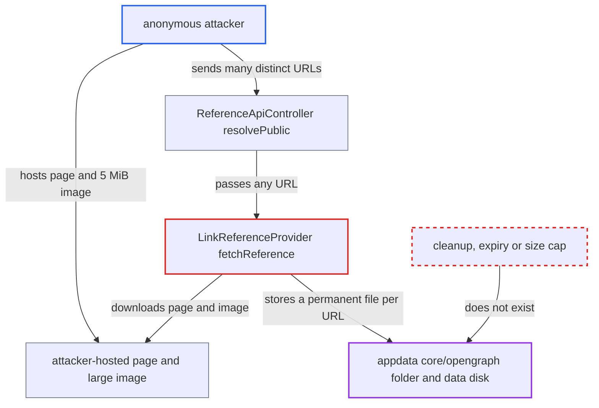

# Anonymous link previews store OpenGraph images in appdata with no cleanup, allowing disk exhaustion

| Field | Value |
|---|---|
| ID | `find_01XP6HhtYHBfNKCU3fSUej5K` |
| Severity | **High** |
| Status | open |
| CWE | CWE-770 — Resource exhaustion |
| Created | 2026-10-27T21:48:10.493458Z |
| Claude Security | https://claude.ai/security/findings/find_01XP6HhtYHBfNKCU3fSUej5K |

## Description

An anonymous visitor with no account can fill the server's data disk. Each public link preview they trigger stores a new image of up to 5 MiB permanently, and nothing removes it. The cause is `fetchReference()`, which saves the page's `og:image` into `appdata_<instanceid>/core/opengraph/` for every URL. It has no expiry, no size cap and no eviction, and only a per-subnet rate limit.

1. **Attacker** hosts an HTML page and a large image on a server they control. The page carries an `og:image` meta tag pointing to an `image/png` of about 5 MiB, and it can be served at any path.
2. **Attacker** sends many requests to the public `resolvePublic` endpoint, each with a different URL. The endpoint is `#[PublicPage]`, needs no login, and a changing query string such as `?n=<i>` makes every URL new. ([`core/Controller/ReferenceApiController.php:129-139`](https://github.com/cx-benchmark/server/blob/6b6317280f8ed50277369c33cee070a643d29654/core/Controller/ReferenceApiController.php#L129-L139))
3. **the reference manager** misses its cache and falls back to the link provider. The cache is keyed per URL, so each new query string reaches the provider, and the link provider handles any URL. ([`lib/private/Collaboration/Reference/ReferenceManager.php:94-124`](https://github.com/cx-benchmark/server/blob/6b6317280f8ed50277369c33cee070a643d29654/lib/private/Collaboration/Reference/ReferenceManager.php#L94-L124))
4. **the provider `fetchReference()`** fetches the page, reads its OpenGraph tags and downloads the `og:image`. `resolveReferencePublic()` ignores `$sharingToken`, so anonymous callers get the same path. The only brake is a rate limit of 10 fetches per 120 s per IPv4 /32 or IPv6 /56. ([`lib/public/Collaboration/Reference/LinkReferenceProvider.php:96-98`](https://github.com/cx-benchmark/server/blob/6b6317280f8ed50277369c33cee070a643d29654/lib/public/Collaboration/Reference/LinkReferenceProvider.php#L96-L98))
5. **the provider `fetchReference()`** writes the image to `appdata_<instanceid>/core/opengraph/` as `md5(url)`. Each distinct URL adds a new file of up to 5 MiB and a filecache row. A missing `Content-Length` passes the size test, and the write is outside any user quota. ([`lib/public/Collaboration/Reference/LinkReferenceProvider.php:183-206`](https://github.com/cx-benchmark/server/blob/6b6317280f8ed50277369c33cee070a643d29654/lib/public/Collaboration/Reference/LinkReferenceProvider.php#L183-L206))
6. **the server** keeps the files indefinitely. The only other code that touches the folder is the reader `ReferenceController::preview()`. No job, TTL or cap deletes anything, so disk use only grows. ([`core/Controller/ReferenceController.php:44-68`](https://github.com/cx-benchmark/server/blob/6b6317280f8ed50277369c33cee070a643d29654/core/Controller/ReferenceController.php#L44-L68))

## Assessment

The attacker is anonymous on the internet and needs no account, share or user. The default configuration is enough, because `reference_opengraph` defaults to `true`. They host an HTML page with an `og:image` tag and a roughly 5 MiB image, then repeatedly call `GET /ocs/v2.php/references/resolvePublic` with `OCS-APIRequest: true` and a new URL each time. The POST `resolvePublic` variant is a second way in and resolves up to 15 references per call. `extractPublic` and `resolveOnePublic` (GET) are also `#[PublicPage]`. The rate limit is keyed per IPv4 /32 or IPv6 /56, so an attacker with more source addresses or subnets scales linearly.

Impact: The attacker can fill the Nextcloud data volume with permanent files. Within the rate limit that is about 50 MiB per 2 minutes per source subnet, or about 35 GiB per day. A full volume breaks uploads, versions and previews for every user, and also the database if it shares the disk. The files stay after the attack stops until an admin deletes them by hand. Confidentiality and integrity are not affected.

## Recommendation

`fetchReference()` stores an OpenGraph image in `appdata/core/opengraph` for every resolved URL, including anonymous public resolutions. Nothing expires or deletes the files, and their total size is unbounded. Disk use grows with attacker-chosen URLs and is limited only by a per-subnet rate.

Fix criteria: The total size of the stored OpenGraph images stays bounded over time, whoever triggers the resolution. Stale images are removed, for example aligned with the reference cache TTL, and/or the folder has a size or entry cap with eviction. Anonymous resolutions do not persist images unless tied to a validated share. To verify, resolve many distinct URLs anonymously and confirm that the folder's size stays bounded and old entries are reclaimed.

## Evidence

**https://github.com/cx-benchmark/server**

- [`lib/public/Collaboration/Reference/LinkReferenceProvider.php:183-206`](https://github.com/cx-benchmark/server/blob/6b6317280f8ed50277369c33cee070a643d29654/lib/public/Collaboration/Reference/LinkReferenceProvider.php#L183-L206)
- [`lib/public/Collaboration/Reference/LinkReferenceProvider.php:106-116`](https://github.com/cx-benchmark/server/blob/6b6317280f8ed50277369c33cee070a643d29654/lib/public/Collaboration/Reference/LinkReferenceProvider.php#L106-L116)
- [`lib/public/Collaboration/Reference/LinkReferenceProvider.php:96-98`](https://github.com/cx-benchmark/server/blob/6b6317280f8ed50277369c33cee070a643d29654/lib/public/Collaboration/Reference/LinkReferenceProvider.php#L96-L98)
- [`core/Controller/ReferenceApiController.php:129-139`](https://github.com/cx-benchmark/server/blob/6b6317280f8ed50277369c33cee070a643d29654/core/Controller/ReferenceApiController.php#L129-L139)
- [`core/Controller/ReferenceApiController.php:178-195`](https://github.com/cx-benchmark/server/blob/6b6317280f8ed50277369c33cee070a643d29654/core/Controller/ReferenceApiController.php#L178-L195)
- [`lib/private/Collaboration/Reference/ReferenceManager.php:94-124`](https://github.com/cx-benchmark/server/blob/6b6317280f8ed50277369c33cee070a643d29654/lib/private/Collaboration/Reference/ReferenceManager.php#L94-L124)
- [`core/Controller/ReferenceController.php:44-68`](https://github.com/cx-benchmark/server/blob/6b6317280f8ed50277369c33cee070a643d29654/core/Controller/ReferenceController.php#L44-L68)
- [`lib/private/Security/Normalizer/IpAddress.php:93-104`](https://github.com/cx-benchmark/server/blob/6b6317280f8ed50277369c33cee070a643d29654/lib/private/Security/Normalizer/IpAddress.php#L93-L104)

