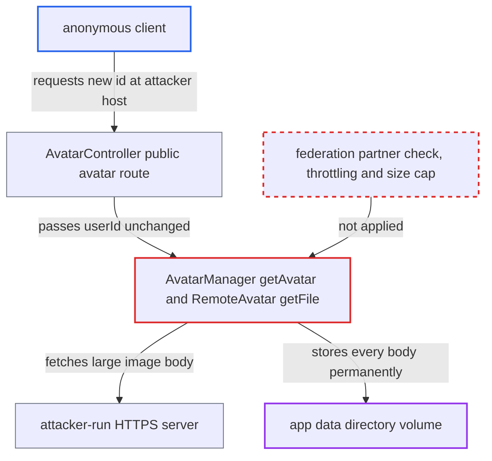

# Anonymous remote-avatar fetch persists unbounded attacker-served data in app data

| Field | Value |
|---|---|
| ID | `find_018rqLA98G3FJz2E7FYhvnv5` |
| Severity | **High** |
| Status | open |
| CWE | CWE-770 — Resource exhaustion |
| Created | 2026-10-27T21:22:45.468459Z |
| Claude Security | https://claude.ai/security/findings/find_018rqLA98G3FJz2E7FYhvnv5 |

## Description

An anonymous internet client can make the server download data from hosts the client runs and store it permanently in app data, until the data volume fills. Uploads and other writes then fail for every user. No login is needed. The cause is `AvatarManager::getAvatar()`, which turns any unknown id containing `@` into an outbound fetch without checking the remote or throttling, and `RemoteAvatar::getFile()`, which stores the body with no size cap.

1. **Attacker** runs an HTTPS server with a valid certificate that answers any avatar path. It replies with `Content-Type: image/png` and a large body, which is the only content check `RemoteAvatar::getFile()` makes. ([`lib/private/Avatar/RemoteAvatar.php:87-122`](https://github.com/cx-benchmark/server/blob/6b6317280f8ed50277369c33cee070a643d29654/lib/private/Avatar/RemoteAvatar.php#L87-L122))
2. **Attacker** requests `GET /index.php/avatar/aN@attacker.example/512` without logging in, with a new N each time. The route is `#[PublicPage]` and `#[NoCSRFRequired]`, has no throttling attribute, and passes `$userId` unchanged on. ([`core/Controller/AvatarController.php:83-168`](https://github.com/cx-benchmark/server/blob/6b6317280f8ed50277369c33cee070a643d29654/core/Controller/AvatarController.php#L83-L168))
3. **`AvatarManager::getAvatar()`** treats the id as a remote avatar. Any id that is not a local user and contains `@` passes `isValidCloudId()`, and nothing checks that the remote is a federation partner. ([`lib/private/Avatar/AvatarManager.php:60-68`](https://github.com/cx-benchmark/server/blob/6b6317280f8ed50277369c33cee070a643d29654/lib/private/Avatar/AvatarManager.php#L60-L68))
4. **`CloudIdManager::resolveCloudId()`** builds the target URL from the request path. It splits on the last `@` and uses the rest as `https://<host>[:port]`, so the attacker chooses the host. ([`lib/private/Federation/CloudIdManager.php:104-118`](https://github.com/cx-benchmark/server/blob/6b6317280f8ed50277369c33cee070a643d29654/lib/private/Federation/CloudIdManager.php#L104-L118))
5. **`getRemoteAvatar()`** creates a permanent folder `avatar/__remote/<raw userId>` before any fetch. Every new id string adds storage, and nothing in the repository ever deletes `__remote` entries. ([`lib/private/Avatar/AvatarManager.php:175-184`](https://github.com/cx-benchmark/server/blob/6b6317280f8ed50277369c33cee070a643d29654/lib/private/Avatar/AvatarManager.php#L175-L184))
6. **`RemoteAvatar::getFile()`** fetches the attacker's URL and writes the whole body to app data. `getBody()` reads the full body into one PHP string, bounded only by `memory_limit` and the 30 s timeout, and `newFile()` writes it with no size limit or image validation. ([`lib/private/Http/Client/Response.php:22-27`](https://github.com/cx-benchmark/server/blob/6b6317280f8ed50277369c33cee070a643d29654/lib/private/Http/Client/Response.php#L22-L27))
7. **Attacker** repeats with new ids and the size and theme variants. Each new id and each of the four size/theme variants adds another permanent file, so the total is unbounded.

## Assessment

Any anonymous internet client can attack, with no login, token or user action. The attacker needs only an HTTPS server with a valid certificate that answers `/index.php/avatar/...` with an `image/*` content type and a large body. The attacker then requests ids such as `a1@attacker.example`, `a2@attacker.example` and so on. The outbound request is also an SSRF primitive, but only to public hosts at a fixed path. By default `Client::preventLocalAddress()` and `DnsPinMiddleware` block local and private addresses, resolved IPs and redirects. Reaching internal hosts would need the non-default `allow_local_remote_servers` setting, which is not part of this finding.

Impact: The attacker gets unbounded, permanent writes to the instance's data directory. Each request stores as much body as fits in `memory_limit` within the 30 s timeout. Sustained requests can fill the volume that holds user files and app data, so uploads and other writes fail for every user. No data is read or changed, because the stored files are only served back as avatars of the attacker's own ids.

## Recommendation

(1) `AvatarManager::getAvatar()` turns any unknown id containing `@` into an outbound fetch for anonymous callers of the public avatar route. It does not check that the remote is a federation partner and does not throttle.

Fix criteria: An anonymous or unrelated request for `x@unrelated-host` causes no outbound request and no app-data write. Remote avatars are fetched only for remotes this instance already federates with, or for authenticated callers under a rate limit. A `GET /index.php/avatar/a1@attacker.example/64` without a session creates no `__remote` folder and opens no outbound connection.

(2) `RemoteAvatar::getFile()` stores the whole remote body with no size cap or image validation, keyed by the raw request id. Nothing ever expires `__remote` entries, so stored data grows without bound.

Fix criteria: Bytes accepted from a remote are capped at an avatar-sized limit and must decode as an image before they are stored. The number and lifetime of cached remote avatars are bounded. A remote that answers with a body over the cap leaves nothing in app data. Repeated requests with different ids do not grow app data without limit.

## Evidence

**https://github.com/cx-benchmark/server**

- [`lib/private/Avatar/RemoteAvatar.php:87-122`](https://github.com/cx-benchmark/server/blob/6b6317280f8ed50277369c33cee070a643d29654/lib/private/Avatar/RemoteAvatar.php#L87-L122)
- [`lib/private/Avatar/AvatarManager.php:60-68`](https://github.com/cx-benchmark/server/blob/6b6317280f8ed50277369c33cee070a643d29654/lib/private/Avatar/AvatarManager.php#L60-L68)
- [`lib/private/Avatar/AvatarManager.php:175-184`](https://github.com/cx-benchmark/server/blob/6b6317280f8ed50277369c33cee070a643d29654/lib/private/Avatar/AvatarManager.php#L175-L184)
- [`core/Controller/AvatarController.php:83-168`](https://github.com/cx-benchmark/server/blob/6b6317280f8ed50277369c33cee070a643d29654/core/Controller/AvatarController.php#L83-L168)
- [`lib/private/Federation/CloudIdManager.php:104-118`](https://github.com/cx-benchmark/server/blob/6b6317280f8ed50277369c33cee070a643d29654/lib/private/Federation/CloudIdManager.php#L104-L118)
- [`lib/private/Http/Client/Response.php:22-27`](https://github.com/cx-benchmark/server/blob/6b6317280f8ed50277369c33cee070a643d29654/lib/private/Http/Client/Response.php#L22-L27)
- [`lib/private/Http/Client/Client.php:159-181`](https://github.com/cx-benchmark/server/blob/6b6317280f8ed50277369c33cee070a643d29654/lib/private/Http/Client/Client.php#L159-L181)

