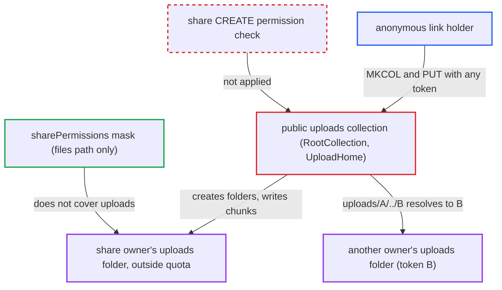

# Any public link allows anonymous quota-exempt writes into the share owner's uploads folder

| Field | Value |
|---|---|
| ID | `find_01UU2sVKkaZmeon2ByP8TJYf` |
| Severity | **High** |
| Status | open |
| CWE | CWE-862 — Missing Authorization |
| Created | 2026-10-27T21:39:29.881560Z |
| Claude Security | https://claude.ai/security/findings/find_01UU2sVKkaZmeon2ByP8TJYf |

## Description

Anyone holding any public link, even a read-only one, can write files of any size into the link owner's `uploads` folder without counting against the owner's quota. Repeated large uploads can fill the server's data disk. The attack needs only a link token, plus the link password if one is set. The cause is that the public uploads endpoint never checks whether the share allows creating files.

1. **anonymous link holder** sends `MKCOL` to `public.php/dav/uploads/<token>/<name>` with any valid link token. The uploads collection is mounted for every public share, and nothing checks that the share grants create permission. ([`apps/dav/lib/Connector/Sabre/ServerFactory.php:288-297`](https://github.com/cx-benchmark/server/blob/6b6317280f8ed50277369c33cee070a643d29654/apps/dav/lib/Connector/Sabre/ServerFactory.php#L288-L297))
2. **`RootCollection`** accepts the share's principal. It accepts every `principals/shares` principal and only checks user principals against the session user. ([`apps/dav/lib/Upload/RootCollection.php:42-44`](https://github.com/cx-benchmark/server/blob/6b6317280f8ed50277369c33cee070a643d29654/apps/dav/lib/Upload/RootCollection.php#L42-L44))
3. **`UploadHome`** resolves the collection to the share owner's `/<uid>/uploads` folder. The folder is chosen from the token alone, without looking at what the share permits, and is created if missing. ([`apps/dav/lib/Upload/UploadHome.php:33-36`](https://github.com/cx-benchmark/server/blob/6b6317280f8ed50277369c33cee070a643d29654/apps/dav/lib/Upload/UploadHome.php#L33-L36))
4. **share permission mask in `publicremote.php`** leaves the owner's `uploads` folder unmasked. The `DirPermissionsMask` covers only `path => 'files'`, so the anonymous request keeps the owner's full permissions on `/<uid>/uploads`. ([`apps/dav/appinfo/v2/publicremote.php:128-134`](https://github.com/cx-benchmark/server/blob/6b6317280f8ed50277369c33cee070a643d29654/apps/dav/appinfo/v2/publicremote.php#L128-L134))
5. **`Directory::createFile`** stores the body sent in a `PUT` to `uploads/<token>/<name>/<chunk>`. It only requires `isCreatable()` on the upload folder, which is true because that folder sits outside the share mask. ([`apps/dav/lib/Connector/Sabre/Directory.php:113-118`](https://github.com/cx-benchmark/server/blob/6b6317280f8ed50277369c33cee070a643d29654/apps/dav/lib/Connector/Sabre/Directory.php#L113-L118))
6. **`Quota` wrapper and `QuotaPlugin`** skip the quota check for this upload. `Quota::free_space()` reports raw disk space for paths starting with `uploads`, and `QuotaPlugin::beforeCreateFile()` checks only when the client sends a `Destination` header with `OC-Total-Length`. ([`lib/private/Files/Storage/Wrapper/Quota.php:82-83`](https://github.com/cx-benchmark/server/blob/6b6317280f8ed50277369c33cee070a643d29654/lib/private/Files/Storage/Wrapper/Quota.php#L82-L83))
7. **anonymous link holder** repeats the `PUT` with very large bodies and re-touches the files. Touching the files keeps them newer than `cache_chunk_gc_ttl`, so the daily `UploadCleanup` job never removes them. ([`apps/dav/lib/Connector/Sabre/QuotaPlugin.php:85-102`](https://github.com/cx-benchmark/server/blob/6b6317280f8ed50277369c33cee070a643d29654/apps/dav/lib/Connector/Sabre/QuotaPlugin.php#L85-L102))

## Assessment

The attacker is anonymous and needs one public link token. A read-only link to a file or folder is enough. Requests go to `public.php/dav` with the header `X-Requested-With: XMLHttpRequest`, or default outgoing federation must be enabled. First `MKCOL /public.php/dav/uploads/<token>/x`, then `PUT /public.php/dav/uploads/<token>/x/1` with a huge body. If the link has a password, the attacker also needs it. There is a second route to another owner's folder. `PublicAuth::getToken()` reads segment 3 of the raw path, while Sabre's `Uri\normalize` collapses `..` before `UploadHome` resolves the token. So a holder of share A can request `uploads/A/../B/...` and reach B's owner's uploads folder, bypassing B's link password for this purpose. The report assumes sabre/dav 4.x behaviour here, because that submodule was not checked out.

Impact: The attacker can create, list, read and delete entries in the share owner's `/<uid>/uploads` folder, though the share never granted write access. They can also write unlimited data there outside the owner's quota, which can exhaust the instance's data disk. Attacker files can collide with or delete the owner's own in-progress chunked uploads if the folder name is known. The report names no confidentiality impact beyond what the link already exposes.

## Recommendation

(1) The public uploads collection is reachable for every share token and writes to the owner's unmasked uploads folder. Share permissions are never enforced for chunked-upload scratch space.

Fix criteria: Requests under `public.php/dav/uploads/<token>/` are refused unless the share grants `PERMISSION_CREATE` and is otherwise valid for writes. The scratch folder used for a public upload is subject to the same permission and quota limits as the final destination. For a read-only link, `MKCOL`, `PUT` and `PROPFIND` under `uploads/<token>/` return 403 or 404 and nothing is created in `/<owner>/uploads`. For a file-drop link, chunk uploads still work but are bounded by the owner's quota.

(2) `UploadHome` takes its token from Sabre's normalised path, while `PublicAuth` authenticates the token from the raw path-info segment. So `uploads/A/../B` resolves another share owner's uploads folder.

Fix criteria: The share whose owner's uploads folder is used is the same share object that `PublicAuth` authenticated. That share is passed into the collection instead of being looked up again from the URL. A `MKCOL` to `uploads/<tokenA>/../<tokenB>/x`, authenticated with A, is rejected and creates nothing under B's owner.

## Evidence

**https://github.com/cx-benchmark/server**

- [`apps/dav/lib/Connector/Sabre/ServerFactory.php:288-297`](https://github.com/cx-benchmark/server/blob/6b6317280f8ed50277369c33cee070a643d29654/apps/dav/lib/Connector/Sabre/ServerFactory.php#L288-L297)
- [`apps/dav/appinfo/v2/publicremote.php:128-134`](https://github.com/cx-benchmark/server/blob/6b6317280f8ed50277369c33cee070a643d29654/apps/dav/appinfo/v2/publicremote.php#L128-L134)
- [`apps/dav/lib/Upload/RootCollection.php:42-44`](https://github.com/cx-benchmark/server/blob/6b6317280f8ed50277369c33cee070a643d29654/apps/dav/lib/Upload/RootCollection.php#L42-L44)
- [`apps/dav/lib/Upload/UploadHome.php:33-36`](https://github.com/cx-benchmark/server/blob/6b6317280f8ed50277369c33cee070a643d29654/apps/dav/lib/Upload/UploadHome.php#L33-L36)
- [`lib/private/Files/Storage/Wrapper/Quota.php:82-83`](https://github.com/cx-benchmark/server/blob/6b6317280f8ed50277369c33cee070a643d29654/lib/private/Files/Storage/Wrapper/Quota.php#L82-L83)
- [`apps/dav/lib/Connector/Sabre/QuotaPlugin.php:85-102`](https://github.com/cx-benchmark/server/blob/6b6317280f8ed50277369c33cee070a643d29654/apps/dav/lib/Connector/Sabre/QuotaPlugin.php#L85-L102)
- [`apps/dav/lib/Connector/Sabre/Directory.php:113-118`](https://github.com/cx-benchmark/server/blob/6b6317280f8ed50277369c33cee070a643d29654/apps/dav/lib/Connector/Sabre/Directory.php#L113-L118)

