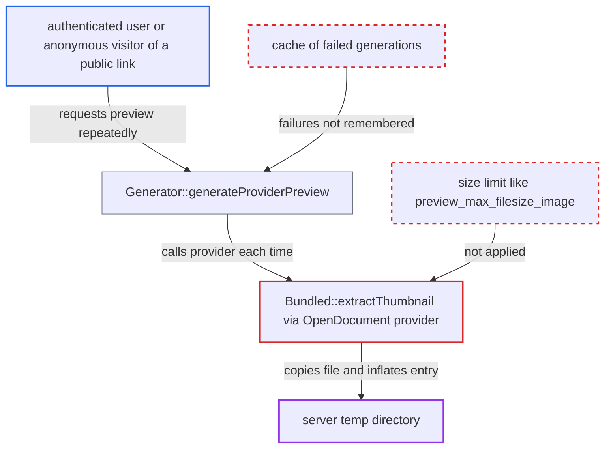

# Bundled preview providers copy and inflate attacker files without size limits

| Field | Value |
|---|---|
| ID | `find_01CjeTfXp9D1YBFR8xP27vUz` |
| Severity | **High** |
| Status | open |
| CWE | CWE-770 — Resource exhaustion |
| Created | 2026-10-27T21:27:05.668465Z |
| Claude Security | https://claude.ai/security/findings/find_01CjeTfXp9D1YBFR8xP27vUz |

## Description

An authenticated low-privilege user can exhaust the server's temp disk and I/O, which breaks uploads, other previews and anything else that needs temp space for every user while the attack runs. The attacker uploads a huge or zip-bomb `.odt` file and requests its preview repeatedly. `Bundled::extractThumbnail()` copies the whole file and inflates the thumbnail entry with no size limit, and failed previews are never cached.

1. **attacker** uploads a huge or zip-bomb file named `.odt`, `.ods` or `.odp`. The mime type comes from the extension, and the default quota is unlimited. The file is either multi-GB or a small ZIP whose `Thumbnails/thumbnail.png` entry inflates to gigabytes.
2. **attacker** requests the file's preview many times, concurrently. The requests go to `/core/preview`, or anonymously to `/apps/files_sharing/publicpreview/<token>` once the folder is link-shared. ([`apps/files_sharing/lib/Controller/PublicPreviewController.php:128-146`](https://github.com/cx-benchmark/server/blob/6b6317280f8ed50277369c33cee070a643d29654/apps/files_sharing/lib/Controller/PublicPreviewController.php#L128-L146))
3. **the provider `OpenDocument`** calls `extractThumbnail()` for the file. `OpenDocument` is enabled by default and handles every `application/vnd.oasis.opendocument.*` file. ([`lib/private/Preview/OpenDocument.php:28-34`](https://github.com/cx-benchmark/server/blob/6b6317280f8ed50277369c33cee070a643d29654/lib/private/Preview/OpenDocument.php#L28-L34))
4. **`Bundled::extractThumbnail()`** copies the entire source file into a temp file. The only guard is a check for size 0. The copy is made even on local storage, because it does not use `getLocalFile()`. ([`lib/private/Preview/Bundled.php:22-36`](https://github.com/cx-benchmark/server/blob/6b6317280f8ed50277369c33cee070a643d29654/lib/private/Preview/Bundled.php#L22-L36))
5. **`OC\Archive\ZIP::extractFile()`** streams the `Thumbnails/thumbnail.png` entry into a second temp file. There is no limit on the inflated size, and this happens before the `preview_max_memory` dimension check. ([`lib/private/Archive/ZIP.php:161-167`](https://github.com/cx-benchmark/server/blob/6b6317280f8ed50277369c33cee070a643d29654/lib/private/Archive/ZIP.php#L161-L167))
6. **`Generator::generateProviderPreview()`** throws `NotFoundException` and stores nothing. Because the failure is not cached, the next request repeats the full copy and inflation. ([`lib/private/Preview/Generator.php:460-475`](https://github.com/cx-benchmark/server/blob/6b6317280f8ed50277369c33cee070a643d29654/lib/private/Preview/Generator.php#L460-L475))

## Assessment

The attacker is an authenticated user who can upload files. The default quota is unlimited, and the `OpenDocument` provider is on by default, so no configuration is needed. The attacker uploads a multi-GB file, or a small ZIP with a huge `Thumbnails/thumbnail.png` entry, under an `.odt`, `.ods` or `.odp` name. They then request its preview through `/core/preview`. Another way in is to share the folder by public link and request previews anonymously through `/apps/files_sharing/publicpreview/<token>`. The public share file list requests previews for every listed file automatically. The `Krita` provider also uses `Bundled::extractThumbnail()`.

Impact: The attacker can fill the temp directory and saturate I/O. The temp directory is often RAM-backed `tmpfs` or on the same volume as the data directory. With a multi-GB source and the default preview concurrency of one request per CPU, uploads, chunk assembly, other previews and anything needing temp space fail for all users while the attack runs. One cheap request triggers gigabytes of server-side work. Confidentiality and integrity are not affected.

## Recommendation

(1) `Bundled::extractThumbnail()` copies the complete source file into temp storage and inflates an archive entry with no size bound. The cost of a preview request therefore depends on attacker-chosen sizes.

Fix criteria: The provider refuses files above a configured size, mirroring `preview_max_filesize_image`. It no longer copies local files and uses `getLocalFile()` instead. It checks the entry's declared uncompressed size against a limit and stops writing once the limit is exceeded. A multi-GB `.odt`, or a small ZIP with a multi-GB `Thumbnails/thumbnail.png` entry, is rejected before any temp write.

(2) Failed preview generations are not remembered, so an expensive failing file is reprocessed on every request.

Fix criteria: Failed attempts are recorded per file id and etag. Later preview requests for the same unchanged file return quickly without re-running providers. Repeated requests for a file whose preview failed do not re-copy the file.

## Evidence

**https://github.com/cx-benchmark/server**

- [`lib/private/Preview/Bundled.php:22-36`](https://github.com/cx-benchmark/server/blob/6b6317280f8ed50277369c33cee070a643d29654/lib/private/Preview/Bundled.php#L22-L36)
- [`lib/private/Preview/OpenDocument.php:28-34`](https://github.com/cx-benchmark/server/blob/6b6317280f8ed50277369c33cee070a643d29654/lib/private/Preview/OpenDocument.php#L28-L34)
- [`lib/private/PreviewManager.php:285-290`](https://github.com/cx-benchmark/server/blob/6b6317280f8ed50277369c33cee070a643d29654/lib/private/PreviewManager.php#L285-L290)
- [`lib/private/Preview/Image.php:23-28`](https://github.com/cx-benchmark/server/blob/6b6317280f8ed50277369c33cee070a643d29654/lib/private/Preview/Image.php#L23-L28)
- [`lib/private/Preview/Generator.php:460-475`](https://github.com/cx-benchmark/server/blob/6b6317280f8ed50277369c33cee070a643d29654/lib/private/Preview/Generator.php#L460-L475)
- [`lib/private/Archive/ZIP.php:161-167`](https://github.com/cx-benchmark/server/blob/6b6317280f8ed50277369c33cee070a643d29654/lib/private/Archive/ZIP.php#L161-L167)
- [`apps/files_sharing/lib/Controller/PublicPreviewController.php:128-146`](https://github.com/cx-benchmark/server/blob/6b6317280f8ed50277369c33cee070a643d29654/apps/files_sharing/lib/Controller/PublicPreviewController.php#L128-L146)

