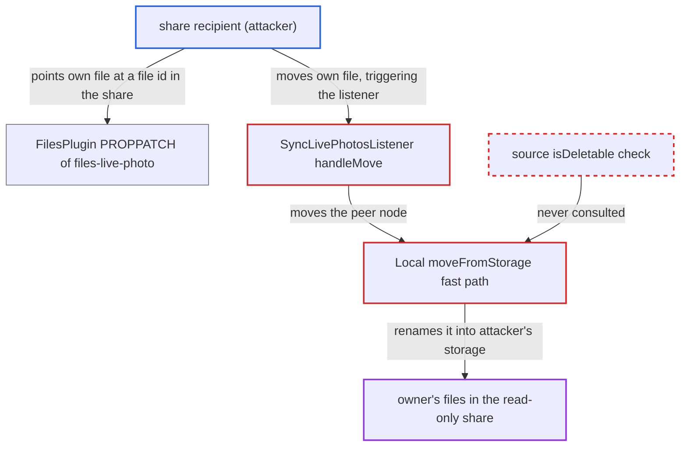

# Cross-storage move bypasses source share permissions, letting recipients remove files from read-only shares

| Field | Value |
|---|---|
| ID | `find_01TR47sfUFPi8xCmcnkjQKj3` |
| Severity | **High** |
| Status | open |
| CWE | CWE-862 — Missing authorization |
| Created | 2026-10-27T21:32:29.451133Z |
| Claude Security | https://claude.ai/security/findings/find_01TR47sfUFPi8xCmcnkjQKj3 |

## Description

A logged-in user who received a read-only share can make the server move files or whole folders out of the owner's storage into their own space. The owner loses the data, and no trashbin copy is made. The attack needs only a PROPPATCH and a MOVE on the attacker's own file, and works on default local storage without server-side encryption or on primary object-store storage. The cause is that `Local::moveFromStorage()` and `ObjectStoreStorage::moveFromStorage()` never check that the source is deletable, and `SyncLivePhotosListener::handleMove()` moves a node picked by attacker-controlled metadata.

1. **Attacker (share recipient)** sets `{http://nextcloud.org/ns}metadata-files-live-photo` on their own file to the id of a file in the read-only share. The key can be written by the file's owner through a WebDAV PROPPATCH, and the value is an arbitrary string that the listener later treats as a file id. ([`apps/dav/lib/Connector/Sabre/FilesPlugin.php:642-700`](https://github.com/cx-benchmark/server/blob/6b6317280f8ed50277369c33cee070a643d29654/apps/dav/lib/Connector/Sabre/FilesPlugin.php#L642-L700))
2. **Attacker (share recipient)** sends a MOVE for their own picture, such as `/remote.php/dav/files/alice/own.jpg`. This raises `BeforeNodeRenamedEvent` while the rename is being processed.
3. **the listener `SyncLivePhotosListener`** looks up the stored id with `getFirstNodeById($peerFileId)`. The lookup also returns nodes inside shares the user has received, so it finds the file in the read-only share. ([`apps/files/lib/Listener/SyncLivePhotosListener.php:70-80`](https://github.com/cx-benchmark/server/blob/6b6317280f8ed50277369c33cee070a643d29654/apps/files/lib/Listener/SyncLivePhotosListener.php#L70-L80))
4. **the handler `handleMove()`** calls `$peerFile->move(...)` on that node. It never checks that the current user may delete or move the peer node. ([`apps/files/lib/Listener/SyncLivePhotosListener.php:144-163`](https://github.com/cx-benchmark/server/blob/6b6317280f8ed50277369c33cee070a643d29654/apps/files/lib/Listener/SyncLivePhotosListener.php#L144-L163))
5. **`Node::move()`** checks only that the target parent is creatable and passes the move on to `View::rename()`. The source node's own delete permission is never checked. ([`lib/private/Files/Node/Node.php:450-470`](https://github.com/cx-benchmark/server/blob/6b6317280f8ed50277369c33cee070a643d29654/lib/private/Files/Node/Node.php#L450-L470))
6. **`View::rename()`** calls `$storage2->moveFromStorage($storage1, ...)` for the cross-storage move. It does not check the source path either and leaves enforcement to the storage layer. ([`lib/private/Files/View.php:818-834`](https://github.com/cx-benchmark/server/blob/6b6317280f8ed50277369c33cee070a643d29654/lib/private/Files/View.php#L818-L834))
7. **`Local::moveFromStorage()`** unwraps the share layers and does a raw `rename()` on the real on-disk path. The fast path never asks the source storage whether it is deletable, so the share's `PermissionsMask` is skipped and the owner's file lands in the attacker's directory. ([`lib/private/Files/Storage/Local.php:650-667`](https://github.com/cx-benchmark/server/blob/6b6317280f8ed50277369c33cee070a643d29654/lib/private/Files/Storage/Local.php#L650-L667))

## Assessment

The attacker is an authenticated user who has received a read-only share (or one without delete permission) of a file or folder from another user, and who owns at least one file of their own. The attacker sets `files-live-photo` on that file to the share's file id, then moves the file over WebDAV. The local fast path is used when both home storages are local and server-side encryption is off, which is the default. With encryption on local storage, the `Common` path is used and its `isDeletable` check applies. Primary object-store deployments have no such fallback and are affected as well. Any other code path that calls `Node::move()` on a node the user can only read would give the same bypass. The report names `SyncLivePhotosListener::handleMove()` as the one such path in core.

Impact: The recipient can remove any file or whole folder tree that was shared with them read-only, or without delete permission, from the owner's storage and take ownership of it in their own space. The owner loses the data and no trashbin copy is made. The recipient could already read the content, so reading is not newly exposed.

## Recommendation

(1) `Local::moveFromStorage()` and `ObjectStoreStorage::moveFromStorage()` move the unwrapped source without asking the source storage whether it is deletable. This bypasses the `PermissionsMask` that implements share permissions.

Fix criteria: Before any data or cache move, the source storage, as wrapped and before unjailing, must report `isDeletable($sourceInternalPath)`. Otherwise the move fails without side effects. Moving a node out of a read-only share through `Node::move()` must fail on local homes, both encrypted and unencrypted. It must also fail on primary object-store homes, with the same bucket and with a different bucket.

(2) `Node::move()` and `View::rename()` check only the target parent's create permission and trust the storage wrappers for the source. Every caller therefore has to repeat the source check itself.

Fix criteria: `Node::move()` refuses when the node is not deletable, or not updatable for same-folder renames, unless it is a movable mount root. With a read-only shared node, `move()` must throw `NotPermittedException` before any storage operation.

(3) `SyncLivePhotosListener` moves a peer node chosen by attacker-controlled `files-live-photo` metadata without checking the user's permission on that peer.

Fix criteria: The listener verifies that the peer node is owned by, or deletable for, the acting user. Preferably it also verifies that the peer's metadata points back to the source. A `files-live-photo` id that points into a read-only share must abort the operation without touching the share.

## Evidence

**https://github.com/cx-benchmark/server**

- [`lib/private/Files/Storage/Local.php:650-667`](https://github.com/cx-benchmark/server/blob/6b6317280f8ed50277369c33cee070a643d29654/lib/private/Files/Storage/Local.php#L650-L667)
- [`lib/private/Files/Storage/Local.php:615-627`](https://github.com/cx-benchmark/server/blob/6b6317280f8ed50277369c33cee070a643d29654/lib/private/Files/Storage/Local.php#L615-L627)
- [`lib/private/Files/ObjectStore/ObjectStoreStorage.php:647-698`](https://github.com/cx-benchmark/server/blob/6b6317280f8ed50277369c33cee070a643d29654/lib/private/Files/ObjectStore/ObjectStoreStorage.php#L647-L698)
- [`lib/private/Files/Storage/Common.php:605-625`](https://github.com/cx-benchmark/server/blob/6b6317280f8ed50277369c33cee070a643d29654/lib/private/Files/Storage/Common.php#L605-L625)
- [`lib/private/Files/Node/Node.php:450-470`](https://github.com/cx-benchmark/server/blob/6b6317280f8ed50277369c33cee070a643d29654/lib/private/Files/Node/Node.php#L450-L470)
- [`lib/private/Files/View.php:818-834`](https://github.com/cx-benchmark/server/blob/6b6317280f8ed50277369c33cee070a643d29654/lib/private/Files/View.php#L818-L834)
- [`apps/files/lib/Listener/SyncLivePhotosListener.php:70-80`](https://github.com/cx-benchmark/server/blob/6b6317280f8ed50277369c33cee070a643d29654/apps/files/lib/Listener/SyncLivePhotosListener.php#L70-L80)
- [`apps/files/lib/Listener/SyncLivePhotosListener.php:144-163`](https://github.com/cx-benchmark/server/blob/6b6317280f8ed50277369c33cee070a643d29654/apps/files/lib/Listener/SyncLivePhotosListener.php#L144-L163)
- [`apps/dav/lib/Connector/Sabre/FilesPlugin.php:642-700`](https://github.com/cx-benchmark/server/blob/6b6317280f8ed50277369c33cee070a643d29654/apps/dav/lib/Connector/Sabre/FilesPlugin.php#L642-L700)
- [`apps/dav/lib/Connector/Sabre/FilesPlugin.php:720-725`](https://github.com/cx-benchmark/server/blob/6b6317280f8ed50277369c33cee070a643d29654/apps/dav/lib/Connector/Sabre/FilesPlugin.php#L720-L725)
- [`apps/dav/lib/Connector/Sabre/Directory.php:443-450`](https://github.com/cx-benchmark/server/blob/6b6317280f8ed50277369c33cee070a643d29654/apps/dav/lib/Connector/Sabre/Directory.php#L443-L450)

