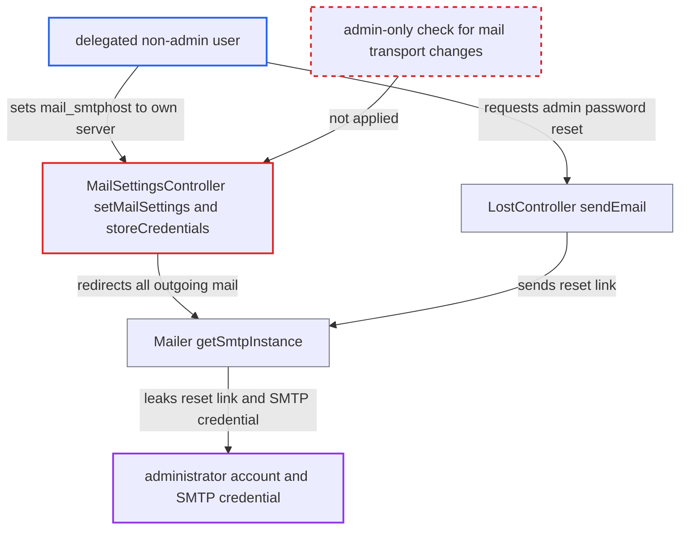

# Delegated Email-server admin can redirect outgoing mail and hijack administrator password resets

| Field | Value |
|---|---|
| ID | `find_01CmMdYDhLgNeLUbiepVty4A` |
| Severity | **High** |
| Status | open |
| CWE | CWE-269 — Privilege escalation |
| Created | 2026-10-27T21:51:06.102263Z |
| Claude Security | https://claude.ai/security/findings/find_01CmMdYDhLgNeLUbiepVty4A |

## Description

A user in a group that has been delegated the 'Email server' settings can take over an administrator account. They can also read the stored SMTP credential and every outgoing e-mail. They need that delegation, which is not on by default, and their own password. The cause is that `setMailSettings()` and `storeCredentials()` are guarded only by `#[AuthorizedAdminSetting(settings: Mail::class)]`, so a delegated user can change `mail_smtphost`.

1. **delegated non-admin user** confirms their own password and posts new mail settings. They send `POST /settings/admin/mailsettings` with `mail_smtphost` set to their own server, and optionally `mail_noverify=true` to turn off certificate checks. ([`apps/settings/lib/Controller/MailSettingsController.php:52-98`](https://github.com/cx-benchmark/server/blob/6b6317280f8ed50277369c33cee070a643d29654/apps/settings/lib/Controller/MailSettingsController.php#L52-L98))
2. **the handler `setMailSettings()`** writes the SMTP transport settings into the system config. It is guarded only by `#[AuthorizedAdminSetting(settings: Mail::class)]`, which a delegated group passes, and it saves the values with `setSystemValues()`. ([`apps/settings/lib/Controller/MailSettingsController.php:52-98`](https://github.com/cx-benchmark/server/blob/6b6317280f8ed50277369c33cee070a643d29654/apps/settings/lib/Controller/MailSettingsController.php#L52-L98))
3. **the attacker** requests a password reset for an administrator account. They send `POST /lostpassword/email` with the target administrator's login. No victim action is needed. ([`core/Controller/LostController.php:234-284`](https://github.com/cx-benchmark/server/blob/6b6317280f8ed50277369c33cee070a643d29654/core/Controller/LostController.php#L234-L284))
4. **the method `LostController::sendEmail()`** sends the reset link through the mailer. The link goes out through `$this->mailer->send()`, and the mailer now delivers it to the attacker's server. ([`core/Controller/LostController.php:234-284`](https://github.com/cx-benchmark/server/blob/6b6317280f8ed50277369c33cee070a643d29654/core/Controller/LostController.php#L234-L284))
5. **the mailer `OC\Mail\Mailer::getSmtpInstance()`** connects to the attacker's host and authenticates there. When `mail_smtpauth` is set, it sends the administrator-stored `mail_smtpname` and `mail_smtppassword` to that host. ([`lib/private/Mail/Mailer.php:283-305`](https://github.com/cx-benchmark/server/blob/6b6317280f8ed50277369c33cee070a643d29654/lib/private/Mail/Mailer.php#L283-L305))
6. **the attacker** opens the reset link from their SMTP server and sets a new password. They call `/lostpassword/set/{token}/{userId}`, which becomes a full administrator. They can then restore the mail settings. ([`core/Controller/LostController.php:234-284`](https://github.com/cx-benchmark/server/blob/6b6317280f8ed50277369c33cee070a643d29654/core/Controller/LostController.php#L234-L284))

## Assessment

The attacker is an authenticated non-admin user in a group delegated the 'Email server' settings. This is a non-default `oc_authorized_groups` row for `OCA\Settings\Settings\Admin\Mail`. The request must come from an admin-allowed IP, and the attacker must confirm their own password. The attacker runs their own SMTP server. The report notes that the threat model says 'subadmin -> admin is not expected'. The owner may treat delegating mail transport as accepted design, and the finding is filed so that decision is explicit. Administrators who delegate the section get no warning that it is admin-equivalent, unlike the `webhook_listeners` section, which is labelled as granting full admin rights.

Impact: The attacker becomes a full administrator and gets full control of the instance and, under the admin trust model, of all users' data. They also read the stored SMTP credential and every outgoing e-mail of every user, such as reset links, share-by-mail links, 2FA backup mails, verification mails and notification digests. Mail can also be black-holed, which is a lesser effect.

Subsequent-system impact: The stolen `mail_smtpname` and `mail_smtppassword` belong to an account on the organisation's mail server. The attacker can use them outside Nextcloud to send mail as the instance, or to read that mailbox, depending on the provider. The effect is limited.

## Recommendation

(1) Changing the SMTP host or credentials is an admin-equivalent capability, because it intercepts password-reset and other security mail for every account. It is still offered to delegated non-admins as an ordinary settings section with no warning.

Fix criteria: Either the mail transport section is not delegatable, by removing `IDelegatedSettings` or by requiring `isAdmin()` in `setMailSettings()` and `storeCredentials()` for host, port, security and auth changes. Or `getName()` labels it admin-equivalent, as `webhook_listeners` does. A delegated non-admin's `POST /settings/admin/mailsettings` that changes `mail_smtphost` is refused, or the delegation UI shows the warning.

(2) Administrator password resets rely only on the e-mail channel, which anyone who controls the mail transport can read.

Fix criteria: This is optional hardening. When the SMTP host changes, administrators are notified or must re-confirm, and self-service password reset may be restricted for members of the `admin` group. Changing the host as a delegated user produces the admin notification or a refusal.

## Evidence

**https://github.com/cx-benchmark/server**

- [`apps/settings/lib/Controller/MailSettingsController.php:52-98`](https://github.com/cx-benchmark/server/blob/6b6317280f8ed50277369c33cee070a643d29654/apps/settings/lib/Controller/MailSettingsController.php#L52-L98)
- [`apps/settings/lib/Settings/Admin/Mail.php:20-118`](https://github.com/cx-benchmark/server/blob/6b6317280f8ed50277369c33cee070a643d29654/apps/settings/lib/Settings/Admin/Mail.php#L20-L118)
- [`lib/private/Mail/Mailer.php:283-305`](https://github.com/cx-benchmark/server/blob/6b6317280f8ed50277369c33cee070a643d29654/lib/private/Mail/Mailer.php#L283-L305)
- [`core/Controller/LostController.php:234-284`](https://github.com/cx-benchmark/server/blob/6b6317280f8ed50277369c33cee070a643d29654/core/Controller/LostController.php#L234-L284)
- [`apps/webhook_listeners/lib/Settings/Admin.php:18-44`](https://github.com/cx-benchmark/server/blob/6b6317280f8ed50277369c33cee070a643d29654/apps/webhook_listeners/lib/Settings/Admin.php#L18-L44)

