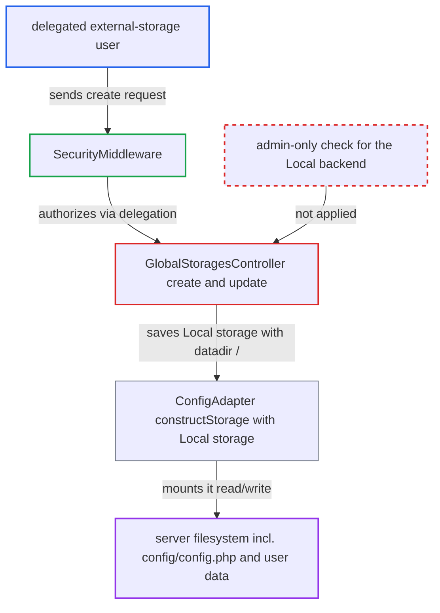

# Delegated external-storage admins can mount the server filesystem via the Local backend

| Field | Value |
|---|---|
| ID | `find_01XvS2Lf48D6LTR1vudNooqG` |
| Severity | **High** |
| Status | open |
| CWE | CWE-863 — Incorrect Authorization |
| Created | 2026-10-27T21:25:06.621862Z |
| Claude Security | https://claude.ai/security/findings/find_01XvS2Lf48D6LTR1vudNooqG |

## Description

A non-admin user who has been given the "External storage" settings page by delegation can mount the server's whole filesystem into their own Files. They can then read and write everything the web server user can reach, including `config/config.php` and every user's data. The attack needs the delegation and the files_external app enabled. The cause is that `StoragesController::createStorage()` guards the `Local` backend only with the system flag `files_external_allow_create_new_local`, which defaults to `true`, and never checks for a real admin.

1. **delegated user** sends a create request for a Local storage. After confirming their own password, they POST to `/index.php/apps/files_external/globalstorages` with `backend=local`, `authMechanism=null::null`, `backendOptions[datadir]=/` and themselves in `applicableUsers[]`. ([`apps/files_external/lib/Controller/GlobalStoragesController.php:69-108`](https://github.com/cx-benchmark/server/blob/6b6317280f8ed50277369c33cee070a643d29654/apps/files_external/lib/Controller/GlobalStoragesController.php#L69-L108))
2. **`SecurityMiddleware`** lets the request through. `AuthorizedAdminSetting` is satisfied when the user's group has an `oc_authorized_groups` row for the setting class, so being an admin is not required. ([`lib/private/AppFramework/Middleware/Security/SecurityMiddleware.php:141-164`](https://github.com/cx-benchmark/server/blob/6b6317280f8ed50277369c33cee070a643d29654/lib/private/AppFramework/Middleware/Security/SecurityMiddleware.php#L141-L164))
3. **`StoragesController::createStorage()`** allows the `Local` backend. Its only check refuses `Local` when `files_external_allow_create_new_local` is false, and that flag defaults to `true`; there is no `isAdmin` check. ([`apps/files_external/lib/Controller/StoragesController.php:82-90`](https://github.com/cx-benchmark/server/blob/6b6317280f8ed50277369c33cee070a643d29654/apps/files_external/lib/Controller/StoragesController.php#L82-L90))
4. **`validate()`** accepts the storage. `GlobalStoragesService::getVisibilityType()` always returns `VISIBILITY_ADMIN`, which is the only visibility `Local` allows. ([`apps/files_external/lib/Service/GlobalStoragesService.php:131-139`](https://github.com/cx-benchmark/server/blob/6b6317280f8ed50277369c33cee070a643d29654/apps/files_external/lib/Service/GlobalStoragesService.php#L131-L139))
5. **`GlobalStoragesController::create()`** saves the storage. It calls `addStorage()`, which stores the free-form `datadir` and the delegated user as the only applicable user. ([`apps/files_external/lib/Controller/GlobalStoragesController.php:69-108`](https://github.com/cx-benchmark/server/blob/6b6317280f8ed50277369c33cee070a643d29654/apps/files_external/lib/Controller/GlobalStoragesController.php#L69-L108))
6. **`ConfigAdapter::constructStorage()`** mounts the storage for that user. It builds `OC\Files\Storage\Local` from the stored backend options, with no further check. ([`apps/files_external/lib/Config/ConfigAdapter.php:88-99`](https://github.com/cx-benchmark/server/blob/6b6317280f8ed50277369c33cee070a643d29654/apps/files_external/lib/Config/ConfigAdapter.php#L88-L99))
7. **`OC\Files\Storage\Local`** exposes the whole server filesystem. It accepts any `datadir`, including `/`, and does raw file operations as the PHP process user. ([`lib/private/Files/Storage/Local.php:48-58`](https://github.com/cx-benchmark/server/blob/6b6317280f8ed50277369c33cee070a643d29654/lib/private/Files/Storage/Local.php#L48-L58))

## Assessment

The attacker is an authenticated non-admin in a group to which an admin has delegated the External storage setting. The shipped but optional files_external app must be enabled. The attacker must confirm their own password. The flag `files_external_allow_create_new_local` must be true, which is its default. No victim action is needed. The same flaw is reachable through `update()` on `GlobalStoragesController`, as well as `create()`.

Impact: The attacker gets read and write access to everything the web server user can reach. That includes `config/config.php` (database credentials, `secret`, `passwordsalt`), every user's data directory past all sharing checks, and application code where it is writable, which can give code execution. They can also destroy data or configuration. A delegation meant for network storage becomes full instance compromise.

## Recommendation

(1) `StoragesController::createStorage()` and `validate()` give delegated settings admins the same backends as real admins. The `Local` backend, which exposes the server filesystem, is gated only by a system flag that defaults to permissive.

Fix criteria: A user authorized only through settings delegation (not `isAdmin`) cannot create or update a storage whose backend is `Local`, including the alias `\OC\Files\Storage\Local`, whatever `files_external_allow_create_new_local` says. As a delegated non-admin, `POST` or `PUT` to `/apps/files_external/globalstorages` with `backend=local` is refused and no `oc_external_mounts` row is created. A real admin still behaves according to the flag.

(2) Delegating `OCA\Files_External\Settings\Admin` does not limit which privileged backends the delegated role can configure.

Fix criteria: Delegated users can still manage network backends, but filesystem-backed storages stay admin-only on the server side, not just hidden in the UI. Repeating the create and update requests through the API as a delegated user confirms this.

## Evidence

**https://github.com/cx-benchmark/server**

- [`apps/files_external/lib/Controller/StoragesController.php:82-90`](https://github.com/cx-benchmark/server/blob/6b6317280f8ed50277369c33cee070a643d29654/apps/files_external/lib/Controller/StoragesController.php#L82-L90)
- [`apps/files_external/lib/Controller/GlobalStoragesController.php:69-108`](https://github.com/cx-benchmark/server/blob/6b6317280f8ed50277369c33cee070a643d29654/apps/files_external/lib/Controller/GlobalStoragesController.php#L69-L108)
- [`lib/private/AppFramework/Middleware/Security/SecurityMiddleware.php:141-164`](https://github.com/cx-benchmark/server/blob/6b6317280f8ed50277369c33cee070a643d29654/lib/private/AppFramework/Middleware/Security/SecurityMiddleware.php#L141-L164)
- [`apps/files_external/lib/Settings/Admin.php:21`](https://github.com/cx-benchmark/server/blob/6b6317280f8ed50277369c33cee070a643d29654/apps/files_external/lib/Settings/Admin.php#L21)
- [`apps/files_external/lib/Lib/Backend/Local.php:23-32`](https://github.com/cx-benchmark/server/blob/6b6317280f8ed50277369c33cee070a643d29654/apps/files_external/lib/Lib/Backend/Local.php#L23-L32)
- [`apps/files_external/lib/Service/GlobalStoragesService.php:131-139`](https://github.com/cx-benchmark/server/blob/6b6317280f8ed50277369c33cee070a643d29654/apps/files_external/lib/Service/GlobalStoragesService.php#L131-L139)
- [`apps/files_external/lib/Config/ConfigAdapter.php:88-99`](https://github.com/cx-benchmark/server/blob/6b6317280f8ed50277369c33cee070a643d29654/apps/files_external/lib/Config/ConfigAdapter.php#L88-L99)
- [`lib/private/Files/Storage/Local.php:48-58`](https://github.com/cx-benchmark/server/blob/6b6317280f8ed50277369c33cee070a643d29654/lib/private/Files/Storage/Local.php#L48-L58)

