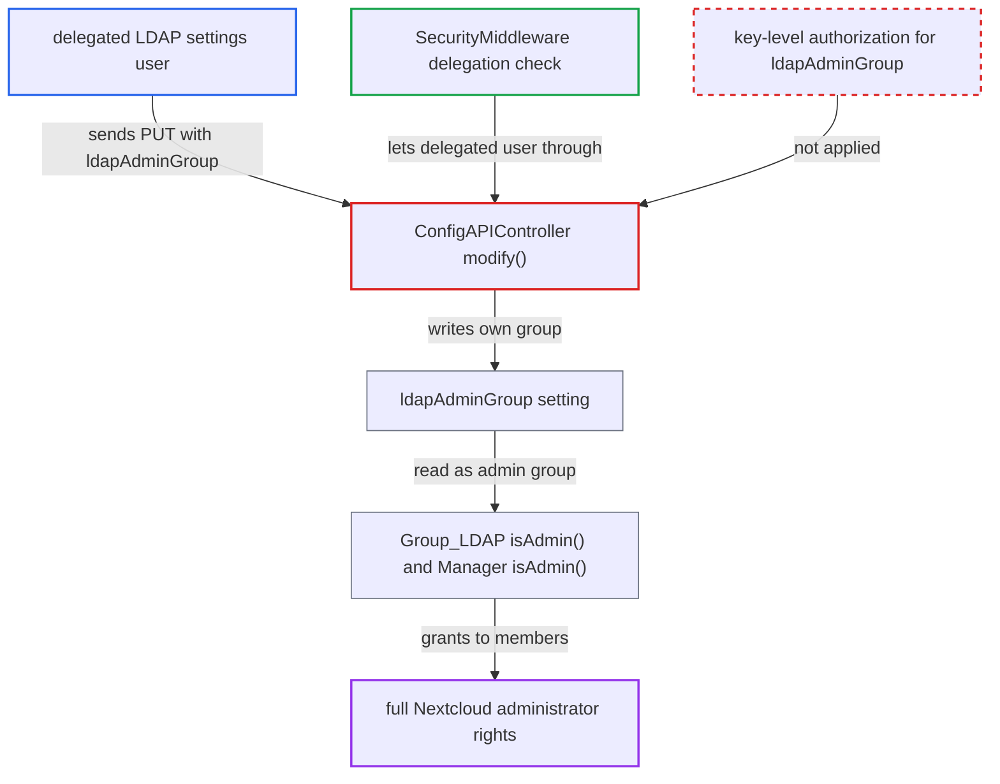

# Delegated LDAP settings users can set ldapAdminGroup and become full administrators

| Field | Value |
|---|---|
| ID | `find_014nhDFVsPMqeiatBtvvZqZV` |
| Severity | **High** |
| Status | open |
| CWE | CWE-269 — Improper privilege management |
| Created | 2026-10-27T21:51:46.421997Z |
| Claude Security | https://claude.ai/security/findings/find_014nhDFVsPMqeiatBtvvZqZV |

## Description

A user who has been delegated the LDAP/AD settings section, but is not an administrator, can make themselves a full Nextcloud administrator with one API request. The user must belong to an LDAP group that is mapped in Nextcloud. The endpoint `modify()` in `ConfigAPIController` lets any delegated user write `ldapAdminGroup`, the key that decides who is an administrator.

1. **Administrator** delegates the LDAP/AD integration section to an ordinary group. `Admin` implements `IDelegatedSettings`, so the section can be handed to a non-admin group from Administration privileges. ([`apps/user_ldap/lib/Settings/Admin.php:21`](https://github.com/cx-benchmark/server/blob/6b6317280f8ed50277369c33cee070a643d29654/apps/user_ldap/lib/Settings/Admin.php#L21))
2. **Delegated user** sends `PUT /ocs/v2.php/apps/user_ldap/api/v1/config/{configID}` with `configData[ldapAdminGroup]` set to the GID of their own LDAP group. `SecurityMiddleware` lets the request through because the user's group is listed for the `Admin` settings class, and this is the only check before `modify()`. ([`lib/private/AppFramework/Middleware/Security/SecurityMiddleware.php:141-164`](https://github.com/cx-benchmark/server/blob/6b6317280f8ed50277369c33cee070a643d29654/lib/private/AppFramework/Middleware/Security/SecurityMiddleware.php#L141-L164))
3. **the handler `modify()`** copies every key of `getConfigTranslationArray()` found in `configData` into the configuration and saves it. No key is held back for full administrators, and `ldapAdminGroup` is one of the keys. ([`apps/user_ldap/lib/Controller/ConfigAPIController.php:104-124`](https://github.com/cx-benchmark/server/blob/6b6317280f8ed50277369c33cee070a643d29654/apps/user_ldap/lib/Controller/ConfigAPIController.php#L104-L124))
4. **`Configuration`** accepts and stores `ldapAdminGroup` as `ldap_admin_group`. `setConfiguration()` accepts any key present in the config defaults, and `ldapAdminGroup` is in them. ([`apps/user_ldap/lib/Configuration.php:227-236`](https://github.com/cx-benchmark/server/blob/6b6317280f8ed50277369c33cee070a643d29654/apps/user_ldap/lib/Configuration.php#L227-L236))
5. **`Group_LDAP::isAdmin()`** returns true for every member of the group whose GID is stored in `ldapAdminGroup`. The attacker's account is a member of that group, so it now counts as an administrator. ([`apps/user_ldap/lib/Group_LDAP.php:1422-1432`](https://github.com/cx-benchmark/server/blob/6b6317280f8ed50277369c33cee070a643d29654/apps/user_ldap/lib/Group_LDAP.php#L1422-L1432))
6. **`Manager::isAdmin()`** grants admin rights to the attacker on the next request. It trusts any backend that implements `IS_ADMIN`, and `Group_Proxy` forwards to `Group_LDAP::isAdmin()`. ([`lib/private/Group/Manager.php:326-338`](https://github.com/cx-benchmark/server/blob/6b6317280f8ed50277369c33cee070a643d29654/lib/private/Group/Manager.php#L326-L338))

## Assessment

The attacker is an authenticated non-admin in a group to which an administrator delegated the LDAP/AD integration section. The shipped `user_ldap` app must be enabled. Their account must be an LDAP user in some mapped LDAP group. With the delegated UI alone they can also add a configuration for a directory they run. They then send the single `PUT` request with their group's GID in `configData[ldapAdminGroup]`. The only intended writer of this key is the CLI command `ldap:promote-group`, and the web UI has no field for it. The LDAP delegation also carries no warning, so an administrator who delegates it is not told it hands out full admin.

Impact: The attacker becomes a full Nextcloud administrator, so every `isAdmin` check in the instance passes. They can manage all users and groups, change system settings and install apps. The report notes that admin can reach all data and code execution. Other powers of the LDAP UI, such as pointing `ldapHost` at another directory or reading the bind password, are part of the delegated role by design and are not this defect.

## Recommendation

(1) `ConfigAPIController::modify()`, and also `copyConfiguration()` and `create()` which save whole configurations, let a user authorised only by settings delegation write `ldapAdminGroup`. That key grants full administrator rights, so a partial-admin role can promote itself.

Fix criteria: A caller for whom `IGroupManager::isAdmin()` is false cannot set or change `ldapAdminGroup` through any web or OCS endpoint. The request is refused or the key is ignored. Full admins and occ keep the ability. Test: as a delegated non-admin, `PUT .../api/v1/config/{id}` with `configData[ldapAdminGroup]` leaves the stored value unchanged. `isAdmin()` for that user stays false.

(2) The LDAP delegation is shown to administrators as an ordinary settings section, although the role controls the authentication backend. Its `getName()` returns null, unlike the `webhook_listeners` section, which warns that it is admin-equivalent.

Fix criteria: If any admin-equivalent power stays with the delegated LDAP role, the delegation UI labels it as such, as `webhook_listeners` does. An administrator granting it is then warned.

## Evidence

**https://github.com/cx-benchmark/server**

- [`apps/user_ldap/lib/Controller/ConfigAPIController.php:104-124`](https://github.com/cx-benchmark/server/blob/6b6317280f8ed50277369c33cee070a643d29654/apps/user_ldap/lib/Controller/ConfigAPIController.php#L104-L124)
- [`apps/user_ldap/lib/Configuration.php:227-236`](https://github.com/cx-benchmark/server/blob/6b6317280f8ed50277369c33cee070a643d29654/apps/user_ldap/lib/Configuration.php#L227-L236)
- [`apps/user_ldap/lib/Group_LDAP.php:1422-1432`](https://github.com/cx-benchmark/server/blob/6b6317280f8ed50277369c33cee070a643d29654/apps/user_ldap/lib/Group_LDAP.php#L1422-L1432)
- [`lib/private/Group/Manager.php:326-338`](https://github.com/cx-benchmark/server/blob/6b6317280f8ed50277369c33cee070a643d29654/lib/private/Group/Manager.php#L326-L338)
- [`lib/private/AppFramework/Middleware/Security/SecurityMiddleware.php:141-164`](https://github.com/cx-benchmark/server/blob/6b6317280f8ed50277369c33cee070a643d29654/lib/private/AppFramework/Middleware/Security/SecurityMiddleware.php#L141-L164)
- [`apps/user_ldap/lib/Settings/Admin.php:21`](https://github.com/cx-benchmark/server/blob/6b6317280f8ed50277369c33cee070a643d29654/apps/user_ldap/lib/Settings/Admin.php#L21)
- [`apps/user_ldap/lib/Command/PromoteGroup.php:32-84`](https://github.com/cx-benchmark/server/blob/6b6317280f8ed50277369c33cee070a643d29654/apps/user_ldap/lib/Command/PromoteGroup.php#L32-L84)
- [`apps/webhook_listeners/lib/Settings/Admin.php:16-44`](https://github.com/cx-benchmark/server/blob/6b6317280f8ed50277369c33cee070a643d29654/apps/webhook_listeners/lib/Settings/Admin.php#L16-L44)

