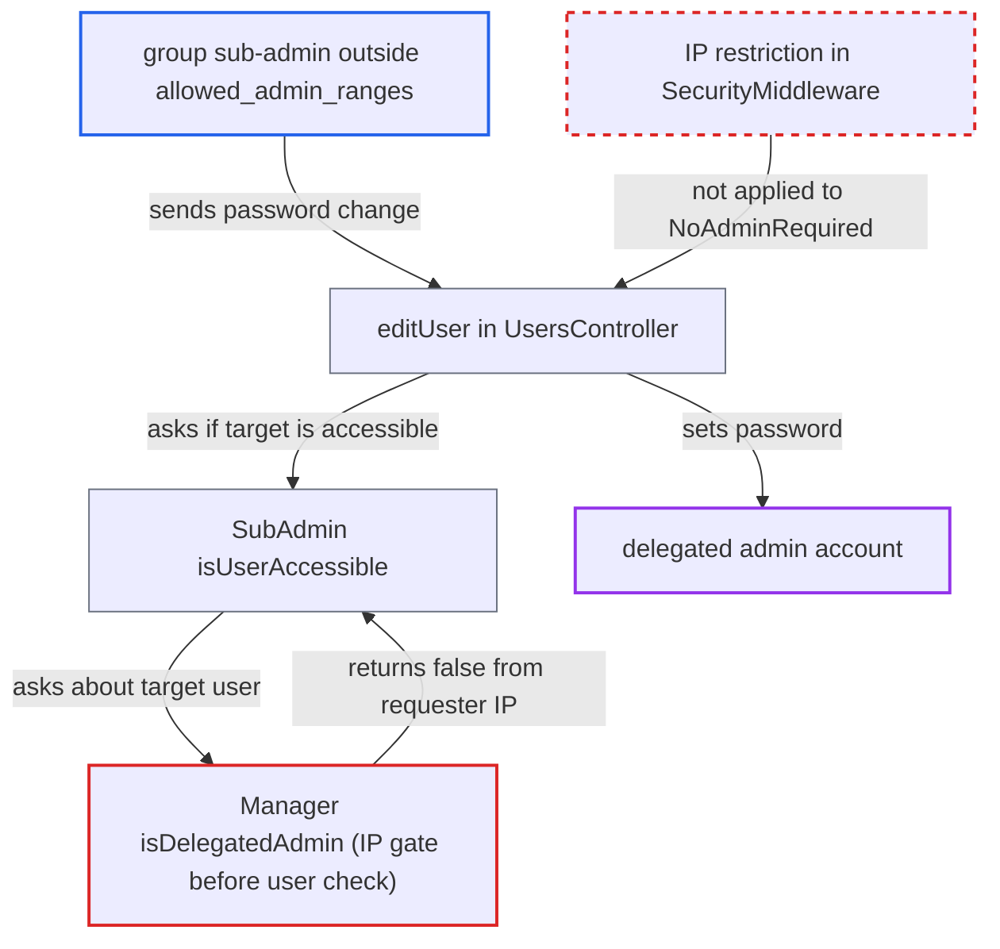

# isDelegatedAdmin() IP gate lets sub-admins manage delegated admins under allowed_admin_ranges

| Field | Value |
|---|---|
| ID | `find_01WdDkXiCYtpavYQiSix8nc6` |
| Severity | **High** |
| Status | open |
| CWE | CWE-863 — Incorrect Authorization |
| Created | 2026-10-27T21:28:06.282509Z |
| Claude Security | https://claude.ai/security/findings/find_01WdDkXiCYtpavYQiSix8nc6 |

## Description

A group sub-admin can reset the password of, or delete, disable or wipe, a Users-delegated admin who shares one of their groups. They can then log in as that admin. This works only when the operator has set `allowed_admin_ranges` (default `[]`) and the sub-admin sends the request from outside those ranges. The cause is `isDelegatedAdmin()`, which answers from the requester's IP instead of the target user, so `isUserAccessible()` loses its guard.

1. **Group sub-admin** sends a password change for the delegated admin from an IP outside `allowed_admin_ranges`. The request is `PUT /ocs/v2.php/cloud/users/{delegatedAdmin}` with `key=password`, and the target is a member of one of the sub-admin's groups. ([`apps/provisioning_api/lib/Controller/UsersController.php:1336-1378`](https://github.com/cx-benchmark/server/blob/6b6317280f8ed50277369c33cee070a643d29654/apps/provisioning_api/lib/Controller/UsersController.php#L1336-L1378))
2. **`SecurityMiddleware`** lets the request through without an IP check. The IP check applies only to `SubAdminRequired` methods or methods without `NoAdminRequired`, and `editUser` carries `#[NoAdminRequired]`. ([`lib/private/AppFramework/Middleware/Security/SecurityMiddleware.php:175-186`](https://github.com/cx-benchmark/server/blob/6b6317280f8ed50277369c33cee070a643d29654/lib/private/AppFramework/Middleware/Security/SecurityMiddleware.php#L175-L186))
3. **the method `isUserAccessible()`** asks `isDelegatedAdmin()` whether the target user is a delegated admin. The call at line 230 is the only thing that stops a sub-admin from managing a Users-delegated admin. ([`lib/private/SubAdmin.php:220-237`](https://github.com/cx-benchmark/server/blob/6b6317280f8ed50277369c33cee070a643d29654/lib/private/SubAdmin.php#L220-L237))
4. **the method `isDelegatedAdmin()`** returns `false` because the requester's IP is outside the allowed ranges. It checks `RemoteAddress::allowsAdminActions()` before it looks at `$userId`, so the answer says nothing about the target user. ([`lib/private/Group/Manager.php:341-350`](https://github.com/cx-benchmark/server/blob/6b6317280f8ed50277369c33cee070a643d29654/lib/private/Group/Manager.php#L341-L350))
5. **the method `isUserAccessible()`** grants access on the group overlap alone. `isSubAdmin()` still succeeds for the attacker through the `group_admin` row, so the shared group is enough. ([`lib/private/SubAdmin.php:220-237`](https://github.com/cx-benchmark/server/blob/6b6317280f8ed50277369c33cee070a643d29654/lib/private/SubAdmin.php#L220-L237))
6. **the handler `editUser()`** sets the delegated admin's password. For a non-self target it applies the change once `isUserAccessible()` is true. ([`apps/provisioning_api/lib/Controller/UsersController.php:1336-1378`](https://github.com/cx-benchmark/server/blob/6b6317280f8ed50277369c33cee070a643d29654/apps/provisioning_api/lib/Controller/UsersController.php#L1336-L1378))
7. **Attacker** logs in as the delegated admin. The attacker now holds the account and everything it can do.

## Assessment

The attacker is a group sub-admin with a normal login. Three conditions must hold. The operator has enabled `allowed_admin_ranges`, which is off by default (`[]`). The attacker sends requests from outside those ranges. A Users-delegated admin is a member of one of the attacker's groups. The attacker then calls the provisioning endpoint on that admin. The same weakness covers `editUser`/`editUserMultiValue` (password, email, display name), `deleteUser`, `disableUser`/`enableUser`, `wipeUserDevices`, `resendWelcomeMessage` and `getUserData` in `UsersController`, and `ChangePasswordController`.

Impact: The attacker takes over the delegated-admin account, with its files and data. They can also delete, disable or wipe it. After logging in from an allowed range, which a sub-admin employee can plausibly reach, the attacker gets the delegation's instance-wide power over every non-admin account: password resets, deletions and group changes. Members of the `admin` group stay out of reach.

## Recommendation

(1) `isDelegatedAdmin($userId)` mixes a request-scoped rule (the requester IP must be in `allowed_admin_ranges`) into a question about a user. Callers who ask about another user get a wrong `false`.

Fix criteria: Whether a user is a delegated admin does not depend on the current request's IP when that user is not the acting user, as `isAdmin()` already does. With `allowed_admin_ranges` set and a sub-admin request from outside it, `PUT /cloud/users/{delegatedAdmin}` is refused. Delete, disable and wipe are refused too, and the delegated admin's password is unchanged.

(2) `SubAdmin::isUserAccessible()` protects delegated-admin targets only through `isDelegatedAdmin()`, which carries the request-dependent IP condition.

Fix criteria: `isUserAccessible()` returns false for any target holding the Users delegation, whatever the remote-address policy. A unit test that mocks `allowsAdminActions()` to false shows that a delegated-admin target is inaccessible to a sub-admin of a shared group.

## Evidence

**https://github.com/cx-benchmark/server**

- [`lib/private/Group/Manager.php:341-350`](https://github.com/cx-benchmark/server/blob/6b6317280f8ed50277369c33cee070a643d29654/lib/private/Group/Manager.php#L341-L350)
- [`lib/private/SubAdmin.php:220-237`](https://github.com/cx-benchmark/server/blob/6b6317280f8ed50277369c33cee070a643d29654/lib/private/SubAdmin.php#L220-L237)
- [`apps/provisioning_api/lib/Controller/UsersController.php:1336-1378`](https://github.com/cx-benchmark/server/blob/6b6317280f8ed50277369c33cee070a643d29654/apps/provisioning_api/lib/Controller/UsersController.php#L1336-L1378)
- [`lib/private/AppFramework/Middleware/Security/SecurityMiddleware.php:175-186`](https://github.com/cx-benchmark/server/blob/6b6317280f8ed50277369c33cee070a643d29654/lib/private/AppFramework/Middleware/Security/SecurityMiddleware.php#L175-L186)
- [`apps/provisioning_api/lib/Middleware/ProvisioningApiMiddleware.php:44-50`](https://github.com/cx-benchmark/server/blob/6b6317280f8ed50277369c33cee070a643d29654/apps/provisioning_api/lib/Middleware/ProvisioningApiMiddleware.php#L44-L50)
- [`lib/private/Group/Manager.php:326-336`](https://github.com/cx-benchmark/server/blob/6b6317280f8ed50277369c33cee070a643d29654/lib/private/Group/Manager.php#L326-L336)
- [`lib/private/Security/Ip/RemoteAddress.php:47-68`](https://github.com/cx-benchmark/server/blob/6b6317280f8ed50277369c33cee070a643d29654/lib/private/Security/Ip/RemoteAddress.php#L47-L68)

