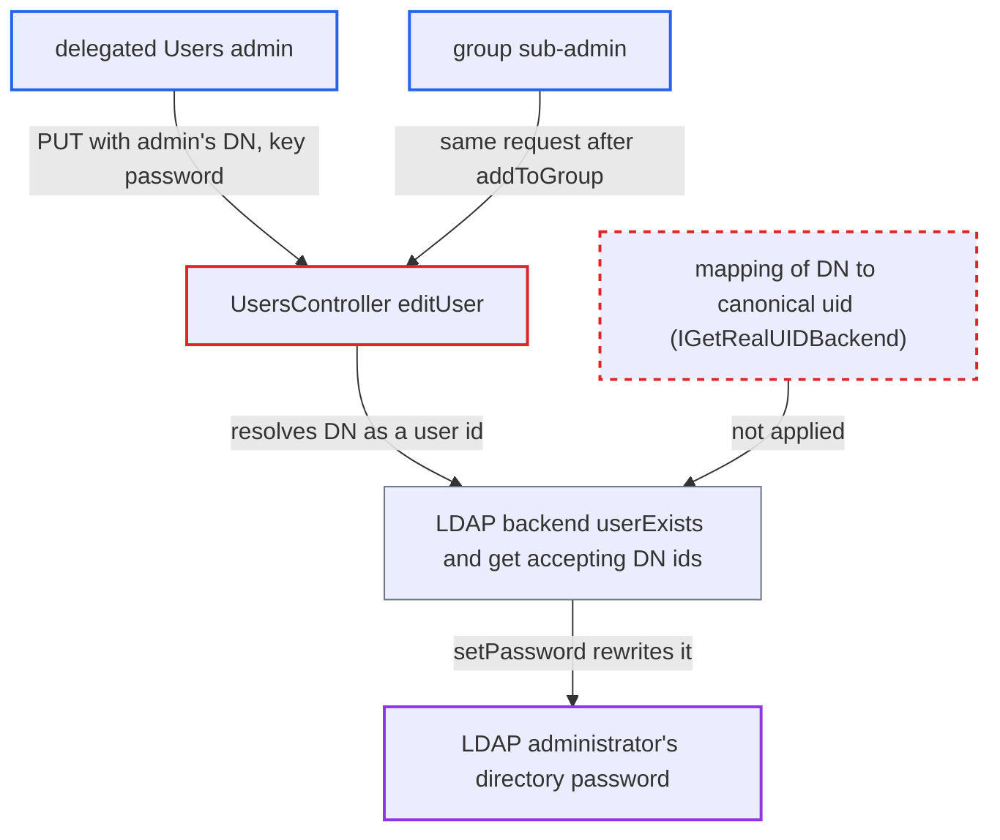

# LDAP backend accepts DNs as user ids, creating admin aliases that evade admin checks

| Field | Value |
|---|---|
| ID | `find_01FYJWEyYiLDBiXm31PhtHPr` |
| Severity | **High** |
| Status | open |
| CWE | CWE-289 — Authentication bypass by alternate name |
| Created | 2026-10-27T21:59:28.114161Z |
| Claude Security | https://claude.ai/security/findings/find_01FYJWEyYiLDBiXm31PhtHPr |

## Description

A delegated Users admin, or a group sub-admin, can reset the password of an LDAP-backed administrator and then log in as that administrator. The attacker must know the admin's DN (64 characters or fewer). The instance must have the LDAP option `turnOnPasswordChange` enabled, and it is off by default. The LDAP backend accepts a DN as a user id, so the admin checks, which go by uid, see an ordinary empty account.

1. **attacker (delegated Users admin)** sends a password change request for the admin's DN. The request is `PUT /ocs/v2.php/cloud/users/<url-encoded DN>` with `key=password&value=X`, and the attacker must already know the DN and have confirmed their own password. ([`apps/provisioning_api/lib/Controller/UsersController.php:1282-1409`](https://github.com/cx-benchmark/server/blob/6b6317280f8ed50277369c33cee070a643d29654/apps/provisioning_api/lib/Controller/UsersController.php#L1282-L1409))
2. **the LDAP user manager** reports the DN as an existing user id. `exists()` and `get()` accept any string that `ldap_explode_dn` parses as a DN and resolve it to the real LDAP user with `dn2username()`. ([`apps/user_ldap/lib/User/Manager.php:211-260`](https://github.com/cx-benchmark/server/blob/6b6317280f8ed50277369c33cee070a643d29654/apps/user_ldap/lib/User/Manager.php#L211-L260))
3. **core `OC\User\Manager::get()`** builds an `IUser` whose `getUID()` is the DN. Core only caps the id at 64 characters and canonicalises it only for an `IGetRealUIDBackend`, which `User_Proxy` does not implement. ([`lib/private/User/Manager.php:132-207`](https://github.com/cx-benchmark/server/blob/6b6317280f8ed50277369c33cee070a643d29654/lib/private/User/Manager.php#L132-L207))
4. **the group manager** finds no admin rights for the alias. `Group_LDAP` resolves ids only through `username2dn()`, which has no mapping row for a DN, so `isAdmin` and `isDelegatedAdmin` are false for the alias. ([`lib/private/Group/Manager.php:326-350`](https://github.com/cx-benchmark/server/blob/6b6317280f8ed50277369c33cee070a643d29654/lib/private/Group/Manager.php#L326-L350))
5. **the handler `editUser()`** lets the request change the password. The delegated-admin branch allows the target when `!isAdmin($targetUser->getUID())` holds, then adds `password` to the permitted fields and calls `$targetUser->setPassword()`. ([`apps/provisioning_api/lib/Controller/UsersController.php:1282-1409`](https://github.com/cx-benchmark/server/blob/6b6317280f8ed50277369c33cee070a643d29654/apps/provisioning_api/lib/Controller/UsersController.php#L1282-L1409))
6. **`User_LDAP::setPassword()`** writes the new password to the real admin's LDAP entry. It resolves the DN to the real user and calls `Access::setPassword($user->getDN(), ...)`, which works only when `turnOnPasswordChange` is 1. ([`apps/user_ldap/lib/User_LDAP.php:189-216`](https://github.com/cx-benchmark/server/blob/6b6317280f8ed50277369c33cee070a643d29654/apps/user_ldap/lib/User_LDAP.php#L189-L216))
7. **attacker** logs in as the administrator with the new password. No action by the victim is needed.

## Assessment

The attacker is a delegated Users admin, or a group sub-admin. The sub-admin first adds the DN alias to a database group they administer through `addToGroup()`, which does not check the target. The instance must run `user_ldap` with `turnOnPasswordChange` (`ldap_turn_on_pwd_change`, default `0`) enabled. The attacker must know the DN of an LDAP-backed administrator, and it must be 64 characters or fewer. A second way in is `ChangePasswordController.php` (`changeUserPassword()`), which has the same gate. Without `turnOnPasswordChange`, `canChangePassword()` is false and the alias gives no material gain. `User_LDAP::deleteUser()` refuses an entry that still exists on LDAP, and other fields are stored under the alias only.

Impact: The attacker sets a new password for an LDAP-backed administrator and logs in as that administrator. That gives control over all users, all data and the configuration, including app installation, which the threat model treats as full server control. The real admin is locked out until their password is reset.

Subsequent-system impact: The new password is written to the administrator's entry in the external LDAP directory. The attacker can bind to the directory as that entry, and the owner is locked out of the directory under that account. Only entries that the Nextcloud service account may write are affected.

## Recommendation

(1) `User_LDAP` and `User_Proxy` report a DN-shaped string as an existing user id and act on the underlying entry, while core builds the `IUser` on the caller's string. One LDAP entry therefore has two uids, and the checks keyed on uid (admin, delegated admin, groups, sub-admin scope) do not apply to the alias.

Fix criteria: Every id that `IUserManager::get()` and `userExists()` accept resolves to exactly one canonical uid. Either the LDAP backend's public `userExists()` and related methods reject DN-shaped ids, or the backend implements `IGetRealUIDBackend` so core keys the `User` on the mapped name. `IUserManager::get('<DN of an admin>')` returns null, or a user whose `getUID()` is the admin's real uid and for whom `isAdmin()` is true. `PUT /cloud/users/<DN>` with `key=password` from a delegated admin or sub-admin is refused.

(2) The admin protections in user management (`isUserAccessible()`, the delegated-admin branch of `editUser()`, `changeUserPassword()`) trust that the target's `IUser::getUID()` is canonical. They decide on the raw request string.

Fix criteria: The protective checks decide on the target's canonical identity, not on the raw request string. With only this change applied, the alias request from the attack path (`PUT /cloud/users/<DN>` with `key=password`) is still refused.

## Evidence

**https://github.com/cx-benchmark/server**

- [`apps/user_ldap/lib/User/Manager.php:211-260`](https://github.com/cx-benchmark/server/blob/6b6317280f8ed50277369c33cee070a643d29654/apps/user_ldap/lib/User/Manager.php#L211-L260)
- [`lib/private/User/Manager.php:132-207`](https://github.com/cx-benchmark/server/blob/6b6317280f8ed50277369c33cee070a643d29654/lib/private/User/Manager.php#L132-L207)
- [`apps/user_ldap/lib/User_Proxy.php:30-39`](https://github.com/cx-benchmark/server/blob/6b6317280f8ed50277369c33cee070a643d29654/apps/user_ldap/lib/User_Proxy.php#L30-L39)
- [`apps/user_ldap/lib/User_LDAP.php:189-216`](https://github.com/cx-benchmark/server/blob/6b6317280f8ed50277369c33cee070a643d29654/apps/user_ldap/lib/User_LDAP.php#L189-L216)
- [`apps/user_ldap/lib/Group_LDAP.php:664-686`](https://github.com/cx-benchmark/server/blob/6b6317280f8ed50277369c33cee070a643d29654/apps/user_ldap/lib/Group_LDAP.php#L664-L686)
- [`lib/private/Group/Manager.php:326-350`](https://github.com/cx-benchmark/server/blob/6b6317280f8ed50277369c33cee070a643d29654/lib/private/Group/Manager.php#L326-L350)
- [`apps/provisioning_api/lib/Controller/UsersController.php:1282-1409`](https://github.com/cx-benchmark/server/blob/6b6317280f8ed50277369c33cee070a643d29654/apps/provisioning_api/lib/Controller/UsersController.php#L1282-L1409)
- [`lib/private/SubAdmin.php:220-237`](https://github.com/cx-benchmark/server/blob/6b6317280f8ed50277369c33cee070a643d29654/lib/private/SubAdmin.php#L220-L237)
- [`apps/user_ldap/lib/Access.php:339-351`](https://github.com/cx-benchmark/server/blob/6b6317280f8ed50277369c33cee070a643d29654/apps/user_ldap/lib/Access.php#L339-L351)
- [`apps/settings/lib/Controller/ChangePasswordController.php:123-127`](https://github.com/cx-benchmark/server/blob/6b6317280f8ed50277369c33cee070a643d29654/apps/settings/lib/Controller/ChangePasswordController.php#L123-L127)

