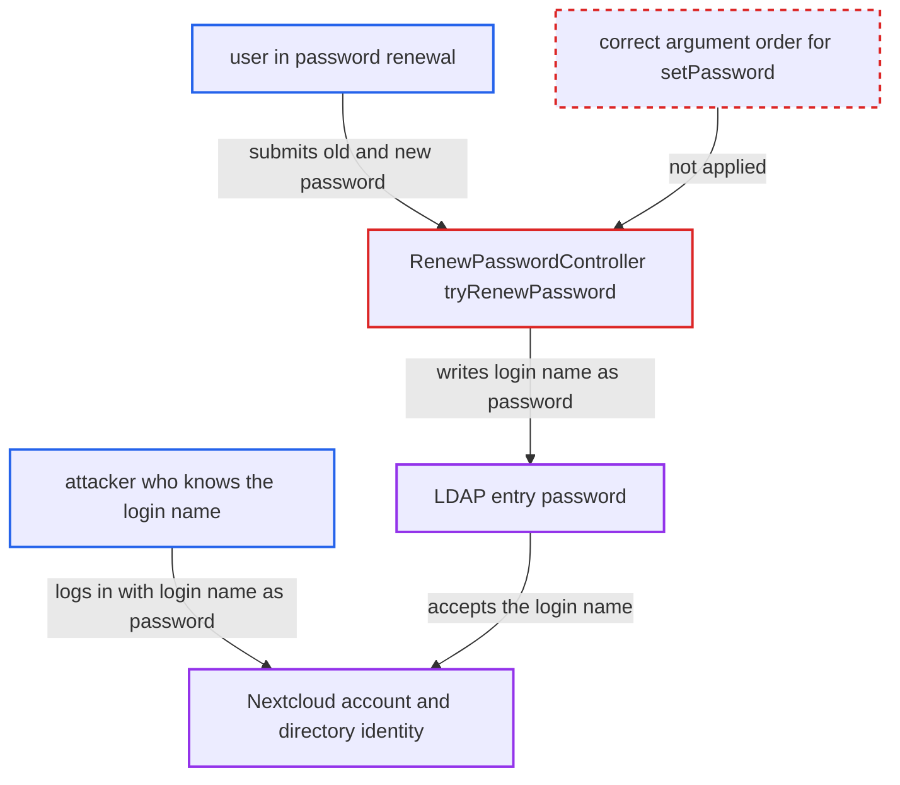

# LDAP password renewal writes the login name as the user's new directory password

| Field | Value |
|---|---|
| ID | `find_01ASujADcq3KM3PfWwxR3698` |
| Severity | **High** |
| Status | open |
| CWE | CWE-683 — Incorrect argument order |
| Created | 2026-10-27T21:18:20.510460Z |
| Claude Security | https://claude.ai/security/findings/find_01ASujADcq3KM3PfWwxR3698 |

## Description

An unauthenticated attacker who knows a user's login name can log in as that user after the user renews an expired LDAP password. The renewal stores the login name as the new directory password, not the password the user typed. It needs LDAP password changes and a default ppolicy DN enabled, and a directory that accepts the login name as a password. The cause is `RenewPasswordController::tryRenewPassword`, which passes its arguments to `setPassword` in the wrong order.

1. **LDAP user** is sent into the password renewal flow. `LoginListener::handlePasswordExpiry` flags users in ppolicy grace login or with `pwdReset=TRUE` as `needsPasswordReset` and redirects them to the renewal form. ([`apps/user_ldap/lib/LoginListener.php:205-224`](https://github.com/cx-benchmark/server/blob/6b6317280f8ed50277369c33cee070a643d29654/apps/user_ldap/lib/LoginListener.php#L205-L224))
2. **LDAP user** submits the renewal form with the old and new password. The form posts `oldPassword`, `newPassword` and a hidden `user` field that holds the account's login name. ([`apps/user_ldap/src/views/RenewPassword.vue:55-84`](https://github.com/cx-benchmark/server/blob/6b6317280f8ed50277369c33cee070a643d29654/apps/user_ldap/src/views/RenewPassword.vue#L55-L84))
3. **the controller `RenewPasswordController::tryRenewPassword`** calls `$userObject->setPassword($user, $newPassword)`. `IUser::setPassword` takes `($password, $recoveryPassword)`, so the login name is sent as the new password and the typed password as the recovery password. The old code used `\OC_User::setPassword($user, $newPassword)` with the uid first, and the argument order was kept when it was replaced. ([`apps/user_ldap/lib/Controller/RenewPasswordController.php:106-107`](https://github.com/cx-benchmark/server/blob/6b6317280f8ed50277369c33cee070a643d29654/apps/user_ldap/lib/Controller/RenewPasswordController.php#L106-L107))
4. **the user object `User::setPassword`** forwards the first argument to the backend as the password. It calls `$backend->setPassword($this->uid, $password)` with the login name in the `$password` position. ([`lib/private/User/User.php:340-356`](https://github.com/cx-benchmark/server/blob/6b6317280f8ed50277369c33cee070a643d29654/lib/private/User/User.php#L340-L356))
5. **the backend `User_LDAP::setPassword`** writes the value to the directory through `Access::setPassword`. `Access::setPassword` runs `exopPasswd` or `modReplace` on the user's entry, so the directory password becomes the login name. ([`apps/user_ldap/lib/Access.php:339-351`](https://github.com/cx-benchmark/server/blob/6b6317280f8ed50277369c33cee070a643d29654/apps/user_ldap/lib/Access.php#L339-L351))
6. **the controller** clears `needsPasswordReset` and tells the user to log in with the new password. The typed password was only passed as the encryption recovery password and was never stored, so the user's login with it fails.
7. **attacker** logs in with the victim's login name as both username and password. `User_LDAP::checkPassword` binds successfully against the directory, so the attacker gets a session as the victim.

## Assessment

The instance uses LDAP with an admin having enabled password changes (`turnOnPasswordChange`) and set a default ppolicy DN (`ldapDefaultPPolicyDN`). A victim is forced into renewal by `LoginListener` (grace login or `pwdReset=TRUE`) and submits the form. The directory must not reject the login name as a password. The attacker needs no account and no privileges. They only need to know or guess the victim's login name. One guess per account is enough, so brute-force throttling does not help.

Impact: The attacker gets a full Nextcloud session as the victim, with access to their files, shares, calendars and contacts, or admin rights if the victim is an admin. The victim is locked out of their own account until an admin or a lost-password reset fixes it. The lockout affects only that one account.

Subsequent-system impact: The predictable value is written into the external LDAP directory, so the attacker also knows that directory identity's credential. Wherever that identity is accepted, they can authenticate as the victim. The impact is limited to that one entry and what it may read or change. Services beyond the directory are not rated.

## Recommendation

`RenewPasswordController::tryRenewPassword` passes the account name as the `$password` argument of `IUser::setPassword` and the user's chosen password as `$recoveryPassword`. The directory credential is set to a value an attacker can predict.

Fix criteria: After a user completes the renew form with current password P_old and new password P_new, the LDAP entry's password is exactly P_new and never the account name. `IUser::setPassword` receives P_new as its first argument. After renewal, login with the login name as the password fails and login with P_new succeeds. A controller unit test asserts the argument order passed to `setPassword`.

## Evidence

**https://github.com/cx-benchmark/server**

- [`apps/user_ldap/lib/Controller/RenewPasswordController.php:106-107`](https://github.com/cx-benchmark/server/blob/6b6317280f8ed50277369c33cee070a643d29654/apps/user_ldap/lib/Controller/RenewPasswordController.php#L106-L107)
- [`lib/private/User/User.php:340-356`](https://github.com/cx-benchmark/server/blob/6b6317280f8ed50277369c33cee070a643d29654/lib/private/User/User.php#L340-L356)
- [`apps/user_ldap/lib/User_LDAP.php:189-216`](https://github.com/cx-benchmark/server/blob/6b6317280f8ed50277369c33cee070a643d29654/apps/user_ldap/lib/User_LDAP.php#L189-L216)
- [`apps/user_ldap/lib/Access.php:339-351`](https://github.com/cx-benchmark/server/blob/6b6317280f8ed50277369c33cee070a643d29654/apps/user_ldap/lib/Access.php#L339-L351)
- [`apps/user_ldap/src/views/RenewPassword.vue:55-84`](https://github.com/cx-benchmark/server/blob/6b6317280f8ed50277369c33cee070a643d29654/apps/user_ldap/src/views/RenewPassword.vue#L55-L84)
- [`apps/user_ldap/lib/LoginListener.php:205-224`](https://github.com/cx-benchmark/server/blob/6b6317280f8ed50277369c33cee070a643d29654/apps/user_ldap/lib/LoginListener.php#L205-L224)

