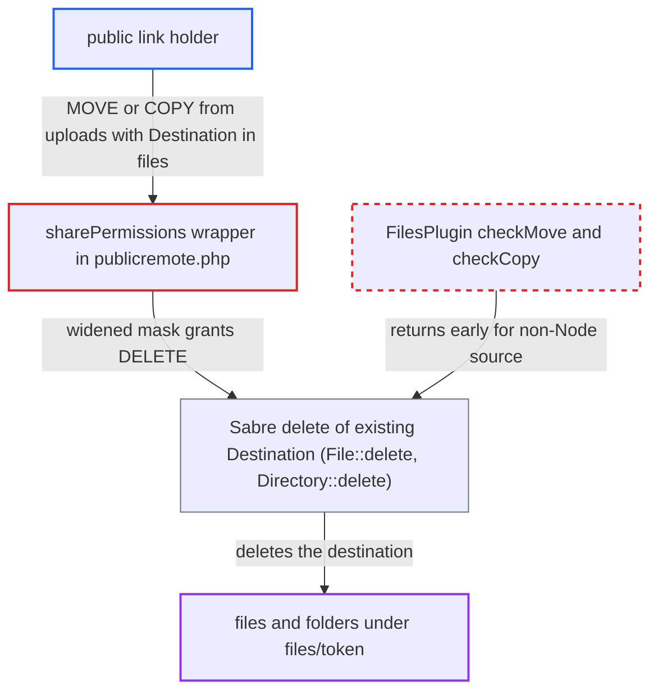

# Public link holders can delete files in read-only shares via MOVE/COPY from uploads collection

| Field | Value |
|---|---|
| ID | `find_01RVPUBn8ixYVhwGgMfqQXJU` |
| Severity | **High** |
| Status | open |
| CWE | CWE-862 — Missing Authorization |
| Created | 2026-10-27T21:37:23.911058Z |
| Claude Security | https://claude.ai/security/findings/find_01RVPUBn8ixYVhwGgMfqQXJU |

## Description

Anyone holding a public folder link can delete files and sub-folders in a read-only share, or one without delete rights. They can also delete a known file name in a file-drop share. Password-protected links also need the password. The cause is `publicremote.php`, which adds READ and DELETE to the share's permission mask for any request under `/uploads/`. That mask then covers the whole shared tree.

1. **link holder** sends a MOVE or COPY whose source is `uploads/<token>` and whose `Destination` is an existing item under `files/<token>/`. The uploads collection is mounted for every public share, so the attacker always has a source node to use, such as `UploadHome` or a folder they create with MKCOL. ([`apps/dav/lib/Connector/Sabre/ServerFactory.php:287-297`](https://github.com/cx-benchmark/server/blob/6b6317280f8ed50277369c33cee070a643d29654/apps/dav/lib/Connector/Sabre/ServerFactory.php#L287-L297))
2. **the `sharePermissions` wrapper in `publicremote.php`** adds `PERMISSION_READ | PERMISSION_DELETE` to the share's permission mask. It does this because the request URI starts with `/uploads/`. The widened mask is not limited to the scratch folder, so it also applies to the nodes under `files/<token>/`. ([`apps/dav/appinfo/v2/publicremote.php:119-137`](https://github.com/cx-benchmark/server/blob/6b6317280f8ed50277369c33cee070a643d29654/apps/dav/appinfo/v2/publicremote.php#L119-L137))
3. **`FilesPlugin`** skips its move and copy checks. `checkMove` and `checkCopy` return at once when the source is not a `Node`, and `QuotaPlugin` does the same. The upload plugins `ChunkingPlugin` and `ChunkingV2Plugin` do not block this source either. ([`apps/dav/lib/Connector/Sabre/FilesPlugin.php:204-208`](https://github.com/cx-benchmark/server/blob/6b6317280f8ed50277369c33cee070a643d29654/apps/dav/lib/Connector/Sabre/FilesPlugin.php#L204-L208))
4. **Sabre `CorePlugin`** deletes the existing destination before the move or copy. It calls `tree->delete()`, and `File::delete()` only checks `isDeletable()`, which reads the widened mask. `Directory::delete()` does the same check and then removes the folder recursively. ([`apps/dav/lib/Connector/Sabre/File.php:543-560`](https://github.com/cx-benchmark/server/blob/6b6317280f8ed50277369c33cee070a643d29654/apps/dav/lib/Connector/Sabre/File.php#L543-L560))
5. **the move or copy** fails after the destination is already gone. `Directory::moveInto` throws `BadRequest`, or `createDirectory` is refused for lack of CREATE, but the deletion is not undone.
6. **link holder** can add the header `X-NC-Skip-Trashbin: true` to make the deletion permanent. The trashbin storage honours this header for anonymous requests too, so the file does not go to the owner's trash. ([`apps/files_trashbin/lib/Storage.php:128-149`](https://github.com/cx-benchmark/server/blob/6b6317280f8ed50277369c33cee070a643d29654/apps/files_trashbin/lib/Storage.php#L128-L149))

## Assessment

The attacker is anyone who holds the token of a public folder link that lacks DELETE. No account is needed, and a password-protected link also needs the password. They send a MOVE to `/public.php/dav/uploads/<token>` over HTTP with the header `X-Requested-With: XMLHttpRequest`. The `Destination` is `/public.php/dav/files/<token>/victim.pdf` or a sub-folder, and they may add `X-NC-Skip-Trashbin: true`. A folder they create with MKCOL under `uploads/<token>` also works as the source, and so does COPY. Read-only links and links with create or update but no delete are affected, and COPY can also remove a known name in a file-drop folder. The report assumes the bundled sabre/dav 4.x, which is not checked out, deletes an existing destination before moving or copying.

Impact: The attacker can delete every file and sub-folder inside the shared folder. Recursive removal wipes whole sub-trees, and the skip-trashbin header makes the loss permanent. The share root survives, and nothing beyond what the link already exposes can be read.

## Recommendation

(1) `publicremote.php` adds READ and DELETE to the share permission mask for the whole shared tree whenever the request URI starts with `/uploads/`. Sabre's delete-before-move or copy then removes the existing `Destination`.

Fix criteria: For every request, including those addressed to `uploads/`, a public-link client's effective permissions on nodes under `files/<token>/` never exceed the share's permissions. Any extra rights that chunk assembly needs are limited to the uploads scratch folder or to the server's own assembly step. Test with a read-only link: MOVE and COPY of `uploads/<token>`, of a MKCOL'd `uploads/<token>/x` and of a chunk, each with `Destination` set to an existing file or folder in `files/<token>/`, return an error and leave the destination untouched.

(2) The uploads collection is served for every public share without checking that the share grants CREATE. This gives any link holder a ready source node for the MOVE or COPY.

Fix criteria: `uploads/<token>/` is refused unless the share grants `PERMISSION_CREATE`. This is defence in depth only and does not protect create-without-delete links on its own. Test with a read-only link: any request under `uploads/<token>/` fails and creates nothing in `/<owner>/uploads`.

## Evidence

**https://github.com/cx-benchmark/server**

- [`apps/dav/appinfo/v2/publicremote.php:119-137`](https://github.com/cx-benchmark/server/blob/6b6317280f8ed50277369c33cee070a643d29654/apps/dav/appinfo/v2/publicremote.php#L119-L137)
- [`apps/dav/lib/Connector/Sabre/ServerFactory.php:287-297`](https://github.com/cx-benchmark/server/blob/6b6317280f8ed50277369c33cee070a643d29654/apps/dav/lib/Connector/Sabre/ServerFactory.php#L287-L297)
- [`apps/dav/lib/Connector/Sabre/File.php:543-560`](https://github.com/cx-benchmark/server/blob/6b6317280f8ed50277369c33cee070a643d29654/apps/dav/lib/Connector/Sabre/File.php#L543-L560)
- [`apps/dav/lib/Connector/Sabre/Directory.php:310-326`](https://github.com/cx-benchmark/server/blob/6b6317280f8ed50277369c33cee070a643d29654/apps/dav/lib/Connector/Sabre/Directory.php#L310-L326)
- [`apps/dav/lib/Connector/Sabre/FilesPlugin.php:204-208`](https://github.com/cx-benchmark/server/blob/6b6317280f8ed50277369c33cee070a643d29654/apps/dav/lib/Connector/Sabre/FilesPlugin.php#L204-L208)
- [`apps/dav/lib/Upload/ChunkingPlugin.php:43-78`](https://github.com/cx-benchmark/server/blob/6b6317280f8ed50277369c33cee070a643d29654/apps/dav/lib/Upload/ChunkingPlugin.php#L43-L78)
- [`apps/dav/lib/Upload/ChunkingV2Plugin.php:99-118`](https://github.com/cx-benchmark/server/blob/6b6317280f8ed50277369c33cee070a643d29654/apps/dav/lib/Upload/ChunkingV2Plugin.php#L99-L118)
- [`apps/dav/lib/Files/Sharing/FilesDropPlugin.php:71-81`](https://github.com/cx-benchmark/server/blob/6b6317280f8ed50277369c33cee070a643d29654/apps/dav/lib/Files/Sharing/FilesDropPlugin.php#L71-L81)
- [`apps/files_trashbin/lib/Storage.php:128-149`](https://github.com/cx-benchmark/server/blob/6b6317280f8ed50277369c33cee070a643d29654/apps/files_trashbin/lib/Storage.php#L128-L149)

