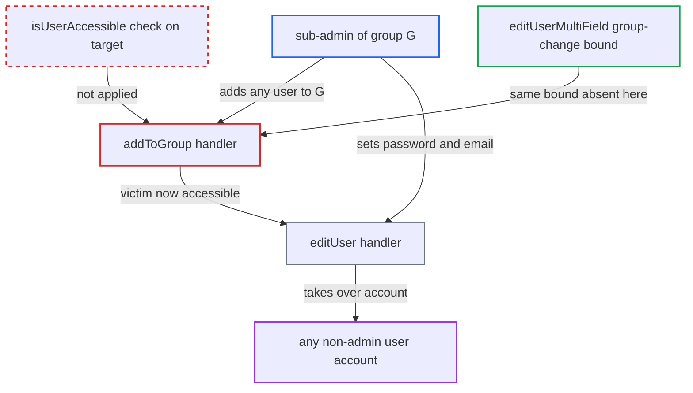

# Sub-admin can add any non-admin user to their group and then take over the account

| Field | Value |
|---|---|
| ID | `find_01Ei2nJnTCG3srNntrK72uYw` |
| Severity | **High** |
| Status | open |
| CWE | CWE-285 — Improper Authorization |
| Created | 2026-10-27T21:29:12.876986Z |
| Claude Security | https://claude.ai/security/findings/find_01Ei2nJnTCG3srNntrK72uYw |

## Description

A sub-admin of any single group can take over any non-admin, non-delegated-admin account on the instance. That includes sub-admins of other groups. The attacker needs the sub-admin role for one group. `addToGroup()` in `UsersController` checks only that the caller administers the group, and never checks whether the target user is one the caller may manage.

1. **Sub-admin attacker** confirms their own password. The report lists this as the first step before the attacker changes anything about another account.
2. **Sub-admin attacker** sends `POST /ocs/v2.php/cloud/users/{victim}/groups` with `groupid=G`. `G` is a group the attacker administers, and `{victim}` can be any existing non-admin account.
3. **the handler `addToGroup()`** authorizes the caller and adds the victim to `G`. It passes the call on `isSubAdminOfGroup($loggedInUser, $group)` alone, then runs `$group->addUser($targetUser)` without calling `isUserAccessible()` on the target. ([`apps/provisioning_api/lib/Controller/UsersController.php:1880-1906`](https://github.com/cx-benchmark/server/blob/6b6317280f8ed50277369c33cee070a643d29654/apps/provisioning_api/lib/Controller/UsersController.php#L1880-L1906))
4. **the check `isUserAccessible()`** now treats the victim as managed by the attacker. It is true when the target shares a group with the caller's `group_admin` rows and is not an admin or delegated admin, and the new membership satisfies that. ([`lib/private/SubAdmin.php:220-237`](https://github.com/cx-benchmark/server/blob/6b6317280f8ed50277369c33cee070a643d29654/lib/private/SubAdmin.php#L220-L237))
5. **Sub-admin attacker** sends `PUT /ocs/v2.php/cloud/users/{victim}` with `key=password`. `editUser()` now allows the change and sets the password through `$targetUser->setPassword($value)`. ([`apps/provisioning_api/lib/Controller/UsersController.php:1336-1409`](https://github.com/cx-benchmark/server/blob/6b6317280f8ed50277369c33cee070a643d29654/apps/provisioning_api/lib/Controller/UsersController.php#L1336-L1409))
6. **Sub-admin attacker** logs in as the victim. No action by the victim is needed.

## Assessment

The attacker is a sub-admin of any one group `G`, a role an admin has granted. The attack runs over the OCS API and needs no action from the victim. The target can be any existing non-admin, non-delegated-admin account. Note: `provisioning_api/appinfo/info.xml` says group admins can "perform the same functions as an admin for groups they manage", and the unit test `testAddToGroupSuccessAsSubadmin` covers this call without an accessibility check. Upstream may therefore treat this as by design. The report finds no accepted-risk entry in the project's memory that covers it.

Impact: The attacker can reset the password and email of any non-admin, non-delegated-admin account and then read that user's files, calendars and contacts. They can also delete, disable or wipe those accounts and read their data with `getUserData()`. Admin and delegated-admin accounts are excluded by `isUserAccessible()`, so server administration is not reached directly.

## Recommendation

`addToGroup()` authorizes a sub-admin on the group alone. The sub-admin can therefore add any account to a group they manage and gain password and email control over accounts the admin never assigned to them.

Fix criteria: A caller who is neither admin nor delegated admin can add a user to a group they administer only if `isUserAccessible()` is already true for that user before the change, as `editUserMultiField()` does. As sub-admin of `G`, `POST /cloud/users/{userInNoneOfMyGroups}/groups groupid=G` is refused. The account's group set is unchanged. A later `PUT /cloud/users/{user}` with `key=password` is still refused.

## Evidence

**https://github.com/cx-benchmark/server**

- [`apps/provisioning_api/lib/Controller/UsersController.php:1880-1906`](https://github.com/cx-benchmark/server/blob/6b6317280f8ed50277369c33cee070a643d29654/apps/provisioning_api/lib/Controller/UsersController.php#L1880-L1906)
- [`lib/private/SubAdmin.php:220-237`](https://github.com/cx-benchmark/server/blob/6b6317280f8ed50277369c33cee070a643d29654/lib/private/SubAdmin.php#L220-L237)
- [`apps/provisioning_api/lib/Controller/UsersController.php:1336-1409`](https://github.com/cx-benchmark/server/blob/6b6317280f8ed50277369c33cee070a643d29654/apps/provisioning_api/lib/Controller/UsersController.php#L1336-L1409)
- [`apps/provisioning_api/lib/Controller/UsersController.php:1086-1090`](https://github.com/cx-benchmark/server/blob/6b6317280f8ed50277369c33cee070a643d29654/apps/provisioning_api/lib/Controller/UsersController.php#L1086-L1090)
- [`apps/provisioning_api/lib/Controller/UsersController.php:1955-1968`](https://github.com/cx-benchmark/server/blob/6b6317280f8ed50277369c33cee070a643d29654/apps/provisioning_api/lib/Controller/UsersController.php#L1955-L1968)

