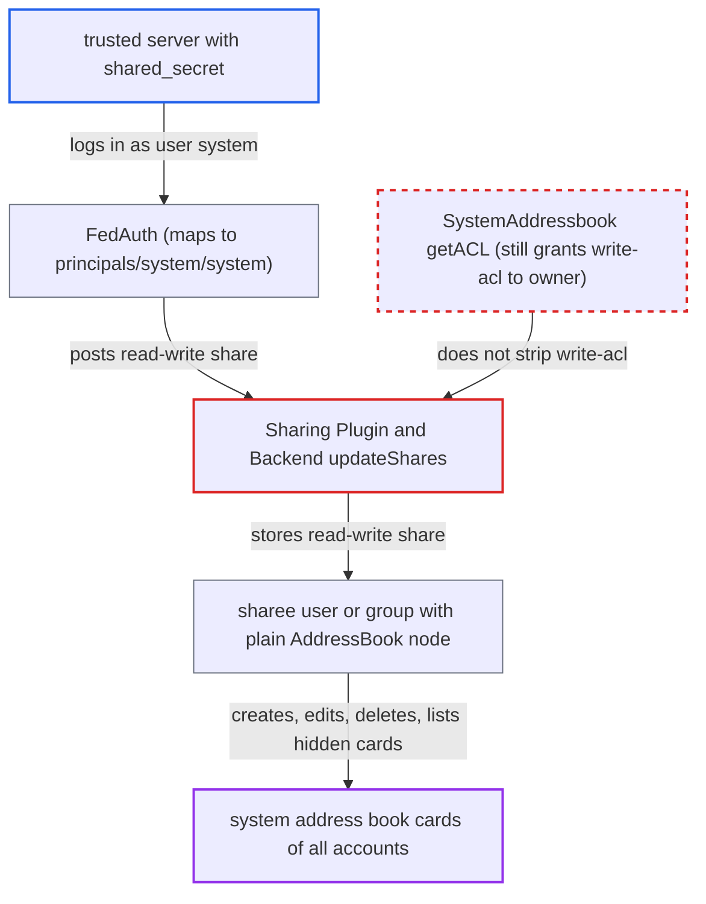

# System address book owner keeps write-acl, letting trusted servers share it read-write

| Field | Value |
|---|---|
| ID | `find_01Hkjax5fXVbDZyPb6XAJCNd` |
| Severity | **High** |
| Status | open |
| CWE | CWE-285 — Improper Authorization |
| Created | 2026-10-27T21:25:49.711492Z |
| Claude Security | https://claude.ai/security/findings/find_01Hkjax5fXVbDZyPb6XAJCNd |

## Description

A server on the trusted-server list can share the read-only system address book read-write with any local user or group. That user or group can then create, change or delete every account's card, and can list cards the enumeration settings and guest filter hide. The cause is `SystemAddressbook::getACL()`, which removes only `{DAV:}write` and `{DAV:}all`, so the owner keeps `{DAV:}write-acl`.

1. **attacker with a trusted server's `shared_secret`** authenticates to the DAV server as user `system`. `FedAuth` accepts Basic user `system` with any trusted server's `shared_secret` and maps it to `principals/system/system`, the owner of the system address book. ([`apps/federation/lib/DAV/FedAuth.php:26-47`](https://github.com/cx-benchmark/server/blob/6b6317280f8ed50277369c33cee070a643d29654/apps/federation/lib/DAV/FedAuth.php#L26-L47))
2. **attacker** sends a share POST to `/remote.php/dav/addressbooks/system/system/system`. The body is an `oc:share`/`oc:set` XML with `principal:principals/users/<account>` and `<oc:read-write/>`.
3. **the sharing plugin** authorises the POST on `{DAV:}write-acl` alone. The system book's ACL still contains the owner's `{DAV:}write-acl` entry, because `SystemAddressbook::getACL()` strips only `{DAV:}write` and `{DAV:}all`. ([`apps/dav/lib/CardDAV/SystemAddressbook.php:337-344`](https://github.com/cx-benchmark/server/blob/6b6317280f8ed50277369c33cee070a643d29654/apps/dav/lib/CardDAV/SystemAddressbook.php#L337-L344))
4. **`AddressBook::updateShares()`** passes the request to the sharing backend. It refuses only when `isShared()` is true, and the system book has no `owner-principal` key, so `isShared()` is false. ([`apps/dav/lib/CardDAV/AddressBook.php:67-72`](https://github.com/cx-benchmark/server/blob/6b6317280f8ed50277369c33cee070a643d29654/apps/dav/lib/CardDAV/AddressBook.php#L67-L72))
5. **`Sharing\Backend::updateShares()`** stores an `ACCESS_READ_WRITE` share for the chosen user or group. It accepts any existing local user or group and does not check that the book is the read-only system book. ([`apps/dav/lib/DAV/Sharing/Backend.php:53-91`](https://github.com/cx-benchmark/server/blob/6b6317280f8ed50277369c33cee070a643d29654/apps/dav/lib/DAV/Sharing/Backend.php#L53-L91))
6. **`UserAddressBooks::getChildren()`** gives the sharee a plain `AddressBook` named `system_shared_by_system`. The restricted `SystemAddressbook` is built only when `principaluri` is `principals/system/system`, so the sharee's node grants `{DAV:}write` and lists all children unfiltered. ([`apps/dav/lib/CardDAV/UserAddressBooks.php:86-104`](https://github.com/cx-benchmark/server/blob/6b6317280f8ed50277369c33cee070a643d29654/apps/dav/lib/CardDAV/UserAddressBooks.php#L86-L104))
7. **the sharee account** creates, changes or deletes cards under `addressbooks/users/<account>/system_shared_by_system/`. This reaches every account's card in the system address book.

## Assessment

The attacker runs or has compromised a server on the instance's trusted-server list and knows its shared secret. To profit, it also needs a local account, or it picks chosen users or groups as sharees. The `federation` app is enabled by default. `Principal::findByUri()` needs no user session unless `shareapi_only_share_with_group_members` is on, and that setting is off by default. No victim action is needed. The same root cause covers the other address books under `principals/system/system`, the synced trusted-server books. The report assumes Sabre's DAVACL `checkPrivileges()` grants a privilege when an ACE names the current principal, and it could not check this because sabre/dav 4.x is not in the checkout. Before commit `5e4750494` the share POST needed `{DAV:}write`, which `SystemAddressbook` stripped, so this is a regression.

Impact: The chosen account, or every member of the chosen group, gets write access to the whole system address book. It can change names, emails or phone numbers of any account, or delete their cards. It can also list cards hidden by the `shareapi_*enumeration*` settings and the guest filter. Altered cards stay altered until `SyncService::updateUser()` runs for that account. Private-scope profile data is not exposed.

## Recommendation

(1) `SystemAddressbook::getACL()` leaves `{DAV:}write-acl` and `{DAV:}write-properties` for the owner principal and for `{DAV:}authenticated`. The system address book is meant to be read-only, and the owner principal is the identity trusted federated servers use.

Fix criteria: No principal other than the instance itself, which is not reachable over DAV, holds write-acl or write-properties on the system address book. A share POST or PROPPATCH on `/addressbooks/system/system/system`, authenticated as a trusted server or as any local user, is rejected with 403 or 404. The `dav_shares` table contains no row with type=addressbook for the system address book id.

(2) `AddressBook::updateShares()` and `isShared()` treat the system address book like any user-owned book, so it can be shared whenever the ACL permits. Sharees then get a plain `AddressBook` node with write access instead of the restricted `SystemAddressbook`.

Fix criteria: The backend refuses sharing of address books owned by `principals/system/system`, whatever the ACL says. Address books whose owner-principal is `principals/system/system` are always built as the read-only `SystemAddressbook` (or ignored) when listed for a sharee. No path gives `{DAV:}write` or an unfiltered child listing on the system address book.

## Evidence

**https://github.com/cx-benchmark/server**

- [`apps/dav/lib/CardDAV/SystemAddressbook.php:337-344`](https://github.com/cx-benchmark/server/blob/6b6317280f8ed50277369c33cee070a643d29654/apps/dav/lib/CardDAV/SystemAddressbook.php#L337-L344)
- [`apps/dav/lib/CardDAV/AddressBook.php:94-128`](https://github.com/cx-benchmark/server/blob/6b6317280f8ed50277369c33cee070a643d29654/apps/dav/lib/CardDAV/AddressBook.php#L94-L128)
- [`apps/dav/lib/DAV/Sharing/Plugin.php:146-151`](https://github.com/cx-benchmark/server/blob/6b6317280f8ed50277369c33cee070a643d29654/apps/dav/lib/DAV/Sharing/Plugin.php#L146-L151)
- [`apps/dav/lib/CardDAV/AddressBook.php:67-72`](https://github.com/cx-benchmark/server/blob/6b6317280f8ed50277369c33cee070a643d29654/apps/dav/lib/CardDAV/AddressBook.php#L67-L72)
- [`apps/dav/lib/DAV/Sharing/Backend.php:53-91`](https://github.com/cx-benchmark/server/blob/6b6317280f8ed50277369c33cee070a643d29654/apps/dav/lib/DAV/Sharing/Backend.php#L53-L91)
- [`apps/federation/lib/DAV/FedAuth.php:26-47`](https://github.com/cx-benchmark/server/blob/6b6317280f8ed50277369c33cee070a643d29654/apps/federation/lib/DAV/FedAuth.php#L26-L47)
- [`apps/dav/lib/CardDAV/CardDavBackend.php:138-185`](https://github.com/cx-benchmark/server/blob/6b6317280f8ed50277369c33cee070a643d29654/apps/dav/lib/CardDAV/CardDavBackend.php#L138-L185)
- [`apps/dav/lib/CardDAV/UserAddressBooks.php:86-104`](https://github.com/cx-benchmark/server/blob/6b6317280f8ed50277369c33cee070a643d29654/apps/dav/lib/CardDAV/UserAddressBooks.php#L86-L104)

