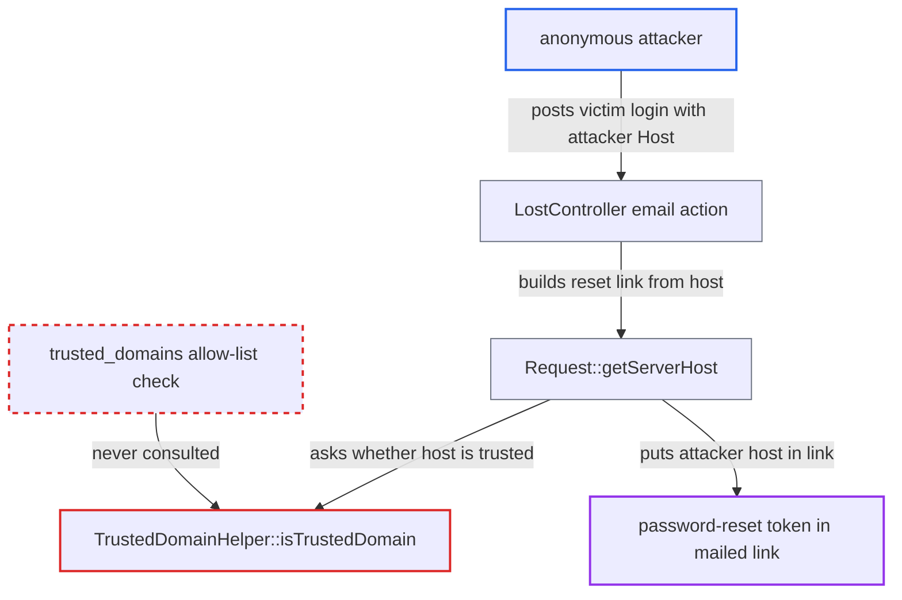

# Trusted-domain check bypassed when overwritehost is set but overwritecondaddr does not match

| Field | Value |
|---|---|
| ID | `find_01LH5ouNjqhaPj4u5A3M7S7u` |
| Severity | **High** |
| Status | open |
| CWE | CWE-644 — Host header injection |
| Created | 2026-10-27T21:23:45.542854Z |
| Claude Security | https://claude.ai/security/findings/find_01LH5ouNjqhaPj4u5A3M7S7u |

## Description

An anonymous attacker can make Nextcloud email a password-reset link that points at the attacker's server to a chosen user. If the user clicks it, the attacker gets the one-time token and can set a new password for that account. This works only when `overwritehost` is set together with an `overwritecondaddr` that does not match the attacker's address. The cause is `TrustedDomainHelper::isTrustedDomain()`, which trusts any host whenever `overwritehost` is non-empty.

1. **attacker** sends a raw POST to `/lostpassword/email` with the victim's login and `Host: attacker.example`. The request comes from an address that does not match `overwritecondaddr`. The `OCS-APIRequest` header gets it past the CSRF check. ([`core/Controller/LostController.php:254-258`](https://github.com/cx-benchmark/server/blob/6b6317280f8ed50277369c33cee070a643d29654/core/Controller/LostController.php#L254-L258))
2. **`Request::isOverwriteCondition()`** returns false for the attacker's `REMOTE_ADDR`. `getOverwriteHost()` therefore returns null, and the configured `overwritehost` is not used for this request. ([`lib/private/AppFramework/Http/Request.php:583-587`](https://github.com/cx-benchmark/server/blob/6b6317280f8ed50277369c33cee070a643d29654/lib/private/AppFramework/Http/Request.php#L583-L587))
3. **`Request::getServerHost()`** falls back to the raw request host. It takes the host from `getInsecureServerHost()` and returns it if `isTrustedDomain()` says it is trusted. ([`lib/private/AppFramework/Http/Request.php:753-776`](https://github.com/cx-benchmark/server/blob/6b6317280f8ed50277369c33cee070a643d29654/lib/private/AppFramework/Http/Request.php#L753-L776))
4. **`TrustedDomainHelper::isTrustedDomain()`** approves the attacker's host. It returns `true` for any host as soon as `overwritehost` is non-empty, so `trusted_domains` is never checked. The global gate in `lib/OC.php` uses the same helper and does not stop the request either. ([`lib/private/Security/TrustedDomainHelper.php:58-62`](https://github.com/cx-benchmark/server/blob/6b6317280f8ed50277369c33cee070a643d29654/lib/private/Security/TrustedDomainHelper.php#L58-L62))
5. **`URLGenerator::getBaseUrl()`** builds absolute URLs on the attacker's host. It takes the base of every absolute URL from `getServerHost()`. ([`lib/private/URLGenerator.php:266-271`](https://github.com/cx-benchmark/server/blob/6b6317280f8ed50277369c33cee070a643d29654/lib/private/URLGenerator.php#L266-L271))
6. **`LostController::email()`** mails the victim a reset link containing the one-time token on `attacker.example`. The link is built with `linkToRouteAbsolute('core.lost.resetform', ...)`, so the mail is genuine but its link points at the attacker's server. ([`core/Controller/LostController.php:254-258`](https://github.com/cx-benchmark/server/blob/6b6317280f8ed50277369c33cee070a643d29654/core/Controller/LostController.php#L254-L258))
7. **attacker** takes the token from the victim's click and calls `setPassword`. The victim must click the link, which sends the token to the attacker's server. The attacker then sets a new password for that account.

## Assessment

The attacker is anonymous and needs no account. The attacker needs network access to the server from an address that does not match `overwritecondaddr`. The deployment must set `overwritehost` together with an `overwritecondaddr` that does not match that address, which the attacker does not control. The victim must also click the link in the mail. The same short-circuit means `isTrustedUrl()` accepts any `Origin` in `LoginController::tryLogin()` whenever `overwritehost` is set. Every absolute link built during a poisoned request carries the attacker's host: `getAbsoluteURL()`, `linkToRouteAbsolute()`, `linkToOCSRouteAbsolute()` and `linkToRemote()`.

Impact: The attacker can take over one account for each poisoned mail the victim opens. For a user without second-factor login, that means full access to the user's files, shares, calendars and contacts. For an admin, it means control of the instance. Availability is affected only because the victim loses access to their own account.

## Recommendation

`TrustedDomainHelper::isTrustedDomain()` trusts any host whenever `overwritehost` is configured. `Request::getServerHost()` applies `overwritehost` only when the `overwritecondaddr` condition matches, so a request that fails the condition escapes the `trusted_domains` allow-list.

Fix criteria: A request whose `REMOTE_ADDR` does not satisfy `overwritecondaddr` has its `Host` and `X-Forwarded-Host` checked against `trusted_domains`, exactly as when `overwritehost` is unset. Only the `overwritehost` value itself, or a request the override actually applies to, may skip the check. To verify, configure `overwritehost` with a non-matching `overwritecondaddr` and send a password-reset request with `Host: attacker.example`. The request must be rejected as an untrusted domain. Any URL generated must use a configured trusted domain.

## Evidence

**https://github.com/cx-benchmark/server**

- [`lib/private/Security/TrustedDomainHelper.php:58-62`](https://github.com/cx-benchmark/server/blob/6b6317280f8ed50277369c33cee070a643d29654/lib/private/Security/TrustedDomainHelper.php#L58-L62)
- [`lib/private/AppFramework/Http/Request.php:753-776`](https://github.com/cx-benchmark/server/blob/6b6317280f8ed50277369c33cee070a643d29654/lib/private/AppFramework/Http/Request.php#L753-L776)
- [`lib/private/AppFramework/Http/Request.php:583-587`](https://github.com/cx-benchmark/server/blob/6b6317280f8ed50277369c33cee070a643d29654/lib/private/AppFramework/Http/Request.php#L583-L587)
- [`lib/private/URLGenerator.php:266-271`](https://github.com/cx-benchmark/server/blob/6b6317280f8ed50277369c33cee070a643d29654/lib/private/URLGenerator.php#L266-L271)
- [`core/Controller/LostController.php:254-258`](https://github.com/cx-benchmark/server/blob/6b6317280f8ed50277369c33cee070a643d29654/core/Controller/LostController.php#L254-L258)
- [`lib/OC.php:937-945`](https://github.com/cx-benchmark/server/blob/6b6317280f8ed50277369c33cee070a643d29654/lib/OC.php#L937-L945)

