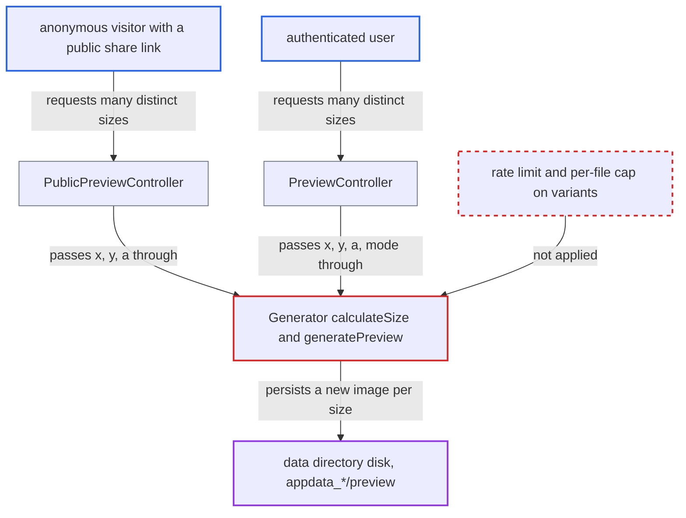

# Unbounded persistent preview variants let any requester fill preview storage

| Field | Value |
|---|---|
| ID | `find_01LxpnjE2xeYJDFn2ZR9RYU1` |
| Severity | **High** |
| Status | open |
| CWE | CWE-770 — Resource exhaustion |
| Created | 2026-10-27T21:25:54.842086Z |
| Claude Security | https://claude.ai/security/findings/find_01LxpnjE2xeYJDFn2ZR9RYU1 |

## Description

An anonymous visitor with any public share link to an image, or any logged-in user on their own files, can fill the server's data disk with preview images. Once the disk is full, the instance fails for all users. The cause is `calculateSize()` in `Generator.php`: it leaves one requested dimension unrounded, and nothing limits how many previews are stored per file.

1. **Attacker** requests the maximum preview size from the preview endpoint. A request with `?x=-1&y=-1` tells the attacker the maximum preview width and height, 4096×4096 by default. ([`apps/files_sharing/lib/Controller/PublicPreviewController.php:90-146`](https://github.com/cx-benchmark/server/blob/6b6317280f8ed50277369c33cee070a643d29654/apps/files_sharing/lib/Controller/PublicPreviewController.php#L90-L146))
2. **Attacker** sends many requests where one dimension equals the maximum and the other is varied. For example `?x=W&y=<maxH>` and `?x=<maxW>&y=H` for W and H from 1 to 4095. The `x`, `y` and `a` values go straight from the request to `getPreview()`, and no rate limit is applied. ([`apps/files_sharing/lib/Controller/PublicPreviewController.php:90-146`](https://github.com/cx-benchmark/server/blob/6b6317280f8ed50277369c33cee070a643d29654/apps/files_sharing/lib/Controller/PublicPreviewController.php#L90-L146))
3. **the method `calculateSize()`** skips the power-of-four rounding of the requested size. The rounding is skipped when either dimension equals the max preview dimension. Crop mode is the default, because `$a` defaults to `false`, so the aspect-ratio normalisation is skipped too and the other dimension is used as requested. ([`lib/private/Preview/Generator.php:519-540`](https://github.com/cx-benchmark/server/blob/6b6317280f8ed50277369c33cee070a643d29654/lib/private/Preview/Generator.php#L519-L540))
4. **the method `generatePreview()`** crops the full max preview to the requested size and saves it. Each new combination of width, height and cropped flag is rendered with `cropCopy` and persisted through `savePreview()`. No cap on variants per file exists. ([`lib/private/Preview/Generator.php:564-631`](https://github.com/cx-benchmark/server/blob/6b6317280f8ed50277369c33cee070a643d29654/lib/private/Preview/Generator.php#L564-L631))
5. **the class `LocalPreviewStorage`** writes each variant as a separate file under `appdata_*/preview`. The unique index `previews_file_uniq_idx` treats every distinct width, height and cropped combination as its own stored preview, so each request adds a row and a file. ([`lib/private/Preview/Storage/LocalPreviewStorage.php:48-52`](https://github.com/cx-benchmark/server/blob/6b6317280f8ed50277369c33cee070a643d29654/lib/private/Preview/Storage/LocalPreviewStorage.php#L48-L52))
6. **Attacker** repeats the requests until the disk is full. The files are never pruned, because `BackgroundCleanupJob` only removes previews of deleted files, so storage use only grows.

## Assessment

The attacker needs no account if they hold any public link to an image, or to a folder containing images. They use the public preview endpoint `/apps/files_sharing/publicpreview/<token>`, which passes `PublicShareMiddleware`. Any authenticated user can do the same against their own files through `/core/preview`, without a share. No special setting is needed. Crop mode is the default in both controllers.

Impact: The attacker makes the server write thousands of near-full-size images per source image, up to several GB for one photo. These files are not counted against user quota. A bounded number of requests exhausts the disk holding the data directory, so uploads, database writes on co-located databases, logging and further previews fail for every user. Confidentiality and integrity are not affected.

## Recommendation

(1) `calculateSize()` leaves one requested dimension unrounded, either because it equals the max dimension or because only one dimension is adjusted. The number of cached variants per file is therefore unbounded, and every variant is persisted.

Fix criteria: The set of stored preview sizes per file is bounded and does not depend on request values. Any requested `(x, y, a, mode)` maps onto a small fixed set of stored dimensions, or non-standard sizes are served without being stored. Looping `x` or `y` from 1 to 4096 against one image creates at most a handful of new rows in `oc_previews` and new files under `appdata_*/preview`.

(2) The authenticated and public preview endpoints accept arbitrary size parameters. They apply no rate limiting and no per-file cap on generated previews.

Fix criteria: Requests that would create a new stored variant are rate limited per client or share, or the generator refuses to persist more than a fixed number of variants per file, or both. A burst of distinct-size requests from one anonymous client is throttled or stops creating files.

## Evidence

**https://github.com/cx-benchmark/server**

- [`lib/private/Preview/Generator.php:519-540`](https://github.com/cx-benchmark/server/blob/6b6317280f8ed50277369c33cee070a643d29654/lib/private/Preview/Generator.php#L519-L540)
- [`lib/private/Preview/Generator.php:482-500`](https://github.com/cx-benchmark/server/blob/6b6317280f8ed50277369c33cee070a643d29654/lib/private/Preview/Generator.php#L482-L500)
- [`lib/private/Preview/Generator.php:564-631`](https://github.com/cx-benchmark/server/blob/6b6317280f8ed50277369c33cee070a643d29654/lib/private/Preview/Generator.php#L564-L631)
- [`lib/private/Preview/Storage/LocalPreviewStorage.php:48-52`](https://github.com/cx-benchmark/server/blob/6b6317280f8ed50277369c33cee070a643d29654/lib/private/Preview/Storage/LocalPreviewStorage.php#L48-L52)
- [`apps/files_sharing/lib/Controller/PublicPreviewController.php:90-146`](https://github.com/cx-benchmark/server/blob/6b6317280f8ed50277369c33cee070a643d29654/apps/files_sharing/lib/Controller/PublicPreviewController.php#L90-L146)
- [`core/Controller/PreviewController.php:115-164`](https://github.com/cx-benchmark/server/blob/6b6317280f8ed50277369c33cee070a643d29654/core/Controller/PreviewController.php#L115-L164)
- [`core/Migrations/Version33000Date20250819110529.php:69`](https://github.com/cx-benchmark/server/blob/6b6317280f8ed50277369c33cee070a643d29654/core/Migrations/Version33000Date20250819110529.php#L69)

