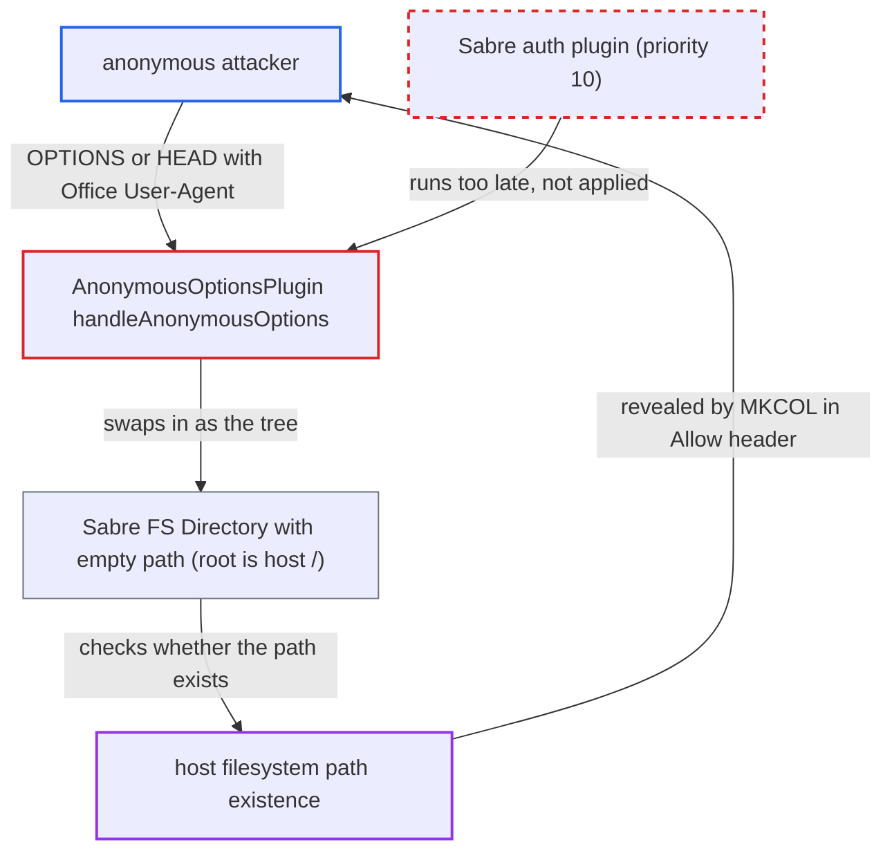

# Anonymous Office OPTIONS/HEAD resolves request path on host filesystem, leaking path existence

| Field | Value |
|---|---|
| ID | `find_01S5o71U6gfSiNn7WhovZFGz` |
| Severity | **Medium** |
| Status | open |
| CWE | CWE-204 — Observable response discrepancy |
| Created | 2026-10-27T21:37:51.489083Z |
| Claude Security | https://claude.ai/security/findings/find_01S5o71U6gfSiNn7WhovZFGz |

## Description

An anonymous internet client can learn whether any chosen path exists on the server's host filesystem. That includes the data directory, account names, and guessed file names in users' private local storage. Only existence leaks, not file content. The attacker needs an `OPTIONS` or `HEAD` request with a `Microsoft Office` User-Agent and no `Authorization` header. The cause is `AnonymousOptionsPlugin::handleAnonymousOptions()`, which answers before login using a tree built from `Sabre\DAV\FS\Directory('')`, so the tree root is the host's `/`.

1. **Anonymous attacker** sends an OPTIONS or HEAD request for a chosen host path. The request has a `User-Agent` containing `Microsoft Office` and no `Authorization` header, and the path has no leading slash, for example `/remote.php/dav/<host path>`. Nothing restricts the path. ([`apps/dav/lib/Connector/Sabre/AnonymousOptionsPlugin.php:46-53`](https://github.com/cx-benchmark/server/blob/6b6317280f8ed50277369c33cee070a643d29654/apps/dav/lib/Connector/Sabre/AnonymousOptionsPlugin.php#L46-L53))
2. **the plugin `AnonymousOptionsPlugin`** runs before authentication on the DAV servers. It is registered on `beforeMethod:*` at priority 9, ahead of the auth plugin at priority 10, so no credentials or share token are needed. The same plugin is added to `/remote.php/dav`, `/remote.php/webdav` and the `public.php` DAV servers. ([`apps/dav/lib/Connector/Sabre/AnonymousOptionsPlugin.php:29-33`](https://github.com/cx-benchmark/server/blob/6b6317280f8ed50277369c33cee070a643d29654/apps/dav/lib/Connector/Sabre/AnonymousOptionsPlugin.php#L29-L33))
3. **the handler `handleAnonymousOptions()`** replaces the server tree with `new Tree(new Directory(''))`. `Sabre\DAV\FS\Directory` is sabre's local-filesystem collection. Its path is `''`, so the tree root is the host's `/`. ([`apps/dav/lib/Connector/Sabre/AnonymousOptionsPlugin.php:55-58`](https://github.com/cx-benchmark/server/blob/6b6317280f8ed50277369c33cee070a643d29654/apps/dav/lib/Connector/Sabre/AnonymousOptionsPlugin.php#L55-L58))
4. **`CorePlugin::httpOptions()`** builds the `Allow` header from the request path. `Server::getAllowedMethods()` looks the path up in the tree and adds `MKCOL` only if the lookup throws `NotFound`. So the header shows whether `/<request path>` exists on the host. ([`apps/dav/lib/Connector/Sabre/AnonymousOptionsPlugin.php:55-58`](https://github.com/cx-benchmark/server/blob/6b6317280f8ed50277369c33cee070a643d29654/apps/dav/lib/Connector/Sabre/AnonymousOptionsPlugin.php#L55-L58))
5. **Anonymous attacker** repeats the request with different paths and reads the `Allow` header. The attacker finds the data directory (the `.ocdata` marker), then account names under `<datadir>/<uid>/`, then guessed names under `<datadir>/<uid>/files/<name>`. No login attempt is made, so nothing throttles the requests.

## Assessment

Any unauthenticated client on the network can attack. It needs no account, share token or special setting. The request must be `OPTIONS` or `HEAD`, carry a `User-Agent` matching `/Microsoft Office/i`, and have no `Authorization` header. The same plugin is reachable on `/remote.php/dav`, `/remote.php/webdav` and the `public.php` DAV servers. The leak is reduced only where PHP `open_basedir` is set, which Nextcloud neither ships nor requires. Confirming guessed names in users' private storage works with the default local primary storage. The report assumes sabre/dav 4.x behaves as described. The `3rdparty` submodule was not checked out.

Impact: An anonymous attacker can tell whether a given path exists on the server host. This reveals install and data directory layout, account names, guessed file names in users' private local storage, OS accounts, processes and backup files. Only existence leaks. No file content is read and nothing is changed. Names must be guessed one request at a time, which limits the loss.

## Recommendation

The pre-authentication Office OPTIONS/HEAD shortcut builds its fake tree from `Sabre\DAV\FS\Directory('')`, which maps to the host filesystem root. `getAllowedMethods()` then resolves the caller's path against it, so the `Allow` header reveals whether that path exists.

Fix criteria: The anonymous OPTIONS/HEAD response is computed without touching the host filesystem and does not depend on whether anything exists at the requested path, for example by using a static header set or an in-memory empty collection. With `User-Agent: Microsoft Office` and no `Authorization` header, `OPTIONS` and `HEAD` for `/remote.php/dav/etc/passwd`, `/remote.php/dav/etc/nonexistent` and `/remote.php/dav/etc` return identical status and `Allow`/`DAV` headers. No `file_exists()` runs on a request-derived path.

## Evidence

**https://github.com/cx-benchmark/server**

- [`apps/dav/lib/Connector/Sabre/AnonymousOptionsPlugin.php:55-58`](https://github.com/cx-benchmark/server/blob/6b6317280f8ed50277369c33cee070a643d29654/apps/dav/lib/Connector/Sabre/AnonymousOptionsPlugin.php#L55-L58)
- [`apps/dav/lib/Connector/Sabre/AnonymousOptionsPlugin.php:46-53`](https://github.com/cx-benchmark/server/blob/6b6317280f8ed50277369c33cee070a643d29654/apps/dav/lib/Connector/Sabre/AnonymousOptionsPlugin.php#L46-L53)
- [`apps/dav/lib/Connector/Sabre/AnonymousOptionsPlugin.php:29-33`](https://github.com/cx-benchmark/server/blob/6b6317280f8ed50277369c33cee070a643d29654/apps/dav/lib/Connector/Sabre/AnonymousOptionsPlugin.php#L29-L33)
- [`apps/dav/lib/Server.php:161-164`](https://github.com/cx-benchmark/server/blob/6b6317280f8ed50277369c33cee070a643d29654/apps/dav/lib/Server.php#L161-L164)
- [`apps/dav/lib/Connector/Sabre/ServerFactory.php:99-100`](https://github.com/cx-benchmark/server/blob/6b6317280f8ed50277369c33cee070a643d29654/apps/dav/lib/Connector/Sabre/ServerFactory.php#L99-L100)
- [`apps/dav/tests/unit/DAV/AnonymousOptionsTest.php:66-70`](https://github.com/cx-benchmark/server/blob/6b6317280f8ed50277369c33cee070a643d29654/apps/dav/tests/unit/DAV/AnonymousOptionsTest.php#L66-L70)
- [`apps/dav/lib/Connector/Sabre/Server.php:223-228`](https://github.com/cx-benchmark/server/blob/6b6317280f8ed50277369c33cee070a643d29654/apps/dav/lib/Connector/Sabre/Server.php#L223-L228)

