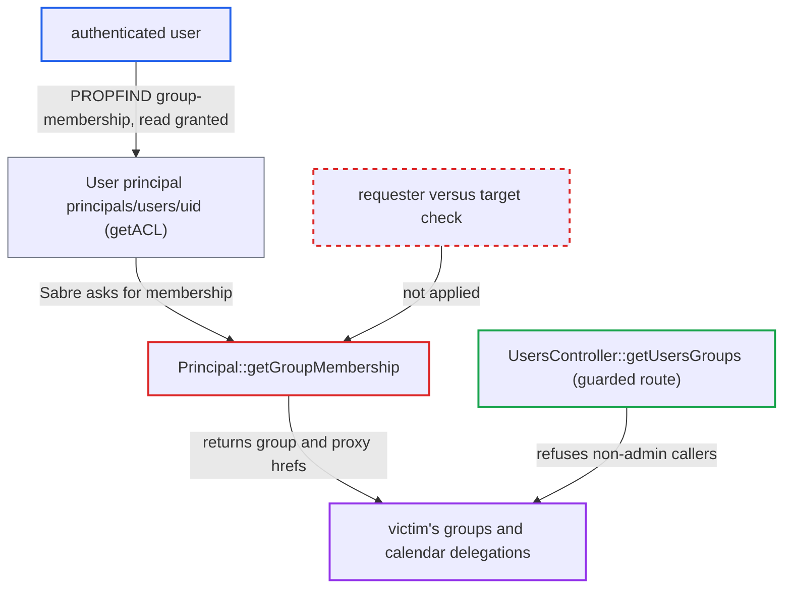

# Any authenticated user can read another user's groups and calendar delegations via DAV principal

| Field | Value |
|---|---|
| ID | `find_01DAqMEirA7i9MyJXzSh6vLZ` |
| Severity | **Medium** |
| Status | open |
| CWE | CWE-359 — Information disclosure |
| Created | 2026-10-27T22:02:06.505337Z |
| Claude Security | https://claude.ai/security/findings/find_01DAqMEirA7i9MyJXzSh6vLZ |

## Description

Any logged-in user can read another user's group memberships and calendar delegations through a DAV request. This includes who is in `admin`, plus department and tenant groups. No setting is needed, and it exposes group and delegation names only, not calendar content. The cause is that `Principal::getGroupMembership()` never compares the requester with the target user.

1. **attacker (any authenticated user)** gets the uid of a victim. The report says the default-on sharee search lists every uid, and any share or comment also shows one.
2. **attacker** sends a PROPFIND for `{DAV:}group-membership` on the victim's principal. The request is `PROPFIND /remote.php/dav/principals/users/<victim>/` with Depth 0 and a body asking for `<d:group-membership/>`.
3. **the principal class `User`** grants read access to every authenticated user. `getACL()` adds a protected `{DAV:}read` entry for `{DAV:}authenticated`, so the attacker passes Sabre's read check. ([`apps/dav/lib/CalDAV/Principal/User.php:32-39`](https://github.com/cx-benchmark/server/blob/6b6317280f8ed50277369c33cee070a643d29654/apps/dav/lib/CalDAV/Principal/User.php#L32-L39))
4. **the plugin `DavAclPlugin`** passes the node to Sabre's ACL `propFind` without a further check. It skips its extra privilege check for `Sabre\CalDAV\Principal\User` nodes, and Sabre answers `{DAV:}group-membership` for any `IPrincipal`. ([`apps/dav/lib/Connector/Sabre/DavAclPlugin.php:74-93`](https://github.com/cx-benchmark/server/blob/6b6317280f8ed50277369c33cee070a643d29654/apps/dav/lib/Connector/Sabre/DavAclPlugin.php#L74-L93))
5. **the backend `Principal::getGroupMembership()`** returns the victim's groups. It returns `principals/groups/<gid>` for every group of the principal named in the path, except hidden ones, and never compares with the requesting user. ([`apps/dav/lib/Connector/Sabre/Principal.php:187-217`](https://github.com/cx-benchmark/server/blob/6b6317280f8ed50277369c33cee070a643d29654/apps/dav/lib/Connector/Sabre/Principal.php#L187-L217))
6. **the trait `PrincipalProxyTrait`** adds the calendar delegation entries to the result. It lists `principals/users/<owner>/calendar-proxy-read|write` for each user who delegated calendar access to the victim. ([`apps/dav/lib/Traits/PrincipalProxyTrait.php:61-86`](https://github.com/cx-benchmark/server/blob/6b6317280f8ed50277369c33cee070a643d29654/apps/dav/lib/Traits/PrincipalProxyTrait.php#L61-L86))

## Assessment

The attacker is any authenticated user with a normal account. No victim action and no non-default setting are needed. They learn a victim uid from the sharee search (on by default), a share or a comment, then send the PROPFIND to the victim's principal. The report assumes `sabre/dav` 4.x, pinned by the `3rdparty` submodule at commit `9a181f79`, which is not checked out. That version is assumed to serve `{DAV:}group-membership` for `IPrincipal` nodes once the read privilege passes, as upstream 4.x does. The backend returns plain strings, so the serialization problem that breaks `group-member-set` on group principals does not apply here.

Impact: The attacker learns the group ids of any account, including `admin` membership, departments and tenants. They also learn who has delegated calendar access to whom. Nothing is written or disrupted, and no calendar content is exposed.

## Recommendation

`Principal::getGroupMembership()` returns the target's groups and proxy relationships to anyone who can read the principal. Every authenticated user can read it, and Sabre exposes `{DAV:}group-membership` and the derived `calendar-proxy-read-for` and `calendar-proxy-write-for` properties with no requester check.

Fix criteria: A non-admin user who sends a PROPFIND for `{DAV:}group-membership`, `calendar-proxy-read-for` or `calendar-proxy-write-for` on another user's principal gets no group or delegation hrefs (empty, 403 or 404). Their own principal still returns full membership. Server-side uses keep working: share resolution in `CalDavBackend` and `CardDavBackend`, and ACL evaluation through `getPrincipalMembership` for the current user.

## Evidence

**https://github.com/cx-benchmark/server**

- [`apps/dav/lib/Connector/Sabre/Principal.php:187-217`](https://github.com/cx-benchmark/server/blob/6b6317280f8ed50277369c33cee070a643d29654/apps/dav/lib/Connector/Sabre/Principal.php#L187-L217)
- [`apps/dav/lib/CalDAV/Principal/User.php:32-39`](https://github.com/cx-benchmark/server/blob/6b6317280f8ed50277369c33cee070a643d29654/apps/dav/lib/CalDAV/Principal/User.php#L32-L39)
- [`apps/dav/lib/Connector/Sabre/DavAclPlugin.php:74-93`](https://github.com/cx-benchmark/server/blob/6b6317280f8ed50277369c33cee070a643d29654/apps/dav/lib/Connector/Sabre/DavAclPlugin.php#L74-L93)
- [`apps/dav/lib/Traits/PrincipalProxyTrait.php:61-86`](https://github.com/cx-benchmark/server/blob/6b6317280f8ed50277369c33cee070a643d29654/apps/dav/lib/Traits/PrincipalProxyTrait.php#L61-L86)
- [`apps/dav/lib/CalDAV/Principal/ProxyRead.php:14-23`](https://github.com/cx-benchmark/server/blob/6b6317280f8ed50277369c33cee070a643d29654/apps/dav/lib/CalDAV/Principal/ProxyRead.php#L14-L23)
- [`apps/provisioning_api/lib/Controller/UsersController.php:1716-1746`](https://github.com/cx-benchmark/server/blob/6b6317280f8ed50277369c33cee070a643d29654/apps/provisioning_api/lib/Controller/UsersController.php#L1716-L1746)
- [`apps/provisioning_api/lib/Controller/AUserDataOCSController.php:94-105`](https://github.com/cx-benchmark/server/blob/6b6317280f8ed50277369c33cee070a643d29654/apps/provisioning_api/lib/Controller/AUserDataOCSController.php#L94-L105)

