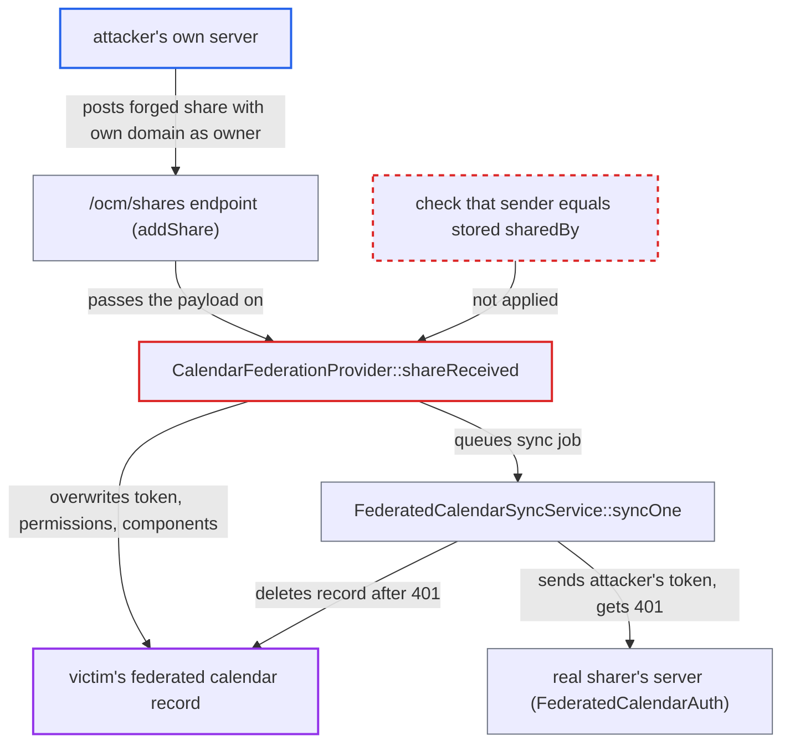

# Any remote server can overwrite another sharer's federated calendar share token and permissions

| Field | Value |
|---|---|
| ID | `find_0197MrMsqzdBSmV8C9umZ7aU` |
| Severity | **Medium** |
| Status | open |
| CWE | CWE-639 — Insecure direct object reference |
| Created | 2026-10-27T21:32:39.165709Z |
| Claude Security | https://claude.ai/security/findings/find_0197MrMsqzdBSmV8C9umZ7aU |

## Description

Anyone running their own internet-reachable server can break a local user's accepted federated calendar share, and the user loses that calendar. The attacker needs the share's URL, and the report says it can be rebuilt from known parts. `CalendarFederationProvider::shareReceived()` picks the stored record using only sender-supplied values and overwrites its `token`, `permissions` and `components` without checking who sent the request.

1. **attacker's server** posts a forged calendar share to the anonymous `/ocm/shares` endpoint. The request sets `shareWith` to the victim, `owner` to a user on the attacker's own domain, and `protocol.url` to the URL of the victim's existing share. ([`apps/cloud_federation_api/lib/Controller/RequestHandlerController.php:102-113`](https://github.com/cx-benchmark/server/blob/6b6317280f8ed50277369c33cee070a643d29654/apps/cloud_federation_api/lib/Controller/RequestHandlerController.php#L102-L113))
2. **`confirmRequestOrigin()`** accepts the request as coming from the attacker's domain. An unsigned request passes when no signatory is stored for that host, and a signed one passes because only the `owner` host must equal the signing origin. ([`lib/private/OCM/OCMDiscoveryService.php:299-320`](https://github.com/cx-benchmark/server/blob/6b6317280f8ed50277369c33cee070a643d29654/lib/private/OCM/OCMDiscoveryService.php#L299-L320))
3. **`shareReceived()`** finds the victim's existing record from the payload alone. It looks up `principals/users/<shareWith>` together with `hash('md5', $calendarUrl)` and calls `findByUri()`, so the sender never has to prove it is the original sharer. ([`apps/dav/lib/CalDAV/Federation/CalendarFederationProvider.php:121-161`](https://github.com/cx-benchmark/server/blob/6b6317280f8ed50277369c33cee070a643d29654/apps/dav/lib/CalDAV/Federation/CalendarFederationProvider.php#L121-L161))
4. **`shareReceived()`** overwrites the stored `token`, `permissions` and `components` with the attacker's values. For a pending invitation it also replaces `displayName`, `color` and `sharedByDisplayName`. For an accepted record it then queues a `FederatedCalendarSyncJob`. ([`apps/dav/lib/CalDAV/Federation/CalendarFederationProvider.php:121-161`](https://github.com/cx-benchmark/server/blob/6b6317280f8ed50277369c33cee070a643d29654/apps/dav/lib/CalDAV/Federation/CalendarFederationProvider.php#L121-L161))
5. **`FederatedCalendarSyncService::syncOne()`** sends the attacker's token to the real sharer's server. The sync job uses the stored token, which is now the attacker's value. ([`apps/dav/lib/CalDAV/Federation/FederatedCalendarSyncService.php:65-84`](https://github.com/cx-benchmark/server/blob/6b6317280f8ed50277369c33cee070a643d29654/apps/dav/lib/CalDAV/Federation/FederatedCalendarSyncService.php#L65-L84))
6. **`FederatedCalendarAuth`** rejects the token with a 401 response. The token is not stored for that remote user and calendar path, so no backend authenticates the request. ([`apps/dav/lib/CalDAV/Federation/FederatedCalendarAuth.php:33-77`](https://github.com/cx-benchmark/server/blob/6b6317280f8ed50277369c33cee070a643d29654/apps/dav/lib/CalDAV/Federation/FederatedCalendarAuth.php#L33-L77))
7. **`FederatedCalendarSyncService::syncOne()`** deletes the victim's federated calendar record. The 401 branch treats the rejection as a lost share and removes the record, so the victim loses the calendar. ([`apps/dav/lib/CalDAV/Federation/FederatedCalendarSyncService.php:65-84`](https://github.com/cx-benchmark/server/blob/6b6317280f8ed50277369c33cee070a643d29654/apps/dav/lib/CalDAV/Federation/FederatedCalendarSyncService.php#L65-L84))

## Assessment

The attacker runs any internet-reachable server and needs no account on the victim's server. They need an existing share and its calendar URL. That URL is built predictably as `<sharer base>/remote.php/dav/remote-calendars/<base64(sharee cloud id)>/<calendar uri>_shared_by_<sharer uid>`. Calendar federation and incoming server-to-server shares are on by default. The only host check, `FederatedCalendarInvitationService::isSameHost()`, runs just on the trusted-server auto-accept path, not before an existing record is overwritten. If the record is still a pending invitation, the overwrite changes the invitation's shown names and colour, and the deletion happens once the victim accepts it. The report assumes the Guzzle 7 client in the `3rdparty` submodule (commit `9a181f79`, not in the checked-out tree) reports a 4xx response as a `ClientException` that carries the status code. The 401 branch in `FederatedCalendarSyncService.php` is written for that behaviour.

Impact: The attacker can replace the stored token, permissions and components of a local user's federated calendar share that came from a different sharer. They can also set the display name, colour and sharer name shown on a pending invitation. The next sync deletes the record, so the victim loses the calendar until the sharer re-shares it and the victim accepts again, and the attack can be repeated. Nothing is disclosed: the remote URL cannot be changed and the real token is never learned.

## Recommendation

Incoming federated calendar shares are matched to existing local records only by the sender-supplied calendar URL and sharee. Updates to an existing record (token, permissions, components, invitation metadata) are applied without verifying that the sender is the sharer who created it.

Fix criteria: An incoming share changes an existing federated calendar record only when its authenticated sender (`owner`/`sharedBy`, tied to the signed origin) equals the stored `sharedBy` and the calendar URL's host matches that sender. Otherwise the share is rejected or kept as a separate invitation. To verify, send a share from another origin for an existing accepted calendar URL. The token, permissions, components and state must stay unchanged, and no sync job may be queued.

## Evidence

**https://github.com/cx-benchmark/server**

- [`apps/dav/lib/CalDAV/Federation/CalendarFederationProvider.php:121-161`](https://github.com/cx-benchmark/server/blob/6b6317280f8ed50277369c33cee070a643d29654/apps/dav/lib/CalDAV/Federation/CalendarFederationProvider.php#L121-L161)
- [`apps/cloud_federation_api/lib/Controller/RequestHandlerController.php:102-113`](https://github.com/cx-benchmark/server/blob/6b6317280f8ed50277369c33cee070a643d29654/apps/cloud_federation_api/lib/Controller/RequestHandlerController.php#L102-L113)
- [`lib/private/OCM/OCMDiscoveryService.php:299-320`](https://github.com/cx-benchmark/server/blob/6b6317280f8ed50277369c33cee070a643d29654/lib/private/OCM/OCMDiscoveryService.php#L299-L320)
- [`apps/dav/lib/CalDAV/Federation/FederatedCalendarSyncService.php:65-84`](https://github.com/cx-benchmark/server/blob/6b6317280f8ed50277369c33cee070a643d29654/apps/dav/lib/CalDAV/Federation/FederatedCalendarSyncService.php#L65-L84)
- [`apps/dav/lib/CalDAV/Federation/FederatedCalendarAuth.php:33-77`](https://github.com/cx-benchmark/server/blob/6b6317280f8ed50277369c33cee070a643d29654/apps/dav/lib/CalDAV/Federation/FederatedCalendarAuth.php#L33-L77)
- [`apps/dav/lib/CalDAV/Federation/FederationSharingService.php:134-137`](https://github.com/cx-benchmark/server/blob/6b6317280f8ed50277369c33cee070a643d29654/apps/dav/lib/CalDAV/Federation/FederationSharingService.php#L134-L137)
- [`apps/dav/lib/CalDAV/Federation/FederatedCalendarInvitationService.php:96-133`](https://github.com/cx-benchmark/server/blob/6b6317280f8ed50277369c33cee070a643d29654/apps/dav/lib/CalDAV/Federation/FederatedCalendarInvitationService.php#L96-L133)

