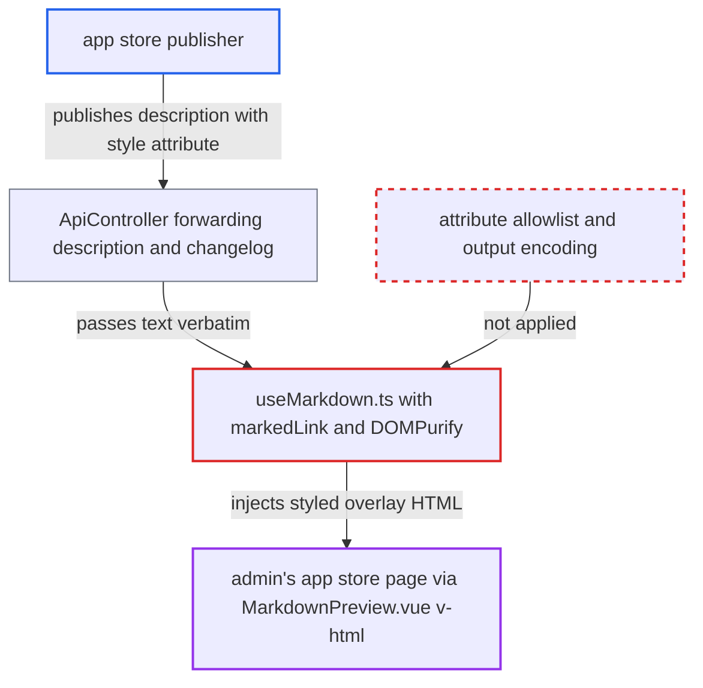

# App store markdown sanitizer allows style/attribute injection in app descriptions

| Field | Value |
|---|---|
| ID | `find_01PdmDT6U3gKCaLEiwtxUY4L` |
| Severity | **Medium** |
| Status | open |
| CWE | CWE-79 — Cross-site scripting |
| Created | 2026-10-27T21:52:45.201196Z |
| Claude Security | https://claude.ai/security/findings/find_01PdmDT6U3gKCaLEiwtxUY4L |

## Description

Anyone who can publish or update an app on the Nextcloud app store can change how an admin's app store page looks. They can cover the page with a fake screen or send the admin's clicks to an attacker-chosen `https://` link. Scripts do not run. The cause is that `useMarkdown.ts` sanitizes tags only, so `style` and `id` attributes survive. Its custom renderers such as `markedLink` also put raw text into the HTML.

1. **app publisher** puts HTML or markdown with a `style` attribute into an app's `description` or release `changelog`. Publishing needs only a free developer account on the app store, not an account on the victim instance, and the report treats the app store's own validation as absent.
2. **backend `ApiController`** forwards the app store text to the admin's browser unchanged. No server-side sanitization is applied to `description` or the changelog text. ([`apps/appstore/lib/Controller/ApiController.php:526`](https://github.com/cx-benchmark/server/blob/6b6317280f8ed50277369c33cee070a643d29654/apps/appstore/lib/Controller/ApiController.php#L526))
3. **renderer `markedLink`** builds link HTML from the raw `href`, raw `title` and raw label `text`. A label such as `[
x](https://a)` therefore turns into literal HTML before sanitizing, and the other custom renderers for headings and blockquotes also emit raw `text`. ([`apps/appstore/src/composables/useMarkdown.ts:73-91`](https://github.com/cx-benchmark/server/blob/6b6317280f8ed50277369c33cee070a643d29654/apps/appstore/src/composables/useMarkdown.ts#L73-L91))
4. **DOMPurify in `useMarkdown.ts`** filters tags but keeps attributes such as `style`, `id`, `class` and `name`. Only `ALLOWED_TAGS` is set, so DOMPurify's default attribute list stays in force and it is the only barrier left. ([`apps/appstore/src/composables/useMarkdown.ts:34-60`](https://github.com/cx-benchmark/server/blob/6b6317280f8ed50277369c33cee070a643d29654/apps/appstore/src/composables/useMarkdown.ts#L34-L60))
5. **`MarkdownPreview.vue`** inserts the sanitized string into the page with `v-html`. The same component shows the text in `AppDescriptionTab.vue`, `AppReleasesTab.vue` and `UpdateAllDialog.vue`. ([`apps/appstore/src/components/MarkdownPreview.vue:28`](https://github.com/cx-benchmark/server/blob/6b6317280f8ed50277369c33cee070a643d29654/apps/appstore/src/components/MarkdownPreview.vue#L28))
6. **Nextcloud default CSP** lets the injected `style` attribute take effect. `style-src 'unsafe-inline'` and `img-src data:` are allowed, so a full-screen fixed-position element can paint an SVG from a `data:` URI over the admin UI. ([`lib/public/AppFramework/Http/ContentSecurityPolicy.php:43-53`](https://github.com/cx-benchmark/server/blob/6b6317280f8ed50277369c33cee070a643d29654/lib/public/AppFramework/Http/ContentSecurityPolicy.php#L43-L53))
7. **admin** opens the app's details in the app store. This is a routine action, and the overlay then covers the settings UI and sends clicks to the attacker's page. ([`apps/appstore/src/components/AppstoreSidebar/AppDescriptionTab.vue:29`](https://github.com/cx-benchmark/server/blob/6b6317280f8ed50277369c33cee070a643d29654/apps/appstore/src/components/AppstoreSidebar/AppDescriptionTab.vue#L29))

## Assessment

The attacker is anyone able to publish or update an app on the Nextcloud app store. They need no account on the victim instance. A Nextcloud admin must open that app's details in the app store, or view its release changelog, which is routine. The attack works over the internet against default deployments. The report assumes `marked` `^18.1.1` and `dompurify` `^3.4.17` as pinned in `package.json`, since `node_modules` was not present. It also treats the app store's server-side validation of `description` as absent, because it is unknown.

Impact: The attacker controls the content and layout of the admin's app store page. They can overlay or hide real controls, show fake screens such as a session-expired or re-login page, shadow element ids that the page's scripts look up with `id` or `name` attributes, and send clicks to an attacker-chosen `https://` link. The nonce-based `script-src` blocks script execution, and `javascript:` links are rejected. The report found no direct data disclosure and no change to server state, only a limited loss of integrity of the admin UI.

## Recommendation

(1) DOMPurify in `useMarkdown.ts` is configured with a tag allowlist only. The default attribute allowlist, including `style`, `id`, `name` and `class`, therefore applies to untrusted app store markdown.

Fix criteria: Sanitization restricts attributes to an explicit minimal allowlist, for example `href`, `title` and `rel` on `a`. No `style`, `id`, `name`, `class` or event attributes survive. A description containing `
` or `[x](<https://a/" style="position:fixed">)` renders with no `style` attribute in the resulting DOM.

(2) The custom marked renderers `markedLink`, the heading renderer and `markedBlockquote` emit raw `href`, `title` and unrendered token `text`. This bypasses marked's output encoding and allows attribute and tag injection before sanitization.

Fix criteria: The renderers HTML-encode `title`, URL-encode or clean `href`, and render the label with `parser.parseInline(tokens)` or escape `text`, instead of splicing in raw strings. `[x](https://a 'y" style="z')` and a label containing `<` produce encoded output with no injected attributes, even before DOMPurify runs.

## Evidence

**https://github.com/cx-benchmark/server**

- [`apps/appstore/src/composables/useMarkdown.ts:34-60`](https://github.com/cx-benchmark/server/blob/6b6317280f8ed50277369c33cee070a643d29654/apps/appstore/src/composables/useMarkdown.ts#L34-L60)
- [`apps/appstore/src/composables/useMarkdown.ts:73-91`](https://github.com/cx-benchmark/server/blob/6b6317280f8ed50277369c33cee070a643d29654/apps/appstore/src/composables/useMarkdown.ts#L73-L91)
- [`apps/appstore/src/components/MarkdownPreview.vue:28`](https://github.com/cx-benchmark/server/blob/6b6317280f8ed50277369c33cee070a643d29654/apps/appstore/src/components/MarkdownPreview.vue#L28)
- [`apps/appstore/src/components/AppstoreSidebar/AppDescriptionTab.vue:29`](https://github.com/cx-benchmark/server/blob/6b6317280f8ed50277369c33cee070a643d29654/apps/appstore/src/components/AppstoreSidebar/AppDescriptionTab.vue#L29)
- [`apps/appstore/src/components/AppstoreSidebar/AppReleasesTab.vue:48-51`](https://github.com/cx-benchmark/server/blob/6b6317280f8ed50277369c33cee070a643d29654/apps/appstore/src/components/AppstoreSidebar/AppReleasesTab.vue#L48-L51)
- [`apps/appstore/lib/Controller/ApiController.php:526`](https://github.com/cx-benchmark/server/blob/6b6317280f8ed50277369c33cee070a643d29654/apps/appstore/lib/Controller/ApiController.php#L526)
- [`lib/public/AppFramework/Http/ContentSecurityPolicy.php:43-53`](https://github.com/cx-benchmark/server/blob/6b6317280f8ed50277369c33cee070a643d29654/lib/public/AppFramework/Http/ContentSecurityPolicy.php#L43-L53)

