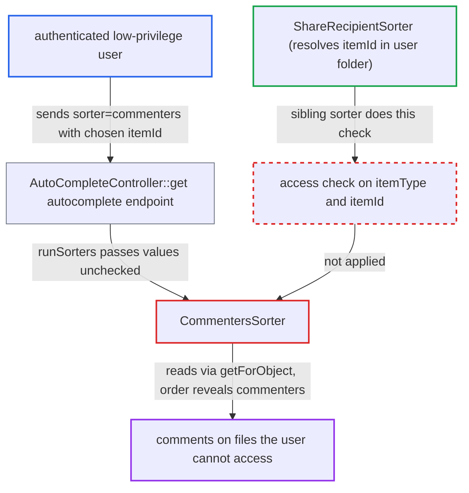

# Autocomplete commenters sorter leaks who commented on files the caller cannot access

| Field | Value |
|---|---|
| ID | `find_01Tc8edPSSpKS1xVJaPd4Fmz` |
| Severity | **Medium** |
| Status | open |
| CWE | CWE-639 — Insecure direct object reference |
| Created | 2026-10-27T21:25:25.237009Z |
| Claude Security | https://claude.ai/security/findings/find_01Tc8edPSSpKS1xVJaPd4Fmz |

## Description

Any logged-in user can learn which users commented on files they cannot access, and roughly how many comments each wrote. Only this limited metadata leaks, not comment text, file names or contents. The sorter `CommentersSorter` reads comments for a caller-chosen `itemType` and `itemId` and never checks that the caller can access that object.

1. **Authenticated user** calls the autocomplete endpoint with the commenters sorter. The request is `GET /ocs/v2.php/core/autocomplete/get?search=<prefix>&sorter=commenters&itemType=files&itemId=<N>`, where `N` is a file id the user cannot access. ([`core/Controller/AutoCompleteController.php:56-74`](https://github.com/cx-benchmark/server/blob/6b6317280f8ed50277369c33cee070a643d29654/core/Controller/AutoCompleteController.php#L56-L74))
2. **the controller `AutoCompleteController::get`** passes `itemType`, `itemId` and the sorter name on to `runSorters()`. The route is `#[NoAdminRequired]` and does no access check on the object. ([`core/Controller/AutoCompleteController.php:56-74`](https://github.com/cx-benchmark/server/blob/6b6317280f8ed50277369c33cee070a643d29654/core/Controller/AutoCompleteController.php#L56-L74))
3. **the sorter `CommentersSorter::sort()`** loads all comments on the object through `retrieveCommentsInformation()` and counts them per `actor_id`. It calls `ICommentsManager::getForObject($type, $id)`, which returns every comment on the object with no authorization. ([`apps/comments/lib/Collaboration/CommentersSorter.php:32-88`](https://github.com/cx-benchmark/server/blob/6b6317280f8ed50277369c33cee070a643d29654/apps/comments/lib/Collaboration/CommentersSorter.php#L32-L88))
4. **the manager `getForObject()`** returns every comment for any object type and id. It leaves access control to its callers, and `CommentersSorter` does none. ([`lib/private/Comments/Manager.php:327-370`](https://github.com/cx-benchmark/server/blob/6b6317280f8ed50277369c33cee070a643d29654/lib/private/Comments/Manager.php#L327-L370))
5. **the sorter method `compare()`** moves users with more comments on the object to the top of the result list. The hidden comment counts therefore show in the order of the response. ([`apps/comments/lib/Collaboration/CommentersSorter.php:90-97`](https://github.com/cx-benchmark/server/blob/6b6317280f8ed50277369c33cee070a643d29654/apps/comments/lib/Collaboration/CommentersSorter.php#L90-L97))
6. **Authenticated user** compares the order with a baseline request made without the sorter. Users who moved up commented on file `N`. Repeating this over sequential file ids maps who comments on which files.

## Assessment

The attacker is any authenticated user with no special role. The comments app is enabled by default and registers the sorter, and `ocs/v1.php` loads every app, so the sorter is available on each OCS request. The attack works with default user enumeration, where the results contain several users. File ids are sequential integers, so the attacker can sweep them. The report also says other apps that store data in the shared `comments` table under other object types would leak the same way through arbitrary `itemType` values. It names Talk's `chat`, which is not in this repository.

Impact: For files the attacker cannot access, the attacker learns whether a file id has comments, which enumerable users commented on it, and their relative comment counts. Comment text, file names and file contents stay hidden. Nothing is modified and service is not affected.

## Recommendation

`CommentersSorter` reads comment data for a caller-chosen `(itemType, itemId)` without checking that the current user may read comments on that object. The ordering of the autocomplete response then reveals comments on objects outside the caller's access.

Fix criteria: The sorter changes ordering only when the current user is authorized to read comments on the object. For `files`, the id must resolve in the user's folder, the same check the DAV comments entity collection applies. Object types the sorter cannot authorize are ignored. Verify that a user without access to file F gets the same order with and without `sorter=commenters&itemType=files&itemId=F`. Also verify that a user with access still sees commenters first.

## Evidence

**https://github.com/cx-benchmark/server**

- [`apps/comments/lib/Collaboration/CommentersSorter.php:32-88`](https://github.com/cx-benchmark/server/blob/6b6317280f8ed50277369c33cee070a643d29654/apps/comments/lib/Collaboration/CommentersSorter.php#L32-L88)
- [`apps/comments/lib/Collaboration/CommentersSorter.php:90-97`](https://github.com/cx-benchmark/server/blob/6b6317280f8ed50277369c33cee070a643d29654/apps/comments/lib/Collaboration/CommentersSorter.php#L90-L97)
- [`core/Controller/AutoCompleteController.php:56-74`](https://github.com/cx-benchmark/server/blob/6b6317280f8ed50277369c33cee070a643d29654/core/Controller/AutoCompleteController.php#L56-L74)
- [`lib/private/Comments/Manager.php:327-370`](https://github.com/cx-benchmark/server/blob/6b6317280f8ed50277369c33cee070a643d29654/lib/private/Comments/Manager.php#L327-L370)
- [`apps/files_sharing/lib/Collaboration/ShareRecipientSorter.php:36-45`](https://github.com/cx-benchmark/server/blob/6b6317280f8ed50277369c33cee070a643d29654/apps/files_sharing/lib/Collaboration/ShareRecipientSorter.php#L36-L45)
- [`apps/comments/lib/Listener/CommentsEntityEventListener.php:35-38`](https://github.com/cx-benchmark/server/blob/6b6317280f8ed50277369c33cee070a643d29654/apps/comments/lib/Listener/CommentsEntityEventListener.php#L35-L38)
- [`apps/comments/appinfo/info.xml:45-49`](https://github.com/cx-benchmark/server/blob/6b6317280f8ed50277369c33cee070a643d29654/apps/comments/appinfo/info.xml#L45-L49)

