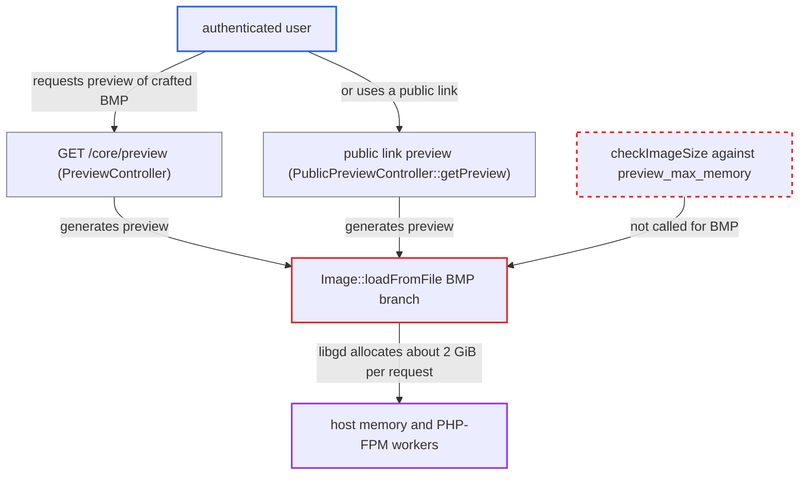

# BMP branch of Image::loadFromFile skips preview_max_memory dimension check

| Field | Value |
|---|---|
| ID | `find_01MUtZxGHQLkT499fVr7Y7KK` |
| Severity | **Medium** |
| Status | open |
| CWE | CWE-770 — Resource exhaustion |
| Created | 2026-10-27T21:33:25.781784Z |
| Claude Security | https://claude.ai/security/findings/find_01MUtZxGHQLkT499fVr7Y7KK |

## Description

A logged-in user can make the server run out of memory and take down the whole Nextcloud instance. They upload a small BMP file that claims huge dimensions and then request its preview several times at once. The weak spot is the BMP branch of `Image::loadFromFile()`, which skips the `preview_max_memory` size check that every other image format gets. The full effect needs PHP built against the system libgd.

1. **Attacker** uploads a crafted RLE8 `.bmp` file. The file is about 17 MB and declares about 46000×46000 pixels. Its last bytes are truncated so that the decode fails only after every pixel has been written.
2. **Attacker** sends concurrent preview requests for the file. The request is `GET /core/preview?fileId=<id>`, which any user may call for their own file. A public link and `/apps/files_sharing/publicpreview/<token>` work as well. ([`core/Controller/PreviewController.php:104-127`](https://github.com/cx-benchmark/server/blob/6b6317280f8ed50277369c33cee070a643d29654/core/Controller/PreviewController.php#L104-L127))
3. **the provider `Preview\Image::getThumbnail()`** accepts the file after a byte-size check only. It checks just the 50 MB `preview_max_filesize_image` limit, and the 17 MB file passes. Dimensions are not looked at here. ([`lib/private/Preview/Image.php:22-42`](https://github.com/cx-benchmark/server/blob/6b6317280f8ed50277369c33cee070a643d29654/lib/private/Preview/Image.php#L22-L42))
4. **the method `Image::loadFromFile()`** calls `imagecreatefrombmp()` without `checkImageSize()`. The `IMAGETYPE_BMP` branch is the only raster branch that skips the check, so the declared `w*h*4` is never compared with `preview_max_memory` (256 MB by default). ([`lib/private/Image.php:696-698`](https://github.com/cx-benchmark/server/blob/6b6317280f8ed50277369c33cee070a643d29654/lib/private/Image.php#L696-L698))
5. **libgd** allocates and fills a canvas of about 2 GiB. libgd builds the whole canvas from the header dimensions before it reads pixel data. With system libgd the memory comes from `malloc`/`calloc`, outside PHP's `memory_limit`.
6. **the generator `Generator::generateProviderPreview()`** stores nothing when the decode fails, so the work repeats. A provider that returns null persists nothing. The truncated BMP therefore costs the same on every later request. Up to one request per CPU runs at a time under the `preview_concurrency_new` semaphore. ([`lib/private/Preview/Generator.php:436-475`](https://github.com/cx-benchmark/server/blob/6b6317280f8ed50277369c33cee070a643d29654/lib/private/Preview/Generator.php#L436-L475))
7. **Host operating system** runs out of memory and its OOM killer stops processes. The concurrent decodes together commit gigabytes of memory, and the OOM killer can take down PHP-FPM workers and other processes.

## Assessment

The attacker must be an authenticated user who can upload a file. The BMP preview provider is on by default, so no configuration is needed. Two routes lead to the flaw. One is `GET /core/preview?fileId=<id>`, which is `#[NoAdminRequired]`. The other is a public link share whose preview is served anonymously by `PublicPreviewController::getPreview` at `/apps/files_sharing/publicpreview/<token>`. The full effect needs PHP linked against the system libgd, which is a deployment condition. The report names the distribution packages and Ubuntu's `php8.3-gd` with `libgd3` 2.3.3 as examples. With PHP's bundled libgd, each request is instead cut off at `memory_limit`. The report assumes that libgd 2.3.3 creates the image from the header dimensions before decoding.

Impact: The attacker can exhaust host memory and cause an instance-wide outage, because the OOM killer can stop PHP-FPM workers and other processes. Because a truncated file is never cached, every request repeats the cost. There is no data disclosure or modification.

## Recommendation

The BMP branch of `Image::loadFromFile()` skips the dimension check against `preview_max_memory` that every other format gets. Attacker-declared BMP dimensions therefore drive libgd's allocation and pixel writes with no limit from the project.

Fix criteria: Before `imagecreatefrombmp()` runs, the BMP's declared width×height is validated against `preview_max_memory` in the same way as for the other formats. The `IMG_BMP` capability is also checked. To verify, load a small RLE8 BMP whose declared dimensions give a `w*h*4` above the limit. `loadFromFile()` must reject it without `imagecreatefrombmp()` being called.

## Evidence

**https://github.com/cx-benchmark/server**

- [`lib/private/Image.php:696-698`](https://github.com/cx-benchmark/server/blob/6b6317280f8ed50277369c33cee070a643d29654/lib/private/Image.php#L696-L698)
- [`lib/private/Image.php:557-595`](https://github.com/cx-benchmark/server/blob/6b6317280f8ed50277369c33cee070a643d29654/lib/private/Image.php#L557-L595)
- [`lib/private/Preview/Image.php:22-42`](https://github.com/cx-benchmark/server/blob/6b6317280f8ed50277369c33cee070a643d29654/lib/private/Preview/Image.php#L22-L42)
- [`lib/private/Image.php:1105-1118`](https://github.com/cx-benchmark/server/blob/6b6317280f8ed50277369c33cee070a643d29654/lib/private/Image.php#L1105-L1118)
- [`lib/private/PreviewManager.php:274-290`](https://github.com/cx-benchmark/server/blob/6b6317280f8ed50277369c33cee070a643d29654/lib/private/PreviewManager.php#L274-L290)
- [`lib/private/PreviewManager.php:325`](https://github.com/cx-benchmark/server/blob/6b6317280f8ed50277369c33cee070a643d29654/lib/private/PreviewManager.php#L325)
- [`lib/private/Preview/Generator.php:436-475`](https://github.com/cx-benchmark/server/blob/6b6317280f8ed50277369c33cee070a643d29654/lib/private/Preview/Generator.php#L436-L475)
- [`core/Controller/PreviewController.php:104-127`](https://github.com/cx-benchmark/server/blob/6b6317280f8ed50277369c33cee070a643d29654/core/Controller/PreviewController.php#L104-L127)

