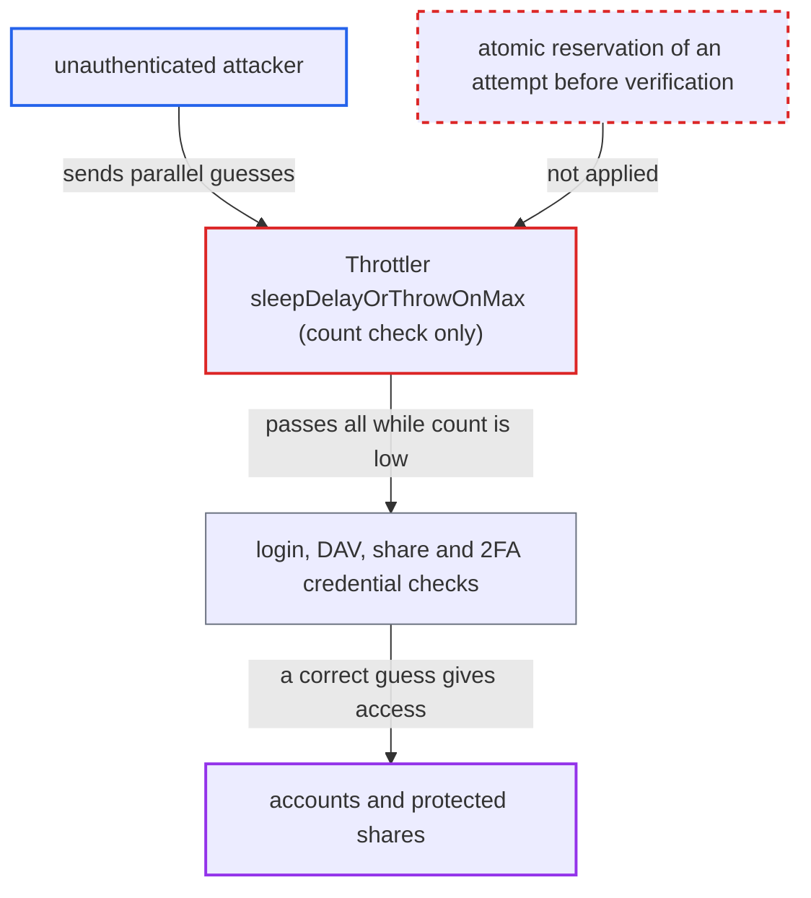

# Brute-force attempt limit is check-then-register; concurrent guesses exceed the cap

| Field | Value |
|---|---|
| ID | `find_01TA9ZzrkiDUWGgVyPDFEoLY` |
| Severity | **Medium** |
| Status | open |
| CWE | CWE-367 — Race condition |
| Created | 2026-10-27T21:54:41.105995Z |
| Claude Security | https://claude.ai/security/findings/find_01TA9ZzrkiDUWGgVyPDFEoLY |

## Description

An unauthenticated attacker can make far more password, share-password or 2FA guesses than the brute-force cap allows. The number of guesses is limited only by how many requests the server handles at once. The attack needs only a parallel burst of requests. The cause is that `Throttler::sleepDelayOrThrowOnMax()` only reads the failed-attempt count, and each caller records a failed attempt only after the credential check.

1. **attacker** loads the login page and gets a request token. The login, Basic-auth and share-password endpoints can be reached without an account.
2. **attacker** sends many parallel guesses for one victim. For example `POST /login`, Basic-auth requests to `remote.php/dav`, or `POST /s/{token}/authenticate`, each carrying a different password.
3. **the method `Throttler::sleepDelayOrThrowOnMax()`** reads the failed-attempt count and lets every request through. It throws `MaxDelayReached` (429) only when more than `auth.bruteforce.max-attempts` (default 10) attempts are recorded in the last 30 minutes. It reserves and records nothing, so every request that arrives while the count is still 10 or lower passes. It also does not sleep. ([`lib/private/Security/Bruteforce/Throttler.php:229-256`](https://github.com/cx-benchmark/server/blob/6b6317280f8ed50277369c33cee070a643d29654/lib/private/Security/Bruteforce/Throttler.php#L229-L256))
4. **the middleware `BruteForceMiddleware`** runs the check in `beforeController` and registers the failure only in `afterController`. The controller verifies the credential in between, so all the parallel requests are checked against the same low count. ([`lib/private/AppFramework/Middleware/Security/BruteForceMiddleware.php:50-69`](https://github.com/cx-benchmark/server/blob/6b6317280f8ed50277369c33cee070a643d29654/lib/private/AppFramework/Middleware/Security/BruteForceMiddleware.php#L50-L69))
5. **the controller** verifies every guess with a slow password hash comparison and returns the real result. The comparison takes 50-300 ms, so the window before any failure is registered is wide and no fine timing is needed. A correct guess in the burst succeeds. ([`lib/private/AppFramework/Middleware/Security/BruteForceMiddleware.php:76-101`](https://github.com/cx-benchmark/server/blob/6b6317280f8ed50277369c33cee070a643d29654/lib/private/AppFramework/Middleware/Security/BruteForceMiddleware.php#L76-L101))
6. **the other credential checks** repeat the same check-then-register order. `Session::logClientIn` checks the count before verification and `handleLoginFailed` registers the failure afterwards. The public share auth classes do the same. ([`lib/private/User/Session.php:410-491`](https://github.com/cx-benchmark/server/blob/6b6317280f8ed50277369c33cee070a643d29654/lib/private/User/Session.php#L410-L491))

## Assessment

The attacker is anonymous and reaches the web login, Basic-auth DAV/OCS login, public share password pages, password confirmation (`sudo`) or 2FA (`solveChallenge`) over the network. No special setting is needed. The cap is `auth.bruteforce.max-attempts` (default 10) per 30 minutes. Per-user rate limiting on `solveChallenge` (`UserRateLimit(5,100)`) is also check-then-register in `Limiter::register`, so it does not stop the burst. With `MemoryCacheBackend` (filed separately) the recorded count is also undercounted, so bursts can be repeated.

Impact: The cap of 11 guesses per 30 minutes holds only for sequential guessing. A parallel burst gives as many verified guesses as the server can handle at once. A weak or reused password, a share password or a 6-digit TOTP code can then be guessed. The code shows only the extra guesses, not a compromise itself.

## Recommendation

The attempt counter is read before the credential is verified and incremented only afterwards, with no atomic reservation. `Throttler::sleepDelayOrThrowOnMax` has no side effect, so concurrent requests all see a count below the cap.

Fix criteria: The number of credential verifications actually performed per subnet, action and window never exceeds `auth.bruteforce.max-attempts` + 1, however many requests run concurrently. One way is to reserve the attempt atomically before verifying and release it on success, since the `postLogin` `resetDelay` hook already exists. Another is to make check-and-increment one atomic backend operation. To confirm, send 50 concurrent wrong guesses from one IP at count 0. At most 11 must reach the password check, and the rest must get 429.

## Evidence

**https://github.com/cx-benchmark/server**

- [`lib/private/Security/Bruteforce/Throttler.php:229-256`](https://github.com/cx-benchmark/server/blob/6b6317280f8ed50277369c33cee070a643d29654/lib/private/Security/Bruteforce/Throttler.php#L229-L256)
- [`lib/private/AppFramework/Middleware/Security/BruteForceMiddleware.php:50-69`](https://github.com/cx-benchmark/server/blob/6b6317280f8ed50277369c33cee070a643d29654/lib/private/AppFramework/Middleware/Security/BruteForceMiddleware.php#L50-L69)
- [`lib/private/AppFramework/Middleware/Security/BruteForceMiddleware.php:76-101`](https://github.com/cx-benchmark/server/blob/6b6317280f8ed50277369c33cee070a643d29654/lib/private/AppFramework/Middleware/Security/BruteForceMiddleware.php#L76-L101)
- [`lib/private/User/Session.php:410-491`](https://github.com/cx-benchmark/server/blob/6b6317280f8ed50277369c33cee070a643d29654/lib/private/User/Session.php#L410-L491)
- [`lib/private/AppFramework/Middleware/PublicShare/PublicShareMiddleware.php:40-46`](https://github.com/cx-benchmark/server/blob/6b6317280f8ed50277369c33cee070a643d29654/lib/private/AppFramework/Middleware/PublicShare/PublicShareMiddleware.php#L40-L46)
- [`apps/dav/lib/Connector/Sabre/PublicAuth.php:64-88`](https://github.com/cx-benchmark/server/blob/6b6317280f8ed50277369c33cee070a643d29654/apps/dav/lib/Connector/Sabre/PublicAuth.php#L64-L88)
- [`lib/private/Security/Bruteforce/Throttler.php:217-225`](https://github.com/cx-benchmark/server/blob/6b6317280f8ed50277369c33cee070a643d29654/lib/private/Security/Bruteforce/Throttler.php#L217-L225)
- [`lib/public/Security/Bruteforce/IThrottler.php:125-136`](https://github.com/cx-benchmark/server/blob/6b6317280f8ed50277369c33cee070a643d29654/lib/public/Security/Bruteforce/IThrottler.php#L125-L136)

