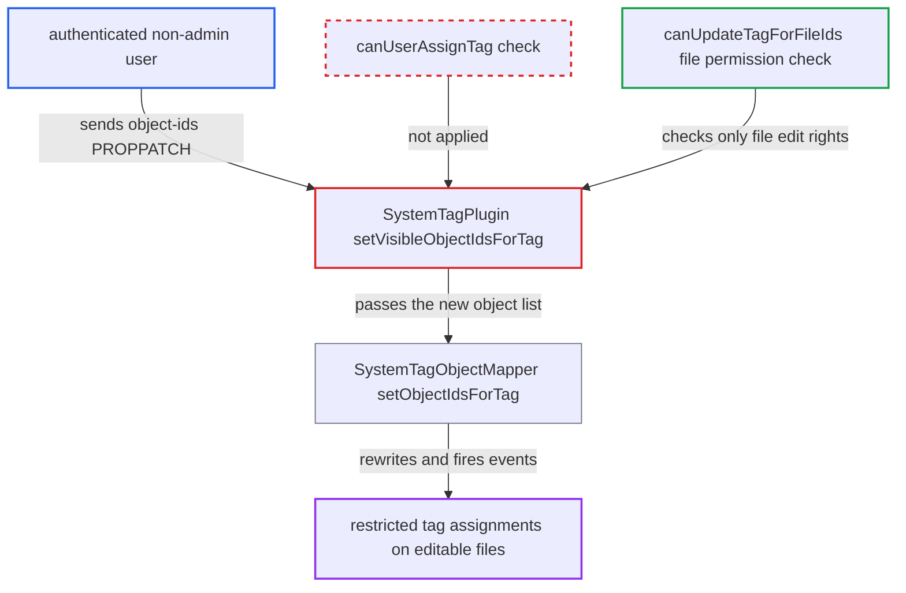

# Bulk object-ids PROPPATCH skips canUserAssignTag, allowing restricted system tag (un)assignment

| Field | Value |
|---|---|
| ID | `find_01V8eEahueFH57TFnYtRuCDR` |
| Severity | **Medium** |
| Status | open |
| CWE | CWE-862 — Missing authorization |
| Created | 2026-10-27T21:24:24.519171Z |
| Claude Security | https://claude.ai/security/findings/find_01V8eEahueFH57TFnYtRuCDR |

## Description

Any logged-in non-admin user can add or remove admin-restricted system tags on files they are allowed to edit, including files shared with them with edit rights. Invisible tags and read-only files are out of reach. The bulk `object-ids` PROPPATCH handler `setVisibleObjectIdsForTag()` checks only file update permission and never checks whether the user may assign the tag.

1. **the attacker** lists visible tags with a PROPFIND on `/remote.php/dav/systemtags/`. Restricted tags show `can-assign=false`, which tells the attacker which tags the UI would block but the server still serves.
2. **the attacker** sends a PROPPATCH of `{http://nextcloud.org/ns}object-ids` to `systemtags/<restrictedId>/files`. The body lists file ids the attacker can edit, or leaves out files that already carry the tag in order to remove it. The handler needs only a logged-in user and passes the ids on. ([`apps/dav/lib/SystemTag/SystemTagPlugin.php:408-453`](https://github.com/cx-benchmark/server/blob/6b6317280f8ed50277369c33cee070a643d29654/apps/dav/lib/SystemTag/SystemTagPlugin.php#L408-L453))
3. **`SystemTagsByIdCollection::getChild()`** resolves the restricted tag for the caller. It checks only `canUserSeeTag()`, which is true for restricted tags, and `SystemTagNode::getChild()` then returns the `files` node without a further check. ([`apps/dav/lib/SystemTag/SystemTagsByIdCollection.php:81-93`](https://github.com/cx-benchmark/server/blob/6b6317280f8ed50277369c33cee070a643d29654/apps/dav/lib/SystemTag/SystemTagsByIdCollection.php#L81-L93))
4. **the method `setVisibleObjectIdsForTag()`** works out the added and removed file ids and checks only file permission. `canUpdateTagForFileIds()` confirms the caller has `PERMISSION_UPDATE` on each file, and `canUserAssignTag()` is never called. ([`apps/dav/lib/SystemTag/SystemTagPlugin.php:534-551`](https://github.com/cx-benchmark/server/blob/6b6317280f8ed50277369c33cee070a643d29654/apps/dav/lib/SystemTag/SystemTagPlugin.php#L534-L551))
5. **`SystemTagObjectMapper::setObjectIdsForTag()`** rewrites the tag's object list and fires assign and unassign events. It deletes and re-inserts the whole mapping and has no authorization check of its own. ([`lib/private/SystemTag/SystemTagObjectMapper.php:303-381`](https://github.com/cx-benchmark/server/blob/6b6317280f8ed50277369c33cee070a643d29654/lib/private/SystemTag/SystemTagObjectMapper.php#L303-L381))

## Assessment

The attacker is any authenticated non-admin user, and no special setting is needed. They find a restricted tag with PROPFIND on `/remote.php/dav/systemtags/`, then send the PROPPATCH on `systemtags/<restrictedId>/files` with ids of files they can edit. To untag, they omit files that are already tagged and writable by them. The shipped frontend uses the same endpoint for bulk tagging and hides restricted tags only on the client (`SystemTagPicker.vue:50`), so calling the endpoint directly bypasses that.

Impact: The attacker can assign or remove admin-restricted tags on files they already have update permission on, including files others share with them with edit rights. This defeats the restricted-tag policy that admins use as a classification and workflow trigger (`apps/workflowengine/lib/Check/FileSystemTags.php`). No data is disclosed and availability is not affected. Any further effect depends on admin workflow rules keyed on the tag, which come from apps outside this repository.

## Recommendation

`SystemTagPlugin::setVisibleObjectIdsForTag()`, called by the `object-ids` PROPPATCH handler, authorizes only on file update permission. It never checks whether the acting user may assign the tag itself, unlike the per-file endpoints.

Fix criteria: Any change to a tag's object list through the `object-ids` PROPPATCH, whether set or remove, is refused with 403 when `ISystemTagManager::canUserAssignTag($tag, $user)` is false, matching `SystemTagsObjectMappingCollection::createFile()` and `SystemTagMappingNode::delete()`. A non-admin outside the tag's groups who sends the PROPPATCH against a restricted tag gets 403, and the `systemtag_object_mapping` rows stay unchanged. Public tags, and allowed group members or admins, still succeed.

## Evidence

**https://github.com/cx-benchmark/server**

- [`apps/dav/lib/SystemTag/SystemTagPlugin.php:534-551`](https://github.com/cx-benchmark/server/blob/6b6317280f8ed50277369c33cee070a643d29654/apps/dav/lib/SystemTag/SystemTagPlugin.php#L534-L551)
- [`apps/dav/lib/SystemTag/SystemTagPlugin.php:408-453`](https://github.com/cx-benchmark/server/blob/6b6317280f8ed50277369c33cee070a643d29654/apps/dav/lib/SystemTag/SystemTagPlugin.php#L408-L453)
- [`apps/dav/lib/SystemTag/SystemTagsByIdCollection.php:81-93`](https://github.com/cx-benchmark/server/blob/6b6317280f8ed50277369c33cee070a643d29654/apps/dav/lib/SystemTag/SystemTagsByIdCollection.php#L81-L93)
- [`apps/dav/lib/SystemTag/SystemTagNode.php:184-186`](https://github.com/cx-benchmark/server/blob/6b6317280f8ed50277369c33cee070a643d29654/apps/dav/lib/SystemTag/SystemTagNode.php#L184-L186)
- [`lib/private/SystemTag/SystemTagObjectMapper.php:303-381`](https://github.com/cx-benchmark/server/blob/6b6317280f8ed50277369c33cee070a643d29654/lib/private/SystemTag/SystemTagObjectMapper.php#L303-L381)
- [`lib/private/SystemTag/SystemTagManager.php:361-388`](https://github.com/cx-benchmark/server/blob/6b6317280f8ed50277369c33cee070a643d29654/lib/private/SystemTag/SystemTagManager.php#L361-L388)
- [`apps/dav/lib/SystemTag/SystemTagsObjectMappingCollection.php:41-58`](https://github.com/cx-benchmark/server/blob/6b6317280f8ed50277369c33cee070a643d29654/apps/dav/lib/SystemTag/SystemTagsObjectMappingCollection.php#L41-L58)
- [`apps/systemtags/src/services/api.ts:205-230`](https://github.com/cx-benchmark/server/blob/6b6317280f8ed50277369c33cee070a643d29654/apps/systemtags/src/services/api.ts#L205-L230)

