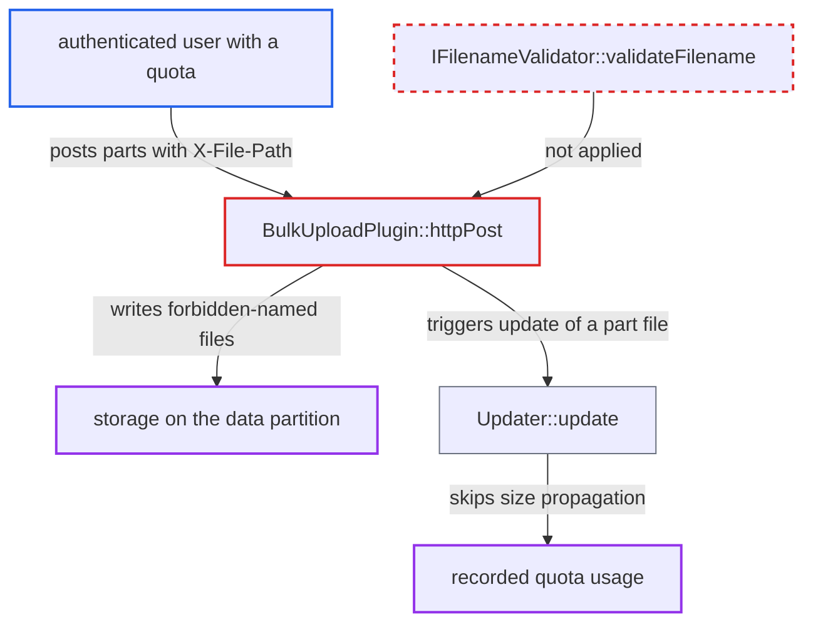

# Bulk upload skips filename validation, letting users write unindexed .part files that escape quota

| Field | Value |
|---|---|
| ID | `find_01WQyXb4M1m1V4jain6rxKn3` |
| Severity | **Medium** |
| Status | open |
| CWE | CWE-641 — Improper file name restriction |
| Created | 2026-10-27T21:37:57.117479Z |
| Claude Security | https://claude.ai/security/findings/find_01WQyXb4M1m1V4jain6rxKn3 |

## Description

Any logged-in user with a quota that has space left can store far more data than the quota allows, and can fill the server's data disk for all users. Bulk upload (`POST /remote.php/dav/bulk`) writes files under any client-supplied name in `X-File-Path`. `BulkUploadPlugin::httpPost()` never runs filename validation, so `.part` files are stored but never counted against quota.

1. **authenticated user** sends a bulk upload request with a forbidden file name. The request is a `POST` to `/remote.php/dav/bulk` with `Content-Type: multipart/related`, and a part with `X-File-Path: junk1.part`, `Content-Length` and a matching `OC-Checksum`.
2. **the handler `BulkUploadPlugin::httpPost()`** passes the client-supplied name straight to `newFile()`. No `verifyPath()` or `validateFilename()` call comes first, and a failure after the write only adds an error entry, so the written bytes are not cleaned up. ([`apps/dav/lib/BulkUpload/BulkUploadPlugin.php:62-88`](https://github.com/cx-benchmark/server/blob/6b6317280f8ed50277369c33cee070a643d29654/apps/dav/lib/BulkUpload/BulkUploadPlugin.php#L62-L88))
3. **`Folder::newFile()` and `View::basicOperation()`** let the write through. `newFile()` checks only CREATE permission and `..` segments, and `basicOperation()` checks only `Filesystem::isFileBlacklisted()`, so the name is never validated. ([`lib/private/Files/Node/Folder.php:172-195`](https://github.com/cx-benchmark/server/blob/6b6317280f8ed50277369c33cee070a643d29654/lib/private/Files/Node/Folder.php#L172-L195))
4. **`Quota::file_put_contents()`** accepts the write if it fits the remaining free space. It only checks that this one write is smaller than the free space, and `QuotaPlugin` does not hook `POST`, so no other quota check applies. ([`lib/private/Files/Storage/Wrapper/Quota.php:59-109`](https://github.com/cx-benchmark/server/blob/6b6317280f8ed50277369c33cee070a643d29654/lib/private/Files/Storage/Wrapper/Quota.php#L59-L109))
5. **`Updater::update()`** returns early for the `.part` path. It creates no cache entry and does not propagate the size to the parent folders, so the bytes never reach the folder size that quota reads. ([`lib/private/Files/Cache/Updater.php:69-93`](https://github.com/cx-benchmark/server/blob/6b6317280f8ed50277369c33cee070a643d29654/lib/private/Files/Cache/Updater.php#L69-L93))
6. **authenticated user** repeats the request with new names such as `junk2.part`. Recorded usage never grows, so each request can again store up to the remaining quota, and the total stored data is unbounded.

## Assessment

The attacker is any authenticated user whose account has an admin-set quota with some space left. No victim action is needed. The attacker posts to the bulk upload endpoint with names that the validator always rejects, such as `.part` names. Names over 250 bytes, control characters, backslashes and any forbidden extensions, basenames or characters the admin configured are also accepted. On the default local storage the file stays on disk, but `Scanner::scanFile()` refuses to index it, and `ObjectTree::getNodeForPath()` rejects the name, so the user cannot reach or delete it over DAV. On an object-store primary storage, `ObjectStoreStorage::writeStream()` inserts the cache entry itself, so the file does enter the user's namespace.

Impact: The attacker can store unbounded data beyond their quota, because each request is limited only by the remaining quota and the PHP memory limit (each part is read into a string). The data partition can fill up, which stops writes for every user. On local storage the orphaned files cannot be seen, scanned or deleted through Nextcloud, and are not charged to quota. On object-store primary storage the forbidden-named files appear as ordinary files in the user's namespace and sync to clients and share recipients. The naming policy is bypassed at the storage level. No data is disclosed.

## Recommendation

The bulk upload path creates files through `Folder::newFile()` without running the filename validation (`View::verifyPath()`/`IFilenameValidator::validateFilename()`) on the name and its parent segments, as `Directory::createFile()` does. Forbidden names, including internal `.part` names, are therefore written to storage, where they are not indexed and not charged to quota.

Fix criteria: Before any bytes are written, every segment of `X-File-Path` passes the same validation as a WebDAV `PUT`. A failing part gets a per-file error, and nothing is left on storage for it. Bulk parts named `a.part`, `a.filepart`, a 251-byte name or an admin-forbidden extension are all rejected. No such file appears in the user's data directory. Repeated bulk posts cannot push on-disk usage past `getQuotaBytes()`.

## Evidence

**https://github.com/cx-benchmark/server**

- [`apps/dav/lib/BulkUpload/BulkUploadPlugin.php:62-88`](https://github.com/cx-benchmark/server/blob/6b6317280f8ed50277369c33cee070a643d29654/apps/dav/lib/BulkUpload/BulkUploadPlugin.php#L62-L88)
- [`lib/private/Files/Node/Folder.php:172-195`](https://github.com/cx-benchmark/server/blob/6b6317280f8ed50277369c33cee070a643d29654/lib/private/Files/Node/Folder.php#L172-L195)
- [`lib/private/Files/View.php:1202-1253`](https://github.com/cx-benchmark/server/blob/6b6317280f8ed50277369c33cee070a643d29654/lib/private/Files/View.php#L1202-L1253)
- [`lib/private/Files/Cache/Updater.php:69-93`](https://github.com/cx-benchmark/server/blob/6b6317280f8ed50277369c33cee070a643d29654/lib/private/Files/Cache/Updater.php#L69-L93)
- [`lib/private/Files/Cache/Scanner.php:104-116`](https://github.com/cx-benchmark/server/blob/6b6317280f8ed50277369c33cee070a643d29654/lib/private/Files/Cache/Scanner.php#L104-L116)
- [`lib/private/Files/Storage/Wrapper/Quota.php:59-109`](https://github.com/cx-benchmark/server/blob/6b6317280f8ed50277369c33cee070a643d29654/lib/private/Files/Storage/Wrapper/Quota.php#L59-L109)
- [`lib/private/Files/FilenameValidator.php:68-76`](https://github.com/cx-benchmark/server/blob/6b6317280f8ed50277369c33cee070a643d29654/lib/private/Files/FilenameValidator.php#L68-L76)
- [`apps/dav/lib/Connector/Sabre/Directory.php:105-112`](https://github.com/cx-benchmark/server/blob/6b6317280f8ed50277369c33cee070a643d29654/apps/dav/lib/Connector/Sabre/Directory.php#L105-L112)
- [`apps/dav/lib/Connector/Sabre/ObjectTree.php:76-82`](https://github.com/cx-benchmark/server/blob/6b6317280f8ed50277369c33cee070a643d29654/apps/dav/lib/Connector/Sabre/ObjectTree.php#L76-L82)
- [`lib/private/Files/ObjectStore/ObjectStoreStorage.php:528-539`](https://github.com/cx-benchmark/server/blob/6b6317280f8ed50277369c33cee070a643d29654/lib/private/Files/ObjectStore/ObjectStoreStorage.php#L528-L539)

