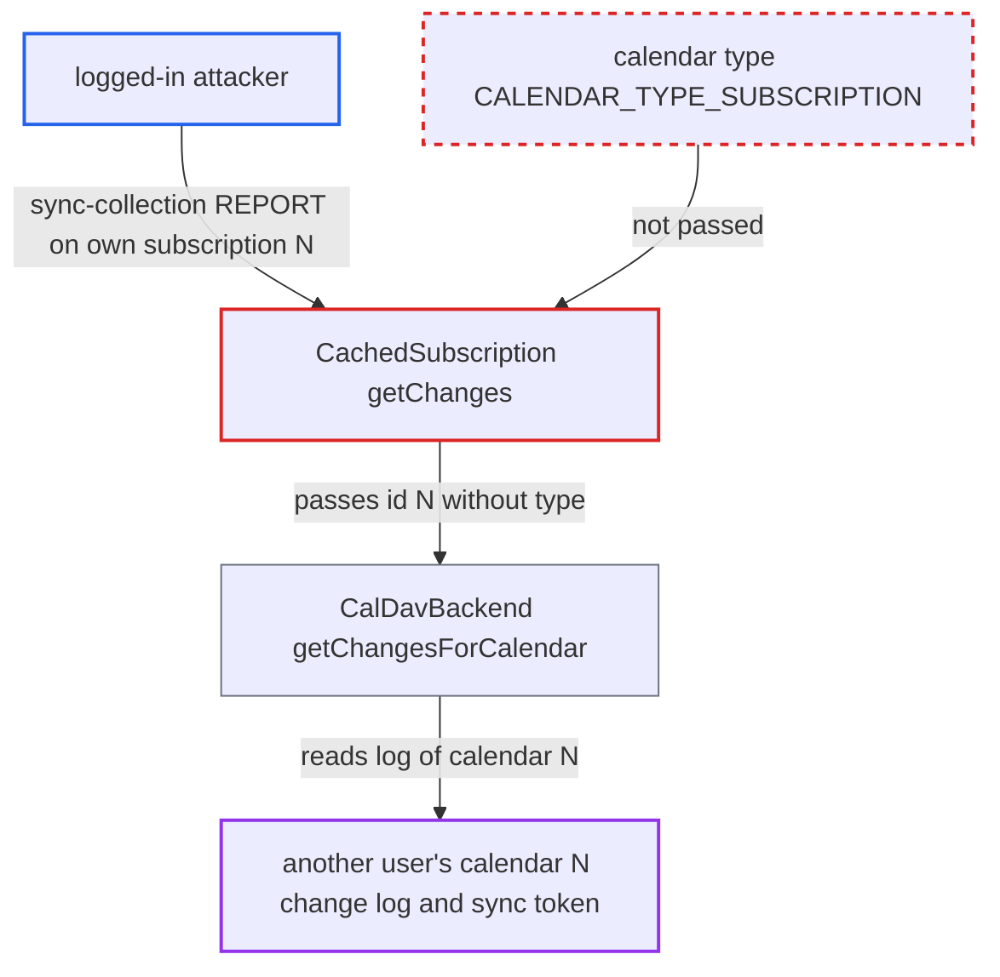

# Cached webcal subscription sync-collection reads another user's calendar change log by id

| Field | Value |
|---|---|
| ID | `find_01MgRPNZr451SSsjj67cxT4W` |
| Severity | **Medium** |
| Status | open |
| CWE | CWE-706 — Incorrect reference resolution |
| Created | 2026-10-27T21:30:47.098601Z |
| Claude Security | https://claude.ai/security/findings/find_01MgRPNZr451SSsjj67cxT4W |

## Description

Any logged-in user can learn metadata about another user's calendar: the URIs of objects deleted from it, its change counter, and whether it exists. No event content is exposed and nothing is modified. The attacker only needs their own webcal subscription and the header `X-NC-CalDAV-Webcal-Caching: On`. `CachedSubscription::getChanges()` reads the change log by a subscription id without passing the subscription type, so the id is looked up among regular calendars.

1. **attacker** creates a webcal subscription of their own. Subscriptions and calendars use separate id counters, so the new subscription gets an id N that can equal the id of another user's regular calendar.
2. **attacker** sends a `sync-collection` REPORT to the subscription with the header `X-NC-CalDAV-Webcal-Caching: On`. The request uses the sync token `http://sabre.io/ns/sync/0`, and the header makes the server serve the subscription as a cached subscription. ([`apps/dav/lib/CalDAV/WebcalCaching/Plugin.php:52-66`](https://github.com/cx-benchmark/server/blob/6b6317280f8ed50277369c33cee070a643d29654/apps/dav/lib/CalDAV/WebcalCaching/Plugin.php#L52-L66))
3. **`CalendarHome`** serves the subscription as a `CachedSubscription` node. This happens when cached subscriptions are enabled for the request, and the Sync plugin accepts the REPORT because subscriptions carry a `{http://sabredav.org/ns}sync-token`. ([`apps/dav/lib/CalDAV/CalendarHome.php:192-198`](https://github.com/cx-benchmark/server/blob/6b6317280f8ed50277369c33cee070a643d29654/apps/dav/lib/CalDAV/CalendarHome.php#L192-L198))
4. **`CachedSubscription::getChanges()`** adds only a limit check and calls `parent::getChanges()`. In sabre/dav 4.x the parent calls `getChangesForCalendar()` with the subscription id and no calendar type, unlike the other overrides in the class, which pass `CALENDAR_TYPE_SUBSCRIPTION`. ([`apps/dav/lib/CalDAV/CachedSubscription.php:201-207`](https://github.com/cx-benchmark/server/blob/6b6317280f8ed50277369c33cee070a643d29654/apps/dav/lib/CalDAV/CachedSubscription.php#L201-L207))
5. **`CalDavBackend::getChangesForCalendar()`** reads the sync token and change log of regular calendar N. With the default type it reads `synctoken` from the `calendars` row with id N and the `calendarchanges` rows with `calendartype = 0`. ([`apps/dav/lib/CalDAV/CalDavBackend.php:2870-2906`](https://github.com/cx-benchmark/server/blob/6b6317280f8ed50277369c33cee070a643d29654/apps/dav/lib/CalDAV/CalDavBackend.php#L2870-L2906))
6. **Sabre Sync plugin** builds the multistatus response from that log. Added and modified hrefs are dropped because `getMultipleChildren()` uses the subscription type. Every deleted URI of calendar N is returned as a 404 response, together with calendar N's sync token. ([`apps/dav/lib/CalDAV/CalDavBackend.php:1757-1834`](https://github.com/cx-benchmark/server/blob/6b6317280f8ed50277369c33cee070a643d29654/apps/dav/lib/CalDAV/CalDavBackend.php#L1757-L1834))

## Assessment

The attacker is any authenticated user. They create a webcal subscription, which gets the next id N. Creation is rate-limited to 10 per hour and 30 per user, but deleting and recreating keeps advancing N. They send a `sync-collection` REPORT with token `http://sabre.io/ns/sync/0` and the header `X-NC-CalDAV-Webcal-Caching: On` to their subscription. A matching user agent also turns on cached subscriptions, so clients such as Windows 10 Calendar, Evolution and KDE get the foreign data automatically. No victim action is needed. The report notes that instances are often internet-facing.

Impact: The attacker sees the URIs of objects deleted from another user's calendar (often UUIDs, sometimes names derived from the UID), that calendar's change counter, and whether it exists. A missing calendar N shows up as an invalid-sync-token error. Added and modified hrefs are filtered out, no event content is exposed, nothing is modified and service is not affected. Subscription sync for affected clients is also broken.

## Recommendation

`CachedSubscription::getChanges()` passes a `calendarsubscriptions` id to a backend method that defaults to the regular-calendar type. This mixes up two independent id spaces.

Fix criteria: A `sync-collection` on a cached subscription reads only the `calendarsubscriptions` sync token and the `calendarchanges` and `calendarobjects` rows with `calendartype = CALENDAR_TYPE_SUBSCRIPTION`. To verify, create a calendar and a subscription with the same id, then delete an object from the calendar. The subscription's sync response must contain neither that href nor the calendar's token.

## Evidence

**https://github.com/cx-benchmark/server**

- [`apps/dav/lib/CalDAV/CachedSubscription.php:201-207`](https://github.com/cx-benchmark/server/blob/6b6317280f8ed50277369c33cee070a643d29654/apps/dav/lib/CalDAV/CachedSubscription.php#L201-L207)
- [`apps/dav/lib/CalDAV/CalDavBackend.php:2870-2906`](https://github.com/cx-benchmark/server/blob/6b6317280f8ed50277369c33cee070a643d29654/apps/dav/lib/CalDAV/CalDavBackend.php#L2870-L2906)
- [`apps/dav/lib/CalDAV/CalDavBackend.php:1757-1834`](https://github.com/cx-benchmark/server/blob/6b6317280f8ed50277369c33cee070a643d29654/apps/dav/lib/CalDAV/CalDavBackend.php#L1757-L1834)
- [`apps/dav/lib/CalDAV/CalendarHome.php:192-198`](https://github.com/cx-benchmark/server/blob/6b6317280f8ed50277369c33cee070a643d29654/apps/dav/lib/CalDAV/CalendarHome.php#L192-L198)
- [`apps/dav/lib/CalDAV/WebcalCaching/Plugin.php:52-66`](https://github.com/cx-benchmark/server/blob/6b6317280f8ed50277369c33cee070a643d29654/apps/dav/lib/CalDAV/WebcalCaching/Plugin.php#L52-L66)
- [`apps/dav/lib/CalDAV/CalDavBackend.php:2971-3003`](https://github.com/cx-benchmark/server/blob/6b6317280f8ed50277369c33cee070a643d29654/apps/dav/lib/CalDAV/CalDavBackend.php#L2971-L3003)

