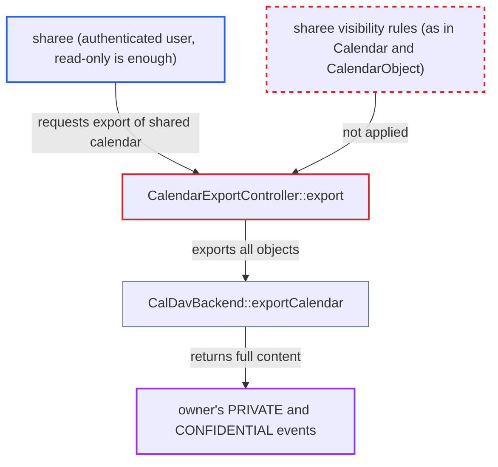

# Calendar export API returns private and confidential events of shared calendars to sharees

| Field | Value |
|---|---|
| ID | `find_01Q6qj2H5PQaYCGT7cEqaKH3` |
| Severity | **Medium** |
| Status | open |
| CWE | CWE-285 — Improper Authorization |
| Created | 2026-10-27T21:21:45.295797Z |
| Claude Security | https://claude.ai/security/findings/find_01Q6qj2H5PQaYCGT7cEqaKH3 |

## Description

Any signed-in user who has a calendar shared with them, even read-only, can download the full contents of the owner's private and confidential events. Everywhere else those events are hidden or masked from sharees. The calendar export endpoint `POST /ocs/v2.php/calendar/export` (`CalendarExportController::export`) and the code behind it never apply the sharee visibility rules.

1. **sharee** sends a export request for a shared calendar. The request is `POST /ocs/v2.php/calendar/export` with the `OCS-APIRequest: true` header and `target` set to `<calendar-uri>_shared_by_<owner>`, a URI the sharee can see in their own calendar home.
2. **the controller `CalendarExportController::export`** looks up the calendar with `getCalendarsForPrincipal`. The lookup also returns calendars shared with the user. The controller checks only that the result is an `ICalendarExport`, never `isShared()` or the share's access level. ([`apps/dav/lib/Controller/CalendarExportController.php:76-102`](https://github.com/cx-benchmark/server/blob/6b6317280f8ed50277369c33cee070a643d29654/apps/dav/lib/Controller/CalendarExportController.php#L76-L102))
3. **`CalDavBackend::getCalendarsForUser`** returns the owner's calendar id to the sharee. Direct, group and circle shares all go through this branch, and `read-only` is set from the share access. ([`apps/dav/lib/CalDAV/CalDavBackend.php:397-457`](https://github.com/cx-benchmark/server/blob/6b6317280f8ed50277369c33cee070a643d29654/apps/dav/lib/CalDAV/CalDavBackend.php#L397-L457))
4. **`CalendarImpl::export`** yields every row the backend returns. It applies no classification filtering or masking, although it knows `isShared()` and the share's access level. ([`apps/dav/lib/CalDAV/CalendarImpl.php:355-368`](https://github.com/cx-benchmark/server/blob/6b6317280f8ed50277369c33cee070a643d29654/apps/dav/lib/CalDAV/CalendarImpl.php#L355-L368))
5. **`CalDavBackend::exportCalendar`** selects all objects of the calendar. The `SELECT *` on `calendarobjects` filters only by `calendarid`, `calendartype` and `deleted_at IS NULL`, so PRIVATE and CONFIDENTIAL objects come back with full `calendardata`. ([`apps/dav/lib/CalDAV/CalDavBackend.php:1031-1059`](https://github.com/cx-benchmark/server/blob/6b6317280f8ed50277369c33cee070a643d29654/apps/dav/lib/CalDAV/CalDavBackend.php#L1031-L1059))
6. **the controller** streams the unmasked data to the sharee. The response contains the complete iCalendar data, including private events and the details of confidential events. ([`apps/dav/lib/Controller/CalendarExportController.php:76-102`](https://github.com/cx-benchmark/server/blob/6b6317280f8ed50277369c33cee070a643d29654/apps/dav/lib/Controller/CalendarExportController.php#L76-L102))

## Assessment

The attacker is any authenticated user with whom a calendar is shared. A read-only share is enough, and so is a share given to a large group or through a circle. They need no action from the owner. The export endpoint is rate limited to 1 request per minute, but one request is enough.

Impact: The sharee reads the full, unmasked contents of the owner's private and confidential events, for every calendar shared with them. Elsewhere those events are hidden or shown as `Busy`. The exposure is limited to calendars the attacker already has a share on, and nothing can be changed or made unavailable.

## Recommendation

`CalendarExportController::export`, `CalendarImpl::export` and `CalDavBackend::exportCalendar` export raw calendar objects without the classification-based visibility rules that apply to sharees.

Fix criteria: Exporting a calendar the requesting principal does not own is either refused, as `CalendarMigrator` does, or omits PRIVATE objects and masks CONFIDENTIAL objects and strips alarms exactly as `CalendarObject::get()` does for that principal's access level. To verify, share a calendar read-only and add a `CLASS:PRIVATE` and a `CLASS:CONFIDENTIAL` event as the owner. Then confirm the sharee's `POST /ocs/v2.php/calendar/export` response contains neither the private event nor the confidential event's details.

## Evidence

**https://github.com/cx-benchmark/server**

- [`apps/dav/lib/Controller/CalendarExportController.php:76-102`](https://github.com/cx-benchmark/server/blob/6b6317280f8ed50277369c33cee070a643d29654/apps/dav/lib/Controller/CalendarExportController.php#L76-L102)
- [`apps/dav/lib/CalDAV/CalendarImpl.php:355-368`](https://github.com/cx-benchmark/server/blob/6b6317280f8ed50277369c33cee070a643d29654/apps/dav/lib/CalDAV/CalendarImpl.php#L355-L368)
- [`apps/dav/lib/CalDAV/CalDavBackend.php:1031-1059`](https://github.com/cx-benchmark/server/blob/6b6317280f8ed50277369c33cee070a643d29654/apps/dav/lib/CalDAV/CalDavBackend.php#L1031-L1059)
- [`apps/dav/lib/CalDAV/CalDavBackend.php:397-457`](https://github.com/cx-benchmark/server/blob/6b6317280f8ed50277369c33cee070a643d29654/apps/dav/lib/CalDAV/CalDavBackend.php#L397-L457)
- [`apps/dav/lib/CalDAV/Calendar.php:291-346`](https://github.com/cx-benchmark/server/blob/6b6317280f8ed50277369c33cee070a643d29654/apps/dav/lib/CalDAV/Calendar.php#L291-L346)
- [`apps/dav/lib/CalDAV/CalendarObject.php:43-62`](https://github.com/cx-benchmark/server/blob/6b6317280f8ed50277369c33cee070a643d29654/apps/dav/lib/CalDAV/CalendarObject.php#L43-L62)
- [`apps/dav/lib/UserMigration/CalendarMigrator.php:169-172`](https://github.com/cx-benchmark/server/blob/6b6317280f8ed50277369c33cee070a643d29654/apps/dav/lib/UserMigration/CalendarMigrator.php#L169-L172)

