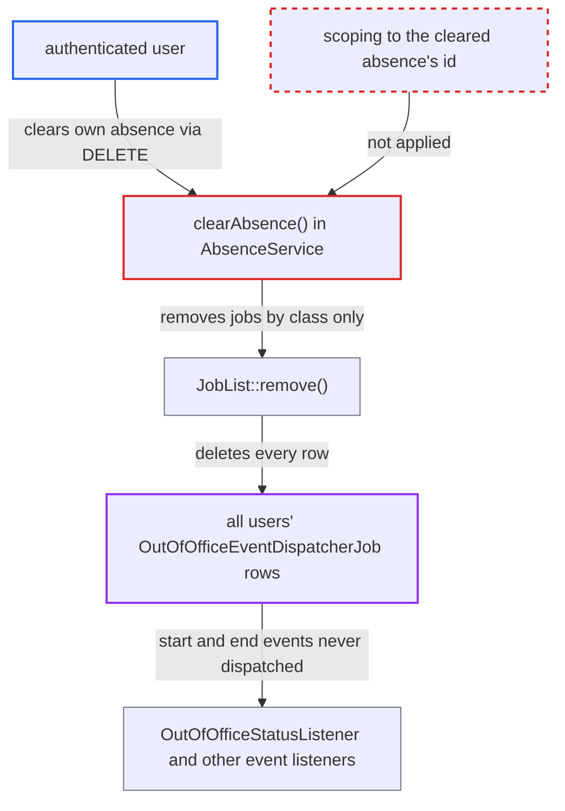

# Clearing own out-of-office deletes all users' scheduled out-of-office event jobs

| Field | Value |
|---|---|
| ID | `find_01DN4xbK2sTr7trUMcPfp95U` |
| Severity | **Medium** |
| Status | open |
| CWE | CWE-863 — Incorrect authorization |
| Created | 2026-10-27T21:33:05.879377Z |
| Claude Security | https://claude.ai/security/findings/find_01DN4xbK2sTr7trUMcPfp95U |

## Description

Any logged-in user can cancel the pending out-of-office start and end events of every other user on the instance. The attacker only needs to create and then clear their own absence. `AbsenceService::clearAbsence()` calls `jobList->remove(OutOfOfficeEventDispatcherJob::class)` without an argument, so the removal covers all users' jobs, not just the caller's. The absence records themselves are not touched.

1. **authenticated user** creates their own absence with OCS `POST /ocs/v2.php/apps/dav/api/v1/outOfOffice/<self>`. `createOrUpdateAbsence()` schedules two `OutOfOfficeEventDispatcherJob` jobs per absence, with the argument `['id' => <absence id>, 'event' => 'start'|'end']`, and does this for every user. ([`apps/dav/lib/Service/AbsenceService.php:83-103`](https://github.com/cx-benchmark/server/blob/6b6317280f8ed50277369c33cee070a643d29654/apps/dav/lib/Service/AbsenceService.php#L83-L103))
2. **authenticated user** sends `DELETE` to the same URL. `clearOutOfOffice()` is `#[NoAdminRequired]`, so any logged-in user can call it, and it calls `clearAbsence()` for the session user. ([`apps/dav/lib/Controller/OutOfOfficeController.php:178-188`](https://github.com/cx-benchmark/server/blob/6b6317280f8ed50277369c33cee070a643d29654/apps/dav/lib/Controller/OutOfOfficeController.php#L178-L188))
3. **the method `clearAbsence()`** deletes the caller's `Absence` row and calls `$this->jobList->remove(OutOfOfficeEventDispatcherJob::class)` with no argument. The call is not limited to the two jobs that belong to the cleared absence's id. ([`apps/dav/lib/Service/AbsenceService.php:111-125`](https://github.com/cx-benchmark/server/blob/6b6317280f8ed50277369c33cee070a643d29654/apps/dav/lib/Service/AbsenceService.php#L111-L125))
4. **the method `JobList::remove()`** deletes every row of the job class. It adds the `argument_hash` condition only when an argument is given, so with none it removes all `OutOfOfficeEventDispatcherJob` rows of all users. ([`lib/private/BackgroundJob/JobList.php:87-113`](https://github.com/cx-benchmark/server/blob/6b6317280f8ed50277369c33cee070a643d29654/lib/private/BackgroundJob/JobList.php#L87-L113))
5. **the job `OutOfOfficeEventDispatcherJob`** never runs for the other users' absences. This job is the only code that dispatches `OutOfOfficeStartedEvent` and `OutOfOfficeEndedEvent`, so those events are never sent for the victims. ([`apps/dav/lib/BackgroundJob/OutOfOfficeEventDispatcherJob.php:39-75`](https://github.com/cx-benchmark/server/blob/6b6317280f8ed50277369c33cee070a643d29654/apps/dav/lib/BackgroundJob/OutOfOfficeEventDispatcherJob.php#L39-L75))
6. **the listener `OutOfOfficeStatusListener`** never re-queues `UserStatusAutomation` for the victims. A victim without office-hours availability is therefore not switched to the out-of-office DND status when the absence begins, because `UserStatusAutomation` has already removed its own job while the absence is in the future. ([`apps/user_status/lib/Listener/OutOfOfficeStatusListener.php:50-57`](https://github.com/cx-benchmark/server/blob/6b6317280f8ed50277369c33cee070a643d29654/apps/user_status/lib/Listener/OutOfOfficeStatusListener.php#L50-L57))

## Assessment

The attacker is any authenticated user. They need no special role, setting or victim action. They create their own absence with OCS `POST /ocs/v2.php/apps/dav/api/v1/outOfOffice/<self>` and then clear it with `DELETE` on the same URL. Repeating the pair keeps removing jobs scheduled afterwards. A benign user who clears their own absence triggers the same effect by accident.

Impact: Other users' pending out-of-office start and end jobs are deleted. Victims without office-hours availability are not switched to the out-of-office DND status when their absence begins. Listeners of `OutOfOfficeStartedEvent` and `OutOfOfficeEndedEvent`, including apps outside this repository, never get the events. The absence rows stay intact and still show as configured, so the problem is easy to miss until each victim saves their absence again. The effect is limited to a loss of integrity in other users' automation state.

## Recommendation

`AbsenceService::clearAbsence()` removes `OutOfOfficeEventDispatcherJob` entries by class only. Clearing the caller's own absence therefore deletes background jobs that belong to every other user's absence.

Fix criteria: Clearing an absence removes only the `OutOfOfficeEventDispatcherJob` entries whose argument references that absence's id, for both the `start` and `end` events. To verify, schedule future absences for users A and B, then have A call `DELETE /ocs/v2.php/apps/dav/api/v1/outOfOffice/A`. B's two rows in `oc_jobs` must still exist. B's start and end events must still fire.

## Evidence

**https://github.com/cx-benchmark/server**

- [`apps/dav/lib/Service/AbsenceService.php:111-125`](https://github.com/cx-benchmark/server/blob/6b6317280f8ed50277369c33cee070a643d29654/apps/dav/lib/Service/AbsenceService.php#L111-L125)
- [`lib/private/BackgroundJob/JobList.php:87-113`](https://github.com/cx-benchmark/server/blob/6b6317280f8ed50277369c33cee070a643d29654/lib/private/BackgroundJob/JobList.php#L87-L113)
- [`apps/dav/lib/Service/AbsenceService.php:83-103`](https://github.com/cx-benchmark/server/blob/6b6317280f8ed50277369c33cee070a643d29654/apps/dav/lib/Service/AbsenceService.php#L83-L103)
- [`apps/dav/lib/Controller/OutOfOfficeController.php:178-188`](https://github.com/cx-benchmark/server/blob/6b6317280f8ed50277369c33cee070a643d29654/apps/dav/lib/Controller/OutOfOfficeController.php#L178-L188)
- [`apps/dav/lib/BackgroundJob/OutOfOfficeEventDispatcherJob.php:39-75`](https://github.com/cx-benchmark/server/blob/6b6317280f8ed50277369c33cee070a643d29654/apps/dav/lib/BackgroundJob/OutOfOfficeEventDispatcherJob.php#L39-L75)
- [`apps/dav/lib/BackgroundJob/UserStatusAutomation.php:66-83`](https://github.com/cx-benchmark/server/blob/6b6317280f8ed50277369c33cee070a643d29654/apps/dav/lib/BackgroundJob/UserStatusAutomation.php#L66-L83)
- [`apps/user_status/lib/Listener/OutOfOfficeStatusListener.php:50-57`](https://github.com/cx-benchmark/server/blob/6b6317280f8ed50277369c33cee070a643d29654/apps/user_status/lib/Listener/OutOfOfficeStatusListener.php#L50-L57)

