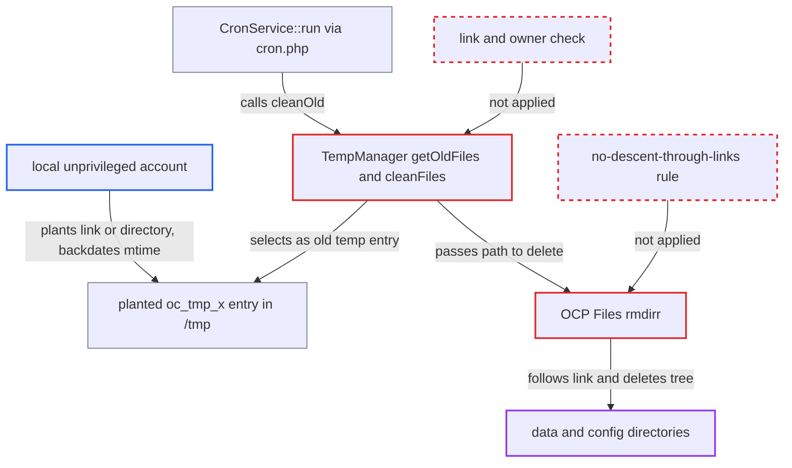

# Cron temp cleanup deletes through attacker-planted symlinks in shared temp directory

| Field | Value |
|---|---|
| ID | `find_014z1U5S4MYa8m7oqfBgEjh5` |
| Severity | **Medium** |
| Status | open |
| CWE | CWE-59 — Link following |
| Created | 2026-10-27T21:51:24.752525Z |
| Claude Security | https://claude.ai/security/findings/find_014z1U5S4MYa8m7oqfBgEjh5 |

## Description

A local, unprivileged account on the same host can make Nextcloud's cron job recursively delete the data directory, the config directory or other directories the web-server user can write. This works when `tempdirectory` is unset, so the temp directory is the shared `/tmp`. `getOldFiles()` selects old `oc_tmp_` entries by name and age only, and `OCP\Files::rmdirr()` follows symlinks while deleting. Data is destroyed and the instance stops working. Nothing is disclosed.

1. **local attacker** plants an `oc_tmp_x` entry in `/tmp` and backdates its mtime. The entry needs an mtime more than an hour old, which `touch` can set. Where `fs.protected_symlinks=0` it is a symlink to the data or config directory. Otherwise it is an attacker-owned 0777 directory that will later hold a swapped link. ([`lib/private/TempManager.php:161-199`](https://github.com/cx-benchmark/server/blob/6b6317280f8ed50277369c33cee070a643d29654/lib/private/TempManager.php#L161-L199))
2. **`cron.php` through `CronService::run()`** calls `cleanOld()` on every run. The call happens in every cron mode (system cron, webcron, AJAX) and before the background-job mode is checked. ([`core/Service/CronService.php:98`](https://github.com/cx-benchmark/server/blob/6b6317280f8ed50277369c33cee070a643d29654/core/Service/CronService.php#L98))
3. **`getOldFiles()`** selects the planted entry as a stale temp file. It takes every entry named `oc_tmp_*` whose `filemtime()` is over an hour old. It does not check for a link, the owner or where the entry came from. ([`lib/private/TempManager.php:137-153`](https://github.com/cx-benchmark/server/blob/6b6317280f8ed50277369c33cee070a643d29654/lib/private/TempManager.php#L137-L153))
4. **`cleanFiles()`** passes the path to `OCP\Files::rmdirr()`. It runs a link-following `file_exists()` first. It catches only `UnexpectedValueException`, and PHP warnings are only logged, so nothing stops the delete. ([`lib/private/TempManager.php:106-130`](https://github.com/cx-benchmark/server/blob/6b6317280f8ed50277369c33cee070a643d29654/lib/private/TempManager.php#L106-L130))
5. **`rmdirr()`** walks into the link target and deletes its contents as the web-server user. `is_dir()` and `RecursiveDirectoryIterator` follow a symlinked root. Children are removed through `getRealPath()`, and only the final `rmdir()` on the link itself fails. ([`lib/public/Files.php:30-60`](https://github.com/cx-benchmark/server/blob/6b6317280f8ed50277369c33cee070a643d29654/lib/public/Files.php#L30-L60))
6. **local attacker** swaps a directory inside the `oc_tmp_*` directory for a symlink while the walk runs. This is the route where `fs.protected_symlinks=1` blocks a top-level link. `hasChildren()`, `getChildren()` and `getRealPath()` resolve the path string again at each step, so the rest of the deletion goes into the target. ([`lib/public/Files.php:30-60`](https://github.com/cx-benchmark/server/blob/6b6317280f8ed50277369c33cee070a643d29654/lib/public/Files.php#L30-L60))

## Assessment

The attacker is an unprivileged local account on the host, such as a shell user, another PHP-FPM pool user or a compromised co-hosted service. It needs write access to `/tmp` and the cron process must use it. That is the default when `tempdirectory` is unset, and system cron runs outside any web-server PrivateTmp. Where `fs.protected_symlinks=0`, a plain symlink `oc_tmp_x` to the target is enough. Where it is 1 (the default on most Linux distributions), the kernel blocks the top-level link, so the attacker uses an own 0777 `oc_tmp_*` directory and swaps a subdirectory for a symlink once deletion starts. The attacker can widen the race window with many decoy entries and watch progress with inotify. The next `cron.php` run triggers the deletion.

Impact: The attacker can have everything the web-server user can write deleted recursively. That includes the data directory (user files, appdata, encryption keys, logs), the config directory with `config.php`, and writable app directories. Data is destroyed and the instance stops working.

## Recommendation

(1) `TempManager::getOldFiles()` and `cleanFiles()` pick entries in a directory other local accounts can write. They use only the `oc_tmp_` name prefix and a link-following `filemtime()`, and delete them without checking type or owner.

Fix criteria: Cleanup removes only entries that are not symbolic links (checked with `lstat` or `is_link`) and that the PHP process user owns. Any other `oc_tmp_*` entry is left alone, or only the link itself is removed. A foreign-owned `/tmp/oc_tmp_x`, whether symlink or directory, survives a cron run, and the target directory's contents stay intact.

(2) `OCP\Files::rmdirr()` follows a symlinked root and deletes children by resolving path strings again (`getRealPath()`, path-based recursion). A link at the root, or one swapped in during the walk, sends the deletion outside the tree.

Fix criteria: Recursive deletion never descends through a symbolic link at any level, including one swapped in during the walk. A symlinked root is unlinked, not traversed. Children are removed only after checking that no path component has become a link. With a symlinked root, and with a subdirectory replaced by a symlink during deletion, nothing outside the tree is removed.

## Evidence

**https://github.com/cx-benchmark/server**

- [`lib/private/TempManager.php:137-153`](https://github.com/cx-benchmark/server/blob/6b6317280f8ed50277369c33cee070a643d29654/lib/private/TempManager.php#L137-L153)
- [`lib/private/TempManager.php:106-130`](https://github.com/cx-benchmark/server/blob/6b6317280f8ed50277369c33cee070a643d29654/lib/private/TempManager.php#L106-L130)
- [`lib/public/Files.php:30-60`](https://github.com/cx-benchmark/server/blob/6b6317280f8ed50277369c33cee070a643d29654/lib/public/Files.php#L30-L60)
- [`core/Service/CronService.php:98`](https://github.com/cx-benchmark/server/blob/6b6317280f8ed50277369c33cee070a643d29654/core/Service/CronService.php#L98)
- [`lib/private/TempManager.php:161-199`](https://github.com/cx-benchmark/server/blob/6b6317280f8ed50277369c33cee070a643d29654/lib/private/TempManager.php#L161-L199)

