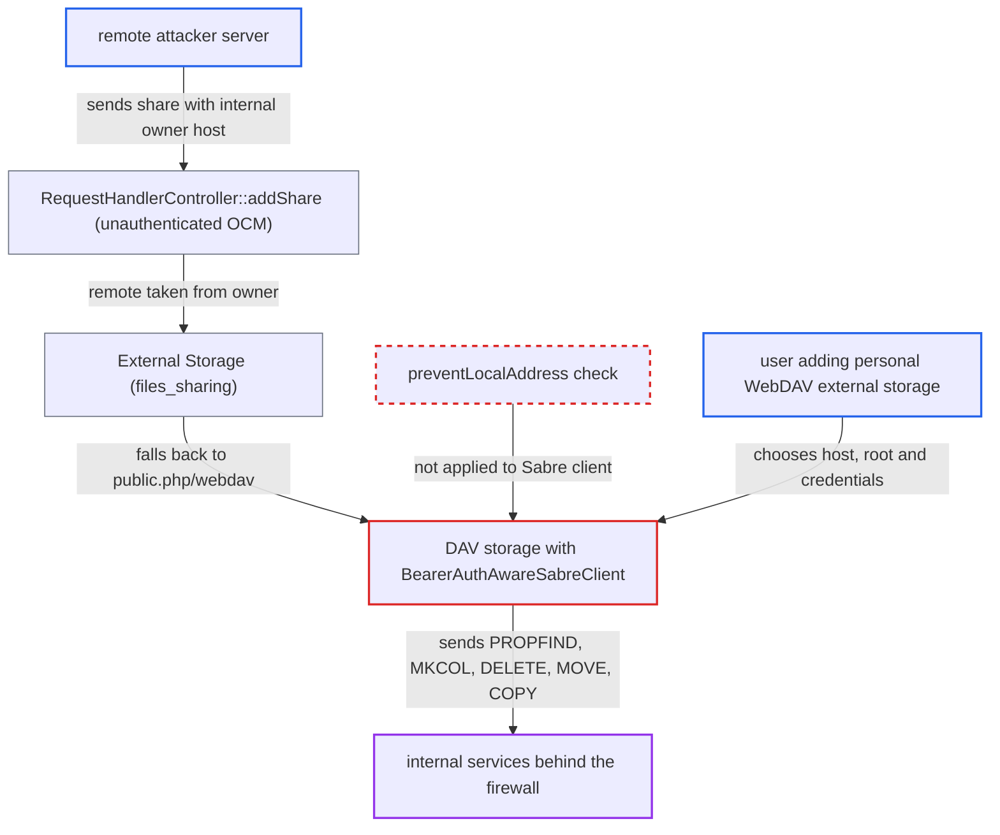

# DAV storage sends PROPFIND/MKCOL/DELETE/MOVE/COPY via raw Sabre client, bypassing SSRF guard

| Field | Value |
|---|---|
| ID | `find_0131iGaANW6WNYNWBeqH5W3W` |
| Severity | **Medium** |
| Status | open |
| CWE | CWE-918 — Server-side request forgery |
| Created | 2026-10-27T21:31:04.592421Z |
| Claude Security | https://claude.ai/security/findings/find_0131iGaANW6WNYNWBeqH5W3W |

## Description

A remote server acting as a federated sharer, or a user allowed to add a personal WebDAV external storage, can make the Nextcloud server send WebDAV requests to internal hosts. The federated route needs a victim to accept a share. The cause is that `OC\Files\Storage\DAV` sends PROPFIND, MKCOL, DELETE, MOVE, COPY and PROPPATCH through a raw Sabre client that never applies the local-address check `preventLocalAddress()`.

1. **remote attacker server** posts an OCM share to the target Nextcloud with an internal host in `owner`. The request goes to `/ocs/v2.php/cloud/shares` and needs no login, for example `owner=user@http://10.0.0.5:8080/prefix`; `CloudIdManager` keeps the explicit `http://` scheme and port. ([`apps/federatedfilesharing/lib/OCM/CloudFederationProviderFiles.php:108-120`](https://github.com/cx-benchmark/server/blob/6b6317280f8ed50277369c33cee070a643d29654/apps/federatedfilesharing/lib/OCM/CloudFederationProviderFiles.php#L108-L120))
2. **`CloudFederationProviderFiles`** stores the remote taken from the `owner` string. It uses `splitUserRemote($share->getOwner())` as supplied, so the internal host becomes the share's remote. ([`apps/federatedfilesharing/lib/OCM/CloudFederationProviderFiles.php:108-120`](https://github.com/cx-benchmark/server/blob/6b6317280f8ed50277369c33cee070a643d29654/apps/federatedfilesharing/lib/OCM/CloudFederationProviderFiles.php#L108-L120))
3. **target user** accepts the pending remote share. This is the routine 'Accept' click and the only victim action needed.
4. **`External\Storage`** falls back to `/public.php/webdav` on the same remote. OCM discovery fails because the guarded client throws `LocalServerException`, which `OCMDiscoveryService::discover` turns into `OCMProviderException`. The fallback builds the storage anyway instead of refusing it. ([`apps/files_sharing/lib/External/Storage.php:92-155`](https://github.com/cx-benchmark/server/blob/6b6317280f8ed50277369c33cee070a643d29654/apps/files_sharing/lib/External/Storage.php#L92-L155))
5. **`DAV::init()`** creates the raw `BearerAuthAwareSabreClient` for the internal host. The base URI comes from `createBaseUri()` and `$this->host`, with only proxy and TLS options added and no host validation. ([`lib/private/Files/Storage/DAV.php:235-300`](https://github.com/cx-benchmark/server/blob/6b6317280f8ed50277369c33cee070a643d29654/lib/private/Files/Storage/DAV.php#L235-L300))
6. **`DAV::propfind()`** sends a PROPFIND to the internal address when the mount is used. `file_exists`, `stat`, `getMetaData` and similar calls reach it, so the first file listing triggers the request. ([`lib/private/Files/Storage/DAV.php:578-600`](https://github.com/cx-benchmark/server/blob/6b6317280f8ed50277369c33cee070a643d29654/lib/private/Files/Storage/DAV.php#L578-L600))
7. **`simpleResponse()`, `rename()`, `copy()` and `touch()`** send MKCOL, DELETE, MOVE, COPY and PROPPATCH requests to the internal service. Browsing, renaming or deleting in the mount triggers these, and MOVE and COPY carry a `Destination` header. ([`lib/private/Files/Storage/DAV.php:1014-1033`](https://github.com/cx-benchmark/server/blob/6b6317280f8ed50277369c33cee070a643d29654/lib/private/Files/Storage/DAV.php#L1014-L1033))
8. **attacker** reads the internal service's reaction through the storage's error type and file listing. `convertException()` maps 401, 403, 404 or 405 and connection errors to different outcomes, and a WebDAV listing from the internal service is shown in the victim's file view.

## Assessment

The main route needs a remote server that can send an OCM share request, which needs no login. A local user must then accept the pending share. Accepting is described as a routine click. A second route needs no victim. A user who is allowed to add a personal WebDAV or Nextcloud external storage (`files_external`, where `OwnCloud` extends `DAV`) picks the host, root path and Basic credentials directly. This is a non-default configuration. Both routes reach the same unguarded Sabre client.

Impact: On the Nextcloud server itself the report finds no direct loss. The server is used as a request proxy. Responses show up only indirectly, as an error category or a parsed WebDAV listing.

Subsequent-system impact: Internal services receive attacker-chosen WebDAV methods (PROPFIND, MKCOL, DELETE, MOVE, COPY, PROPPATCH), paths and `Destination` headers from the trusted server address. The distinct error outcomes allow port and path scanning. A WebDAV-speaking internal service's directory listing is exposed in the victim's file view, which is a limited disclosure. Internal DAV endpoints that trust the source network can be changed, which is a limited effect. Request bodies are not attacker-controlled, which bounds the impact.

## Recommendation

(1) `DAV::init()` builds a raw `Sabre\DAV\Client` for PROPFIND, MKCOL, DELETE, MOVE, COPY and PROPPATCH. These requests skip the local-address policy that `OC\Http\Client\Client::preventLocalAddress()` applies to GET and PUT.

Fix criteria: Every outbound request from the DAV storage, whatever the client library or HTTP method, is rejected when the target host violates `IRemoteHostValidator` and `allow_local_remote_servers` is not enabled. The storage is then marked unavailable, and redirects are covered too. To check, configure a DAV or federated storage whose host resolves to a loopback or RFC1918 address. Confirm that no PROPFIND, MKCOL or MOVE reaches it.

(2) `OCA\Files_Sharing\External\Storage::__construct` falls back to `/public.php/webdav` on the cloud-id remote when OCM discovery fails. A remote that the guarded client refused still gets a storage pointed at it.

Fix criteria: A remote whose discovery failed because the host violates the local-address policy does not produce a usable storage. To check, accept a federated share whose owner cloud id points to an internal address. The share must stay unavailable, and the Sabre client must send no request to that address.

## Evidence

**https://github.com/cx-benchmark/server**

- [`lib/private/Files/Storage/DAV.php:235-300`](https://github.com/cx-benchmark/server/blob/6b6317280f8ed50277369c33cee070a643d29654/lib/private/Files/Storage/DAV.php#L235-L300)
- [`lib/private/Files/Storage/DAV.php:578-600`](https://github.com/cx-benchmark/server/blob/6b6317280f8ed50277369c33cee070a643d29654/lib/private/Files/Storage/DAV.php#L578-L600)
- [`lib/private/Files/Storage/DAV.php:1014-1033`](https://github.com/cx-benchmark/server/blob/6b6317280f8ed50277369c33cee070a643d29654/lib/private/Files/Storage/DAV.php#L1014-L1033)
- [`lib/private/Files/Storage/DAV.php:656-700`](https://github.com/cx-benchmark/server/blob/6b6317280f8ed50277369c33cee070a643d29654/lib/private/Files/Storage/DAV.php#L656-L700)
- [`lib/private/Http/Client/Client.php:159-181`](https://github.com/cx-benchmark/server/blob/6b6317280f8ed50277369c33cee070a643d29654/lib/private/Http/Client/Client.php#L159-L181)
- [`apps/files_sharing/lib/External/Storage.php:92-155`](https://github.com/cx-benchmark/server/blob/6b6317280f8ed50277369c33cee070a643d29654/apps/files_sharing/lib/External/Storage.php#L92-L155)
- [`apps/federatedfilesharing/lib/OCM/CloudFederationProviderFiles.php:108-120`](https://github.com/cx-benchmark/server/blob/6b6317280f8ed50277369c33cee070a643d29654/apps/federatedfilesharing/lib/OCM/CloudFederationProviderFiles.php#L108-L120)
- [`apps/files_sharing/lib/External/Storage.php:420-440`](https://github.com/cx-benchmark/server/blob/6b6317280f8ed50277369c33cee070a643d29654/apps/files_sharing/lib/External/Storage.php#L420-L440)

