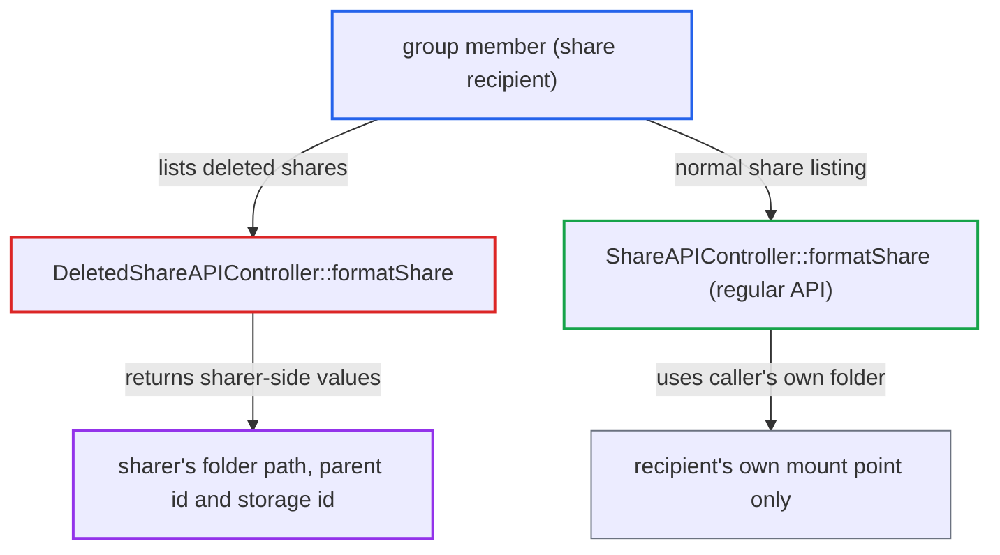

# Deleted shares API discloses the sharer's folder path and source storage id to recipients

| Field | Value |
|---|---|
| ID | `find_01R1r9WBSmAGHAVjgzXxpsBN` |
| Severity | **Medium** |
| Status | open |
| CWE | CWE-200 — Information exposure |
| Created | 2026-10-27T21:36:18.435332Z |
| Claude Security | https://claude.ai/security/findings/find_01R1r9WBSmAGHAVjgzXxpsBN |

## Description

Any signed-in member of a group, team, room or deck that received a share can see the sharer's private folder names above the shared item. For items on external storage, they can also see the storage id, which can include a username, host and root. The attacker needs only to remove the share from themselves and list deleted shares. `DeletedShareAPIController::formatShare()` builds its answer from the sharer's folder instead of the recipient's.

1. **recipient** removes a received group share from their own list. `DELETE /ocs/v2.php/apps/files_sharing/api/v1/shares/{id}` runs `deleteFromSelf()` for any group member, which sets the user-specific share's permissions to 0. ([`apps/files_sharing/lib/Controller/ShareAPIController.php:569-575`](https://github.com/cx-benchmark/server/blob/6b6317280f8ed50277369c33cee070a643d29654/apps/files_sharing/lib/Controller/ShareAPIController.php#L569-L575))
2. **`getDeletedSharedWith()`** returns the shares the caller removed from self. It selects the caller's received shares whose permissions are 0, which now includes this one. ([`lib/private/Share20/Manager.php:1309-1315`](https://github.com/cx-benchmark/server/blob/6b6317280f8ed50277369c33cee070a643d29654/lib/private/Share20/Manager.php#L1309-L1315))
3. **recipient** calls `GET /ocs/v2.php/apps/files_sharing/api/v1/deletedshares`. `index()` is `#[NoAdminRequired]` and formats every group, team, room or deck share the caller removed from self. ([`apps/files_sharing/lib/Controller/DeletedShareAPIController.php:138-149`](https://github.com/cx-benchmark/server/blob/6b6317280f8ed50277369c33cee070a643d29654/apps/files_sharing/lib/Controller/DeletedShareAPIController.php#L138-L149))
4. **`formatShare()` in `DeletedShareAPIController`** looks up the node in the sharer's home folder and returns its properties. It uses `getUserFolder($share->getSharedBy())`, so `path` holds every ancestor folder name, `storage_id` is the sharer's backing storage id and `file_parent` is the sharer's parent folder id. ([`apps/files_sharing/lib/Controller/DeletedShareAPIController.php:73-94`](https://github.com/cx-benchmark/server/blob/6b6317280f8ed50277369c33cee070a643d29654/apps/files_sharing/lib/Controller/DeletedShareAPIController.php#L73-L94))
5. **recipient** restores the share with `POST /deletedshares/{id}`. This puts the share back, so every group share can be exposed this way without further action by the sharer.

## Assessment

The attacker is any authenticated user who belongs to a group, team, room or deck that received a share. Group sharing is on by default, and the sharer does nothing further. The attacker calls `DELETE /ocs/v2.php/apps/files_sharing/api/v1/shares/{id}` on the group share, then `GET /ocs/v2.php/apps/files_sharing/api/v1/deletedshares`. They can restore the share afterwards with `POST /deletedshares/{id}`. The regular share API gives recipients only the shared item and their own mount point, and `pendingShares()` replaces `path` with the name.

Impact: The recipient learns metadata it was not given: the names of every ancestor folder of the shared item in the sharer's home, and the sharer's parent folder id. For items on external storage it also learns the backend storage id, such as `smb::<username>@<host>//<share>/<root>`, an `sftp::user@host` string or `local::<server path>`. File contents outside the share stay unreadable, and nothing can be modified or disrupted.

## Recommendation

`DeletedShareAPIController::formatShare()` takes `path`, `storage_id` and `file_parent` from the node as resolved in the sharer's user folder. This discloses the sharer's folder hierarchy and backing-storage identifiers to the recipient.

Fix criteria: Entries returned by `GET /deletedshares` contain only recipient-side information. `path` is the share target or node name, and no field carries the sharer's ancestor folder names, parent folder id or source storage id. Verify that a group member who removed a share from self and then lists deleted shares cannot learn any ancestor folder name of the shared item. Also verify that they cannot learn the storage id of an external storage it lives on.

## Evidence

**https://github.com/cx-benchmark/server**

- [`apps/files_sharing/lib/Controller/DeletedShareAPIController.php:73-94`](https://github.com/cx-benchmark/server/blob/6b6317280f8ed50277369c33cee070a643d29654/apps/files_sharing/lib/Controller/DeletedShareAPIController.php#L73-L94)
- [`apps/files_sharing/lib/Controller/DeletedShareAPIController.php:138-149`](https://github.com/cx-benchmark/server/blob/6b6317280f8ed50277369c33cee070a643d29654/apps/files_sharing/lib/Controller/DeletedShareAPIController.php#L138-L149)
- [`apps/files_sharing/lib/Controller/ShareAPIController.php:569-575`](https://github.com/cx-benchmark/server/blob/6b6317280f8ed50277369c33cee070a643d29654/apps/files_sharing/lib/Controller/ShareAPIController.php#L569-L575)
- [`lib/private/Share20/Manager.php:1309-1315`](https://github.com/cx-benchmark/server/blob/6b6317280f8ed50277369c33cee070a643d29654/lib/private/Share20/Manager.php#L1309-L1315)
- [`apps/files_sharing/lib/Controller/ShareAPIController.php:172-186`](https://github.com/cx-benchmark/server/blob/6b6317280f8ed50277369c33cee070a643d29654/apps/files_sharing/lib/Controller/ShareAPIController.php#L172-L186)
- [`apps/files_sharing/lib/SharedStorage.php:250-252`](https://github.com/cx-benchmark/server/blob/6b6317280f8ed50277369c33cee070a643d29654/apps/files_sharing/lib/SharedStorage.php#L250-L252)
- [`apps/files_external/lib/Lib/Storage/SMB.php:137-142`](https://github.com/cx-benchmark/server/blob/6b6317280f8ed50277369c33cee070a643d29654/apps/files_external/lib/Lib/Storage/SMB.php#L137-L142)

