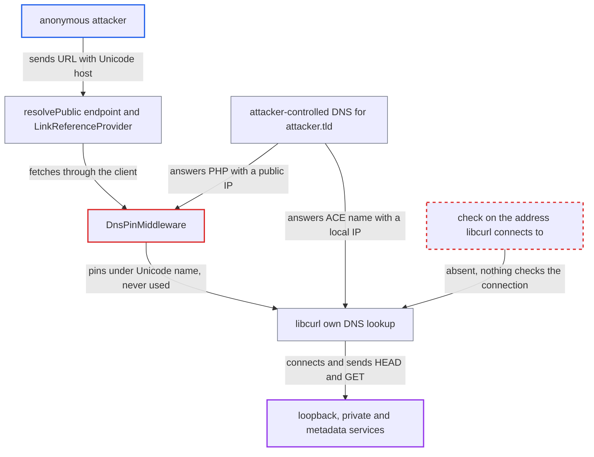

# DNS pin keyed on raw Unicode hostname is bypassed when libcurl resolves the IDNA form

| Field | Value |
|---|---|
| ID | `find_01WRPkCzbnv95bfCbhVRfR5w` |
| Severity | **Medium** |
| Status | open |
| CWE | CWE-918 — Server-Side Request Forgery |
| Created | 2026-10-27T21:37:51.120904Z |
| Claude Security | https://claude.ai/security/findings/find_01WRPkCzbnv95bfCbhVRfR5w |

## Description

An anonymous attacker who controls DNS for a domain can make the Nextcloud server send HEAD and GET requests to loopback, private and cloud-metadata addresses that its default policy forbids. Some page title and description text comes back to the attacker. It needs a Unicode hostname and a libcurl that converts it to IDNA form. The cause is `DnsPinMiddleware`, which pins the vetted IPs under the raw Unicode host name, so libcurl never uses the pin.

1. **anonymous attacker** calls the public reference endpoint with a crafted text. The attacker sends `GET /ocs/v2.php/references/resolvePublic` with `reference=http://ü.attacker.tld/ http://x.y` and the `OCS-APIRequest: true` header, and runs DNS for `attacker.tld`. ([`core/Controller/ReferenceApiController.php:129-139`](https://github.com/cx-benchmark/server/blob/6b6317280f8ed50277369c33cee070a643d29654/core/Controller/ReferenceApiController.php#L129-L139))
2. **`LinkReferenceProvider`** accepts the text and fetches the whole string. `IURLGenerator::URL_REGEX` would refuse a lone Unicode host, but the trailing ASCII URL makes it match, and the whole string goes to `IClientService`. ([`lib/public/Collaboration/Reference/LinkReferenceProvider.php:68-146`](https://github.com/cx-benchmark/server/blob/6b6317280f8ed50277369c33cee070a643d29654/lib/public/Collaboration/Reference/LinkReferenceProvider.php#L68-L146))
3. **`preventLocalAddress()`** accepts the host `ü.attacker.tld`. It checks only the host name string through `RemoteHostValidator::isValid()`, and this name is neither a local TLD nor an IP literal. ([`lib/private/Http/Client/Client.php:159-181`](https://github.com/cx-benchmark/server/blob/6b6317280f8ed50277369c33cee070a643d29654/lib/private/Http/Client/Client.php#L159-L181))
4. **`DnsPinMiddleware`** resolves the name in PHP and pins the answer under the Unicode spelling. The attacker's DNS answers PHP's query with a public IP, which passes the check, and the pin is keyed `"$hostName:$port"` with the raw UTF-8 host. ([`lib/private/Http/Client/DnsPinMiddleware.php:115-165`](https://github.com/cx-benchmark/server/blob/6b6317280f8ed50277369c33cee070a643d29654/lib/private/Http/Client/DnsPinMiddleware.php#L115-L165))
5. **libcurl** converts the host to `xn--tda.attacker.tld` and misses the pin. The UTF-8 locale that Nextcloud forces at boot lets libcurl's `idn2_lookup_ul()` do the conversion before it looks in its DNS cache. ([`lib/private/legacy/OC_Util.php:489-501`](https://github.com/cx-benchmark/server/blob/6b6317280f8ed50277369c33cee070a643d29654/lib/private/legacy/OC_Util.php#L489-L501))
6. **libcurl** resolves the ACE name itself and connects to a local address. The attacker's DNS answers `xn--tda.attacker.tld` with `127.0.0.1`, `10.x` or `169.254.169.254`, and nothing checks this answer. ([`lib/private/Http/Client/DnsPinMiddleware.php:115-165`](https://github.com/cx-benchmark/server/blob/6b6317280f8ed50277369c33cee070a643d29654/lib/private/Http/Client/DnsPinMiddleware.php#L115-L165))

## Assessment

The attacker is anonymous and needs no login. The attacker runs DNS for a domain such as `attacker.tld` and calls `GET /ocs/v2.php/references/resolvePublic`, which is limited by `AnonRateLimit` to 25 requests per 120 seconds. A logged-in user can reach the same code through `resolveOne`. Webcal subscriptions and other `IClientService` callers that take user URLs are exposed in the same way. The attack needs a libcurl linked with libidn2 that converts with `idn2_lookup_ul()` (for example the Debian, Ubuntu and RHEL packages and the PHP Docker images). It also needs a recursive resolver that forwards a query name with non-LDH octets. A fullwidth variant such as `ｅvil.attacker.tld` is mapped to `evil.attacker.tld` by both PHP and libcurl. That variant needs no different answers, but it becomes a TTL-0 DNS rebinding race against the same name. The report assumes guzzlehttp/guzzle 7.x and guzzlehttp/psr7 2.x, because the `3rdparty` submodule is not checked out.

Impact: The server sends HEAD and GET requests to loopback and private addresses that its default policy (`allow_local_remote_servers=false`) forbids. Through the OpenGraph provider the attacker reads back the title and description of HTML pages served only on the host's loopback. No Nextcloud data is changed and the service is not degraded.

Subsequent-system impact: Internal services on the server's network (admin interfaces, cloud metadata endpoints, HTTP front ends) receive attacker-chosen GET and HEAD requests from the trusted Nextcloud host. Some disclosure comes back to the attacker, such as page title and description, and internal images stored as previews. Side effects on such services are possible but limited by the callers' request shapes.

## Recommendation

(1) `DnsPinMiddleware::addDnsPinning()` resolves the host under one spelling (`idn_to_utf8`) and pins it under another (the raw Guzzle host). Neither is the IDNA ACE form libcurl uses to look up its DNS cache, so the address that is checked is not the address that is used.

Fix criteria: The name PHP resolves and checks, the `CURLOPT_RESOLVE` key, and the host libcurl connects to are byte-identical (for example all in ACE form), or any non-ASCII or non-normalised host is rejected. A request to `http://ü.attacker.tld/`, and to a fullwidth-mapped variant whose ACE name resolves to `127.0.0.1`, raises `LocalServerException` without any connection to loopback.

(2) The local-address policy is enforced only by pre-resolving DNS. When libcurl resolves a name itself after a pin miss, nothing checks the address it connects to.

Fix criteria: The address policy is enforced on the address actually connected to, independently of the pin, so that any pin-key mismatch (IDN, trailing dot, case, redirects) fails closed. A host whose libcurl resolution differs from PHP's resolution is refused.

## Evidence

**https://github.com/cx-benchmark/server**

- [`lib/private/Http/Client/DnsPinMiddleware.php:115-165`](https://github.com/cx-benchmark/server/blob/6b6317280f8ed50277369c33cee070a643d29654/lib/private/Http/Client/DnsPinMiddleware.php#L115-L165)
- [`lib/private/Http/Client/ClientService.php:44-56`](https://github.com/cx-benchmark/server/blob/6b6317280f8ed50277369c33cee070a643d29654/lib/private/Http/Client/ClientService.php#L44-L56)
- [`lib/private/Http/Client/Client.php:159-181`](https://github.com/cx-benchmark/server/blob/6b6317280f8ed50277369c33cee070a643d29654/lib/private/Http/Client/Client.php#L159-L181)
- [`lib/private/Security/RemoteHostValidator.php:34-58`](https://github.com/cx-benchmark/server/blob/6b6317280f8ed50277369c33cee070a643d29654/lib/private/Security/RemoteHostValidator.php#L34-L58)
- [`lib/private/legacy/OC_Util.php:489-501`](https://github.com/cx-benchmark/server/blob/6b6317280f8ed50277369c33cee070a643d29654/lib/private/legacy/OC_Util.php#L489-L501)
- [`lib/public/Collaboration/Reference/LinkReferenceProvider.php:68-146`](https://github.com/cx-benchmark/server/blob/6b6317280f8ed50277369c33cee070a643d29654/lib/public/Collaboration/Reference/LinkReferenceProvider.php#L68-L146)
- [`core/Controller/ReferenceApiController.php:129-139`](https://github.com/cx-benchmark/server/blob/6b6317280f8ed50277369c33cee070a643d29654/core/Controller/ReferenceApiController.php#L129-L139)

