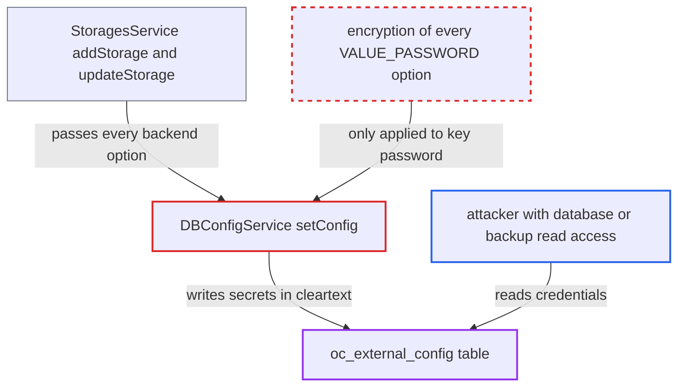

# External-storage secrets not named 'password' stored in cleartext in oc_external_config

| Field | Value |
|---|---|
| ID | `find_01BsKpJesZ5TXWhUAmN65mYS` |
| Severity | **Medium** |
| Status | open |
| CWE | CWE-312 — Cleartext Storage |
| Created | 2026-10-27T21:30:29.201920Z |
| Claude Security | https://claude.ai/security/findings/find_01BsKpJesZ5TXWhUAmN65mYS |

## Description

Someone who can read the Nextcloud database or a backup, but not `config.php`, can get working credentials for external storage mounts. These include S3 and Swift keys, SSE-C keys and SSH private keys. `DBConfigService::setConfig()` encrypts a mount option only when its key is literally `password`, so secrets declared under other names are stored in cleartext in `oc_external_config`.

1. **a user saving a mount** submits a storage configuration through `StoragesService`. `addStorage()` and `updateStorage()` pass every backend option to `setConfig()`, so this is the only way these values are saved. ([`apps/files_external/lib/Service/StoragesService.php:208-209`](https://github.com/cx-benchmark/server/blob/6b6317280f8ed50277369c33cee070a643d29654/apps/files_external/lib/Service/StoragesService.php#L208-L209))
2. **the method `setConfig()`** encrypts the value only when the key is `password`. Every other key is written to `oc_external_config` unchanged, whatever the parameter is declared as. ([`apps/files_external/lib/Service/DBConfigService.php:362-372`](https://github.com/cx-benchmark/server/blob/6b6317280f8ed50277369c33cee070a643d29654/apps/files_external/lib/Service/DBConfigService.php#L362-L372))
3. **the auth mechanism `AccessKey`** declares the S3 secret access key as `VALUE_PASSWORD` under the name `secret`. The name is not `password`, so the value skips encryption. `sse_c_key` in `Backend\AmazonS3` and the Rackspace `key` are stored the same way. ([`apps/files_external/lib/Lib/Auth/AmazonS3/AccessKey.php:29-31`](https://github.com/cx-benchmark/server/blob/6b6317280f8ed50277369c33cee070a643d29654/apps/files_external/lib/Lib/Auth/AmazonS3/AccessKey.php#L29-L31))
4. **the auth mechanism `RSAPrivateKey`** accepts a pasted SSH `private_key` and keeps it as given. The loader falls back to an empty passphrase, so an unencrypted PEM key is accepted and stored in cleartext, unlike keys that `RSA::createKey()` generates and PEM-encrypts. ([`apps/files_external/lib/Lib/Auth/PublicKey/RSAPrivateKey.php:38-60`](https://github.com/cx-benchmark/server/blob/6b6317280f8ed50277369c33cee070a643d29654/apps/files_external/lib/Lib/Auth/PublicKey/RSAPrivateKey.php#L38-L60))
5. **the attacker** reads `oc_external_config` from the database or a backup. A query on `key` and `value` shows `secret`, `sse_c_key`, Rackspace `key` and `private_key` directly, while `password` rows stay as ciphertext.

## Assessment

The attacker needs read access to the Nextcloud database, or to a dump or backup of it, but not to `config.php`. No victim action is needed. They query `oc_external_config` and read the secret values. The rows cover every configured mount, both global and personal. The report names no other way in.

Impact: The attacker obtains working S3 or Swift credentials, SSE-C keys and SSH private keys for every configured mount. The `password` values for the same mounts stay encrypted. Nextcloud itself loses no integrity or availability.

Subsequent-system impact: The leaked S3 and Swift access keys, SSE-C keys and SSH private keys authenticate directly to the external buckets and SFTP accounts behind the mounts. This gives the attacker the same read and write access Nextcloud has, outside Nextcloud's control.

## Recommendation

Encryption of mount options at rest depends on the option name `password`, not on the parameter being declared `VALUE_PASSWORD`. Other secret options are therefore saved in cleartext.

Fix criteria: Every backend or auth option declared `VALUE_PASSWORD` (at least `secret`, `sse_c_key`, the Rackspace `key` and `private_key`) is stored encrypted with the instance secret and decrypted on read. Existing rows are migrated. To verify, create S3, Rackspace and SFTP-key mounts. Then check that `oc_external_config` holds no plaintext secret and that the mounts still work.

## Evidence

**https://github.com/cx-benchmark/server**

- [`apps/files_external/lib/Service/DBConfigService.php:362-372`](https://github.com/cx-benchmark/server/blob/6b6317280f8ed50277369c33cee070a643d29654/apps/files_external/lib/Service/DBConfigService.php#L362-L372)
- [`apps/files_external/lib/Service/DBConfigService.php:549-563`](https://github.com/cx-benchmark/server/blob/6b6317280f8ed50277369c33cee070a643d29654/apps/files_external/lib/Service/DBConfigService.php#L549-L563)
- [`apps/files_external/lib/Lib/Auth/AmazonS3/AccessKey.php:29-31`](https://github.com/cx-benchmark/server/blob/6b6317280f8ed50277369c33cee070a643d29654/apps/files_external/lib/Lib/Auth/AmazonS3/AccessKey.php#L29-L31)
- [`apps/files_external/lib/Lib/Backend/AmazonS3.php:55-57`](https://github.com/cx-benchmark/server/blob/6b6317280f8ed50277369c33cee070a643d29654/apps/files_external/lib/Lib/Backend/AmazonS3.php#L55-L57)
- [`apps/files_external/lib/Lib/Auth/OpenStack/Rackspace.php:28-29`](https://github.com/cx-benchmark/server/blob/6b6317280f8ed50277369c33cee070a643d29654/apps/files_external/lib/Lib/Auth/OpenStack/Rackspace.php#L28-L29)
- [`apps/files_external/lib/Lib/Auth/PublicKey/RSAPrivateKey.php:38-60`](https://github.com/cx-benchmark/server/blob/6b6317280f8ed50277369c33cee070a643d29654/apps/files_external/lib/Lib/Auth/PublicKey/RSAPrivateKey.php#L38-L60)
- [`apps/files_external/lib/Lib/Auth/PublicKey/RSA.php:72-79`](https://github.com/cx-benchmark/server/blob/6b6317280f8ed50277369c33cee070a643d29654/apps/files_external/lib/Lib/Auth/PublicKey/RSA.php#L72-L79)
- [`apps/files_external/lib/Service/StoragesService.php:208-209`](https://github.com/cx-benchmark/server/blob/6b6317280f8ed50277369c33cee070a643d29654/apps/files_external/lib/Service/StoragesService.php#L208-L209)

