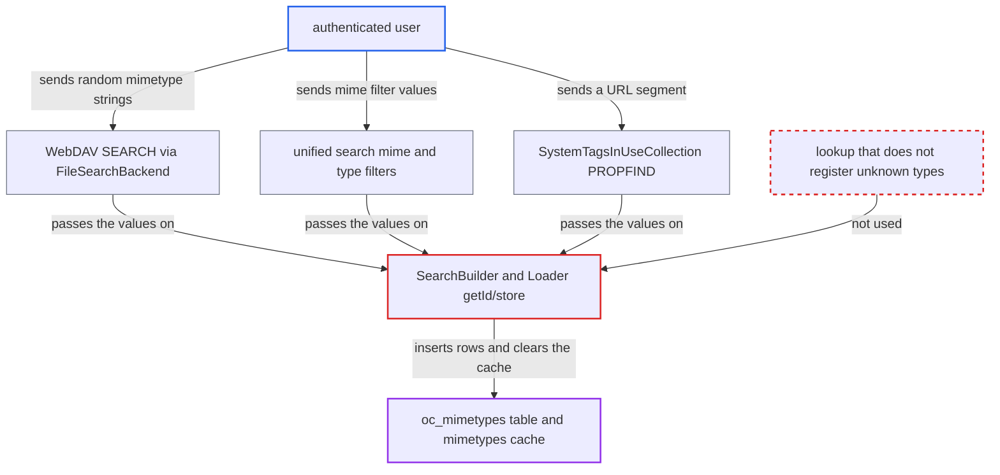

# File search with unknown mimetype inserts attacker strings into global mimetypes table

| Field | Value |
|---|---|
| ID | `find_01Js1ye6aQ3m9uZwQ64pBreo` |
| Severity | **Medium** |
| Status | open |
| CWE | CWE-770 — Uncontrolled resource consumption |
| Created | 2026-10-27T21:55:29.008182Z |
| Claude Security | https://claude.ai/security/findings/find_01Js1ye6aQ3m9uZwQ64pBreo |

## Description

Any logged-in user can add junk mimetype strings to the instance-wide mimetype table and slow the service for everyone. The effect persists until an administrator deletes the rows by hand. A search calls `IMimeTypeLoader::getId()` in `SearchBuilder`, and `getId()` inserts any mimetype it does not know.

1. **authenticated user** sends a search with unknown mimetype strings. A WebDAV `SEARCH` can compare `{DAV:}getcontenttype` with `eq` against up to 100 OR-ed random strings of up to 255 bytes per request. ([`apps/dav/lib/Files/FileSearchBackend.php:494-520`](https://github.com/cx-benchmark/server/blob/6b6317280f8ed50277369c33cee070a643d29654/apps/dav/lib/Files/FileSearchBackend.php#L494-L520))
2. **`SearchBuilder`** turns each mimetype value into a numeric id with `getId()`. The raw search value goes to `IMimeTypeLoader::getId()`, a call meant to register types, not to look them up. ([`lib/private/Files/Cache/SearchBuilder.php:218-234`](https://github.com/cx-benchmark/server/blob/6b6317280f8ed50277369c33cee070a643d29654/lib/private/Files/Cache/SearchBuilder.php#L218-L234))
3. **`Loader::getId()`** calls `store()` for every string it does not know. It makes no distinction between looking a type up and registering it. ([`lib/private/Files/Type/Loader.php:63-68`](https://github.com/cx-benchmark/server/blob/6b6317280f8ed50277369c33cee070a643d29654/lib/private/Files/Type/Loader.php#L63-L68))
4. **`Loader::store()`** inserts the string into `oc_mimetypes` and removes the shared `mimetypes` cache entry. The row is permanent and shared by all users, and the next request must reload the table. ([`lib/private/Files/Type/Loader.php:101-134`](https://github.com/cx-benchmark/server/blob/6b6317280f8ed50277369c33cee070a643d29654/lib/private/Files/Type/Loader.php#L101-L134))
5. **`Loader::loadMimetypes()`** reloads every row of `oc_mimetypes` into memory on each cache miss. The file cache is touched on almost every request, so a growing table slows all requests, and each new insert clears the cache again. ([`lib/private/Files/Type/Loader.php:141-160`](https://github.com/cx-benchmark/server/blob/6b6317280f8ed50277369c33cee070a643d29654/lib/private/Files/Type/Loader.php#L141-L160))

## Assessment

The attacker is any authenticated Nextcloud user. No victim action and no special setup are needed. One entry point is a WebDAV `SEARCH` to `/remote.php/dav/`. Its `{DAV:}where` holds a `{DAV:}or` of up to 100 `{DAV:}eq` comparisons on `{DAV:}getcontenttype`, each with a random string of up to 255 bytes. The second is the unified-search `mime` or `type` filters in `FilesSearchProvider`. The third is `PROPFIND /remote.php/dav/systemtags-assigned/<mediaType>`. Here `SystemTagsInUseCollection` passes the URL segment unvalidated to `detectAssignedSystemTagsIn()`. That builds `mimetype LIKE '<mediaType>/%'` and registers `<mediaType>` as a new row. The attacker repeats the request to grow the table without bound.

Impact: The attacker adds junk rows to the instance-wide `oc_mimetypes` table and makes every request that touches the file cache slower. This continues after the attack stops, until an administrator removes the rows by hand, because there is no repair step. Code that calls `IMimeTypeLoader::getMimetypeById()` can see attacker-chosen strings. Existing mappings are not changed and no data is disclosed.

## Recommendation

`SearchBuilder` converts user-supplied mimetype search values with the register-on-miss `IMimeTypeLoader::getId()`, so a read-only search writes to a shared table.

Fix criteria: A search never creates mimetype rows. An unknown mimetype value gives a comparison that matches nothing, using a lookup that returns null or false for unknown types and does not touch the database. To check, issue a DAV SEARCH for `{DAV:}getcontenttype eq 'zzz/never'`. The row count of `oc_mimetypes` must stay the same and the `mimetypes` cache must not be invalidated.

## Evidence

**https://github.com/cx-benchmark/server**

- [`lib/private/Files/Cache/SearchBuilder.php:218-234`](https://github.com/cx-benchmark/server/blob/6b6317280f8ed50277369c33cee070a643d29654/lib/private/Files/Cache/SearchBuilder.php#L218-L234)
- [`lib/private/Files/Type/Loader.php:63-68`](https://github.com/cx-benchmark/server/blob/6b6317280f8ed50277369c33cee070a643d29654/lib/private/Files/Type/Loader.php#L63-L68)
- [`lib/private/Files/Type/Loader.php:101-134`](https://github.com/cx-benchmark/server/blob/6b6317280f8ed50277369c33cee070a643d29654/lib/private/Files/Type/Loader.php#L101-L134)
- [`lib/private/Files/Type/Loader.php:141-160`](https://github.com/cx-benchmark/server/blob/6b6317280f8ed50277369c33cee070a643d29654/lib/private/Files/Type/Loader.php#L141-L160)
- [`apps/dav/lib/Files/FileSearchBackend.php:494-520`](https://github.com/cx-benchmark/server/blob/6b6317280f8ed50277369c33cee070a643d29654/apps/dav/lib/Files/FileSearchBackend.php#L494-L520)
- [`apps/files/lib/Search/FilesSearchProvider.php:156-157`](https://github.com/cx-benchmark/server/blob/6b6317280f8ed50277369c33cee070a643d29654/apps/files/lib/Search/FilesSearchProvider.php#L156-L157)
- [`apps/dav/lib/SystemTag/SystemTagsInUseCollection.php:45-73`](https://github.com/cx-benchmark/server/blob/6b6317280f8ed50277369c33cee070a643d29654/apps/dav/lib/SystemTag/SystemTagsInUseCollection.php#L45-L73)

