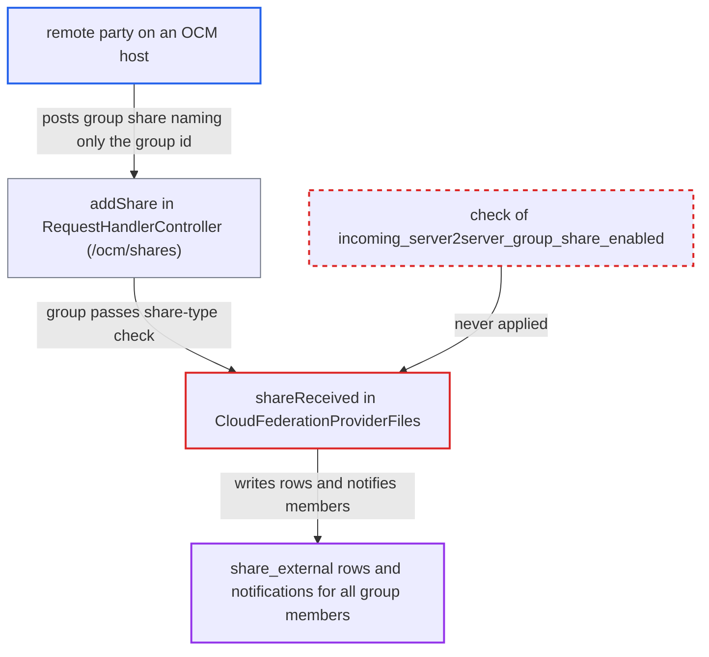

# Incoming federated group shares accepted although admin setting disables them

| Field | Value |
|---|---|
| ID | `find_01BpczWQQzA5SujHD8CPBvpX` |
| Severity | **Medium** |
| Status | open |
| CWE | CWE-862 — Missing Authorization |
| Created | 2026-10-27T21:32:05.616667Z |
| Claude Security | https://claude.ai/security/findings/find_01BpczWQQzA5SujHD8CPBvpX |

## Description

Any remote party can push a federated share offer to every member of any local group, even though the admin switch for incoming group shares is off, which is the default. The attacker needs only the group id and an OCM host, and no login. `CloudFederationProviderFiles::shareReceived()` checks only the user-share setting and never checks `incoming_server2server_group_share_enabled`. The effect is limited to unsolicited pending shares and notifications.

1. **remote party** posts a group share offer to `/ocm/shares`. The request sets `shareType=group` and `shareWith=<groupid>@<victim>`. The endpoint is a public page, and unsigned requests from a host without a signatory are accepted by default. ([`apps/cloud_federation_api/lib/Controller/RequestHandlerController.php:98-186`](https://github.com/cx-benchmark/server/blob/6b6317280f8ed50277369c33cee070a643d29654/apps/cloud_federation_api/lib/Controller/RequestHandlerController.php#L98-L186))
2. **the handler `addShare()`** lets the group share past its share-type check. `getSupportedShareTypes()` always returns `['user', 'group']`, so the `in_array` check passes. The only group check left is `groupExists()`. ([`apps/federatedfilesharing/lib/OCM/CloudFederationProviderFiles.php:663-678`](https://github.com/cx-benchmark/server/blob/6b6317280f8ed50277369c33cee070a643d29654/apps/federatedfilesharing/lib/OCM/CloudFederationProviderFiles.php#L663-L678))
3. **the method `shareReceived()`** checks only the user-share setting. `isS2SEnabled(true)` reads the incoming user-share switch, which is on by default. `isIncomingServer2serverGroupShareEnabled()` is never called, so the group switch has no effect here. ([`apps/federatedfilesharing/lib/OCM/CloudFederationProviderFiles.php:92-125`](https://github.com/cx-benchmark/server/blob/6b6317280f8ed50277369c33cee070a643d29654/apps/federatedfilesharing/lib/OCM/CloudFederationProviderFiles.php#L92-L125))
4. **the method `shareReceived()`** stores the group share and notifies every member. It inserts a group `share_external` row and sends each member an activity and a pending-share notification. If the owner's remote is on the trusted-server list, it also auto-accepts the share into each member's files. ([`apps/federatedfilesharing/lib/OCM/CloudFederationProviderFiles.php:178-243`](https://github.com/cx-benchmark/server/blob/6b6317280f8ed50277369c33cee070a643d29654/apps/federatedfilesharing/lib/OCM/CloudFederationProviderFiles.php#L178-L243))

## Assessment

The attacker is any internet party running or claiming an OCM host, with no login. The default configuration is enough: incoming user shares on and incoming group shares off (`files_sharing/incoming_server2server_group_share_enabled` is `no`). The attacker POSTs to `/ocm/shares` with `shareType=group`, `shareWith=<groupid>@<victim>`, `owner=<user>@<their host>`, `resourceType=file` and a webdav `sharedSecret`. No user has to act first. `FederationRateLimit(5, 1200)` limits each source. Members who join the group later are covered too, because `canAccessShare()` resolves membership when it is checked. Only the OCM endpoint `/ocm/shares` delivers group shares, because the legacy OCS `createShare` hard-codes `'user'`. A second effect is that the reply differs between 400 `Group ... does not exists` and 201, which shows which group ids exist. Misses are throttled by brute-force protection. `OCMDiscoveryService::getLocalOCMProvider()` also advertises `group` whatever the setting says.

Impact: The admin's ban on incoming federated group shares does not work. An outsider can place pending shares and notifications in the accounts of every member of any group, current and future, without knowing user ids. Members who accept get a remote mount, and a remote on the trusted-server list gets one automatically. No local file contents or credentials are exposed. The effect is limited to unsolicited share entries and notifications, plus probing of group ids.

## Recommendation

`shareReceived()`, `getSupportedShareTypes()` and the local OCM discovery document ignore `incoming_server2server_group_share_enabled`, so the admin control over incoming federated group shares is never enforced on the request path.

Fix criteria: With the setting disabled, an incoming OCM share with `shareType=group` is refused before any `share_external` row is written, before any group lookup reveals whether the group exists, and before any member is notified. The discovery document does not list `group`. To check, POST such a share to `/ocm/shares` on a default install. The reply must be 4xx/501 and identical for existing and missing groups, with no row created and no notification sent. With the setting enabled, group shares still work.

## Evidence

**https://github.com/cx-benchmark/server**

- [`apps/federatedfilesharing/lib/OCM/CloudFederationProviderFiles.php:92-125`](https://github.com/cx-benchmark/server/blob/6b6317280f8ed50277369c33cee070a643d29654/apps/federatedfilesharing/lib/OCM/CloudFederationProviderFiles.php#L92-L125)
- [`apps/federatedfilesharing/lib/OCM/CloudFederationProviderFiles.php:178-243`](https://github.com/cx-benchmark/server/blob/6b6317280f8ed50277369c33cee070a643d29654/apps/federatedfilesharing/lib/OCM/CloudFederationProviderFiles.php#L178-L243)
- [`apps/federatedfilesharing/lib/OCM/CloudFederationProviderFiles.php:663-678`](https://github.com/cx-benchmark/server/blob/6b6317280f8ed50277369c33cee070a643d29654/apps/federatedfilesharing/lib/OCM/CloudFederationProviderFiles.php#L663-L678)
- [`apps/federatedfilesharing/lib/FederatedShareProvider.php:940-946`](https://github.com/cx-benchmark/server/blob/6b6317280f8ed50277369c33cee070a643d29654/apps/federatedfilesharing/lib/FederatedShareProvider.php#L940-L946)
- [`apps/cloud_federation_api/lib/Controller/RequestHandlerController.php:98-186`](https://github.com/cx-benchmark/server/blob/6b6317280f8ed50277369c33cee070a643d29654/apps/cloud_federation_api/lib/Controller/RequestHandlerController.php#L98-L186)
- [`lib/private/OCM/OCMDiscoveryService.php:221-224`](https://github.com/cx-benchmark/server/blob/6b6317280f8ed50277369c33cee070a643d29654/lib/private/OCM/OCMDiscoveryService.php#L221-L224)

