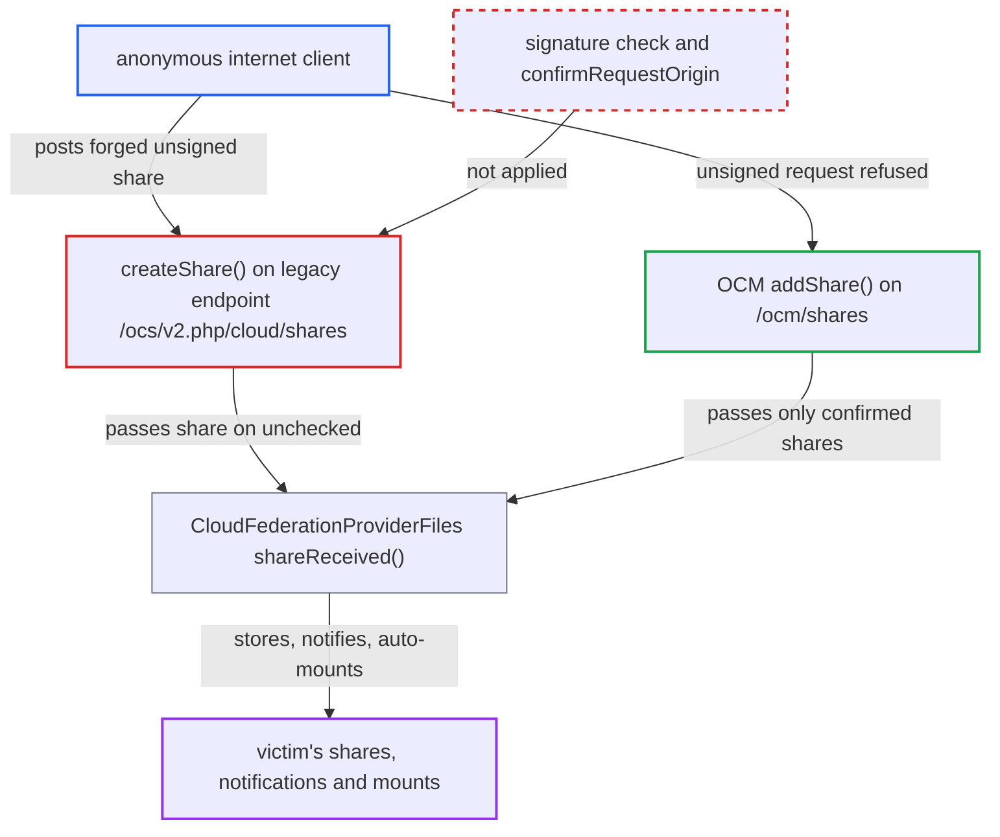

# Legacy OCS federated-share endpoint bypasses OCM request-signature origin confirmation

| Field | Value |
|---|---|
| ID | `find_015otxzdDRgk4FUvrGnc1aQQ` |
| Severity | **Medium** |
| Status | open |
| CWE | CWE-290 — Authentication Bypass by Spoofing |
| Created | 2026-10-27T21:32:39.040938Z |
| Claude Security | https://claude.ai/security/findings/find_015otxzdDRgk4FUvrGnc1aQQ |

## Description

An anonymous internet client can forge a federated share that appears to come from a trusted partner server, such as `ceo@partner.example`. The victim gets a share, activity entry and notification attributed to the spoofed owner. The share can also be auto-mounted. The old endpoint `POST /ocs/v2.php/cloud/shares`, handled by `createShare()`, never checks the request signature or confirms the owner's host. The OCM endpoint does both.

1. **attacker** posts a forged share to the legacy endpoint. The request to `POST /ocs/v2.php/cloud/shares` sets `shareWith` to the victim and `ownerFederatedId` to a host that normally signs, for example `ceo@partner.example`, and adds `remoteId`, `token` and `name`. ([`apps/federatedfilesharing/appinfo/routes.php:14-23`](https://github.com/cx-benchmark/server/blob/6b6317280f8ed50277369c33cee070a643d29654/apps/federatedfilesharing/appinfo/routes.php#L14-L23))
2. **the handler `createShare()`** builds the share from request parameters alone. The handler is `#[PublicPage]` and `#[NoCSRFRequired]`. It takes `ownerFederatedId`, `sharedByFederatedId`, `owner`, `sharedBy`, `token` and `name` as sent. It never calls `getIncomingSignedRequest()` or `confirmRequestOrigin()`, and it skips the `Spoofchecker` homograph check. ([`apps/federatedfilesharing/lib/Controller/RequestHandlerController.php:71-125`](https://github.com/cx-benchmark/server/blob/6b6317280f8ed50277369c33cee070a643d29654/apps/federatedfilesharing/lib/Controller/RequestHandlerController.php#L71-L125))
3. **the attribute `FederationRateLimit`** only picks a rate limit and lets the request through. `shouldApply()` catches every exception from `getIncomingSignedRequest()` and returns `true`. The only effect is a rate limit of 5 requests per 20 minutes per IP, and an unsigned or spoofed request is never rejected. ([`lib/private/AppFramework/Http/Attributes/FederationRateLimit.php:38-54`](https://github.com/cx-benchmark/server/blob/6b6317280f8ed50277369c33cee070a643d29654/lib/private/AppFramework/Http/Attributes/FederationRateLimit.php#L38-L54))
4. **the method `shareReceived()`** stores the share and notifies the victim as the spoofed owner. It takes `remote` from the claimed owner's host and publishes an activity and a notification naming the spoofed `ownerFederatedId` and `sharedByFederatedId`. ([`apps/federatedfilesharing/lib/OCM/CloudFederationProviderFiles.php:110-225`](https://github.com/cx-benchmark/server/blob/6b6317280f8ed50277369c33cee070a643d29654/apps/federatedfilesharing/lib/OCM/CloudFederationProviderFiles.php#L110-L225))
5. **the method `shareReceived()`** auto-accepts and mounts the share when the claimed host is a trusted server. `federatedTrustedShareAutoAccept` defaults to `yes`. The share is mounted under the name the attacker chose. ([`apps/federatedfilesharing/lib/OCM/CloudFederationProviderFiles.php:110-225`](https://github.com/cx-benchmark/server/blob/6b6317280f8ed50277369c33cee070a643d29654/apps/federatedfilesharing/lib/OCM/CloudFederationProviderFiles.php#L110-L225))

## Assessment

The attacker is an unauthenticated internet client and needs no login. The attack gains something over the OCM endpoint only when the impersonated host already has a stored signatory, or when the admin has set `ocm_signed_request_enforced`. The attacker does not control either of these. Auto-mounting also needs the claimed host to be a trusted server with `federatedTrustedShareAutoAccept` at its default `yes`. The mount reads `https://<spoofed host>/public.php/webdav` with the attacker's token. It shows the attacker's content, and takes uploads, only if the attacker holds a valid share token on that host, such as a public link from an account there. Otherwise it shows a broken entry. The legacy notification endpoints `acceptShare`, `declineShare`, `unshare`, `revoke` and `reShare` skip the sharedSecret-derived `confirmRequestOrigin()` that `receiveNotification()` applies. Anyone who holds a share token can use it from any host. `updatePermissions` does nothing, because `updateResharePermissions()` always throws.

Impact: The attacker can plant shares, activity entries and notifications that appear to come from a trusted federated identity. The attacker can also plant auto-accepted mounts under names the attacker picks. The report calls the damage limited to share metadata and attribution. Reading the victim's data needs further action from the victim, and service is not affected.

## Recommendation

The legacy `federatedfilesharing` controller reaches `shareReceived()` and `notificationReceived()` without the signature enforcement and origin confirmation that the OCM controller applies. Choosing the legacy URL therefore bypasses request signing. The legacy endpoints are still used by old peers through `Notifications::tryLegacyEndPoint()`, so they must apply the OCM policy and not be removed.

Fix criteria: Every public entry point that reaches `shareReceived()` or `notificationReceived()` applies the same policy as `/ocm/shares` and `/ocm/notifications`. It refuses unsigned requests when `ocm_signed_request_enforced` is set. It confirms the claimed owner host (for shares) or the sharedSecret-derived identity (for notifications) against the signer or the stored signatory. It applies the homograph check. An unsigned legacy request whose owner host has a stored signatory is rejected. With enforcement on, any unsigned legacy request is rejected.

## Evidence

**https://github.com/cx-benchmark/server**

- [`apps/federatedfilesharing/lib/Controller/RequestHandlerController.php:71-125`](https://github.com/cx-benchmark/server/blob/6b6317280f8ed50277369c33cee070a643d29654/apps/federatedfilesharing/lib/Controller/RequestHandlerController.php#L71-L125)
- [`apps/federatedfilesharing/appinfo/routes.php:14-23`](https://github.com/cx-benchmark/server/blob/6b6317280f8ed50277369c33cee070a643d29654/apps/federatedfilesharing/appinfo/routes.php#L14-L23)
- [`apps/cloud_federation_api/lib/Controller/RequestHandlerController.php:102-113`](https://github.com/cx-benchmark/server/blob/6b6317280f8ed50277369c33cee070a643d29654/apps/cloud_federation_api/lib/Controller/RequestHandlerController.php#L102-L113)
- [`lib/private/OCM/OCMDiscoveryService.php:271-320`](https://github.com/cx-benchmark/server/blob/6b6317280f8ed50277369c33cee070a643d29654/lib/private/OCM/OCMDiscoveryService.php#L271-L320)
- [`lib/private/AppFramework/Http/Attributes/FederationRateLimit.php:38-54`](https://github.com/cx-benchmark/server/blob/6b6317280f8ed50277369c33cee070a643d29654/lib/private/AppFramework/Http/Attributes/FederationRateLimit.php#L38-L54)
- [`apps/federatedfilesharing/lib/OCM/CloudFederationProviderFiles.php:110-225`](https://github.com/cx-benchmark/server/blob/6b6317280f8ed50277369c33cee070a643d29654/apps/federatedfilesharing/lib/OCM/CloudFederationProviderFiles.php#L110-L225)
- [`apps/cloud_federation_api/lib/Controller/RequestHandlerController.php:304-315`](https://github.com/cx-benchmark/server/blob/6b6317280f8ed50277369c33cee070a643d29654/apps/cloud_federation_api/lib/Controller/RequestHandlerController.php#L304-L315)

