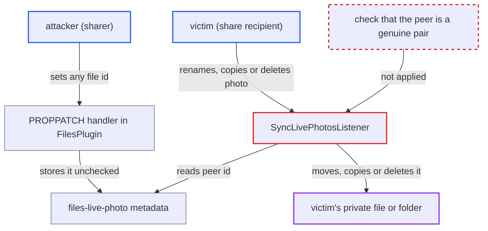

# Live photo peer link trusted across users lets sharer move or delete recipient's private files

| Field | Value |
|---|---|
| ID | `find_01JtsBJxns4MbjZ2QtWfk8JR` |
| Severity | **Medium** |
| Status | open |
| CWE | CWE-285 — Improper authorization |
| Created | 2026-10-27T21:26:26.130107Z |
| Claude Security | https://claude.ai/security/findings/find_01JtsBJxns4MbjZ2QtWfk8JR |

## Description

A user who shares a folder with edit rights can make a recipient's own private file or folder get moved into the sharer's storage, copied into the share, or deleted. This happens when the recipient renames, moves, copies or deletes a planted photo in the share. The attacker needs only a login, a shared folder and a guessed file id. The cause is `SyncLivePhotosListener`, which acts on whatever node the attacker-writable `files-live-photo` metadata points to, without checking it is a real Live Photo pair.

1. **attacker (any authenticated user)** shares a folder with the victim and uploads a photo. The share gives the victim edit rights (update, create and delete), and the photo is `S/photo.jpg` in the shared folder `S`.
2. **attacker** sends a PROPPATCH that sets the `files-live-photo` metadata on the photo to the id of one of the victim's private nodes. The key is writable by the file's owner or anyone with update permission, and the stored string is not checked against the real peer or against what the writer can access. ([`apps/dav/lib/Connector/Sabre/FilesPlugin.php:642-724`](https://github.com/cx-benchmark/server/blob/6b6317280f8ed50277369c33cee070a643d29654/apps/dav/lib/Connector/Sabre/FilesPlugin.php#L642-L724))
3. **victim** renames, moves, copies or deletes the planted photo inside the share. A rename through the Files UI or WebDAV MOVE goes through `View::rename`, which fires `BeforeNodeRenamedEvent` and reaches the listener. ([`lib/private/Files/Node/HookConnector.php:148-161`](https://github.com/cx-benchmark/server/blob/6b6317280f8ed50277369c33cee070a643d29654/lib/private/Files/Node/HookConnector.php#L148-L161))
4. **the listener `SyncLivePhotosListener`** reads the peer id and resolves it with `getFirstNodeById` in the victim's own folder. `LivePhotosService::getLivePhotoPeerId()` casts the stored string to an int, and the lookup runs in the victim's namespace, so the id finds the victim's private node. ([`apps/files/lib/Listener/SyncLivePhotosListener.php:53-90`](https://github.com/cx-benchmark/server/blob/6b6317280f8ed50277369c33cee070a643d29654/apps/files/lib/Listener/SyncLivePhotosListener.php#L53-L90))
5. **the handler `handleMove()`** moves the victim's private node into the share folder under the new photo name plus the peer's extension. `Node::move()` only checks that the victim may create files in the share folder and may move their own files, so the node ends up in the attacker's storage. ([`apps/files/lib/Listener/SyncLivePhotosListener.php:144-162`](https://github.com/cx-benchmark/server/blob/6b6317280f8ed50277369c33cee070a643d29654/apps/files/lib/Listener/SyncLivePhotosListener.php#L144-L162))
6. **the handler `handleDeletion()`** deletes the victim's private node when the victim deletes the photo. The delete runs with the victim's rights, and copying the photo similarly makes `handleCopy()` copy the private node into the share. ([`apps/files/lib/Listener/SyncLivePhotosListener.php:201-219`](https://github.com/cx-benchmark/server/blob/6b6317280f8ed50277369c33cee070a643d29654/apps/files/lib/Listener/SyncLivePhotosListener.php#L201-L219))

## Assessment

The attacker is any authenticated user. They share a folder with the victim with edit rights (update, create and delete) and upload a photo into it. They also need the id of a private file or folder of the victim. Ids are global sequential integers, so the attacker has to guess one. They can plant many photos, and nothing in the code limits this. The attack runs only when the victim acts on the planted photo inside the share. That can be a rename or move through the Files UI or WebDAV MOVE, a copy, or a delete.

Impact: Each rename or move pulls one of the victim's private files or whole folder trees into the attacker's storage. The attacker then owns it and can read its full content and take it away. A copy puts the private node into the share. A delete removes the victim's node into the victim's trash. The report notes no service availability impact.

## Recommendation

(1) `SyncLivePhotosListener` moves, copies or deletes whatever node the attacker-writable `files-live-photo` id resolves to in the acting user's folder. It never checks that the node is the genuine Live Photo peer.

Fix criteria: Before moving, copying or deleting a peer, the listener confirms the pair is genuine. The peer must carry a reciprocal `files-live-photo` pointing back at the source. Both files must be in the same parent folder with the same base name, and on shared storages also on the same storage. A test shows that a photo whose metadata points at an unrelated file id in the recipient's home can be renamed or deleted by the recipient without that unrelated node being moved or deleted.

(2) The WebDAV PROPPATCH handling in `FilesPlugin` stores any string as `files-live-photo`. It does not check that the referenced id is a sibling file the writer can access.

Fix criteria: Setting `files-live-photo` is rejected unless the referenced id resolves, in the writer's own folder, to a sibling file: same parent, same base name, and an image and video pair. A test shows that a PROPPATCH pointing at an arbitrary id is refused.

## Evidence

**https://github.com/cx-benchmark/server**

- [`apps/files/lib/Listener/SyncLivePhotosListener.php:53-90`](https://github.com/cx-benchmark/server/blob/6b6317280f8ed50277369c33cee070a643d29654/apps/files/lib/Listener/SyncLivePhotosListener.php#L53-L90)
- [`apps/files/lib/Listener/SyncLivePhotosListener.php:144-162`](https://github.com/cx-benchmark/server/blob/6b6317280f8ed50277369c33cee070a643d29654/apps/files/lib/Listener/SyncLivePhotosListener.php#L144-L162)
- [`apps/files/lib/Listener/SyncLivePhotosListener.php:201-219`](https://github.com/cx-benchmark/server/blob/6b6317280f8ed50277369c33cee070a643d29654/apps/files/lib/Listener/SyncLivePhotosListener.php#L201-L219)
- [`apps/files/lib/Service/LivePhotosService.php:24-36`](https://github.com/cx-benchmark/server/blob/6b6317280f8ed50277369c33cee070a643d29654/apps/files/lib/Service/LivePhotosService.php#L24-L36)
- [`apps/dav/lib/Connector/Sabre/FilesPlugin.php:642-724`](https://github.com/cx-benchmark/server/blob/6b6317280f8ed50277369c33cee070a643d29654/apps/dav/lib/Connector/Sabre/FilesPlugin.php#L642-L724)
- [`lib/private/Server.php:425-432`](https://github.com/cx-benchmark/server/blob/6b6317280f8ed50277369c33cee070a643d29654/lib/private/Server.php#L425-L432)
- [`lib/private/Files/Node/HookConnector.php:148-161`](https://github.com/cx-benchmark/server/blob/6b6317280f8ed50277369c33cee070a643d29654/lib/private/Files/Node/HookConnector.php#L148-L161)

