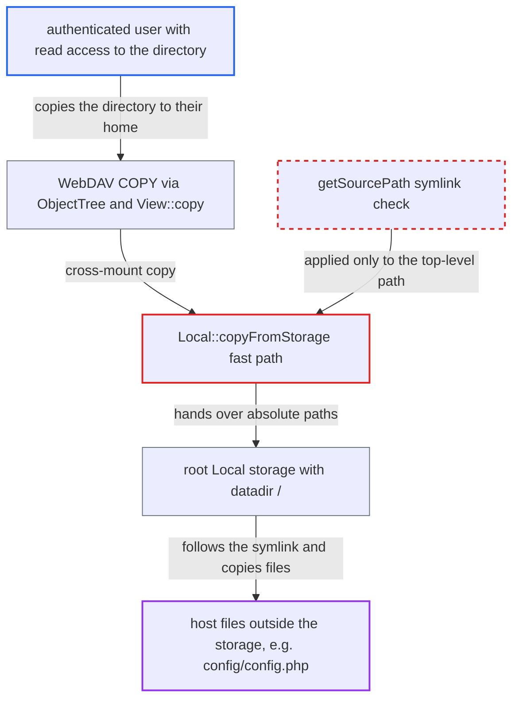

# Local cross-storage copy fast path follows symlinks outside the source storage root

| Field | Value |
|---|---|
| ID | `find_01Qgo6on2oHr2iL6QnuNU8Lv` |
| Severity | **Medium** |
| Status | open |
| CWE | CWE-59 — Link following |
| Created | 2026-10-27T22:10:08.007620Z |
| Claude Security | https://claude.ai/security/findings/find_01Qgo6on2oHr2iL6QnuNU8Lv |

## Description

An authenticated user who can read a directory on a Local-backed storage can copy files from anywhere on the host that the PHP process can read, such as `config/config.php`, into their own home. This needs a symlink that points outside the storage to already sit in that directory. Nextcloud never creates symlinks, so another channel must place it. The cause is `Local::copyFromStorage()`, which skips the symlink check in `getSourcePath()` for the children it copies.

1. **outside channel** places a symlink inside a directory of a Local-backed storage. The link points outside the storage root. Nextcloud has no code that creates symlinks, so this happens through something like an NFS/SMB/SFTP export of the directory or another service writing to it.
2. **attacker** sends a WebDAV COPY of that directory into another mount, such as their home. The request checks only that the destination can be created and that the top-level source exists, then calls `View::copy`. No check is made on the children. ([`apps/dav/lib/Connector/Sabre/ObjectTree.php:157-190`](https://github.com/cx-benchmark/server/blob/6b6317280f8ed50277369c33cee070a643d29654/apps/dav/lib/Connector/Sabre/ObjectTree.php#L157-L190))
3. **`View::copy`** calls `copyFromStorage` on the destination storage. A copy between two different mount points goes this way and reaches the Local fast path. A copy within one mount calls `copy()` on the storage and keeps the per-child checks. ([`lib/private/Files/View.php:988-996`](https://github.com/cx-benchmark/server/blob/6b6317280f8ed50277369c33cee070a643d29654/lib/private/Files/View.php#L988-L996))
4. **`Local::copyFromStorage()`** checks only the top-level source path, then calls `copy()` on `new Local(['datadir' => '/'])`. The fast path is accepted by `canDoCrossStorageMove()` for homes, external Local mounts and shares of either. ([`lib/private/Files/Storage/Local.php:629-647`](https://github.com/cx-benchmark/server/blob/6b6317280f8ed50277369c33cee070a643d29654/lib/private/Files/Storage/Local.php#L629-L647))
5. **root `Local` storage** accepts any path on the host. Its `realDataDir` is `/`, so the containment check in `getSourcePath()` always passes. ([`lib/private/Files/Storage/Local.php:52-60`](https://github.com/cx-benchmark/server/blob/6b6317280f8ed50277369c33cee070a643d29654/lib/private/Files/Storage/Local.php#L52-L60))
6. **`Common::copy()`** walks the directory on disk and copies each child, following the symlink. `opendir`, `readdir`, `is_dir` and PHP `copy()` all follow symbolic links. Nothing re-checks that a child stays inside the source storage root, so the link target's files are written as regular files in the destination. ([`lib/private/Files/Storage/Common.php:219-233`](https://github.com/cx-benchmark/server/blob/6b6317280f8ed50277369c33cee070a643d29654/lib/private/Files/Storage/Common.php#L219-L233))
7. **attacker** requests the copied file by name to download it. The copied children are not yet in the target cache. The first access by name scans them in, and a later scan would also do it. ([`lib/private/Files/View.php:1394-1408`](https://github.com/cx-benchmark/server/blob/6b6317280f8ed50277369c33cee070a643d29654/lib/private/Files/View.php#L1394-L1408))

## Assessment

The attacker is an authenticated user with read access to a directory on a Local-backed storage. That can be an external `Local` mount, a home, or a share of either. A symlink pointing outside that storage must already be in the directory, placed by a channel outside Nextcloud, for example an NFS/SMB/SFTP export of the same directory, another service writing to it, or a link an operator left there. The setting `localstorage.allowsymlinks` does not need to be changed. It defaults to `false` and is meant to block this. The attacker sends a WebDAV COPY of the directory to another mount. A move reaches the same recursive copy only when `rename()` fails across devices. A move on the same device just moves the link itself.

Impact: The attacker can read any file or tree the PHP process can read on the host. Examples are `config/config.php` (database credentials, `secret`, `passwordsalt`), other users' data directories and `/etc`. The content is copied into the attacker's own Nextcloud files. The link target is only read, never written or deleted.

## Recommendation

`Local::copyFromStorage()` and `moveFromStorage()` do the recursive copy through an unrestricted root `Local` storage. The symlink check in `Local::getSourcePath()` (`localstorage.allowsymlinks`) is therefore not applied to the children of the copied directory.

Fix criteria: Cross-storage copies and moves between Local storages apply the same containment as direct access. Every file and directory touched during the recursive copy resolves with `realpath` inside the source storage's root, and the target resolves inside the target's root, unless `localstorage.allowsymlinks` is enabled. The operation fails, rather than silently skipping, when a child escapes. To verify, create a symlink inside a Local external mount that points outside it. Then copy, move or trash the containing directory to a home folder. No content from the link target may appear in the destination.

## Evidence

**https://github.com/cx-benchmark/server**

- [`lib/private/Files/Storage/Local.php:629-647`](https://github.com/cx-benchmark/server/blob/6b6317280f8ed50277369c33cee070a643d29654/lib/private/Files/Storage/Local.php#L629-L647)
- [`lib/private/Files/Storage/Local.php:52-60`](https://github.com/cx-benchmark/server/blob/6b6317280f8ed50277369c33cee070a643d29654/lib/private/Files/Storage/Local.php#L52-L60)
- [`lib/private/Files/Storage/Local.php:547-576`](https://github.com/cx-benchmark/server/blob/6b6317280f8ed50277369c33cee070a643d29654/lib/private/Files/Storage/Local.php#L547-L576)
- [`lib/private/Files/Storage/Local.php:424-441`](https://github.com/cx-benchmark/server/blob/6b6317280f8ed50277369c33cee070a643d29654/lib/private/Files/Storage/Local.php#L424-L441)
- [`lib/private/Files/Storage/Common.php:219-233`](https://github.com/cx-benchmark/server/blob/6b6317280f8ed50277369c33cee070a643d29654/lib/private/Files/Storage/Common.php#L219-L233)
- [`lib/private/Files/Storage/Local.php:615-626`](https://github.com/cx-benchmark/server/blob/6b6317280f8ed50277369c33cee070a643d29654/lib/private/Files/Storage/Local.php#L615-L626)
- [`lib/private/Files/View.php:988-996`](https://github.com/cx-benchmark/server/blob/6b6317280f8ed50277369c33cee070a643d29654/lib/private/Files/View.php#L988-L996)
- [`apps/dav/lib/Connector/Sabre/ObjectTree.php:157-190`](https://github.com/cx-benchmark/server/blob/6b6317280f8ed50277369c33cee070a643d29654/apps/dav/lib/Connector/Sabre/ObjectTree.php#L157-L190)
- [`lib/private/Files/Storage/Common.php:544-560`](https://github.com/cx-benchmark/server/blob/6b6317280f8ed50277369c33cee070a643d29654/lib/private/Files/Storage/Common.php#L544-L560)
- [`lib/private/Files/View.php:1394-1408`](https://github.com/cx-benchmark/server/blob/6b6317280f8ed50277369c33cee070a643d29654/lib/private/Files/View.php#L1394-L1408)
- [`config/config.sample.php:2627-2634`](https://github.com/cx-benchmark/server/blob/6b6317280f8ed50277369c33cee070a643d29654/config/config.sample.php#L2627-L2634)

