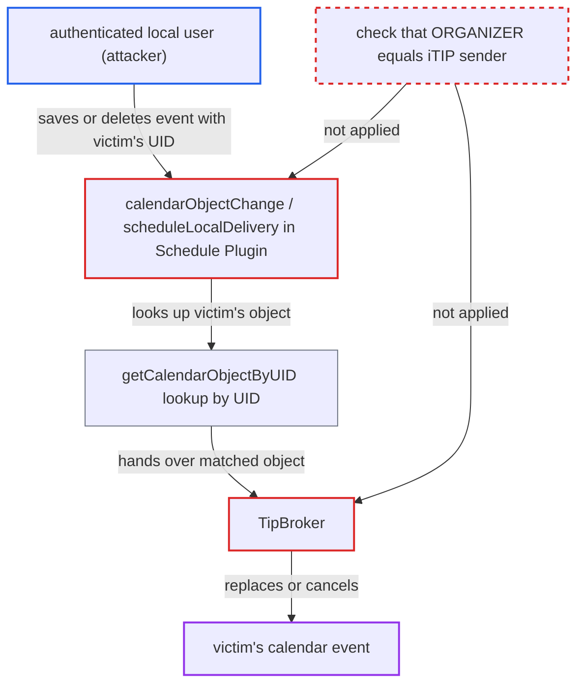

# Local iTIP delivery lets any user replace or cancel another user's event by UID

| Field | Value |
|---|---|
| ID | `find_01RR134PU1dfFusZvsuQBV2y` |
| Severity | **Medium** |
| Status | open |
| CWE | CWE-639 — Insecure direct object reference |
| Created | 2026-10-27T21:33:25.727785Z |
| Claude Security | https://claude.ai/security/findings/find_01RR134PU1dfFusZvsuQBV2y |

## Description

Any logged-in local user who knows the UID of another user's event can overwrite that event wholesale or mark it cancelled, without the victim doing anything. The attacker sends a calendar invitation (iTIP message) that reuses the UID. The weak spot is `scheduleLocalDelivery()` and `TipBroker`, which match the victim's event by UID alone and never check that the sender is its organizer.

1. **attacker (any authenticated local user)** learns the UID of a victim's event. UIDs are not secret. Every attendee gets the UID and every sharee sees it, read-only sharees included, because the CONFIDENTIAL mask keeps `UID`. ([`apps/dav/lib/CalDAV/CalendarObject.php:95-118`](https://github.com/cx-benchmark/server/blob/6b6317280f8ed50277369c33cee070a643d29654/apps/dav/lib/CalDAV/CalendarObject.php#L95-L118))
2. **attacker** saves an event with that UID in their own calendar, or deletes it. The event names the attacker as `ORGANIZER` and the victim as `ATTENDEE`. A `mailto:` attendee resolves to the local user with that e-mail under default sharing settings. Deleting the event produces a CANCEL instead. ([`apps/dav/lib/Connector/Sabre/Principal.php:454-470`](https://github.com/cx-benchmark/server/blob/6b6317280f8ed50277369c33cee070a643d29654/apps/dav/lib/Connector/Sabre/Principal.php#L454-L470))
3. **the plugin method `calendarObjectChange()`** passes the change on as if the attacker were the organizer. It hands the attacker's own addresses to the processing, so `parseEventForOrganizer()` produces a REQUEST to the victim. `beforeUnbind()` does the same for a CANCEL when the attacker deletes the event. ([`apps/dav/lib/CalDAV/Schedule/Plugin.php:165-214`](https://github.com/cx-benchmark/server/blob/6b6317280f8ed50277369c33cee070a643d29654/apps/dav/lib/CalDAV/Schedule/Plugin.php#L165-L214))
4. **the plugin method `scheduleLocalDelivery()`** delivers the message to the victim and only strips VALARMs. It then calls the parent method. No check is made that the sender is the organizer of the victim's existing object. ([`apps/dav/lib/CalDAV/Schedule/Plugin.php:256-265`](https://github.com/cx-benchmark/server/blob/6b6317280f8ed50277369c33cee070a643d29654/apps/dav/lib/CalDAV/Schedule/Plugin.php#L256-L265))
5. **the backend method `getCalendarObjectByUID()`** selects the victim's existing event by UID. It filters only on the recipient's principal and `uid`, so the attacker's chosen UID picks the victim's event. ([`apps/dav/lib/CalDAV/CalDavBackend.php:2666-2687`](https://github.com/cx-benchmark/server/blob/6b6317280f8ed50277369c33cee070a643d29654/apps/dav/lib/CalDAV/CalDavBackend.php#L2666-L2687))
6. **the broker `TipBroker`** replaces or cancels the victim's event, and the result is saved without an ACL check. A REQUEST falls back to sabre/vobject's default, which replaces all components of the existing object. `processMessageCancel()` sets `STATUS:CANCELLED` and the sender's `SEQUENCE` on every matching instance. ([`apps/dav/lib/CalDAV/TipBroker.php:53-88`](https://github.com/cx-benchmark/server/blob/6b6317280f8ed50277369c33cee070a643d29654/apps/dav/lib/CalDAV/TipBroker.php#L53-L88))

## Assessment

The attacker is any authenticated local user who knows a UID in the victim's calendar. They might know it as an invitee or as a read-only sharee of a calendar. They put an event with that UID into one of their own calendars, with `ORGANIZER` set to themself and `ATTENDEE` set to the victim, or they delete it to send a CANCEL. The victim does nothing. Under default sharing settings, the attacker can address any local user by e-mail. The same missing check applies to messages that enter through `CalendarImpl::handleIMipMessage()`.

Impact: The victim's event is replaced with attacker-chosen content (time, title, location, attendees, `ORGANIZER` set to the attacker) or marked cancelled. A read-only sharee therefore gains write access over every event of the shared calendar. An invitee can rewrite the organizer's copy and every other attendee's copy. Reach is limited to UIDs the attacker knows and to VEVENTs. Nothing is disclosed to the attacker and the service is not degraded.

## Recommendation

Local iTIP REQUEST and CANCEL processing (`scheduleLocalDelivery()` with `TipBroker`) matches the recipient's existing object by UID alone. A sender who is not that object's organizer can therefore replace or cancel it.

Fix criteria: An incoming REQUEST or CANCEL that matches an existing object in the recipient's calendars is applied only if the existing object's `ORGANIZER` (normalized calendar-user address) equals the iTIP sender. Otherwise the existing object is left untouched and the message gets a failure schedule-status. The same rule holds for messages entering through `CalendarImpl::handleIMipMessage()`. To verify, have user B send a REQUEST and a CANCEL for a UID that user A organizes or owns, and confirm A's object is byte-identical afterwards.

## Evidence

**https://github.com/cx-benchmark/server**

- [`apps/dav/lib/CalDAV/Schedule/Plugin.php:256-265`](https://github.com/cx-benchmark/server/blob/6b6317280f8ed50277369c33cee070a643d29654/apps/dav/lib/CalDAV/Schedule/Plugin.php#L256-L265)
- [`apps/dav/lib/CalDAV/TipBroker.php:53-88`](https://github.com/cx-benchmark/server/blob/6b6317280f8ed50277369c33cee070a643d29654/apps/dav/lib/CalDAV/TipBroker.php#L53-L88)
- [`apps/dav/lib/CalDAV/Schedule/Plugin.php:90-93`](https://github.com/cx-benchmark/server/blob/6b6317280f8ed50277369c33cee070a643d29654/apps/dav/lib/CalDAV/Schedule/Plugin.php#L90-L93)
- [`apps/dav/lib/CalDAV/Schedule/Plugin.php:165-214`](https://github.com/cx-benchmark/server/blob/6b6317280f8ed50277369c33cee070a643d29654/apps/dav/lib/CalDAV/Schedule/Plugin.php#L165-L214)
- [`apps/dav/lib/CalDAV/CalDavBackend.php:2666-2687`](https://github.com/cx-benchmark/server/blob/6b6317280f8ed50277369c33cee070a643d29654/apps/dav/lib/CalDAV/CalDavBackend.php#L2666-L2687)
- [`apps/dav/lib/Connector/Sabre/Principal.php:454-470`](https://github.com/cx-benchmark/server/blob/6b6317280f8ed50277369c33cee070a643d29654/apps/dav/lib/Connector/Sabre/Principal.php#L454-L470)
- [`apps/dav/lib/CalDAV/CalendarObject.php:95-118`](https://github.com/cx-benchmark/server/blob/6b6317280f8ed50277369c33cee070a643d29654/apps/dav/lib/CalDAV/CalendarObject.php#L95-L118)

