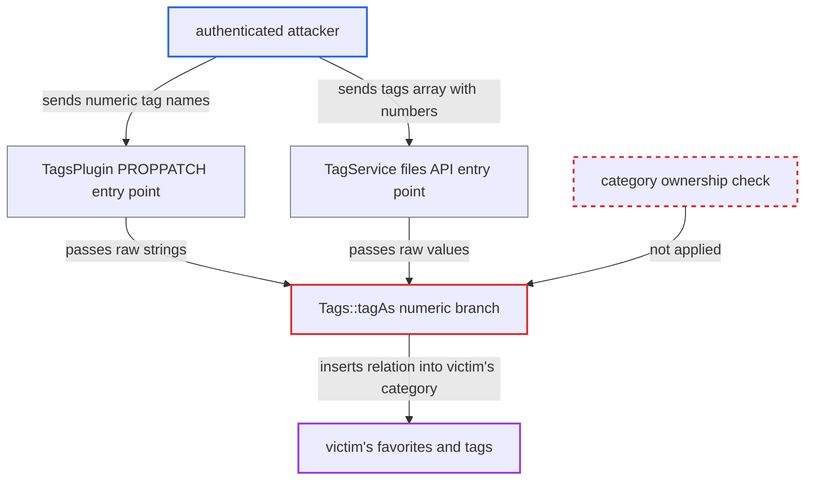

# Numeric tag names are used as raw category ids, allowing writes to other users' tag relations

| Field | Value |
|---|---|
| ID | `find_01FJoPaGBSktk16KhhmxWvwf` |
| Severity | **Medium** |
| Status | open |
| CWE | CWE-639 — Authorization bypass through user-controlled key |
| Created | 2026-10-27T21:25:54.774811Z |
| Claude Security | https://claude.ai/security/findings/find_01FJoPaGBSktk16KhhmxWvwf |

## Description

Any logged-in user can add a file they can reach to another user's private favorites or tags, and the victim does nothing. This works by sending a number as a tag name through the DAV tags property or the files API. `Tags::tagAs()` treats a numeric value as a raw category id and never checks that the category belongs to the caller. The impact is limited to adding relations; reads and removals are not possible.

1. **authenticated attacker** sends a PROPPATCH with numeric tag names. The request targets a file shared with the victim, or shared to the attacker, and carries `<oc:tag>` elements such as `7`, one per guessed category id. The ids are sequential, so many can be sent at once.
2. **`TagList::xmlDeserialize`** collects the text of each tag element without validation. `<oc:tag>7</oc:tag>` becomes the string `"7"`. ([`apps/dav/lib/Connector/Sabre/TagList.php:65-77`](https://github.com/cx-benchmark/server/blob/6b6317280f8ed50277369c33cee070a643d29654/apps/dav/lib/Connector/Sabre/TagList.php#L65-L77))
3. **`TagsPlugin::updateTags()`** passes the raw strings on to `tagAs()`. The strings come from the PROPPATCH handled in `handleUpdateProperties` and are passed on unchanged. ([`apps/dav/lib/Connector/Sabre/TagsPlugin.php:185-203`](https://github.com/cx-benchmark/server/blob/6b6317280f8ed50277369c33cee070a643d29654/apps/dav/lib/Connector/Sabre/TagsPlugin.php#L185-L203))
4. **`Tags::tagAs()`** skips name resolution for numeric values and inserts them as `categoryid`. `is_numeric()` is true for `"7"`, `" 7"`, `"7.0"` and `7`. The value is written into `vcategory_to_object` for the attacker's file id, and nothing checks who owns category 7. ([`lib/private/Tags.php:419-439`](https://github.com/cx-benchmark/server/blob/6b6317280f8ed50277369c33cee070a643d29654/lib/private/Tags.php#L419-L439))
5. **victim's `Tags::getFavorites()`** returns the injected file as one of the victim's favorites. `getIdsForTag()` selects `objid` by `categoryid` alone, so the foreign relation looks like the victim's own. ([`lib/private/Tags.php:167-191`](https://github.com/cx-benchmark/server/blob/6b6317280f8ed50277369c33cee070a643d29654/lib/private/Tags.php#L167-L191))
6. **`Tags::getTagsForObjects()`** shows the injected tag in the victim's PROPFIND. It joins `vcategory` on the victim's `uid`. The injected row therefore appears as `oc:favorite` or `oc:tags`. ([`lib/private/Tags.php:128-134`](https://github.com/cx-benchmark/server/blob/6b6317280f8ed50277369c33cee070a643d29654/lib/private/Tags.php#L128-L134))

## Assessment

The attacker needs any authenticated account. They need a file they can reach that the victim can also see, either shared with the victim or shared to the attacker. There are two ways in. One is `PROPPATCH /remote.php/dav/files/<me>/shared.txt` with an `{http://owncloud.org/ns}tags` property. The other is `POST /apps/files/api/v1/files/{path}` (`#[NoAdminRequired]`) with `tags[]`, as strings or as integers in a JSON body. Category ids are small sequential numbers, so the attacker can sweep them blindly in one request. The victim takes no action.

Impact: The attacker can add relations between their reachable files and other users' favorites or custom tags. A shared file then shows in the victim's Favorites (files list, dashboard widget, favorites activity filter) or carries the victim's own tags. The attacker cannot read other users' tags, cannot practically remove relations and cannot touch file contents. The result is a limited loss of integrity in other users' personal metadata.

## Recommendation

`Tags::tagAs()`, `Tags::unTag()` and `Tags::getIdsForTag()` take a numeric value as a raw `vcategory.id` and act on it without checking that the category belongs to the `Tags` instance's user. Callers pass untrusted tag names through unchanged.

Fix criteria: Every relation insert, delete and lookup in `OC\Tags` works only on categories owned by `$this->user`. Either the value is resolved against the user's own loaded tags (by id or name) and unknown ids are rejected, or values from the DAV and REST tag APIs are always treated as names. Test: a PROPPATCH with `<oc:tag>7</oc:tag>`, where 7 is another user's category, creates no `vcategory_to_object` row for that category. A numeric-named own tag still round-trips. The victim's favorites list is unchanged.

## Evidence

**https://github.com/cx-benchmark/server**

- [`lib/private/Tags.php:419-439`](https://github.com/cx-benchmark/server/blob/6b6317280f8ed50277369c33cee070a643d29654/lib/private/Tags.php#L419-L439)
- [`apps/dav/lib/Connector/Sabre/TagsPlugin.php:185-203`](https://github.com/cx-benchmark/server/blob/6b6317280f8ed50277369c33cee070a643d29654/apps/dav/lib/Connector/Sabre/TagsPlugin.php#L185-L203)
- [`apps/dav/lib/Connector/Sabre/TagList.php:65-77`](https://github.com/cx-benchmark/server/blob/6b6317280f8ed50277369c33cee070a643d29654/apps/dav/lib/Connector/Sabre/TagList.php#L65-L77)
- [`apps/files/lib/Service/TagService.php:50-78`](https://github.com/cx-benchmark/server/blob/6b6317280f8ed50277369c33cee070a643d29654/apps/files/lib/Service/TagService.php#L50-L78)
- [`lib/private/Tags.php:167-191`](https://github.com/cx-benchmark/server/blob/6b6317280f8ed50277369c33cee070a643d29654/lib/private/Tags.php#L167-L191)
- [`lib/private/Tags.php:128-134`](https://github.com/cx-benchmark/server/blob/6b6317280f8ed50277369c33cee070a643d29654/lib/private/Tags.php#L128-L134)

