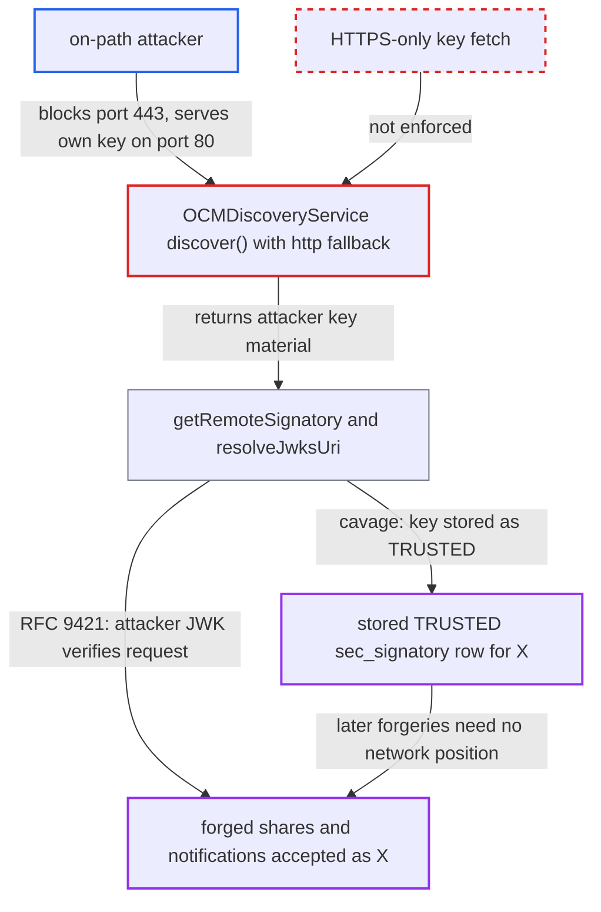

# OCM signing-key and JWKS discovery downgrade to plaintext HTTP enables peer impersonation

| Field | Value |
|---|---|
| ID | `find_017TrS45kg9oz5pNCdffq7xQ` |
| Severity | **Medium** |
| Status | open |
| CWE | CWE-757 — Protocol downgrade |
| Created | 2026-10-27T21:42:46.911195Z |
| Claude Security | https://claude.ai/security/findings/find_017TrS45kg9oz5pNCdffq7xQ |

## Description

An attacker on the network path between a victim server and a federation peer `X` can forge signed share offers and notifications as `X`, and can lock the real `X` out of cavage-signed and unsigned federation. It needs no account, but the attacker must be able to reset connections to `X` on port 443 and answer on port 80. The cause is that `OCMDiscoveryService::discover()` and `resolveJwksUri()` fall back to `http://` when HTTPS fails, so the signing key is fetched over plaintext.

1. **on-path attacker** resets the victim's TCP 443 connections to peer `X` and answers on port 80. The attacker serves their own `publicKey` and `jwksUri` in a discovery document at `http://X/.well-known/ocm`.
2. **attacker** sends a signed `POST /ocm/shares` claiming an owner at `X`. For cavage the `keyId` is `https://X/ocm#signature`, and `getRemoteSignatory()` takes the bare host `X` from it and calls `discover($remote, true)`. ([`lib/private/OCM/OCMSignatoryManager.php:424-438`](https://github.com/cx-benchmark/server/blob/6b6317280f8ed50277369c33cee070a643d29654/lib/private/OCM/OCMSignatoryManager.php#L424-L438))
3. **`OCMDiscoveryService::discover()`** retries over `http://` after the `https://` attempt fails. Every failure, including a TLS handshake or certificate error, becomes `OCMProviderException`, so the fallback fires and returns whatever the plaintext endpoint serves. ([`lib/private/OCM/OCMDiscoveryService.php:163-173`](https://github.com/cx-benchmark/server/blob/6b6317280f8ed50277369c33cee070a643d29654/lib/private/OCM/OCMDiscoveryService.php#L163-L173))
4. **`SignatureManager`** verifies the request against the attacker's key and persists it. On first contact for a `keyId`, `storeSignatory()` stores the fetched key as a `TRUSTED` row for `X`, and later requests are checked against that row with no further fetch. ([`lib/private/Security/Signature/SignatureManager.php:195-220`](https://github.com/cx-benchmark/server/blob/6b6317280f8ed50277369c33cee070a643d29654/lib/private/Security/Signature/SignatureManager.php#L195-L220))
5. **`resolveJwksUri()`** accepts an `http://` discovery document and an `http://` `jwksUri` for RFC 9421 requests. An unknown kid forces a fresh `getRemoteKey()` fetch, and verification uses only that key, so the attacker's JWK verifies a forged request even when `X` already has a stored cavage signatory. ([`lib/private/OCM/OCMSignatoryManager.php:534-567`](https://github.com/cx-benchmark/server/blob/6b6317280f8ed50277369c33cee070a643d29654/lib/private/OCM/OCMSignatoryManager.php#L534-L567))
6. **attacker** signs as `X` from anywhere and blocks the real `X`. A differing key for the stored `TRUSTED` row raises `SignatoryConflictException` for `X`'s own cavage-signed requests, and `confirmRequestOrigin()` refuses its unsigned ones until an operator deletes the `sec_signatory` row by hand. ([`lib/private/Security/Signature/SignatureManager.php:441-460`](https://github.com/cx-benchmark/server/blob/6b6317280f8ed50277369c33cee070a643d29654/lib/private/Security/Signature/SignatureManager.php#L441-L460))

## Assessment

The attacker has no account but sits on the network path between the victim server and peer `X`. They must be able to reset the victim's connections to `X` on port 443 and answer on port 80. For cavage, this works for an `X` with no stored signatory. For RFC 9421 there is no pin. A cavage-triggered `skipCache` discovery caches `false` for `https://X`, and an unknown kid forces a JWKS refetch. This also works when `X` already has a stored cavage signatory. Outbound share traffic is unaffected, because cloud IDs default to `https://`. Only the key-retrieval paths that strip the scheme are affected.

Impact: The attacker can get forged share offers and notifications accepted as signed by `X`. They are also exempt from `FederationRateLimit` when `X` is a trusted server. Notifications on existing shares still need the share's secret. A planted cavage row also locks out `X`'s cavage-signed and unsigned traffic until an operator removes it by hand. Peers that send RFC 9421 are not locked out by it. No victim data is disclosed by this path.

## Recommendation

(1) `OCMDiscoveryService::discover()` and `OCMSignatoryManager::resolveJwksUri()` fall back to `http://` whenever HTTPS discovery fails, including on TLS errors. Signature verification depends on them to fetch the signer's key, so key authenticity rests on an unauthenticated transport.

Fix criteria: Key material for signature verification is accepted only over HTTPS with certificate validation. This covers the cavage `publicKey`, the RFC 9421 discovery document and the JWKS. Any plaintext fallback kept for testing is off by default behind an explicit admin setting. Test: with `https://X` unreachable and `http://X` serving a key, a cavage or RFC 9421 request claiming `X` is rejected and no `sec_signatory` row for `X` is created.

(2) A signatory learned on first contact is stored as `TRUSTED` with no requirement on how it was fetched. A transient downgrade therefore becomes lasting impersonation and a lockout of the real host, and no operator tooling exists for recovery.

Fix criteria: Only signatories obtained over authenticated transport are persisted or marked `TRUSTED`. An operator can inspect and remove a stored remote signatory, or a conflict is surfaced and resolved against the host's current HTTPS-published key. Test: a conflicting key observed over HTTPS is surfaced or recoverable, and the peer is not silently rejected forever.

## Evidence

**https://github.com/cx-benchmark/server**

- [`lib/private/OCM/OCMDiscoveryService.php:84-93`](https://github.com/cx-benchmark/server/blob/6b6317280f8ed50277369c33cee070a643d29654/lib/private/OCM/OCMDiscoveryService.php#L84-L93)
- [`lib/private/OCM/OCMDiscoveryService.php:163-173`](https://github.com/cx-benchmark/server/blob/6b6317280f8ed50277369c33cee070a643d29654/lib/private/OCM/OCMDiscoveryService.php#L163-L173)
- [`lib/private/OCM/OCMSignatoryManager.php:424-438`](https://github.com/cx-benchmark/server/blob/6b6317280f8ed50277369c33cee070a643d29654/lib/private/OCM/OCMSignatoryManager.php#L424-L438)
- [`lib/private/OCM/OCMSignatoryManager.php:534-567`](https://github.com/cx-benchmark/server/blob/6b6317280f8ed50277369c33cee070a643d29654/lib/private/OCM/OCMSignatoryManager.php#L534-L567)
- [`lib/private/Security/Signature/SignatureManager.php:195-220`](https://github.com/cx-benchmark/server/blob/6b6317280f8ed50277369c33cee070a643d29654/lib/private/Security/Signature/SignatureManager.php#L195-L220)
- [`lib/private/Security/Signature/SignatureManager.php:441-460`](https://github.com/cx-benchmark/server/blob/6b6317280f8ed50277369c33cee070a643d29654/lib/private/Security/Signature/SignatureManager.php#L441-L460)
- [`lib/private/Security/Signature/SignatureManager.php:145-183`](https://github.com/cx-benchmark/server/blob/6b6317280f8ed50277369c33cee070a643d29654/lib/private/Security/Signature/SignatureManager.php#L145-L183)
- [`lib/private/OCM/OCMSignatoryManager.php:445-470`](https://github.com/cx-benchmark/server/blob/6b6317280f8ed50277369c33cee070a643d29654/lib/private/OCM/OCMSignatoryManager.php#L445-L470)
- [`lib/private/OCM/OCMDiscoveryService.php:299-320`](https://github.com/cx-benchmark/server/blob/6b6317280f8ed50277369c33cee070a643d29654/lib/private/OCM/OCMDiscoveryService.php#L299-L320)

