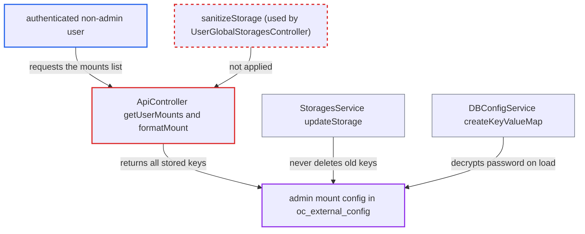

# OCS mounts API discloses admin storage configuration and stale passwords to users

| Field | Value |
|---|---|
| ID | `find_01YZdbZiMNAx2L2nSHsjApqw` |
| Severity | **Medium** |
| Status | open |
| CWE | CWE-212 — Sensitive information exposure |
| Created | 2026-10-27T21:26:26.022007Z |
| Claude Security | https://claude.ai/security/findings/find_01YZdbZiMNAx2L2nSHsjApqw |

## Description

Any logged-in non-admin user who has an admin-defined external storage can read its admin-only configuration. That includes hosts, shares, domains, service-account names, server paths and S3 key ids. If the admin changed the mount's auth mechanism, the old password is also returned in cleartext. `ApiController::formatMount()` returns the full stored config, and `StorageConfig::jsonSerialize(true)` hides only the current mechanism's password fields.

1. **authenticated non-admin user** sends GET to the mounts endpoint. The request goes to `/ocs/v2.php/apps/files_external/api/v1/mounts` with the header `OCS-APIRequest: true`, and `getUserMounts()` is marked `#[NoAdminRequired]`. ([`apps/files_external/lib/Controller/ApiController.php:82-101`](https://github.com/cx-benchmark/server/blob/6b6317280f8ed50277369c33cee070a643d29654/apps/files_external/lib/Controller/ApiController.php#L82-L101))
2. **the handler `getUserMounts()`** loops over the admin mounts that apply to the caller and formats each one. It takes them from `userGlobalStoragesService->getStorages()`, which includes mounts that apply to the user directly, through a group or globally. ([`apps/files_external/lib/Controller/ApiController.php:82-101`](https://github.com/cx-benchmark/server/blob/6b6317280f8ed50277369c33cee070a643d29654/apps/files_external/lib/Controller/ApiController.php#L82-L101))
3. **the method `formatMount()`** puts the whole serialized config into each response entry. It uses `$mountConfig->jsonSerialize(true)` and does not clear `backendOptions` or `mountOptions` first, as the sibling controller does. ([`apps/files_external/lib/Controller/ApiController.php:61-71`](https://github.com/cx-benchmark/server/blob/6b6317280f8ed50277369c33cee070a643d29654/apps/files_external/lib/Controller/ApiController.php#L61-L71))
4. **`StorageConfig::jsonSerialize(true)`** returns all stored option keys except current password parameters. `formatStorageForUI()` hides a key only when the current backend or auth mechanism declares it as `VALUE_PASSWORD`, so every other key and any stale secret key passes through. ([`apps/files_external/lib/Lib/StorageConfig.php:387-436`](https://github.com/cx-benchmark/server/blob/6b6317280f8ed50277369c33cee070a643d29654/apps/files_external/lib/Lib/StorageConfig.php#L387-L436))
5. **the method `createKeyValueMap()`** decrypts a stale `password` value when the config is loaded. After an admin switched the mechanism, the old `password` is still in the database, and it is no longer hidden, so it reaches the user in cleartext. ([`apps/files_external/lib/Service/DBConfigService.php:549-560`](https://github.com/cx-benchmark/server/blob/6b6317280f8ed50277369c33cee070a643d29654/apps/files_external/lib/Service/DBConfigService.php#L549-L560))

## Assessment

The attacker is any authenticated non-admin user to whom at least one admin-defined external storage applies. A global mount applies to everyone. They only need to call the mounts endpoint with `OCS-APIRequest: true`, and no victim action is needed. The stale-password case also needs an admin to have switched a mount from `password::password` to a mechanism with no `password` parameter, such as `smb::kerberos`, `smb::kerberosapache`, `password::global`, `password::global::user`, `amazons3::accesskey` or `null::null`. `StoragesService::updateStorage()` only upserts changed keys and never deletes any. The admin UI removes the old fields only on the client side (`pruneUnusedAuthMechanismOptions`), so the PUT leaves out `password` and the server keeps the stored value.

Impact: The attacker learns admin-only configuration of every admin mount they can see. Examples are SMB `host`, `share`, `root`, `domain` and `user`, the Local `datadir`, S3 `bucket` and access-key id `key`, SFTP and Swift details, and all mount options. A stale service-account password is leaked in cleartext. File contents are not exposed beyond what the mount already grants, and nothing can be changed.

Subsequent-system impact: The leaked host, share, domain and login identify the external SMB, S3, SFTP or Swift system behind the mount. With a leaked stale password, the attacker can sign in to that system directly. This bypasses Nextcloud's `root` subfolder restriction and its authorization. Without a stale password, only identifiers of that system leak.

## Recommendation

(1) `ApiController::formatMount()` sends the full stored configuration of admin mounts to non-admin callers. It does not apply the sanitization that `UserGlobalStoragesController` uses.

Fix criteria: For admin (system) mounts, the OCS mounts endpoint returns no `backendOptions` or `mountOptions` to non-admins. It returns only id, mountPoint, backend, authMechanism, status, statusMessage, userProvided and type. Check: as a regular user with a global SMB mount configured with `password::password`, the response holds no `host`, `share`, `user`, `domain` or `password` key.

(2) `formatStorageForUI()` hides keys by the current mechanism's parameter list, and `StoragesService::updateStorage()` never deletes keys that no longer belong to the backend or auth mechanism. A stored password therefore survives a mechanism change and is no longer hidden.

Fix criteria: Changing a storage's auth mechanism or backend removes config keys that the new pair does not declare. UI serialization never sends a stored `password` or other secret key, whatever the current parameter list. Check: switch an SMB mount from `password::password` to `smb::kerberos`, then confirm no `password` row is left in `oc_external_config` and none appears in any API output.

## Evidence

**https://github.com/cx-benchmark/server**

- [`apps/files_external/lib/Controller/ApiController.php:61-71`](https://github.com/cx-benchmark/server/blob/6b6317280f8ed50277369c33cee070a643d29654/apps/files_external/lib/Controller/ApiController.php#L61-L71)
- [`apps/files_external/lib/Controller/ApiController.php:82-101`](https://github.com/cx-benchmark/server/blob/6b6317280f8ed50277369c33cee070a643d29654/apps/files_external/lib/Controller/ApiController.php#L82-L101)
- [`apps/files_external/lib/Lib/StorageConfig.php:387-436`](https://github.com/cx-benchmark/server/blob/6b6317280f8ed50277369c33cee070a643d29654/apps/files_external/lib/Lib/StorageConfig.php#L387-L436)
- [`apps/files_external/lib/Controller/UserGlobalStoragesController.php:75-90`](https://github.com/cx-benchmark/server/blob/6b6317280f8ed50277369c33cee070a643d29654/apps/files_external/lib/Controller/UserGlobalStoragesController.php#L75-L90)
- [`apps/files_external/lib/Service/StoragesService.php:378-388`](https://github.com/cx-benchmark/server/blob/6b6317280f8ed50277369c33cee070a643d29654/apps/files_external/lib/Service/StoragesService.php#L378-L388)
- [`apps/files_external/lib/Service/DBConfigService.php:549-560`](https://github.com/cx-benchmark/server/blob/6b6317280f8ed50277369c33cee070a643d29654/apps/files_external/lib/Service/DBConfigService.php#L549-L560)
- [`apps/files_external/src/components/AddExternalStorageDialog/AddExternalStorageDialog.vue:73-83`](https://github.com/cx-benchmark/server/blob/6b6317280f8ed50277369c33cee070a643d29654/apps/files_external/src/components/AddExternalStorageDialog/AddExternalStorageDialog.vue#L73-L83)
- [`apps/files_external/src/services/externalStorage.ts:39-61`](https://github.com/cx-benchmark/server/blob/6b6317280f8ed50277369c33cee070a643d29654/apps/files_external/src/services/externalStorage.ts#L39-L61)

