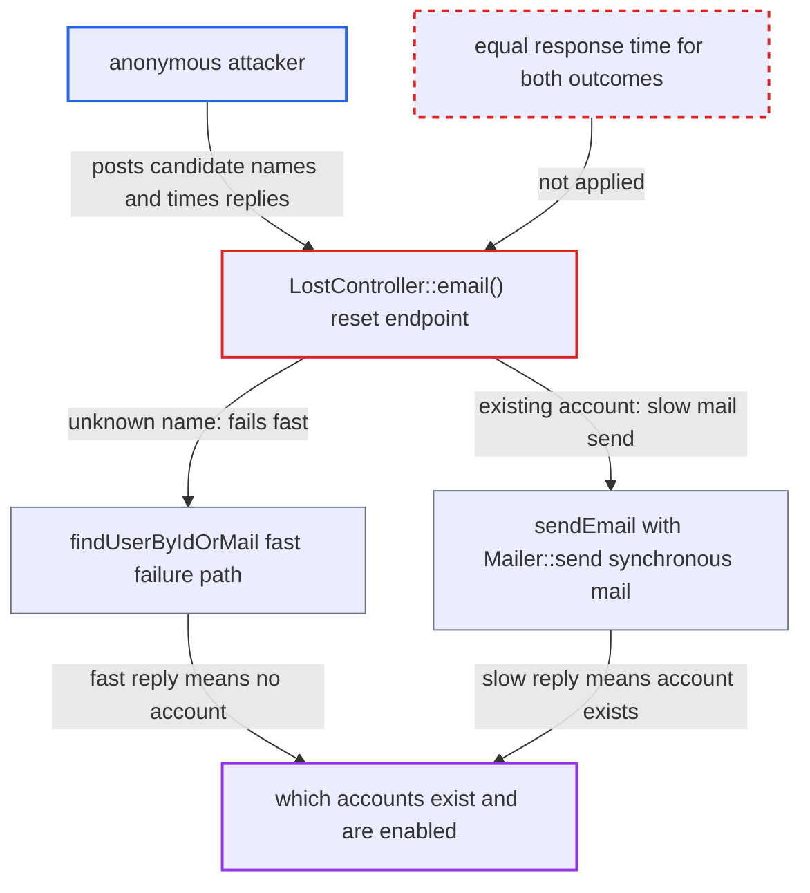

# Password reset request reveals account existence through response timing

| Field | Value |
|---|---|
| ID | `find_01EUbQ42JEPWjeYcteJ2n7Jy` |
| Severity | **Medium** |
| Status | open |
| CWE | CWE-208 — User enumeration |
| Created | 2026-10-27T21:31:09.591244Z |
| Claude Security | https://claude.ai/security/findings/find_01EUbQ42JEPWjeYcteJ2n7Jy |

## Description

An unauthenticated attacker can find out which login names or email addresses belong to real, enabled accounts. They do this by timing the password-reset request. The endpoint `LostController::email()` returns the same `success` body every time. But it only sends a mail, which is slow, when the account exists, so the reply time gives the answer away.

1. **attacker** gets a CSRF token from the public login page. The reset endpoint is anonymous, so no login is needed, only this token.
2. **attacker** posts a candidate login name or email address to `/lostpassword/email`. The handler `LostController::email()` always answers with the identical `{status: success}` body and swallows `ResetPasswordException`. ([`core/Controller/LostController.php:147-177`](https://github.com/cx-benchmark/server/blob/6b6317280f8ed50277369c33cee070a643d29654/core/Controller/LostController.php#L147-L177))
3. **the lookup `findUserByIdOrMail`** throws at once when the name or address is unknown or the account is disabled. It does two lookups and throws `ResetPasswordException`, so the request finishes quickly. ([`core/Controller/LostController.php:299-318`](https://github.com/cx-benchmark/server/blob/6b6317280f8ed50277369c33cee070a643d29654/core/Controller/LostController.php#L299-L318))
4. **the method `sendEmail()`** does the full reset work when the account exists, is enabled and has an email address. It registers the per-user rate limit, creates and encrypts a token, schedules a cleanup job and renders the email template. ([`core/Controller/LostController.php:234-293`](https://github.com/cx-benchmark/server/blob/6b6317280f8ed50277369c33cee070a643d29654/core/Controller/LostController.php#L234-L293))
5. **the method `Mailer::send()`** sends the mail synchronously before the response is produced. The Symfony transport call is an SMTP or sendmail round trip on the request's critical path, which adds hundreds of milliseconds to seconds. ([`lib/private/Mail/Mailer.php:174-213`](https://github.com/cx-benchmark/server/blob/6b6317280f8ed50277369c33cee070a643d29654/lib/private/Mail/Mailer.php#L174-L213))
6. **attacker** compares the response times of the candidates. A slow reply means the account exists, is enabled and has an email address. A fast reply means it does not.

## Assessment

The attacker is anyone on the internet who can reach the login page. They need no account and no victim action. They fetch a CSRF token and POST candidate `user` values to `/lostpassword/email`, then measure the reply times. The instance must be configured to send mail over SMTP or sendmail, which is the normal state for a server offering password reset. The limits `#[AnonRateLimit(limit: 10, period: 300)]` and `BruteForceProtection('passwordResetEmail')` slow one source, but one probe per candidate is enough and probes can be spread across addresses. The brute-force throttle applies to both outcomes alike, so it does not hide the timing difference.

Impact: The attacker learns which login names or email addresses belong to real, enabled accounts that have an email address. This is a limited information leak that can support targeted credential attacks. Nothing is modified and the service is not degraded. Each probe of an existing account also sends a reset mail to that user, capped at 5 per 30 minutes per user.

## Recommendation

The reset-request handler does the slow, synchronous mail delivery only for existing accounts, while it returns the same body for all outcomes. So the response time shows whether the account exists.

Fix criteria: The response time of `POST /lostpassword/email` does not depend on whether the identifier matches an existing enabled account. For example, the mail is sent asynchronously through the job queue, or the work or timing on the not-found path is equalized. Time repeated requests for an existing user and for a random name, and confirm that the two timing distributions cannot be told apart.

## Evidence

**https://github.com/cx-benchmark/server**

- [`core/Controller/LostController.php:147-177`](https://github.com/cx-benchmark/server/blob/6b6317280f8ed50277369c33cee070a643d29654/core/Controller/LostController.php#L147-L177)
- [`core/Controller/LostController.php:234-293`](https://github.com/cx-benchmark/server/blob/6b6317280f8ed50277369c33cee070a643d29654/core/Controller/LostController.php#L234-L293)
- [`core/Controller/LostController.php:299-318`](https://github.com/cx-benchmark/server/blob/6b6317280f8ed50277369c33cee070a643d29654/core/Controller/LostController.php#L299-L318)
- [`lib/private/Mail/Mailer.php:174-213`](https://github.com/cx-benchmark/server/blob/6b6317280f8ed50277369c33cee070a643d29654/lib/private/Mail/Mailer.php#L174-L213)

