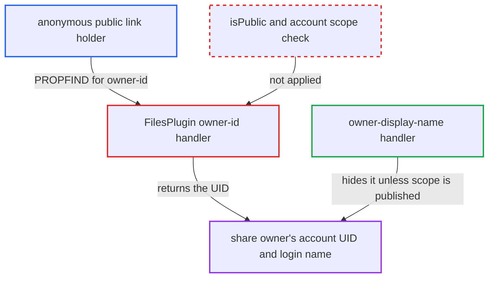

# Public link PROPFIND discloses share owner's user ID despite unpublished name scope

| Field | Value |
|---|---|
| ID | `find_01FGZFHrPinFyLFgfyR2eX9P` |
| Severity | **Medium** |
| Status | open |
| CWE | CWE-359 — Information exposure |
| Created | 2026-10-27T21:37:51.299738Z |
| Claude Security | https://claude.ai/security/findings/find_01FGZFHrPinFyLFgfyR2eX9P |

## Description

Anyone holding a public link with read permission can learn the share owner's account UID, which is also their login name. This works even when the owner has not published their name, which is the default. The cause is the `owner-id` handler in `FilesPlugin::handleGetProperties()`, which skips the `isPublic` and account-scope checks.

1. **link holder** sends a PROPFIND for `oc:owner-id` on the share root. The request goes to `/public.php/dav/files/<token>/`. It needs only the link token, plus the password if the link has one, and no account.
2. **public DAV server** registers `FilesPlugin` with `$isPublicShare` set to true. This lets the plugin answer unauthenticated link holders. ([`apps/dav/lib/Connector/Sabre/ServerFactory.php:172-183`](https://github.com/cx-benchmark/server/blob/6b6317280f8ed50277369c33cee070a643d29654/apps/dav/lib/Connector/Sabre/ServerFactory.php#L172-L183))
3. **`PublicOwnerWrapper`** makes sure an owner always resolves for the share. It falls back to `$share->getShareOwner()`, so `getOwner()` returns a real user. ([`apps/dav/appinfo/v2/publicremote.php:94-142`](https://github.com/cx-benchmark/server/blob/6b6317280f8ed50277369c33cee070a643d29654/apps/dav/appinfo/v2/publicremote.php#L94-L142))
4. **the `owner-id` handler in `FilesPlugin::handleGetProperties()`** returns `$node->getOwner()->getUID()` in the response. It does not check `isPublic` or the owner's display-name scope. The sibling `owner-display-name` handler does check the scope and returns null to anonymous callers unless it is `SCOPE_PUBLISHED`. ([`apps/dav/lib/Connector/Sabre/FilesPlugin.php:365-372`](https://github.com/cx-benchmark/server/blob/6b6317280f8ed50277369c33cee070a643d29654/apps/dav/lib/Connector/Sabre/FilesPlugin.php#L365-L372))

## Assessment

The attacker is anyone with a public link token that has read permission. They need no account, and the link's password too if it has one. They send one PROPFIND to `public.php/dav` for `oc:owner-id` on the share root. The older `public.php/webdav` server also builds the plugin with `$isPublicShare = true`. The web UI's default PROPFIND property list already asks for `oc:owner-id`, so the value also appears in normal public-page traffic. With the default display-name scope `SCOPE_FEDERATED`, the public page hides the owner, but this request still returns the UID. Create-only (file-drop or file-request) links are not affected, because `FilesDropPlugin::beforeMethod()` refuses every method except PUT, MKCOL and MOVE on them. Note: under default federation settings, the public 'Add to your Nextcloud' endpoint (`MountPublicLinkController::createFederatedShare`) also sends the owner's cloud ID to a remote server the caller chooses. That route refuses links with download disabled. It also needs the caller to run a federation endpoint. The PROPFIND leak needs neither and also covers view-only links.

Impact: The attacker learns one identifier per link: the owner's account UID, which is also their login name. This reveals who shared the link and gives a valid login name to use in credential attacks. The attacker gets no file data beyond the share, and there is no write or availability effect.

## Recommendation

On public (unauthenticated) DAV servers, the `owner-id` property is returned without the account-scope check that governs every other exposure of the share owner's identity (`owner-display-name`, the public page initial state, `X-NC-OwnerId`).

Fix criteria: When there is no logged-in user, or `isPublic` is true, `owner-id` is omitted unless the owner's display-name scope is `SCOPE_PUBLISHED`. An anonymous PROPFIND for `oc:owner-id` on a readable public link whose owner has the default `SCOPE_FEDERATED` scope returns the property as not found. Authenticated DAV clients still get it.

## Evidence

**https://github.com/cx-benchmark/server**

- [`apps/dav/lib/Connector/Sabre/FilesPlugin.php:365-372`](https://github.com/cx-benchmark/server/blob/6b6317280f8ed50277369c33cee070a643d29654/apps/dav/lib/Connector/Sabre/FilesPlugin.php#L365-L372)
- [`apps/dav/lib/Connector/Sabre/FilesPlugin.php:373-404`](https://github.com/cx-benchmark/server/blob/6b6317280f8ed50277369c33cee070a643d29654/apps/dav/lib/Connector/Sabre/FilesPlugin.php#L373-L404)
- [`apps/dav/lib/Connector/Sabre/ServerFactory.php:172-183`](https://github.com/cx-benchmark/server/blob/6b6317280f8ed50277369c33cee070a643d29654/apps/dav/lib/Connector/Sabre/ServerFactory.php#L172-L183)
- [`apps/dav/appinfo/v2/publicremote.php:94-142`](https://github.com/cx-benchmark/server/blob/6b6317280f8ed50277369c33cee070a643d29654/apps/dav/appinfo/v2/publicremote.php#L94-L142)
- [`apps/files_sharing/lib/DefaultPublicShareTemplateProvider.php:68-79`](https://github.com/cx-benchmark/server/blob/6b6317280f8ed50277369c33cee070a643d29654/apps/files_sharing/lib/DefaultPublicShareTemplateProvider.php#L68-L79)
- [`apps/dav/lib/Connector/Sabre/AddExtraHeadersPlugin.php:62-66`](https://github.com/cx-benchmark/server/blob/6b6317280f8ed50277369c33cee070a643d29654/apps/dav/lib/Connector/Sabre/AddExtraHeadersPlugin.php#L62-L66)
- [`lib/private/Accounts/AccountManager.php:71`](https://github.com/cx-benchmark/server/blob/6b6317280f8ed50277369c33cee070a643d29654/lib/private/Accounts/AccountManager.php#L71)

