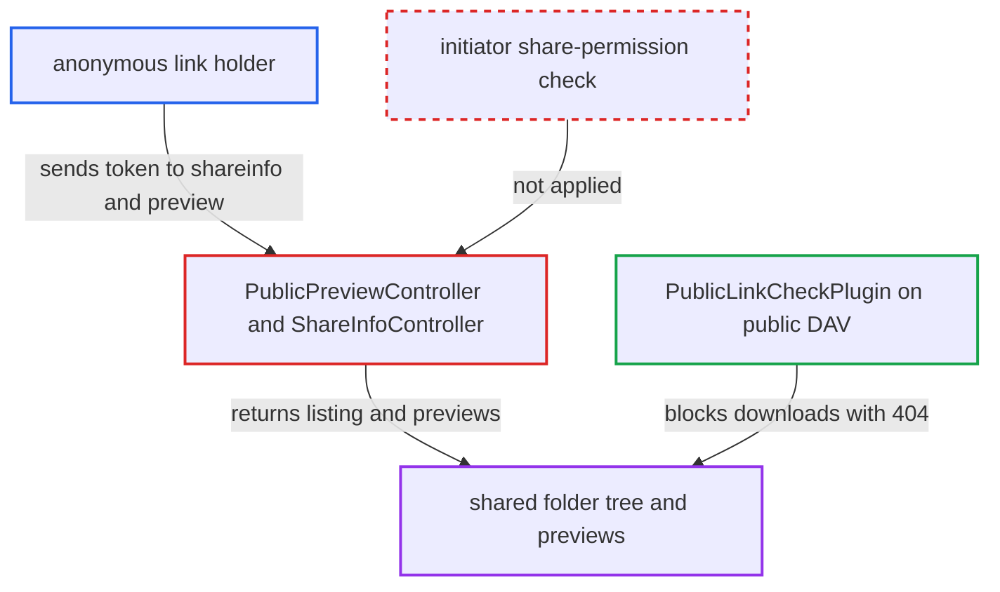

# Public preview and shareinfo endpoints ignore revoked share permission of link creator

| Field | Value |
|---|---|
| ID | `find_016KCMZHmEMVNTJ7FvYgJRF4` |
| Severity | **Medium** |
| Status | open |
| CWE | CWE-863 — Incorrect authorization |
| Created | 2026-10-27T21:34:45.834437Z |
| Claude Security | https://claude.ai/security/findings/find_016KCMZHmEMVNTJ7FvYgJRF4 |

## Description

Anyone holding a public link can keep reading a shared folder after the owner has withdrawn the link creator's share permission. They can list the whole folder tree and get large previews of the files. Original files cannot be downloaded. The cause is that `PublicPreviewController` and `ShareInfoController` check only the share row and never check that the link's initiator can still share the node.

1. **resharer B** creates a public link L on a folder shared by owner A. The link row is stored with `uid_owner` = A and `uid_initiator` = B, and B received the share with share permission.
2. **owner A** removes B's share permission. L is not deleted, because neither `Manager::updateShare()` nor `DefaultShareProvider::update()` touches link reshares, and the link row keeps its token. ([`lib/private/Share20/DefaultShareProvider.php:224-295`](https://github.com/cx-benchmark/server/blob/6b6317280f8ed50277369c33cee070a643d29654/lib/private/Share20/DefaultShareProvider.php#L224-L295))
3. **link holder** posts to `/apps/files_sharing/shareinfo` with `t` and `depth=-1`. `info()` checks only the password and `PERMISSION_READ` on the share row, so it returns the full recursive listing of the owner's node, with names, sizes, file ids, mtimes and etags. ([`apps/files_sharing/lib/Controller/ShareInfoController.php:64-96`](https://github.com/cx-benchmark/server/blob/6b6317280f8ed50277369c33cee070a643d29654/apps/files_sharing/lib/Controller/ShareInfoController.php#L64-L96))
4. **link holder** requests previews with `/apps/files_sharing/publicpreview/{token}?file=...&x=4096&y=4096&a=1` or `/s/{token}/preview`. `getPreview()` checks only `PERMISSION_READ` on the share row and `canSeeContent()`, then serves a preview of any file under the share. ([`apps/files_sharing/lib/Controller/PublicPreviewController.php:90-168`](https://github.com/cx-benchmark/server/blob/6b6317280f8ed50277369c33cee070a643d29654/apps/files_sharing/lib/Controller/PublicPreviewController.php#L90-L168))
5. **link holder** can also call `directLink()` for a single-file link. It has the same gap and returns a maximum-size preview through `getPreview($node, -1, -1)`. ([`apps/files_sharing/lib/Controller/PublicPreviewController.php:185-230`](https://github.com/cx-benchmark/server/blob/6b6317280f8ed50277369c33cee070a643d29654/apps/files_sharing/lib/Controller/PublicPreviewController.php#L185-L230))
6. **`Share::getNode()`** resolves the node in the owner's folder. The node is therefore always readable and shareable, so any check made on it reflects A's permissions, not B's. ([`lib/private/Share20/Share.php:135-162`](https://github.com/cx-benchmark/server/blob/6b6317280f8ed50277369c33cee070a643d29654/lib/private/Share20/Share.php#L135-L162))

## Assessment

The attacker is anonymous and needs only the token of a public link (or mail share) that a resharer created. The owner must have revoked that resharer's share permission afterwards, which the attacker does not control. No victim action is needed. The attacker lists all paths with `POST /apps/files_sharing/shareinfo` (`depth=-1`), then requests previews of each file through `/apps/files_sharing/publicpreview/{token}?file=…&a=1` or `/s/{token}/preview`. A password-protected link stays usable for previews by a session that authenticated before the revocation. `shareinfo` accepts the password directly. `ShareInfoMiddleware` gates `shareinfo` only on outgoing federation, which is enabled by default.

Impact: The attacker keeps reading content the owner meant to withdraw. That is the live folder structure, including files added later, and previews up to `preview_max_x/y` (default 4096px) of previewable files. Default providers are images, TXT, Markdown and OpenDocument. Original files cannot be downloaded because public DAV blocks them, and nothing is modified.

## Recommendation

(1) `PublicPreviewController` and `ShareInfoController` authorise only on the share row and never re-check that the link's initiator still has share permission on the node. Public DAV enforces this, but these endpoints do not.

Fix criteria: Every public endpoint serving data for a link or mail share applies the same validity check as public DAV. The node seen by the `getSharedBy()` user must still be readable and shareable, or the endpoint returns 404. To verify, create a link as a resharer and remove the resharer's share permission. Then confirm that `/publicpreview/{token}`, `/s/{token}/preview` and `/shareinfo` return 404.

(2) `ShareController::validateShare()` calls `isShareable()` on the owner's node through `Share::getNode()`, so it cannot detect that a resharer's permission was revoked.

Fix criteria: The share-validity check evaluates readability and shareability from the initiator's perspective, ideally in one shared helper in the share manager. The public share page returns 404 in the revoked-resharer scenario. It still works for links created by the owner.

## Evidence

**https://github.com/cx-benchmark/server**

- [`apps/files_sharing/lib/Controller/PublicPreviewController.php:90-168`](https://github.com/cx-benchmark/server/blob/6b6317280f8ed50277369c33cee070a643d29654/apps/files_sharing/lib/Controller/PublicPreviewController.php#L90-L168)
- [`apps/files_sharing/lib/Controller/PublicPreviewController.php:185-230`](https://github.com/cx-benchmark/server/blob/6b6317280f8ed50277369c33cee070a643d29654/apps/files_sharing/lib/Controller/PublicPreviewController.php#L185-L230)
- [`apps/files_sharing/lib/Controller/ShareInfoController.php:64-96`](https://github.com/cx-benchmark/server/blob/6b6317280f8ed50277369c33cee070a643d29654/apps/files_sharing/lib/Controller/ShareInfoController.php#L64-L96)
- [`lib/private/Share20/Share.php:135-162`](https://github.com/cx-benchmark/server/blob/6b6317280f8ed50277369c33cee070a643d29654/lib/private/Share20/Share.php#L135-L162)
- [`apps/files_sharing/lib/Controller/ShareController.php:266-268`](https://github.com/cx-benchmark/server/blob/6b6317280f8ed50277369c33cee070a643d29654/apps/files_sharing/lib/Controller/ShareController.php#L266-L268)
- [`apps/dav/lib/Files/Sharing/PublicLinkCheckPlugin.php:47-52`](https://github.com/cx-benchmark/server/blob/6b6317280f8ed50277369c33cee070a643d29654/apps/dav/lib/Files/Sharing/PublicLinkCheckPlugin.php#L47-L52)
- [`apps/dav/appinfo/v2/publicremote.php:153-170`](https://github.com/cx-benchmark/server/blob/6b6317280f8ed50277369c33cee070a643d29654/apps/dav/appinfo/v2/publicremote.php#L153-L170)
- [`apps/dav/appinfo/v1/publicwebdav.php:129-149`](https://github.com/cx-benchmark/server/blob/6b6317280f8ed50277369c33cee070a643d29654/apps/dav/appinfo/v1/publicwebdav.php#L129-L149)
- [`lib/private/Share20/DefaultShareProvider.php:224-295`](https://github.com/cx-benchmark/server/blob/6b6317280f8ed50277369c33cee070a643d29654/lib/private/Share20/DefaultShareProvider.php#L224-L295)

