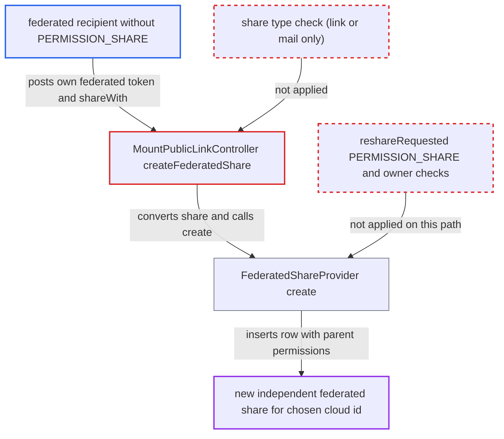

# Public-link conversion endpoint accepts federated share tokens, bypassing reshare permission and revocation

| Field | Value |
|---|---|
| ID | `find_01E2w9ScaEpcV4dov1n6zLSt` |
| Severity | **Medium** |
| Status | open |
| CWE | CWE-863 — Improper Authorization |
| Created | 2026-10-27T21:30:09.734373Z |
| Claude Security | https://claude.ai/security/findings/find_01E2w9ScaEpcV4dov1n6zLSt |

## Description

A remote user who received a federated share without the reshare permission can share the same files on with any cloud id they choose, including another identity of their own. The new share keeps the parent's permissions and survives the owner revoking the original share. The cause is `createFederatedShare()` in `MountPublicLinkController`, which accepts a federated share's token as if it were a public-link token and never checks the share type.

1. **federated recipient** posts their share's token and a chosen `shareWith` cloud id to the endpoint. The token is the OCM `sharedSecret` the recipient already holds. The request goes to `/index.php/apps/federatedfilesharing/createFederatedShare`, a `#[PublicPage]` endpoint, and needs no other login. ([`apps/federatedfilesharing/lib/Controller/MountPublicLinkController.php:75-131`](https://github.com/cx-benchmark/server/blob/6b6317280f8ed50277369c33cee070a643d29654/apps/federatedfilesharing/lib/Controller/MountPublicLinkController.php#L75-L131))
2. **`getShareByToken()`** resolves the token to the recipient's federated share. After the link provider, the lookup falls through to the federated provider, so a `TYPE_REMOTE` share's token resolves like a link token. ([`lib/private/Share20/Manager.php:1355-1362`](https://github.com/cx-benchmark/server/blob/6b6317280f8ed50277369c33cee070a643d29654/lib/private/Share20/Manager.php#L1355-L1362))
3. **the handler `createFederatedShare()`** passes its only checks and rewrites the loaded share. `isPasswordProtected()` is false for federated shares, and the hide-download check passes. The handler never checks the share type, so it sets the recipient to the caller's `$shareWith` and the type to `TYPE_REMOTE`. ([`apps/federatedfilesharing/lib/Controller/MountPublicLinkController.php:75-131`](https://github.com/cx-benchmark/server/blob/6b6317280f8ed50277369c33cee070a643d29654/apps/federatedfilesharing/lib/Controller/MountPublicLinkController.php#L75-L131))
4. **`FederatedShareProvider::create()`** creates a new share row and pushes it to the new remote. It checks only duplicate recipient, same account and `PERMISSION_READ`. It copies the parent's full permissions, `uid_owner` and `uid_initiator` into a new row with a fresh token. ([`apps/federatedfilesharing/lib/FederatedShareProvider.php:79-168`](https://github.com/cx-benchmark/server/blob/6b6317280f8ed50277369c33cee070a643d29654/apps/federatedfilesharing/lib/FederatedShareProvider.php#L79-L168))
5. **owner's server** skips the checks of the normal reshare path. `reshareRequested()` requires `PERMISSION_SHARE` on the parent, applies `shareapi_default_permissions`, refuses resharing back to the owner and records the resharer as initiator. None of this runs here. ([`apps/federatedfilesharing/lib/OCM/CloudFederationProviderFiles.php:538-580`](https://github.com/cx-benchmark/server/blob/6b6317280f8ed50277369c33cee070a643d29654/apps/federatedfilesharing/lib/OCM/CloudFederationProviderFiles.php#L538-L580))

## Assessment

The attacker is a remote recipient of a federated share from this server. They hold that share's token and their share lacks `PERMISSION_SHARE`. They post `token` and `shareWith=<accomplice>@<any-host>` to `/index.php/apps/federatedfilesharing/createFederatedShare` on the owner's server. Outgoing federated sharing must be enabled, which is the default. The report names no other way in.

Impact: The attacker can grant read access, and write access if the parent share has it, on the shared files to any cloud id, even though the owner withheld resharing. Each grant is its own share with its own token, so it keeps working after the owner revokes the attacker's original share or lowers its permissions. It appears in the owner's share list as made by the original initiator. Reach is limited to the nodes already shared with the attacker.

## Recommendation

(1) `createFederatedShare()` treats any share that has a token as a public link. Federated and other non-link share tokens are converted without the rules that govern federated reshares.

Fix criteria: The endpoint converts only shares of type `TYPE_LINK`, and `TYPE_EMAIL` if that is deliberately supported. Any other share type resolved from the token is rejected. Posting a federated share's token to `/apps/federatedfilesharing/createFederatedShare` returns an error and creates no new `share` row.

(2) `FederatedShareProvider::create()` derives a new share from an existing one without the reshare constraints (`PERMISSION_SHARE`, default permission mask, no share back to the owner). It relies on its callers to enforce them.

Fix criteria: When the source share is itself a federated or non-link share, creation requires `PERMISSION_SHARE` on the source. It also applies the same permission mask and owner checks as `reshareRequested()`. A share without `PERMISSION_SHARE` cannot be used to create a derived federated share through any public entry point.

## Evidence

**https://github.com/cx-benchmark/server**

- [`apps/federatedfilesharing/lib/Controller/MountPublicLinkController.php:75-131`](https://github.com/cx-benchmark/server/blob/6b6317280f8ed50277369c33cee070a643d29654/apps/federatedfilesharing/lib/Controller/MountPublicLinkController.php#L75-L131)
- [`lib/private/Share20/Manager.php:1355-1362`](https://github.com/cx-benchmark/server/blob/6b6317280f8ed50277369c33cee070a643d29654/lib/private/Share20/Manager.php#L1355-L1362)
- [`apps/federatedfilesharing/lib/FederatedShareProvider.php:79-168`](https://github.com/cx-benchmark/server/blob/6b6317280f8ed50277369c33cee070a643d29654/apps/federatedfilesharing/lib/FederatedShareProvider.php#L79-L168)
- [`apps/federatedfilesharing/lib/OCM/CloudFederationProviderFiles.php:538-580`](https://github.com/cx-benchmark/server/blob/6b6317280f8ed50277369c33cee070a643d29654/apps/federatedfilesharing/lib/OCM/CloudFederationProviderFiles.php#L538-L580)
- [`lib/private/Share20/Share.php:538-540`](https://github.com/cx-benchmark/server/blob/6b6317280f8ed50277369c33cee070a643d29654/lib/private/Share20/Share.php#L538-L540)

