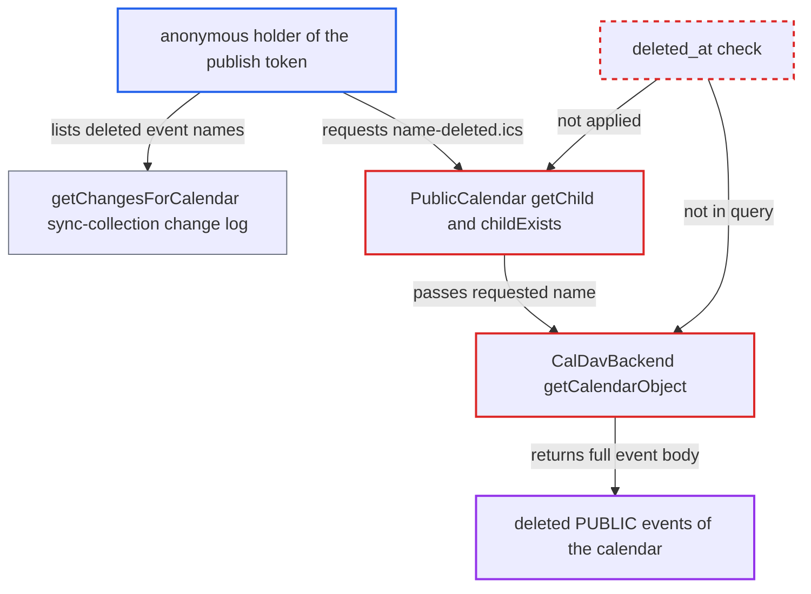

# Published calendar exposes soft-deleted events to anonymous link holders

| Field | Value |
|---|---|
| ID | `find_01MVBfvK9aAxR2GC9Ata7xA7` |
| Severity | **Medium** |
| Status | open |
| CWE | CWE-200 — Information Exposure |
| Created | 2026-10-27T21:32:39.108679Z |
| Claude Security | https://claude.ai/security/findings/find_01MVBfvK9aAxR2GC9Ata7xA7 |

## Description

Anyone who holds the public link of a published calendar can read the full content of events the owner deleted from it. Only non-private events are affected. It works while the calendar trashbin is enabled, with a default retention of 30 days. The cause is `PublicCalendar::getChild()` and `childExists()`, which serve soft-deleted objects because `CalDavBackend::getCalendarObject()` does not filter on `deleted_at`.

1. **calendar owner** deletes a non-private event from the published calendar. With the trashbin enabled, `deleteCalendarObject()` keeps the row, sets `deleted_at` and renames the URI from `<name>.ics` to `<name>-deleted.ics`. ([`apps/dav/lib/CalDAV/CalDavBackend.php:1789-1836`](https://github.com/cx-benchmark/server/blob/6b6317280f8ed50277369c33cee070a643d29654/apps/dav/lib/CalDAV/CalDavBackend.php#L1789-L1836))
2. **`deleteCalendarObject()`** logs the original URI in `calendarchanges` with operation 3. This change log is how the original object name becomes discoverable later. ([`apps/dav/lib/CalDAV/CalDavBackend.php:1789-1836`](https://github.com/cx-benchmark/server/blob/6b6317280f8ed50277369c33cee070a643d29654/apps/dav/lib/CalDAV/CalDavBackend.php#L1789-L1836))
3. **anonymous link holder** sends a `sync-collection` REPORT to `public-calendars/<token>` with sync token `http://sabre.io/ns/sync/0`. `getChangesForCalendar()` returns every changed URI since any numeric token, with deleted ones in the deleted list, including events the viewer never saw. ([`apps/dav/lib/CalDAV/CalDavBackend.php:2897-2930`](https://github.com/cx-benchmark/server/blob/6b6317280f8ed50277369c33cee070a643d29654/apps/dav/lib/CalDAV/CalDavBackend.php#L2897-L2930))
4. **anonymous link holder** requests `public-calendars/<token>/<name>-deleted.ics` with GET or PROPFIND. The requester is authenticated as `principals/system/public`, and the calendar ACL grants it `{DAV:}read`, so the request passes access checks with only the token in the URL. ([`apps/dav/lib/CalDAV/Calendar.php:222-228`](https://github.com/cx-benchmark/server/blob/6b6317280f8ed50277369c33cee070a643d29654/apps/dav/lib/CalDAV/Calendar.php#L222-L228))
5. **`PublicCalendar::getChild()`** looks up the object and returns it. It rejects only `CLASSIFICATION_PRIVATE` and never checks `deleted_at`. ([`apps/dav/lib/CalDAV/PublicCalendar.php:20-32`](https://github.com/cx-benchmark/server/blob/6b6317280f8ed50277369c33cee070a643d29654/apps/dav/lib/CalDAV/PublicCalendar.php#L20-L32))
6. **`getCalendarObject()`** returns the soft-deleted row with its full `calendardata`. The query selects by `calendarid`, `uri` and `calendartype` only, with no `deleted_at IS NULL` condition. ([`apps/dav/lib/CalDAV/CalDavBackend.php:1393-1416`](https://github.com/cx-benchmark/server/blob/6b6317280f8ed50277369c33cee070a643d29654/apps/dav/lib/CalDAV/CalDavBackend.php#L1393-L1416))

## Assessment

The attacker is anyone who has the public calendar link, and no account is needed. The owner must have deleted a non-private event while the trashbin is enabled. The default retention is 30 days, and the object stays reachable until the retention job purges it. If an admin sets retention to `0`, the report implies the window does not apply. The attacker does not need to guess names, because the `sync-collection` REPORT reveals the original names of deleted events, including events created and deleted between the viewer's visits. The request then flows through `PublicCalendarRoot::getChild`, `PublicCalendar::getChild`, `getCalendarObject` and `PublicCalendarObject::get()`.

Impact: The attacker reads the full content of events the owner deleted from a published calendar, for the length of the retention window. This includes events the attacker never saw while they were live. Exposure is limited to non-private events of that one calendar: PRIVATE objects stay hidden and CONFIDENTIAL objects stay masked. There is no write or availability impact.

## Recommendation

`PublicCalendar::getChild()` and the inherited `childExists()` resolve soft-deleted objects. `CalDavBackend::getCalendarObject()` returns rows with non-null `deleted_at`, and the public node never checks for it.

Fix criteria: Through the `public-calendars/<token>` tree, an object with non-null `deleted_at` is unreachable, and GET, PROPFIND and HEAD of `<name>-deleted.ics` return 404. To verify, publish a calendar, delete a PUBLIC event and read its URI from a `sync-collection` REPORT. Then confirm the public link can fetch the event under neither the original nor the `-deleted` URI. The owner's trashbin and restore still work.

## Evidence

**https://github.com/cx-benchmark/server**

- [`apps/dav/lib/CalDAV/PublicCalendar.php:20-32`](https://github.com/cx-benchmark/server/blob/6b6317280f8ed50277369c33cee070a643d29654/apps/dav/lib/CalDAV/PublicCalendar.php#L20-L32)
- [`apps/dav/lib/CalDAV/CalDavBackend.php:1393-1416`](https://github.com/cx-benchmark/server/blob/6b6317280f8ed50277369c33cee070a643d29654/apps/dav/lib/CalDAV/CalDavBackend.php#L1393-L1416)
- [`apps/dav/lib/CalDAV/CalDavBackend.php:1789-1836`](https://github.com/cx-benchmark/server/blob/6b6317280f8ed50277369c33cee070a643d29654/apps/dav/lib/CalDAV/CalDavBackend.php#L1789-L1836)
- [`apps/dav/lib/CalDAV/CalDavBackend.php:2897-2930`](https://github.com/cx-benchmark/server/blob/6b6317280f8ed50277369c33cee070a643d29654/apps/dav/lib/CalDAV/CalDavBackend.php#L2897-L2930)
- [`apps/dav/lib/CalDAV/Calendar.php:222-228`](https://github.com/cx-benchmark/server/blob/6b6317280f8ed50277369c33cee070a643d29654/apps/dav/lib/CalDAV/Calendar.php#L222-L228)
- [`apps/dav/lib/DAV/PublicAuth.php:56-61`](https://github.com/cx-benchmark/server/blob/6b6317280f8ed50277369c33cee070a643d29654/apps/dav/lib/DAV/PublicAuth.php#L56-L61)
- [`apps/dav/lib/CalDAV/RetentionService.php:19-36`](https://github.com/cx-benchmark/server/blob/6b6317280f8ed50277369c33cee070a643d29654/apps/dav/lib/CalDAV/RetentionService.php#L19-L36)

